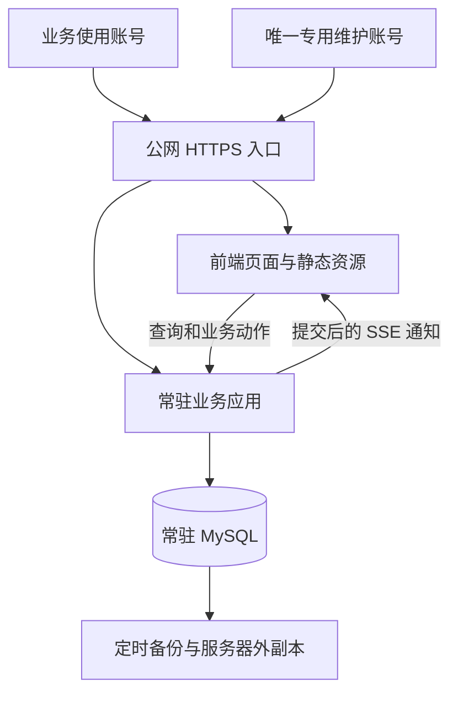
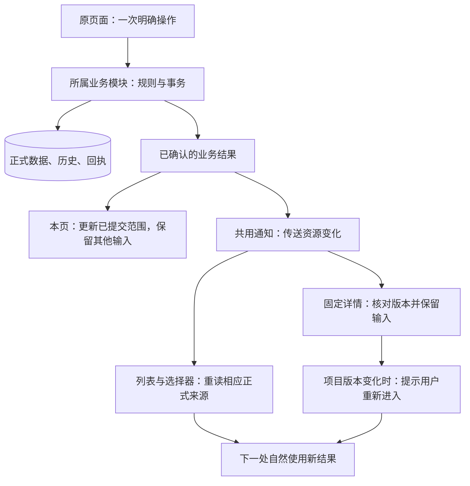
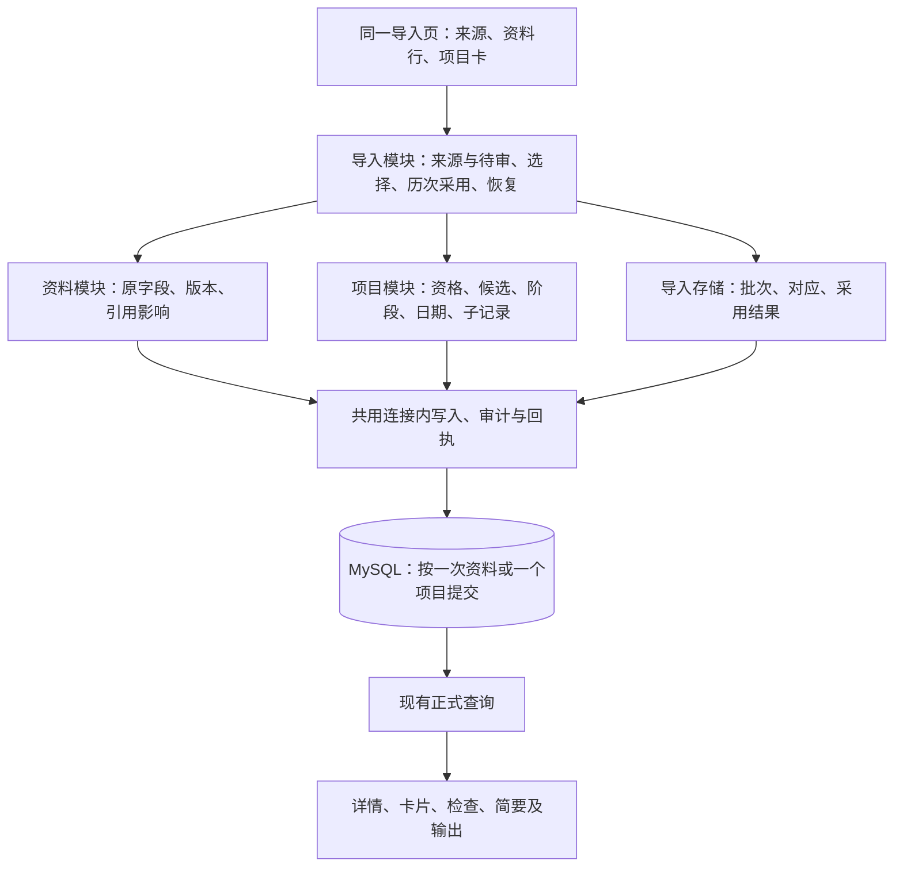
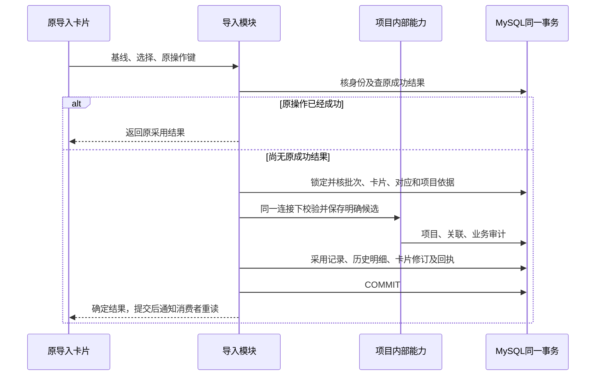
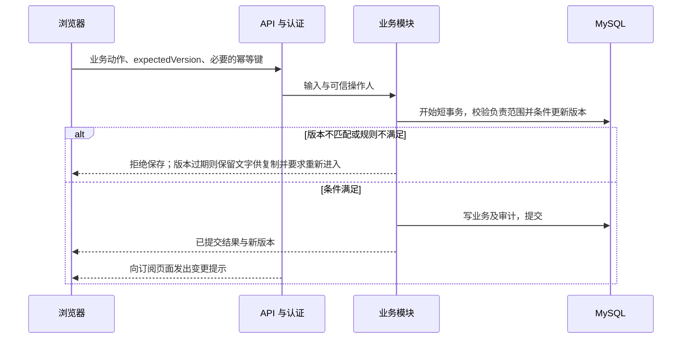
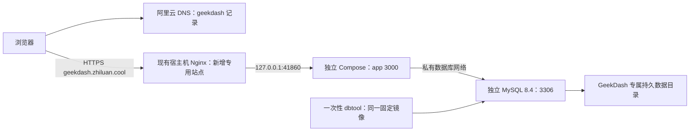

# 系统架构

版本：D0.50；日期：2026-10-20；状态：在现有模块上收敛职责与消费链，具体边界见4.1；本轮纳入DEC-132共享资料开放与DEC-133取消周检查规则。已落位能力与缺口见系统真相，目标图不作为全部模块已实现的证明。

## 1. 现状与约束

原业务来源是本地版六个 HTML 页面及共享 JavaScript，通过浏览器缓存和用户选择的 JSON 文件保存；当前交互复用以1051及用户确认修正为依据。服务器以共享API客户端和深模块承接各页读写，同一短读事务返回项目聚合。已落位的身份、项目保存和业务动作，以及仍缺的页面/模块，统一查[当前系统真相69](../status/current-system-truth.md#69-2026-10-15任务归属与剩余工作核对)，不在架构文档维护另一份施工状态。

已确认约束：业务账号不设固定数量上限，使用者拥有独立账号，全项目可见且按负责范围编辑；并发规模与资源预算按实际需求和测量确定。共享基础资料与企业信息按SPEC-006/DEC-132由所有启用且会话有效的账号维护，不要求项目负责资格；另设一个专用维护管理员账号管理账号与系统维护事项（SPEC-019）。采用常驻MySQL、状态记录、公网测试、深模块与长期维护。

identity 向项目深模块提供可信 actor，项目写事务再次核验账号与会话；账号/会话→资料→项目的取锁次序保护授权及引用。创建、责任、普通保存复用同一项目版本、审计和持久回执，不增加 Redis。各阶段优先级归执行计划，邀请码及完整账号后台的边界归SPEC-001；下方架构图表达职责与依赖，不证明每个深模块已落位。

## 2. 架构选择

采用模块化单体：一个常驻业务应用，内部按业务职责约束依赖。用户已明确保留现有页面与操作习惯，抽出数据访问、状态管理与业务规则后调用 API；是否进一步合并为单页应用，根据实际切页体验决定。

工程基线采用 Node.js 24 LTS + TypeScript + Fastify 5，mysql2 访问 MySQL 8.4；前端使用原生页面与 TypeScript 共享模块，Vite 多页面构建。部署采用 Docker Compose，使用 SSE 通知变更。具体范围、选型来源及版本锁定方式见[技术栈基线](technology-stack.md)。

## 3. 运行结构

API 与前端同站点，通过 Nginx HTTPS 入口访问，便于会话与 CSRF 防护。MySQL 不暴露公网端口。部署采用 Docker Compose，持久化卷、自动重启和健康检查分别配置。首版不部署 Redis。

测试入口为 `https://geekdash.zhiluan.cool`。Compose 工程使用 `geekdash` 标识，应用、MySQL、内部网络和数据卷独立于主机上的其他项目；数据库实例中另分人工试用库与自动测试库，分别授权。域名用于访问入口，容器/数据卷采用合法且易辨识的工程名称。域名、证书和容器部署均须实施验证，不据目标名称宣称已上线。

## 4. 深模块边界

交互图：[深接口执行架构](../evidence/diagrams/geekdash-execution.html)。旧图展示目标职责，不是所有 HTTP 路由或 SQL 调用的展开，也不能再据它声称全部模块尚未实现。下表保留完整目标能力，本轮只收敛4.1列出的既有边界；会议、固定报告、导入和完整账号后台不随本轮扩建。ERD 仍独立维护于数据文档。

| 模块 | 公开能力示例 | 内部负责 | 数据归属 |
|---|---|---|---|
| 身份与会话 | login、changePassword、logout、resolveActor、createInvitation、revokeInvitation、registerWithInvitation、resetPassword、disableAccount | 凭据验证、期限、撤销、首次改密、邀请码注册、交接校验及入口限速 | users、sessions；维护资格读取配置；registration_invites 为待迁移目标，来源关系归 ERD 5.5 |
| 项目生命周期 | getProjectSnapshot、createProject、saveProject、applyProjectAction、joinResponsibility、leaveResponsibility | 项目授权、有限的明确状态动作、日期、风险/节点已确认范围、版本、事务和审计 | projects 及业务子表 |
| 基础资料与企业信息 | previewReferenceImpact、saveReference、deactivateReference | 可信有效账号、稳定ID、资料版本、引用保护、受影响项目版本与审计 | 客户、工程师、芯片等；system_configuration；旧check_rule_revisions仅保留历史来源 |
| 会议与报告 | 会议计时、结束并固定纪要、读取及下载（拟建能力，非现有API） | 本场范围、控制资格、计时事实和产物一致性；复用现有业务变化呈现 | meetings、reports是预留结构；DEC-140明确会议当前后置，恢复时再按SPEC-008讨论。feedback_entries只是既有预留结构，不因表存在扩建反馈流程 |
| 个人工作状态 | savePreferences、saveDraft、getRecoveryContext | 按用户隔离、修订/乱序保护、容量和恢复；终态自动清理仍待决 | user_preferences、project_drafts |
| 导入 | 接收/核对批次、导入正常内容、原位处理冲突、继续选择、接管 | 来源对应、可靠基准比较、处理资格、卡片/项目版本、逐项事务及历次结果恢复；纠正直接随采用提交，协议与已验范围见P05报告 | import_batches、import_items；P05增量见ERD5.13，不增加jobs |

这些名字是内部公开能力设计，不是已生成的 HTTP 协议。`applyProjectAction` 只接受 SPEC 已确认的有限动作，不能任意改状态或表。backup/restore 属于受控运维入口，按 SPEC-016 和发布维护执行，不作为任意业务用户可调用的接口。

页面和 API 路由仅承担输入转换、调用和结果呈现。核心动作在模块内部完成校验、事务、审计及结果构造。

既有E04保存实现由project-save.ts持有事务，project-records.ts内部形成风险/需求/节点候选及审计；只读预览与正式提交复用校验，正式提交仍重验。DEC-120/121目标调整用户提交范围，继续复用此项目深模块：合并区联合提交或当前记录/节点范围提交都使用同一项目版本、权限与事务能力，不按表新增转发服务。生命周期候选需能参与同一事务，不由前端连续调用多个提交接口。具体实现计划归执行文档1.2，实际协议归API，能力状态归系统真相。

跨模块不得直接修改对方表。导入可通过各模块提供的批量写入能力，在同一应用的统一工作单元内协调事务；不能绕过业务约束直接灌表。审计是公共内部能力，写入必须参与发起动作的同一事务。

公开接口接收可信操作人、业务输入、预期版本及必要幂等键，返回完整业务结果；SQL 连接、锁、审计表及回执写入留在内部。导入协调事务时使用内部事务参与能力，项目规则只有一份，不能从 HTTP 回调自身接口或复制保存逻辑。草稿精确提交终态通过个人状态内部能力参与同一事务，项目模块不直接越界修改其表。

模块数量不是质量指标。不要为每个字段或单次调用创建接口、工厂和转发层；也不要把所有职责挤在一个无边界大文件。

导入页由数据维护模块承接，不另建审批服务。原文件及候选持久化，正式查询仅消费已提交业务表；一次页面主操作协调已明确的基础资料及可导入项目，复用权限、规则和事务能力。行为契约见SPEC-009，逐项目短事务允许部分成功并保留各项结果；资料保存后重读关联候选，无关正常项目不被单个冲突拖住。数据量大不等于需要排队，后台执行与Redis仍须测量依据。

### 4.1 当前收敛的职责与调用

2026-10-19按用户要求收敛既有功能区，不新建阶段或业务模块。深模块的判断标准是：调用者表达一次业务意图后，所属模块包住规则、事务、结果和恢复所需信息；不是文件数量、目录名称或接口层数。下表是本轮实现边界，源码事实只归[同步核查](../status/current-system-truth.md#操作链同步核查2026-10-19)。

| 功能区与归属 | 复用入口 | 模块必须包住的处理 | 页面负责什么 |
| --- | --- | --- | --- |
| 项目信息、分工、生命周期和子记录 | `project-save`、`project-core`、`project-actions`及内部候选函数 | 可信身份、负责范围、固定版本、用户意图转业务动作、引用保护、同事务业务/审计/回执及匹配草稿终结 | 收集本区字段与必要意图，显示结果；不排列内部生命周期命令，不连续调用多个写接口模拟一次保存 |
| 项目检查（项目业务内部） | `project-checks`及项目动作提交出口 | 检查事实、结论/备注实际纠错、原人/时间/核对版本保留；读取侧统一提供今日事实与检查后更新，旧周/规则仅留来源 | 展示完整只读信息，通过或进入修正；普通检查及历史结论/备注纠错直接明确保存，不再提供周截止设置 |
| 共享资料与企业信息 | `catalog`；`public-settings`保留企业读取与旧设置结果兼容 | 可信有效账号、稳定ID、资料版本、引用影响、事务提交后的资源变化；项目版本及项目审计交给项目模块的内部事务参与能力 | 直接维护资料，项目选择器按通知重读候选且保留输入；新增资料本身不冒充项目引用修改 |
| 身份与个人工作恢复 | `identity`、`personal-state`及前端共享入口 | 身份验证、账号隔离、合法返回目标、本人稿及原操作恢复；草稿仍不写正式项目 | 登录后回原任务；普通恢复显示可理解的内容，不要求管理技术副本或JSON |
| 看板、检查卡、统一简要与输出 | `projects`读取、`inspection`、`summary`及输出函数 | 同源正式读取与日期/检查派生口径；输出开始时固定本次快照 | 保留范围、位置、选行和未保存输入，按资源重读；不复制一套业务数据或判定公式 |

**通知是共用传输能力，不是业务裁决模块。** 业务模块在确认提交后提供明确的资源变化信息，由现有`infrastructure/notifications`发送，前端`shared/notifications`承接连接、断流和页面返回恢复。项目、资料及企业信息变化须可识别；按DEC-133，已退役检查设置与其历史回执读取不再发布规则变化。具体线上协议在实现后更新API文档。本轮不新增队列、事件存储或数据库表，也不以HTTP URL和响应JSON的形状猜测业务影响。

共享资料沿账号/会话→配置行→资料→受影响项目的既有取锁次序。开放写入账号不新增角色表或资料负责人表；配置行锁仍串行保护跨账号重名检查，公司信息的并发版本继续复用该配置行。资料改名/启停通过项目模块参与原事务，候选新增只发送资料资源变化；已打开项目重读候选而不替换正式项目快照。账号和系统维护仍单独验证维护资格。

取消周检查规则复用原检查表及结果恢复入口：新检查不依赖规则初始化，旧周/规则外键历史保留，结构变化只使两个旧依据列可空，详见ERD5.12。旧设置新命令拒绝执行，已提交原命令仍可按原回执核对；读取回执不重新写规则或发布通知。本轮不删除旧修订表、旧检查或审计，迁移编写完成不代表运行库已经升级。

需要收回的具体边界：资料模块目前对受影响项目的版本和项目审计写入，应通过项目模块内部能力参与原事务；基本信息表单中的状态/日期命令编排应收回项目保存入口。保留现有锁顺序、原操作回执及旧请求恢复能力，不以架构整理为由改业务规则或重写所有接口。准确步骤归[执行计划1.2.3](../implementation/execution-plan.md#123-按功能区收敛操作链2026-10-19)。

### 4.2 P05导入接入的深模块方案（2026-10-21工程方向已确认）

已确认业务只查SPEC-009及DEC-142～151；DEC-148确认复用现有资料/项目能力、同一事务和三类持久记录的工程方向，DEC-151收敛核对及一次导入交互。以下按P05模块边界组织实现；五个内部施工步骤只维护在执行计划1.3，字段及迁移目标只归ERD5.13。静态调用核查不能替代运行并发、恢复及迁移验证。

| 模块拥有的业务能力 | 内部必须完成 | 对调用者暴露的结果 |
|---|---|---|
| 导入：接收/读取、纠正与选择、采用资料/项目、继续选择、接管 | 来源识别、原始值存在性、处理资格、固定候选、绑定及每次采用记录、逐项目事务协调、原操作恢复 | 原卡内容与差异、具体问题、确定成功/未提交/尚待核对及恢复入口；不向页面暴露SQL或表操作顺序 |
| 资料：保存共享资料 | 沿现catalog字段/唯一性/版本/引用保护，参与调用者持有的连接，返回受影响项目及资源信息 | 可被项目引用的稳定资料及确定保存结果；不自行批准项目采用 |
| 项目：创建/保存完整正式结果 | 沿现core/save/actions/records负责权限、最终事实与依赖、审计及版本；有限历史承接与正常新动作输入分开 | 正式项目与版本、需要通知的资源；不读取导入文件或处理导入卡片状态 |
| 现有读取及个人工作状态 | 当前正式数据、已采用旧历史/行时间、本人未提交选择、页面恢复 | 各页面同源读取；不复制另一套项目或业务判断 |

**正式资料和项目的采用有两个事务边界。**一次资料保存，资料本体、相关当前对应、采用记录、引用项目联动和审计/回执同事务；之后项目失败不回滚它。一次项目保存，所选正式内容、来源对应、完整历史采用、审计/回执和卡片结果同事务；任一失败整体回滚该项目，其他项目独立继续。前端同一主操作可以先保存已明确资料，再重读并采用项目。批次登记、处理人接管及兼容的独立review只完成各自事务；adopt携带的原位修正直接与正式保存同事务，不要求前置review。

当前`catalog.save`、`projectCore.run`、`projectSaves`各自持有事务，不能先调用它们提交再补写导入结果。只抽必要的连接内准备/写入能力，普通入口仍调用同一实现：catalog保留字段、唯一性及引用影响计算；项目沿core/save的引用、最终候选、版本和审计，actions/records/plans提供已有候选与写入。外层拥有连接、锁、COMMIT及回执，内部能力不得再开事务或反向取得上游锁。历史事实承接使用受限内部输入；普通新建仍执行其原有新动作契约，不直接接收来源JSON。

正式提交后由既有通知层发送明确资源变化，通知失败不改成功事实；恢复读回原操作时允许消费者重新读取。详情固定快照、其他区域输入和正在生成的输出继续沿现有规则。来源JSON和采用JSON是受限输入/事实载体，不能当通用表写入或任意状态操作入口；不按新增三张表再拆三层服务。

#### 4.2.1 同连接调用与统一取锁

现`catalog.configuration/prepare`为账号/会话→配置行→资料→引用项目，`project-save.lockReferences/save`为账号/会话→资料→项目，`project-core.run`新建先按账号ID锁经理账号再锁会话、资料，`project-actions.run`为账号/会话→项目。导入在这些顺序中插入自己的批次/卡片/对应锁，不要求普通保存取得导入锁，也不以新全局锁替代现有保护。

| 取锁顺序 | 导入采用/纠正/改来源 | 资料页和普通项目入口的复用要求 |
|---|---|---|
| 1 账号及会话 | 先确定本次会触及的账号集合，按数字ID锁users，再核操作者会话。通常共享账号锁；新批次登记沿现新建命令以操作者排他锁串行保护无批次时的原键恢复 | 不在持有项目/批次后追加其他用户锁。内部项目创建不再次升级操作者锁；其负责人来自已锁账号，不能从旧姓名取账号 |
| 2 配置单例（仅写资料） | 顶部资料/企业保存沿catalog取得配置行锁，再进入导入批次锁；纯项目采用不取配置写锁 | 公司信息固定id=1；名字唯一性及共享资料写入继续由现配置行串行化 |
| 3 批次与卡片 | 来源行只校验并共享锁；按批次ID、条目ID取排他锁。单项目事务只锁该批次及本卡；锁后重读来源、处理人、batch.version、review_version | 采用与接管由同一batch行形成先后。批量在事务外循环，不能把整批所有卡片长期锁住 |
| 4 当前对应 | 先锁顶层项目/资料binding，再按其确定的子scope锁子binding；同层按source_namespace、object_kind、source_scope、source_key的二进制字节顺序。父项目改绑在其旧binding锁内形成新代次 | 不锁整份来源映射；普通保存不更新binding.version。缺binding的并发通过最终唯一键插入解决，不能假设READ COMMITTED会锁住不存在的键 |
| 5 共享资料 | 与lockReferences一致，按实际表名排序、同表数字ID排序；读引用用共享锁、写目标用排他锁。客户标签联动先锁客户再锁标签 | 保留catalog标签修改先锁引用客户的路径；持有资料锁后确定引用项目，之后只向后取项目锁 |
| 6 正式项目 | 所有受影响项目按数字ID排他锁；锁后新读引用和资格/版本。只移除引用的并发保存可先完成，因此catalog必须保留锁后重读引用集合 | 单项目普通保存仍只锁本项目。既有项目新增引用会先取资料锁，故资料改名/停用的影响集不会漏掉并发新增引用 |
| 7 本项目写入与结果 | 在项目锁保护下读最终子记录、写选中字段/关联/阶段/记录、业务审计、adoption/来源历史、卡片结果及receipt；已有回执用当前读读取 | actions/records等内部函数不反向请求配置/资料/账号锁；没有正式项目的待审修正/接管只走所需前缀 |

取锁前可读取候选用于决定锁集合，但不据此授权或写入。若取得锁后发现目标/处理人/对应已经改变，则返回现有版本冲突并保留输入，不在持锁状态切换到另一套目标继续执行。新binding的唯一键竞争失败回滚本项目所有写入，再读取当前对应并定位冲突；不得捕获重复键后把另一个请求的对象当成本次成功。

首次创建的项目/子记录ID在正式INSERT后才可用于新binding，此时没有可提前锁定的binding行；在同一事务内完成插入及唯一键争用。父binding新ID形成的子scope在提交前不会被其他请求当作有效对应。此例外只用于本事务新行，不允许持有项目锁后再回头取已有binding锁。

接管先非锁定读取当前handler ID，再按数字ID共享锁操作者及该handler账号、验证会话，最后排他锁批次并复核handler及batch.version；发生变化则拒绝旧依据，不在持有batch时倒序补锁用户。原handler启用状态在事务内稳定，接管/采用竞争靠batch行串行；保存审计、回执及处理人/version同事务。只恢复自己的已成功操作仍先查原结果，不重新执行接管或授予项目责任。

#### 4.2.2 一次采用的内部调用与恢复

前端提交的是已核对依据和明确选择：批次/来源、卡片修订、目标项目与进入版本、相关对应修订、所选事项及必要意图、原操作键。操作者由会话解析；这些版本是自动携带的保护信息，不增加用户填写项。服务器重新校验，不信任前端计算的最终状态或提供的操作者。

核对归导入模块：复用不可变来源与采用记录里的来源/正式后值成对基准，限定父、子对应的目标及版本，产出正常更新、保持和需处理的候选。前端只消费该分类与默认采用键，普通内容不要求逐字段选择。原位纠正直接进入同一采用事务；既有待审保存接口只作兼容接续，不能成为页面的第二次保存要求。详细分支只归SPEC-009。

图示为职责顺序，取锁执行4.2.1。锁前回读只作已有成功的快速返回；取得批次/卡片锁后以当前读再次查原回执/采用结果，再判断卡片或项目版本，否则等待前一请求完成的重试会被误报冲突。三个独立保护同时成立：原操作键挡重复请求；卡片修订挡同一候选换键/换账号重复采用；正式项目版本挡覆盖别人的新修改。资料或历史采用没有改变正式项目字段，也必须推进已消费的卡片修订。

批次改选来源或处理权变化推进批次依据；提交核验进入时来源与版本，不能把旧选择暗换成当前来源。单条卡片修正及单条对应变化使用自身修订，不为无关绑定变化强迫全批重选。原成功结果固定当时来源，恢复时不从现批次替换它。

本人选择与共享卡片分别保存。恢复时核该选择对应的卡片/项目/相关绑定版本；失效选择保留供核对，不能悄悄换版本继续提交。成功后仅按本轮偏好修订及选择范围有条件清理，不删除同一人后来产生的新输入；迟到自动保存即使留下旧选择，读取时也须依据已消费的卡片修订排除其直接提交资格，不使已采用项重新自动选中。正式采用成功不依赖这次个人偏好清理成功，卡片成功结果仍以业务事务为准。

结果恢复复用现运行层的COMMIT_UNKNOWN含义。确认查询暂未找到结果，只能表示尚未查到，原事务可能仍在执行；不能由not_found直接宣称已回滚。保留原请求依据，重查或重试同一个操作；改选/纠正后是新的明确提交，不能用新键偷偷重送未知操作。只有提交前明确拒绝、已确认回滚或确定成功才报告相应结果。外部通知、页面刷新失败均发生在事务之外，不撤销已确定的正式结果。

`runtime-database.writeTransaction`现用READ COMMITTED、同连接短事务和现有超时，发送COMMIT后异常转换为COMMIT_UNKNOWN。P05不加盲目事务自动重放：死锁/锁等待发生于提交前时由原运行层回滚，返回可按原键重试的未提交结果；COMMIT阶段只按原结果恢复。浏览器批量提交在当前原选择集合上逐项目调用该能力，不把整批放入一个5秒事务；中断后对原键先查询，确定未提交者才按原内容接续，仍未知者保持待核对。

回执scope使用账号与item组成的有限字符串，资料、项目采用由同一item不能重复消费同一review_version；批次登记/接管/待审修正使用各自操作范围。所有结果查询核会话与原操作归属，不向其他账号泄漏私人提交内容；共享批次的历次结果是单独的已授权读取。永久adoption是业务依据，receipt是传输恢复缓存，audit是本次实际变化：回执不存在时可按adoption恢复成功，不能反向由audit猜成功；同键不同hash拒绝。仅来源事实变化时保存相应采用事实及卡片结果，不伪造普通字段修改审计；全部一致的处理如下。

已绑定且普通字段、关联及已批准来源事实全部一致时，直接读回无需处理，不新增采用记录、不推进卡片修订或项目版本。仅旧历史默认版本/说明行时间等可见来源事实发生实际变化时，项目版本同事务推进一次，复用固定详情和SSE保护；采用记录说明来源变化，不伪造普通字段修改。完全展示等价的历史重传不推进项目版本。有前次成功的卡片第二轮失败/未知仍保留已处理事实，原卡展示本轮反馈及原键恢复；本轮输入归本人状态，不用失败事务覆写前次成功result。待办计数消费当前有效比较结果，排除可靠绑定且全部一致的卡，不能简单COUNT(status='pending')或由一次失败自动撤销既有完成事实。

#### 4.2.3 来源事实的读取与下一处使用

| 事实来源 | 现有读取入口的最小接入 | 保持的边界 |
|---|---|---|
| 当前字段、关联及子记录 | projects.readDetail/enrich及project-records、project-plans读正式表；summary_notes/chipstat_notes分别进入已有summary_note/chipstat_note | 不复制第二套项目；人员组从锁定线上值合成，未选组保持；姓名不赋账号权 |
| 完整旧历史 | 通过adoption按项目/来源/历史种类选择最近明确采用版本，再分页读legacy_project_history；原无adoption行以迁移冻结的legacy_source_namespace作存量来源入口 | 不从可修改的batch来源反推旧历史；显式空版本覆盖默认展示但旧版本仍可读；同内容只合并展示，不删内部重复、不重放线上操作 |
| 当前说明逐行时间 | project-status-entries接受最后一次真正改变正文的采用基线，再按项目版本应用之后的线上说明审计；projects.enrich批量提供同源结果 | 同文采用不重置线上行时间；只采用历史不替换正文；statusDescHistory进入shared/history的来源部分，statusHistory仍为原混合记录 |
| 当前结案事实 | project-closures.currentClosure及project-dates的筛选/统计共同读取最近一次改变有效结案事实的线上审计或adoption，依据项目版本及同次最终候选取值；adoption冻结结案计划已知/未知依据 | 旧创建来源不是当前结案来源；来源结案返回对应adoption/item及旧人/时间未知，不能把本次采用者冒充旧结案人。保留正常动作的closureAuditId兼容，expectedVersion仍保护本次事实；不以曾有project.close推定新导入结案已知，不新增项目来源派生列 |
| 旧标记及未知时间 | adoption保留lastCheckAt与原时间文字；project-records/plans和前端格式化接受未知 | 旧标记仅在本地原有记录中说明，今日检查只读project_checks；登记时间、旧业务时间和可信线上操作时间各保留含义 |

普通导入审计仍记录实际采用者及前后值；这些名字不表示此人实施过来源文件中的旧事件。导入、资料及项目保存成功后复用现notifications；卡片/检查/简要和输出继续从正式查询新读，固定详情只提醒版本变化并保留输入。以上接入必须在同一项目的导入→线上继续修改→新请求→既有页面与导出链验证，不能以采用表有数据替代已可使用。

## 5. 核心保存链路

交互时序：[一个深接口完成项目提交](../evidence/diagrams/geekdash-save.html)。图展示成功路径；权限、版本、关联、审计失败的退出语义以 SPEC-002 为准。

只有用户点击保存且服务器提交完成才显示已保存。SSE 仅用于减少等待；断线重连、页面重新聚焦及应用重启后要补查版本，防止遗漏通知导致永久陈旧。跨日的派生状态也应重新计算，不能只依赖项目被修改。

SSE 在事务提交后发送资源 ID、版本与提交标识。列表可刷新摘要；已打开的详情保持进入版本，收到新版本后提示重新进入并禁用旧版保存，保留文字供复制。低频版本复核补足遗漏通知，会话到期或撤销时关闭流。反向代理为 SSE 关闭响应缓冲并配置心跳和超时；公网优先 HTTP/2，多标签页连接行为纳入验证。

在线编辑名单使用同一 SSE 通道通知；浏览器以独立心跳接口登记页面实例，后端根据会话与负责关系认证。单进程内存保存短期状态并按超时清理，重启后重新登记；它不承担数据库互斥，不发送编辑字段或内容，不需要 Redis。详细行为以 SPEC-015 为准。

## 6. 状态与缓存

- MySQL 是共享业务、会话、审计的持久来源。
- 个人偏好、设备阅读上下文由 user_preferences 分范围持久化；project_drafts 保存本人未提交底稿，projects 保存正式业务。恢复顺序、同步节流、多标签冲突与提交粒度统一按 SPEC-002/007，不在页面另写规则。
- 当前首版数据库施工设计为 34 表，完整字段、约束及合并取舍只维护于 [ERD 第 3～5 节](../data/ERD.md#3-首版完整物理字段字典施工设计未建表)；command_receipts 与业务审计同事务，schema_migrations 登记实际结构升级。真实 MySQL 性能待验收。
- 初期业务缓存优先使用登录期间的内存缓存，避免把全部敏感数据长期留在浏览器。需要持久缓存时单独定范围、期限和清理规则。
- 退出、账号切换、会话撤销时清理相关缓存；静态文件可按内容哈希长期缓存。
- 不在浏览器存储里放可读的长期登录令牌。

## 7. 队列决策

普通项目写入走数据库事务，队列不能取代并发控制。少量计划备份可以由定时任务执行。若报告、导入、知识库同步需要持续后台执行，再评估 Redis + BullMQ。

采用队列时：MySQL 保留任务状态与业务结果；投递和完成之间允许恢复；消费者必须幂等，重试有次数和退避，进程退出后可重新领取未完成任务。若业务提交必须同时保证任务最终执行，需持久化待投递记录并补偿投递，避免“数据库提交成功但任务丢失”。不要宣称队列天然提供恰好一次执行。

具体任务吞吐尚未测量。首轮若有重任务，建议以低并发开始测量，避免占满共享测试机。

参考：[BullMQ 幂等任务](https://docs.bullmq.io/patterns/idempotent-jobs)、[Redis 持久化](https://redis.io/docs/latest/operate/oss_and_stack/management/persistence/)。

## 8. 安全与可观测性

公网入口需 HTTPS、服务端认证、登录限速、安全 Cookie、写请求 CSRF 防护、输入校验及输出转义。审计身份由会话确定。访问日志不记录凭据和完整敏感业务正文。

最小运行观测：部署版本、请求 ID、错误率、接口延迟、数据库连接和慢查询、磁盘与内存、备份结果；有任务进程时增加失败数、等待时长和恢复结果。可先使用结构化日志与轻量健康检查，不强制部署大型监控平台。

## 9. 测试部署选择

DEC-049 已确认沿用现有新加坡测试机，使用独立 Docker 应用及独立 MySQL 容器，不复用其他业务数据库实例。容器隔离数据、网络与生命周期，CPU、内存及磁盘仍由同一主机共享。当前容量观察见系统真相；业务账号不设固定数量上限，实际承载能力仍需按使用规模验证。

工程建议：首版一个应用进程，限制数据库连接与缓冲规模，镜像在本地或构建环境生成；根据实际需求确定混合读写的并发规模，结合测量和既有服务健康观察确定资源预算。证书入口和监听端口按服务器现状配置，不抢占既有端口；不得停止或重配其他系统来为本项目腾资源。

业务代码更新、数据库生命周期和备份分别管理。更新应用不应重建或清空数据库数据卷。

### 首个公网基底拓扑（2026-10-08 讨论方案）

当前 DEC-071 先免登录部署基底，DEC-072 新建阿里云 DNS 子域记录。服务器已观察到宿主机 Nginx 承接 80/443；下图的基底拓扑现已落地，实际版本/验证范围归部署记录；六页面及业务深模块仍后续。资源/路径参数归运维，施工顺序归执行文档 E12-D01～D07。

单应用常驻，数据库常驻；迁移工具运行后退出。数据库技术身份与未来登录账号分开，首单元不初始化业务用户。镜像本机构建后传输到 x86_64 主机，版本清单绑定源码/镜像/迁移，避免在共享主机安装整套构建依赖。后续 SSE 仍走同站点，当前未实现。

## 10. 施工入口

[执行文档](../implementation/execution-plan.md)按 E01～E12 描述每个功能的实现思路、依赖、失败恢复及验证入口。先工程/迁移/认证，再打通项目聚合保存的真实 MySQL 链路，随后接入状态动作、私人草稿、SSE、资料和六页面，最后完成审查导入、恢复与测试发布。准确业务规则和字段分别引用 SPEC 与 ERD，不在执行文档重新定义。

图源及交付回执在 `docs/evidence/diagrams/`，由本架构派生。两图的确定性产物检查通过；浏览器自动核验因本机调试进程失败而未完成，视觉范围另记证据，不能称完整浏览器验收通过。应用、数据库及部署验证仍未执行。
