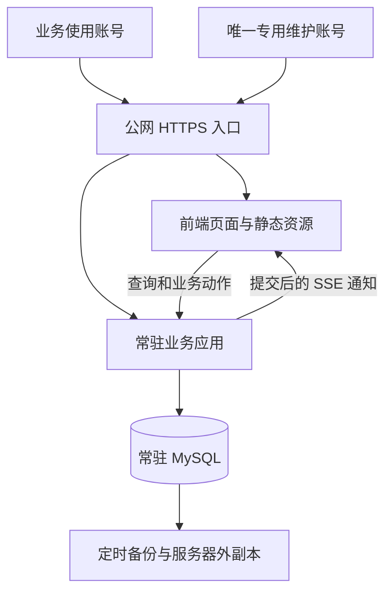
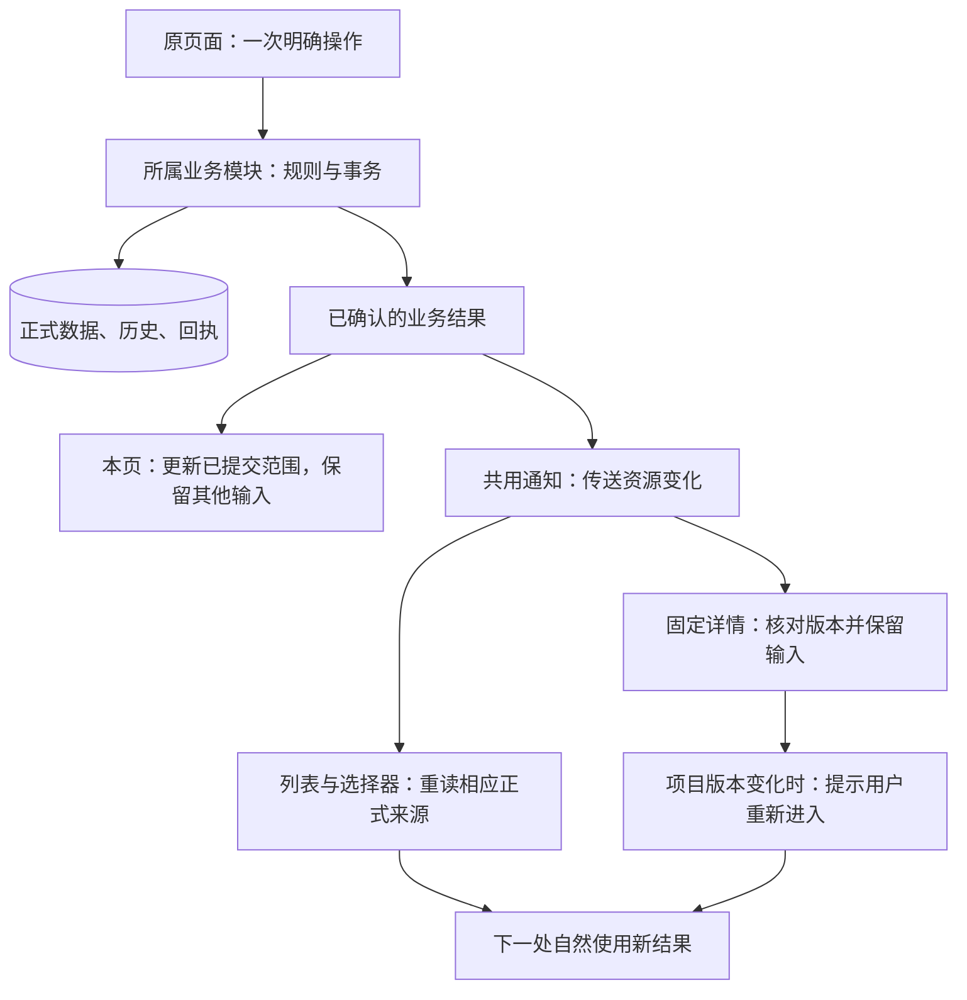
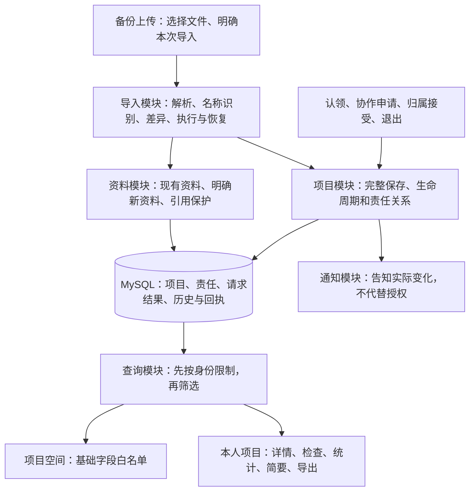
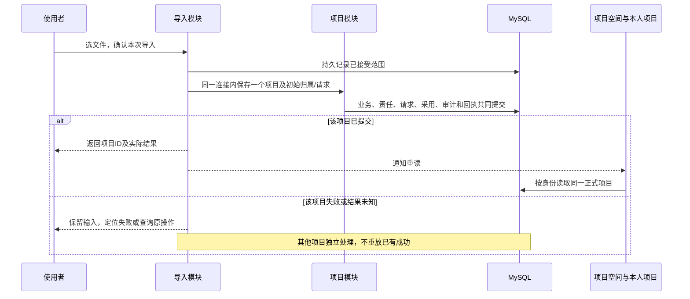
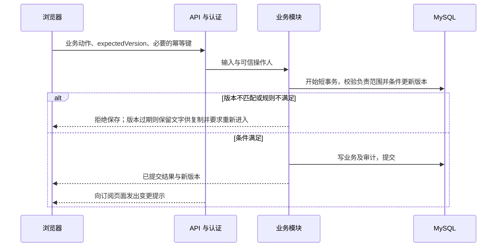
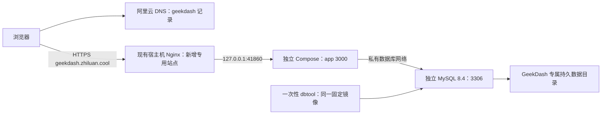

# 系统架构

版本：D0.50；日期：2026-10-20；状态：在现有模块上收敛职责与消费链，具体边界见4.1；本轮纳入DEC-132共享资料开放与DEC-133取消周检查规则。已落位能力与缺口见系统真相，目标图不作为全部模块已实现的证明。

## 1. 现状与约束

原业务来源是本地版六个 HTML 页面及共享 JavaScript，通过浏览器缓存和用户选择的 JSON 文件保存；当前交互复用以1051及用户确认修正为依据。服务器以共享API客户端和深模块承接各页读写，同一短读事务返回项目聚合。已落位的身份、项目保存和业务动作，以及仍缺的页面/模块，统一查[当前系统真相69](../status/current-system-truth.md#69-2026-10-15任务归属与剩余工作核对)，不在架构文档维护另一份施工状态。

已确认约束：业务账号不设固定数量上限，使用者拥有独立账号，项目空间仅基础卡片可见，完整业务按本人负责范围读取和编辑；并发规模与资源预算按实际需求和测量确定。共享基础资料与企业信息按SPEC-006/DEC-132由所有启用且会话有效的账号维护，不要求项目负责资格；另设一个专用维护管理员账号管理账号与系统维护事项（SPEC-019）。采用常驻MySQL、状态记录、公网测试、深模块与长期维护。

identity 向项目深模块提供可信 actor，项目写事务再次核验账号与会话；账号/会话→资料→项目的取锁次序保护授权及引用。创建、责任、普通保存复用同一项目版本、审计和持久回执，不增加 Redis。各阶段优先级归执行计划，邀请码及完整账号后台的边界归SPEC-001；下方架构图表达职责与依赖，不证明每个深模块已落位。

## 2. 架构选择

采用模块化单体：一个常驻业务应用，内部按业务职责约束依赖。用户已明确保留现有页面与操作习惯，抽出数据访问、状态管理与业务规则后调用 API；是否进一步合并为单页应用，根据实际切页体验决定。

工程基线采用 Node.js 24 LTS + TypeScript + Fastify 5，mysql2 访问 MySQL 8.4；前端使用原生页面与 TypeScript 共享模块，Vite 多页面构建。部署采用 Docker Compose，使用 SSE 通知变更。具体范围、选型来源及版本锁定方式见[技术栈基线](technology-stack.md)。

## 3. 运行结构

API 与前端同站点，通过 Nginx HTTPS 入口访问，便于会话与 CSRF 防护。MySQL 不暴露公网端口。部署采用 Docker Compose，持久化卷、自动重启和健康检查分别配置。首版不部署 Redis。

测试入口为 `https://geekdash.zhiluan.cool`。Compose 工程使用 `geekdash` 标识，应用、MySQL、内部网络和数据卷独立于主机上的其他项目；数据库实例中另分人工试用库与自动测试库，分别授权。域名用于访问入口，容器/数据卷采用合法且易辨识的工程名称。域名、证书和容器部署均须实施验证，不据目标名称宣称已上线。

## 4. 深模块边界

交互图：[深接口执行架构](../evidence/diagrams/geekdash-execution.html)。旧图展示目标职责，不是所有 HTTP 路由或 SQL 调用的展开，也不能再据它声称全部模块尚未实现。下表保留完整目标能力，本轮只收敛4.1列出的既有边界；会议、固定报告、导入和完整账号后台不随本轮扩建。ERD 仍独立维护于数据文档。

| 模块 | 公开能力示例 | 内部负责 | 数据归属 |
|---|---|---|---|
| 身份与会话 | login、changePassword、logout、resolveActor、createInvitation、revokeInvitation、registerWithInvitation、resetPassword、disableAccount | 凭据验证、期限、撤销、首次改密、邀请码注册、交接校验及入口限速 | users、sessions；维护资格读取配置；registration_invites 为待迁移目标，来源关系归 ERD 5.5 |
| 项目生命周期 | getProjectSnapshot、createProject、saveProject、applyProjectAction、joinResponsibility、leaveResponsibility | 项目授权、有限的明确状态动作、日期、风险/节点已确认范围、版本、事务和审计 | projects 及业务子表 |
| 基础资料与企业信息 | previewReferenceImpact、saveReference、deactivateReference | 可信有效账号、稳定ID、资料版本、引用保护、受影响项目版本与审计 | 客户、工程师、芯片等；system_configuration；旧check_rule_revisions仅保留历史来源 |
| 会议与报告 | 会议计时、结束并固定纪要、读取及下载（拟建能力，非现有API） | 本场范围、控制资格、计时事实和产物一致性；复用现有业务变化呈现 | meetings、reports是预留结构；DEC-140明确会议当前后置，恢复时再按SPEC-008讨论。feedback_entries只是既有预留结构，不因表存在扩建反馈流程 |
| 个人工作状态 | savePreferences、saveDraft、getRecoveryContext | 按用户隔离、修订/乱序保护、容量和恢复；终态自动清理仍待决 | user_preferences、project_drafts |
| 导入 | 解析备份、按名称识别、确认差异、执行及恢复 | 按SPEC-009协调项目和资料事务；责任及读取按SPEC-014。新目标边界见4.2，已有实现不等同新规则 | 既有import_batches/items及执行、采用记录保留；增量待ERD设计 |

这些名字是内部公开能力设计，不是已生成的 HTTP 协议。`applyProjectAction` 只接受 SPEC 已确认的有限动作，不能任意改状态或表。backup/restore 属于受控运维入口，按 SPEC-016 和发布维护执行，不作为任意业务用户可调用的接口。

页面和 API 路由仅承担输入转换、调用和结果呈现。核心动作在模块内部完成校验、事务、审计及结果构造。

既有E04保存实现由project-save.ts持有事务，project-records.ts内部形成风险/需求/节点候选及审计；只读预览与正式提交复用校验，正式提交仍重验。DEC-120/121目标调整用户提交范围，继续复用此项目深模块：合并区联合提交或当前记录/节点范围提交都使用同一项目版本、权限与事务能力，不按表新增转发服务。生命周期候选需能参与同一事务，不由前端连续调用多个提交接口。具体实现计划归执行文档1.2，实际协议归API，能力状态归系统真相。

跨模块不得直接修改对方表。导入可通过各模块提供的批量写入能力，在同一应用的统一工作单元内协调事务；不能绕过业务约束直接灌表。审计是公共内部能力，写入必须参与发起动作的同一事务。

公开接口接收可信操作人、业务输入、预期版本及必要幂等键，返回完整业务结果；SQL 连接、锁、审计表及回执写入留在内部。导入协调事务时使用内部事务参与能力，项目规则只有一份，不能从 HTTP 回调自身接口或复制保存逻辑。草稿精确提交终态通过个人状态内部能力参与同一事务，项目模块不直接越界修改其表。

模块数量不是质量指标。不要为每个字段或单次调用创建接口、工厂和转发层；也不要把所有职责挤在一个无边界大文件。

导入页由数据维护模块承接，不另建审批服务。原文件及候选持久化，正式查询仅消费已提交业务表；DEC-154将一次主操作的协调归服务器持久执行，页面消费结果，复用权限、规则和事务能力。行为契约见SPEC-009，逐项目短事务允许部分成功并保留各项结果；资料保存后重读关联候选，无关正常项目不被单个冲突拖住。后台接续用于保证切页后任务完整，不据此引入Redis或通用任务平台。

### 4.1 当前收敛的职责与调用

2026-10-19按用户要求收敛既有功能区，不新建阶段或业务模块。深模块的判断标准是：调用者表达一次业务意图后，所属模块包住规则、事务、结果和恢复所需信息；不是文件数量、目录名称或接口层数。下表是本轮实现边界，源码事实只归[同步核查](../status/current-system-truth.md#操作链同步核查2026-10-19)。

| 功能区与归属 | 复用入口 | 模块必须包住的处理 | 页面负责什么 |
| --- | --- | --- | --- |
| 项目信息、分工、生命周期和子记录 | `project-save`、`project-core`、`project-actions`及内部候选函数 | 可信身份、负责范围、固定版本、用户意图转业务动作、引用保护、同事务业务/审计/回执及匹配草稿终结 | 收集本区字段与必要意图，显示结果；不排列内部生命周期命令，不连续调用多个写接口模拟一次保存 |
| 项目检查（项目业务内部） | `project-checks`及项目动作提交出口 | 检查事实、结论/备注实际纠错、原人/时间/核对版本保留；读取侧统一提供今日事实与检查后更新，旧周/规则仅留来源 | 展示完整只读信息，通过或进入修正；普通检查及历史结论/备注纠错直接明确保存，不再提供周截止设置 |
| 共享资料与企业信息 | `catalog`；`public-settings`保留企业读取与旧设置结果兼容 | 可信有效账号、稳定ID、资料版本、引用影响、事务提交后的资源变化；项目版本及项目审计交给项目模块的内部事务参与能力 | 直接维护资料，项目选择器按通知重读候选且保留输入；新增资料本身不冒充项目引用修改 |
| 身份与个人工作恢复 | `identity`、`personal-state`及前端共享入口 | 身份验证、账号隔离、合法返回目标、本人稿及原操作恢复；草稿仍不写正式项目 | 登录后回原任务；普通恢复显示可理解的内容，不要求管理技术副本或JSON |
| 看板、检查卡、统一简要与输出 | `projects`读取、`inspection`、`summary`及输出函数 | 同源正式读取与日期/检查派生口径；输出开始时固定本次快照 | 保留范围、位置、选行和未保存输入，按资源重读；不复制一套业务数据或判定公式 |

**通知是共用传输能力，不是业务裁决模块。** 业务模块在确认提交后提供明确的资源变化信息，由现有`infrastructure/notifications`发送，前端`shared/notifications`承接连接、断流和页面返回恢复。项目、资料及企业信息变化须可识别；按DEC-133，已退役检查设置与其历史回执读取不再发布规则变化。具体线上协议在实现后更新API文档。本轮不新增队列、事件存储或数据库表，也不以HTTP URL和响应JSON的形状猜测业务影响。

共享资料沿账号/会话→配置行→资料→受影响项目的既有取锁次序。开放写入账号不新增角色表或资料负责人表；配置行锁仍串行保护跨账号重名检查，公司信息的并发版本继续复用该配置行。资料改名/启停通过项目模块参与原事务，候选新增只发送资料资源变化；已打开项目重读候选而不替换正式项目快照。账号和系统维护仍单独验证维护资格。

取消周检查规则复用原检查表及结果恢复入口：新检查不依赖规则初始化，旧周/规则外键历史保留，结构变化只使两个旧依据列可空，详见ERD5.12。旧设置新命令拒绝执行，已提交原命令仍可按原回执核对；读取回执不重新写规则或发布通知。本轮不删除旧修订表、旧检查或审计，迁移编写完成不代表运行库已经升级。

需要收回的具体边界：资料模块目前对受影响项目的版本和项目审计写入，应通过项目模块内部能力参与原事务；基本信息表单中的状态/日期命令编排应收回项目保存入口。保留现有锁顺序、原操作回执及旧请求恢复能力，不以架构整理为由改业务规则或重写所有接口。准确步骤归[执行计划1.2.3](../implementation/execution-plan.md#123-按功能区收敛操作链2026-10-19)。

### 4.2 P05导入接入的深模块方案（2026-10-21工程方向已确认）

2026-10-26按SPEC-009/014重新划定目标边界，删除旧来源管理与自动采用判定的施工要求。现有常驻执行器、短事务、审计和原操作恢复可复用；新名称匹配、归属请求及本人读取范围尚未实施。现有物理结构归ERD5.13，已验实现只查系统真相及版本报告。

| 深模块 | 拥有的责任 | 不应落入调用者的工作 |
|---|---|---|
| 导入 | 备份解析、名称识别、已有差异及本次选择、逐项目执行、原结果恢复；完整旧事实保护 | 页面不逐项编排事务，不判断他人归属，不维护来源管理平台 |
| 项目 | 同一正式项目的业务保存、责任/请求决定、加入退出、版本与审计；复用既有状态/节点规则 | 导入不能绕过项目规则直接写表，也不能先提交项目再补责任 |
| 资料 | 复用现有字段、唯一性及版本/引用保护；明确资料保存与项目保存结果不同 | 不把同名资料自动合并，不让资料成功冒充项目成功 |
| 查询 | 项目空间基础白名单与本人业务范围；列表/详情/检查/统计/输出共享授权边界 | 前端筛选、canEdit标记和隐藏按钮不能代替读授权 |
| 通知及个人状态 | 项目负责模块持久维护归属/协作请求；SSE提示有权用户读取实际结果。本人未保存输入独立恢复 | SSE不是请求存储，也不授予权限；不另建通用消息/审批平台，不把草稿写入正式项目 |
| 最小账号启停（DEC-165） | 身份模块拥有维护资格、账号启停、会话撤销及操作回执；项目负责模块提供同连接的交接核验/请求失效，导入执行器消费当前资格 | 前端只发一次明确启停；不能把更新账号、撤销会话、失效请求拆成连续独立HTTP写入，不扩展完整E02后台 |

依据DEC-160，旧模块中被新链取代的规则、入口及孤立调用随替换删除；模块边界按业务职责划定，不要求把每个现有文件全部重写。查询与通知均遵守SPEC-014的成员/空间范围，不能只限制编辑心跳写入而向非成员广播完整编辑者名单。

**保留的事务能力。**常驻应用的持久导入执行器继续使用MySQL记录明确范围及实际结果，无需新加Redis。批次接收、资料保存、每个项目保存分别短事务；一个项目的业务内容、责任、采用结果、审计和回执必须同次提交。资料已存后项目失败不回滚资料，其他项目可继续。断线及重启先核原操作与实际成果，不能重复新增。

**复用接口的边界。**导入调用现有项目及资料模块的连接内能力，外层控制事务和提交，内部不得二次提交。请求批准与责任建立也须一个事务。正式提交后通知消费者新读，通知失败不逆转成功；读取不能触发新的写入。

**目标数据与接入。**名称键、曾用名及请求字段归ERD5.14；操作输入/结果归SPEC-009/014，具体代码落位及切换归计划1.3.3/1.3.4。旧来源结构保留事实，不能当作目标项目身份权威；不直接删除已有迁移或数据表。以下取锁方案待实现及真实并发验证，不描述当前代码已统一。

**同一事务的锁次序。**先锁本动作涉及的账号（ID升序、所需最强模式一次取得）与操作者会话；涉及维护授权时接着共享锁核验系统配置中的唯一维护账号。再按涉及范围依次锁执行记录→资料写入串行保护→批次/候选→资料引用→项目（ID升序）→归属请求→原操作回执。未涉及的层级跳过；领取执行租约是单独短事务，不能持有租约领取锁跨业务事务等待。资料引用保留现有表顺序及ID升序，始终早于项目；资料写入影响项目也按此顺序。普通项目保存不锁全局资料保护行，仅实际资料写入/自动新建时使用。账号停用持目标账号排他锁，接收邀请/成员变更及导入写入必须保护其涉及账号；会话撤销在此保护下沿稳定顺序处理，不能从项目锁反向临时争取新账号锁。

先从只读数据收集需要的账号集合，锁定后在项目锁内重核；若同时变化使集合不完整，回滚并重新读取，不能拿到项目锁后再反向补账号锁。认领、接受/批准、退出及账号停用都遵守同一顺序，最后一人校验与实际关系变化不可分成两个事务。新建项目尚无项目行时，由账号命令序列化与名称唯一键保证重复/竞争边界，不能靠“先查不存在”证明可插入。

**提交和消费。**项目模块在同一连接写业务、正式归属、请求结果及审计/回执；导入再在同次项目事务写采用事实。外层只有一次commit；发送SSE在提交后。收件人请求存在MySQL，通知丢失仍可新读。接受与退出要同时驱动个人列表/检查/统计/简要/导出候选重读；项目空间只读取基础投影。新成员取得访问，退出者已有SSE订阅和接口读取同时失效，不能靠关闭一个前端页实现权限收回。

## 5. 核心保存链路

交互时序：[一个深接口完成项目提交](../evidence/diagrams/geekdash-save.html)。图展示成功路径；权限、版本、关联、审计失败的退出语义以 SPEC-002 为准。

只有用户点击保存且服务器提交完成才显示已保存。SSE 仅用于减少等待；断线重连、页面重新聚焦及应用重启后要补查版本，防止遗漏通知导致永久陈旧。跨日的派生状态也应重新计算，不能只依赖项目被修改。

SSE 在事务提交后发送资源 ID、版本与提交标识。列表可刷新摘要；已打开的详情保持进入版本，收到新版本后提示重新进入并禁用旧版保存，保留文字供复制。低频版本复核补足遗漏通知，会话到期或撤销时关闭流。反向代理为 SSE 关闭响应缓冲并配置心跳和超时；公网优先 HTTP/2，多标签页连接行为纳入验证。

在线编辑名单使用同一 SSE 通道通知；浏览器以独立心跳接口登记页面实例，后端根据会话与负责关系认证。单进程内存保存短期状态并按超时清理，重启后重新登记；它不承担数据库互斥，不发送编辑字段或内容，不需要 Redis。详细行为以 SPEC-015 为准。

## 6. 状态与缓存

- MySQL 是共享业务、会话、审计的持久来源。
- 个人偏好、设备阅读上下文由 user_preferences 分范围持久化；project_drafts 保存本人未提交底稿，projects 保存正式业务。恢复顺序、同步节流、多标签冲突与提交粒度统一按 SPEC-002/007，不在页面另写规则。
- 当前首版数据库施工设计为 34 表，完整字段、约束及合并取舍只维护于 [ERD 第 3～5 节](../data/ERD.md#3-首版完整物理字段字典施工设计未建表)；command_receipts 与业务审计同事务，schema_migrations 登记实际结构升级。真实 MySQL 性能待验收。
- 初期业务缓存优先使用登录期间的内存缓存，避免把全部敏感数据长期留在浏览器。需要持久缓存时单独定范围、期限和清理规则。
- 退出、账号切换、会话撤销时清理相关缓存；静态文件可按内容哈希长期缓存。
- 不在浏览器存储里放可读的长期登录令牌。

## 7. 队列决策

普通项目写入走数据库事务，队列不能取代并发控制。少量计划备份可以由定时任务执行。若报告、导入、知识库同步需要持续后台执行，再评估 Redis + BullMQ。

采用队列时：MySQL 保留任务状态与业务结果；投递和完成之间允许恢复；消费者必须幂等，重试有次数和退避，进程退出后可重新领取未完成任务。若业务提交必须同时保证任务最终执行，需持久化待投递记录并补偿投递，避免“数据库提交成功但任务丢失”。不要宣称队列天然提供恰好一次执行。

具体任务吞吐尚未测量。首轮若有重任务，建议以低并发开始测量，避免占满共享测试机。

参考：[BullMQ 幂等任务](https://docs.bullmq.io/patterns/idempotent-jobs)、[Redis 持久化](https://redis.io/docs/latest/operate/oss_and_stack/management/persistence/)。

## 8. 安全与可观测性

公网入口需 HTTPS、服务端认证、登录限速、安全 Cookie、写请求 CSRF 防护、输入校验及输出转义。审计身份由会话确定。访问日志不记录凭据和完整敏感业务正文。

最小运行观测：部署版本、请求 ID、错误率、接口延迟、数据库连接和慢查询、磁盘与内存、备份结果；有任务进程时增加失败数、等待时长和恢复结果。可先使用结构化日志与轻量健康检查，不强制部署大型监控平台。

## 9. 测试部署选择

DEC-049 已确认沿用现有新加坡测试机，使用独立 Docker 应用及独立 MySQL 容器，不复用其他业务数据库实例。容器隔离数据、网络与生命周期，CPU、内存及磁盘仍由同一主机共享。当前容量观察见系统真相；业务账号不设固定数量上限，实际承载能力仍需按使用规模验证。

工程建议：首版一个应用进程，限制数据库连接与缓冲规模，镜像在本地或构建环境生成；根据实际需求确定混合读写的并发规模，结合测量和既有服务健康观察确定资源预算。证书入口和监听端口按服务器现状配置，不抢占既有端口；不得停止或重配其他系统来为本项目腾资源。

业务代码更新、数据库生命周期和备份分别管理。更新应用不应重建或清空数据库数据卷。

### 首个公网基底拓扑（2026-10-08 讨论方案）

当前 DEC-071 先免登录部署基底，DEC-072 新建阿里云 DNS 子域记录。服务器已观察到宿主机 Nginx 承接 80/443；下图的基底拓扑现已落地，实际版本/验证范围归部署记录；六页面及业务深模块仍后续。资源/路径参数归运维，施工顺序归执行文档 E12-D01～D07。

单应用常驻，数据库常驻；迁移工具运行后退出。数据库技术身份与未来登录账号分开，首单元不初始化业务用户。镜像本机构建后传输到 x86_64 主机，版本清单绑定源码/镜像/迁移，避免在共享主机安装整套构建依赖。后续 SSE 仍走同站点，当前未实现。

## 10. 施工入口

[执行文档](../implementation/execution-plan.md)按 E01～E12 描述每个功能的实现思路、依赖、失败恢复及验证入口。先工程/迁移/认证，再打通项目聚合保存的真实 MySQL 链路，随后接入状态动作、私人草稿、SSE、资料和六页面，最后完成审查导入、恢复与测试发布。准确业务规则和字段分别引用 SPEC 与 ERD，不在执行文档重新定义。

图源及交付回执在 `docs/evidence/diagrams/`，由本架构派生。两图的确定性产物检查通过；浏览器自动核验因本机调试进程失败而未完成，视觉范围另记证据，不能称完整浏览器验收通过。应用、数据库及部署验证仍未执行。
