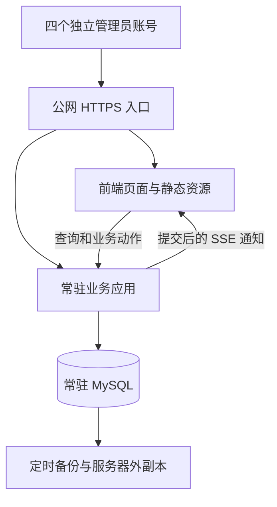
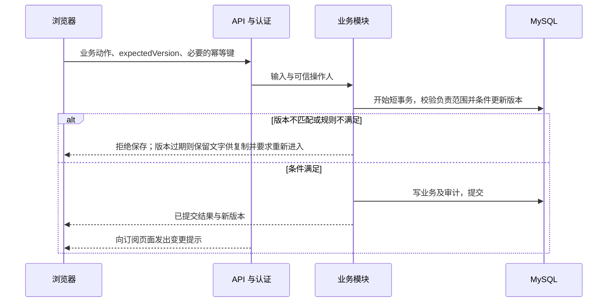

# 系统架构

版本：D0.19；日期：2026-09-30；状态：技术路线已确定，业务规则仍待讨论，未实现。

## 1. 现状与约束

当前交付仍是 V1.050 六个 HTML 页面及共享 JavaScript，通过浏览器缓存和用户选择的 JSON 文件保存。没有服务器应用或真实认证。详细证据见[当前系统真相](../status/current-system-truth.md)。

已确认约束：4 位独立管理员、全项目可见且按负责范围编辑、4 人并发、常驻 MySQL、状态记录、公网测试、深模块与长期维护。

## 2. 架构选择

采用模块化单体：一个常驻业务应用，内部按业务职责约束依赖。用户已明确保留现有页面与操作习惯，抽出数据访问、状态管理与业务规则后调用 API；是否进一步合并为单页应用，根据实际切页体验决定。

工程基线采用 Node.js 24 LTS + TypeScript + Fastify 5，mysql2 访问 MySQL 8.4；前端使用原生页面与 TypeScript 共享模块，Vite 多页面构建。部署采用 Docker Compose，使用 SSE 通知变更。具体范围、选型来源及版本锁定方式见[技术栈基线](technology-stack.md)。

## 3. 运行结构

API 与前端同站点，通过 Nginx HTTPS 入口访问，便于会话与 CSRF 防护。MySQL 不暴露公网端口。部署采用 Docker Compose，持久化卷、自动重启和健康检查分别配置。首版不部署 Redis。

## 4. 深模块边界

| 模块 | 公开能力示例 | 内部负责 | 数据归属 |
|---|---|---|---|
| 身份与会话 | login、logout、resolveActor、revokeSessions | 凭据验证、期限、撤销、登录限速 | users、sessions |
| 项目生命周期 | createProject、completeStage、reschedule、closeProject、joinResponsibility、leaveResponsibility | 项目授权、状态规则、日期、风险、节点、并发、事务和审计 | projects 及业务子表 |
| 基础资料 | maintainReference、deactivateReference | 重名匹配、引用保护、历史名称兼容 | 客户、工程师、芯片等 |
| 会议与报告 | saveMeeting、createReport、getReport | 项目范围、快照、字段规则、输出一致性 | meetings、reports 等 |
| 个人工作状态 | savePreferences、saveDraft、restoreContext | 按用户隔离、恢复、过期和清理 | preferences、drafts |
| 数据维护 | previewImport、saveImportCorrection、commitReviewedImport、restoreDeleted、runBackup | 持久待审区、映射预检、版本保护、导入事务、维护互斥、恢复 | import_batches、import_items、jobs 等 |

页面和 API 路由仅承担输入转换、调用和结果呈现。核心动作在模块内部完成校验、事务、审计及结果构造。

跨模块不得直接修改对方表。导入可通过各模块提供的批量写入能力，在同一应用的统一工作单元内协调事务；不能绕过业务约束直接灌表。审计是公共内部能力，写入必须参与发起动作的同一事务。

模块数量不是质量指标。不要为每个字段或单次调用创建接口、工厂和转发层；也不要把所有职责挤在一个无边界大文件。

独立卡片审查页面仍由数据维护模块承接，不另建审批服务。待审数据持久化于 MySQL，正式查询仅消费已提交业务表；批量通过动作协调项目及基础资料模块与审计，复用权限、规则和事务能力。行为契约见 SPEC-009，按 DEC-033 逐项目短事务允许部分成功，保留各项提交结果用于恢复；数据量大不等于需要排队，后台执行与 Redis 仍须测量依据。

## 5. 核心保存链路

只有用户点击保存且服务器提交完成才显示已保存。SSE 仅用于减少等待；断线重连、页面重新聚焦及应用重启后要补查版本，防止遗漏通知导致永久陈旧。跨日的派生状态也应重新计算，不能只依赖项目被修改。

SSE 在事务提交后发送资源 ID、版本与提交标识。列表可刷新摘要；已打开的详情保持进入版本，收到新版本后提示重新进入并禁用旧版保存，保留文字供复制。低频版本复核补足遗漏通知，会话到期或撤销时关闭流。反向代理为 SSE 关闭响应缓冲并配置心跳和超时；公网优先 HTTP/2，多标签页连接行为纳入验证。

在线编辑名单使用同一 SSE 通道通知；浏览器以独立心跳接口登记页面实例，后端根据会话与负责关系认证。单进程内存保存短期状态并按超时清理，重启后重新登记；它不承担数据库互斥，不发送编辑字段或内容，不需要 Redis。详细行为以 SPEC-015 为准。

## 6. 状态与缓存

- MySQL 是共享业务、会话、审计的持久来源。
- 当前用户的页面偏好可在浏览器快速恢复，同时保存到用户偏好表。
- 草稿不自动变成正式数据；提交时重新校验项目版本。
- 初期业务缓存优先使用登录期间的内存缓存，避免把全部敏感数据长期留在浏览器。需要持久缓存时单独定范围、期限和清理规则。
- 退出、账号切换、会话撤销时清理相关缓存；静态文件可按内容哈希长期缓存。
- 不在浏览器存储里放可读的长期登录令牌。

## 7. 队列决策

普通项目写入走数据库事务，队列不能取代并发控制。少量计划备份可以由定时任务执行。若报告、导入、知识库同步需要持续后台执行，再评估 Redis + BullMQ。

采用队列时：MySQL 保留任务状态与业务结果；投递和完成之间允许恢复；消费者必须幂等，重试有次数和退避，进程退出后可重新领取未完成任务。若业务提交必须同时保证任务最终执行，需持久化待投递记录并补偿投递，避免“数据库提交成功但任务丢失”。不要宣称队列天然提供恰好一次执行。

具体任务吞吐尚未测量。首轮若有重任务，建议以低并发开始测量，避免占满共享测试机。

参考：[BullMQ 幂等任务](https://docs.bullmq.io/patterns/idempotent-jobs)、[Redis 持久化](https://redis.io/docs/latest/operate/oss_and_stack/management/persistence/)。

## 8. 安全与可观测性

公网入口需 HTTPS、服务端认证、登录限速、安全 Cookie、写请求 CSRF 防护、输入校验及输出转义。审计身份由会话确定。访问日志不记录凭据和完整敏感业务正文。

最小运行观测：部署版本、请求 ID、错误率、接口延迟、数据库连接和慢查询、磁盘与内存、备份结果；有任务进程时增加失败数、等待时长和恢复结果。可先使用结构化日志与轻量健康检查，不强制部署大型监控平台。

## 9. 测试部署选择

2026-09-29 的只读观察表明测试机为共享 2 核 4 GB 主机，已有 MySQL 8.4.11。复用服务建立专库专账号与独立容器都可评估，PROP-006 尚未批准。实施前重新测量容量、检查维护归属、备份与端口；不得停止或重配其他系统来为本项目腾资源。

业务代码更新、数据库生命周期和备份分别管理。更新应用不应重建或清空数据库数据卷。
