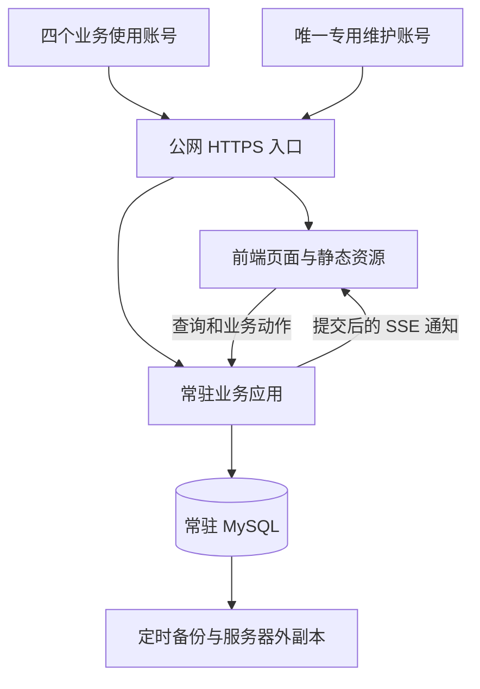
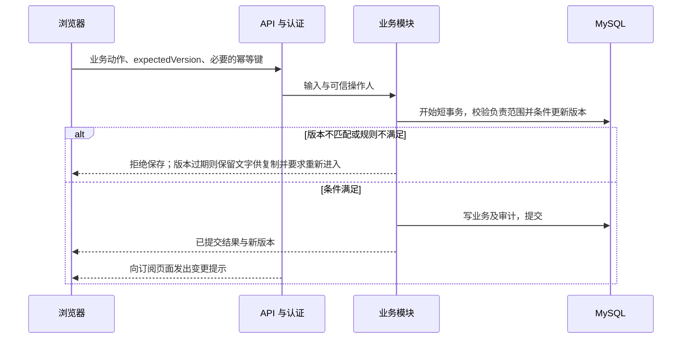
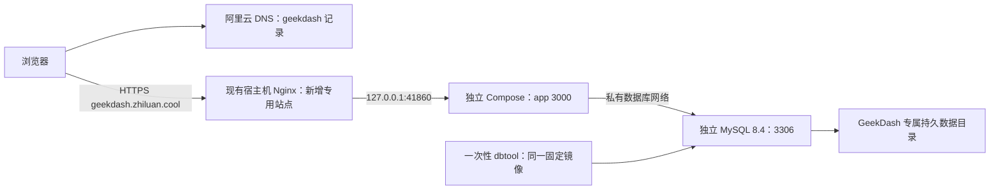

# 系统架构

版本：D0.48；日期：2026-10-08；状态：深接口目标架构保持；已落位能力与缺口见系统真相，本图不作为全部模块已实现的证明。

## 1. 现状与约束

原业务来源是 V1.050 六个 HTML 页面及共享 JavaScript，通过浏览器缓存和用户选择的 JSON 文件保存。新工程已建立工程基底与初始数据库；本次接入看板/详情的只读页面与 projects 深模块，页面共享 API 客户端，模块在同一短读事务内查询项目聚合。保存、其他四页及身份仍待后续。实际验证与运行落位见[当前系统真相](../status/current-system-truth.md)。

已确认约束：4 位业务使用者独立账号、全项目可见且按负责范围编辑、4 人业务并发；额外一个专用维护管理员账号管理共享资料、公共设置和账号（SPEC-019）；常驻 MySQL、状态记录、公网测试、深模块与长期维护。

当前施工优先级按 DEC-090 恢复最小身份，完成 E03 的创建、本人责任和实名普通保存；邀请码及完整账号后台后置。identity 向项目深模块提供可信 actor，项目写事务再次核验账号与会话；账号/会话→资料→项目的取锁次序保护授权及引用。创建、责任、普通保存复用同一项目版本、审计和持久回执，不增加 Redis。实际落位及运行验证见系统真相；图中其他深模块仍是目标。

## 2. 架构选择

采用模块化单体：一个常驻业务应用，内部按业务职责约束依赖。用户已明确保留现有页面与操作习惯，抽出数据访问、状态管理与业务规则后调用 API；是否进一步合并为单页应用，根据实际切页体验决定。

工程基线采用 Node.js 24 LTS + TypeScript + Fastify 5，mysql2 访问 MySQL 8.4；前端使用原生页面与 TypeScript 共享模块，Vite 多页面构建。部署采用 Docker Compose，使用 SSE 通知变更。具体范围、选型来源及版本锁定方式见[技术栈基线](technology-stack.md)。

## 3. 运行结构

API 与前端同站点，通过 Nginx HTTPS 入口访问，便于会话与 CSRF 防护。MySQL 不暴露公网端口。部署采用 Docker Compose，持久化卷、自动重启和健康检查分别配置。首版不部署 Redis。

测试入口为 `https://geekdash.zhiluan.cool`。Compose 工程使用 `geekdash` 标识，应用、MySQL、内部网络和数据卷独立于主机上的其他项目；数据库实例中另分人工试用库与自动测试库，分别授权。域名用于访问入口，容器/数据卷采用合法且易辨识的工程名称。域名、证书和容器部署均须实施验证，不据目标名称宣称已上线。

## 4. 深模块边界

交互图：[深接口执行架构](../evidence/diagrams/geekdash-execution.html)。图展示主要调用和持久边界，不是所有 HTTP 路由或 SQL 调用的展开：资料维护、会议/报告同样从认证入口调用；身份、个人状态和导入也使用 MySQL。完整依赖约束见下表与正文。图中的模块属于施工目标，尚未实现；ERD 仍独立维护于数据文档。

| 模块 | 公开能力示例 | 内部负责 | 数据归属 |
|---|---|---|---|
| 身份与会话 | login、changePassword、logout、resolveActor、createInvitation、revokeInvitation、registerWithInvitation、resetPassword、disableAccount | 凭据验证、期限、撤销、首次改密、邀请码注册、交接校验及入口限速 | users、sessions；维护资格读取配置；registration_invites 为待迁移目标，来源关系归 ERD 5.5 |
| 项目生命周期 | getProjectSnapshot、createProject、saveProject、applyProjectAction、joinResponsibility、leaveResponsibility | 项目授权、有限的明确状态动作、日期、风险/节点已确认范围、版本、事务和审计 | projects 及业务子表 |
| 基础资料与设置 | previewReferenceImpact、saveReference、deactivateReference、saveCheckRule | 维护资格、稳定 ID、引用保护、受影响项目版本、规则修订 | 客户、工程师、芯片等；system_configuration、check_rule_revisions |
| 会议与报告 | saveMeeting、createReport、getReport | 权限确认后的写入、项目范围、固定快照及产物一致性 | meetings、reports、feedback_entries；具体业务写权限仍待决 |
| 个人工作状态 | savePreferences、saveDraft、getRecoveryContext | 按用户隔离、修订/乱序保护、容量和恢复；终态自动清理仍待决 | user_preferences、project_drafts |
| 导入审查 | previewImport、saveImportCorrection、commitReviewedImport、takeOverImport | 持久待审区、映射预检、处理资格、卡片/项目版本、逐项事务和可恢复结果 | import_batches、import_items；首版不建 jobs |

这些名字是内部公开能力设计，不是已生成的 HTTP 协议。`applyProjectAction` 只接受 SPEC 已确认的有限动作，不能任意改状态或表。backup/restore 属于受控运维入口，按 SPEC-016 和发布维护执行，不作为任意业务用户可调用的接口。

页面和 API 路由仅承担输入转换、调用和结果呈现。核心动作在模块内部完成校验、事务、审计及结果构造。

E04-B08风险实现由project-save.ts保留唯一普通保存事务，project-records.ts内部形成风险候选和目标审计；只读save-preview与正式保存复用候选，正式提交仍重验。它是项目模块的内部拆分，不新增立即保存的风险服务或另一套版本。后续节点/变更按同一边界接入，实际协议归API，能力状态归系统真相。

跨模块不得直接修改对方表。导入可通过各模块提供的批量写入能力，在同一应用的统一工作单元内协调事务；不能绕过业务约束直接灌表。审计是公共内部能力，写入必须参与发起动作的同一事务。

公开接口接收可信操作人、业务输入、预期版本及必要幂等键，返回完整业务结果；SQL 连接、锁、审计表及回执写入留在内部。导入协调事务时使用内部事务参与能力，项目规则只有一份，不能从 HTTP 回调自身接口或复制保存逻辑。草稿精确提交终态通过个人状态内部能力参与同一事务，项目模块不直接越界修改其表。

模块数量不是质量指标。不要为每个字段或单次调用创建接口、工厂和转发层；也不要把所有职责挤在一个无边界大文件。

独立卡片审查页面仍由数据维护模块承接，不另建审批服务。待审数据持久化于 MySQL，正式查询仅消费已提交业务表；批量通过动作协调项目及基础资料模块与审计，复用权限、规则和事务能力。行为契约见 SPEC-009，按 DEC-033 逐项目短事务允许部分成功，保留各项提交结果用于恢复；数据量大不等于需要排队，后台执行与 Redis 仍须测量依据。

## 5. 核心保存链路

交互时序：[一个深接口完成项目提交](../evidence/diagrams/geekdash-save.html)。图展示成功路径；权限、版本、关联、审计失败的退出语义以 SPEC-002 为准。

只有用户点击保存且服务器提交完成才显示已保存。SSE 仅用于减少等待；断线重连、页面重新聚焦及应用重启后要补查版本，防止遗漏通知导致永久陈旧。跨日的派生状态也应重新计算，不能只依赖项目被修改。

SSE 在事务提交后发送资源 ID、版本与提交标识。列表可刷新摘要；已打开的详情保持进入版本，收到新版本后提示重新进入并禁用旧版保存，保留文字供复制。低频版本复核补足遗漏通知，会话到期或撤销时关闭流。反向代理为 SSE 关闭响应缓冲并配置心跳和超时；公网优先 HTTP/2，多标签页连接行为纳入验证。

在线编辑名单使用同一 SSE 通道通知；浏览器以独立心跳接口登记页面实例，后端根据会话与负责关系认证。单进程内存保存短期状态并按超时清理，重启后重新登记；它不承担数据库互斥，不发送编辑字段或内容，不需要 Redis。详细行为以 SPEC-015 为准。

## 6. 状态与缓存

- MySQL 是共享业务、会话、审计的持久来源。
- 个人偏好、设备阅读上下文由 user_preferences 分范围持久化；project_drafts 保存本人未提交底稿，projects 保存正式业务。恢复顺序、同步节流、多标签冲突与提交粒度统一按 SPEC-002/007，不在页面另写规则。
- 当前首版数据库施工设计为 34 表，完整字段、约束及合并取舍只维护于 [ERD 第 3～5 节](../data/ERD.md#3-首版完整物理字段字典施工设计未建表)；command_receipts 与业务审计同事务，schema_migrations 登记实际结构升级。真实 MySQL 性能待验收。
- 初期业务缓存优先使用登录期间的内存缓存，避免把全部敏感数据长期留在浏览器。需要持久缓存时单独定范围、期限和清理规则。
- 退出、账号切换、会话撤销时清理相关缓存；静态文件可按内容哈希长期缓存。
- 不在浏览器存储里放可读的长期登录令牌。

## 7. 队列决策

普通项目写入走数据库事务，队列不能取代并发控制。少量计划备份可以由定时任务执行。若报告、导入、知识库同步需要持续后台执行，再评估 Redis + BullMQ。

采用队列时：MySQL 保留任务状态与业务结果；投递和完成之间允许恢复；消费者必须幂等，重试有次数和退避，进程退出后可重新领取未完成任务。若业务提交必须同时保证任务最终执行，需持久化待投递记录并补偿投递，避免“数据库提交成功但任务丢失”。不要宣称队列天然提供恰好一次执行。

具体任务吞吐尚未测量。首轮若有重任务，建议以低并发开始测量，避免占满共享测试机。

参考：[BullMQ 幂等任务](https://docs.bullmq.io/patterns/idempotent-jobs)、[Redis 持久化](https://redis.io/docs/latest/operate/oss_and_stack/management/persistence/)。

## 8. 安全与可观测性

公网入口需 HTTPS、服务端认证、登录限速、安全 Cookie、写请求 CSRF 防护、输入校验及输出转义。审计身份由会话确定。访问日志不记录凭据和完整敏感业务正文。

最小运行观测：部署版本、请求 ID、错误率、接口延迟、数据库连接和慢查询、磁盘与内存、备份结果；有任务进程时增加失败数、等待时长和恢复结果。可先使用结构化日志与轻量健康检查，不强制部署大型监控平台。

## 9. 测试部署选择

DEC-049 已确认沿用现有新加坡测试机，使用独立 Docker 应用及独立 MySQL 容器，不复用其他业务数据库实例。容器隔离数据、网络与生命周期，CPU、内存及磁盘仍由同一主机共享。当前容量观察见系统真相，不能仅凭四人使用就宣布容量通过。

工程建议：首版一个应用进程，限制数据库连接与缓冲规模，镜像在本地或构建环境生成；通过四人混合读写和既有服务健康观察确定实际资源预算。证书入口和监听端口按服务器现状配置，不抢占既有端口；不得停止或重配其他系统来为本项目腾资源。

业务代码更新、数据库生命周期和备份分别管理。更新应用不应重建或清空数据库数据卷。

### 首个公网基底拓扑（2026-10-08 讨论方案）

当前 DEC-071 先免登录部署基底，DEC-072 新建阿里云 DNS 子域记录。服务器已观察到宿主机 Nginx 承接 80/443；下图的基底拓扑现已落地，实际版本/验证范围归部署记录；六页面及业务深模块仍后续。资源/路径参数归运维，施工顺序归执行文档 E12-D01～D07。

单应用常驻，数据库常驻；迁移工具运行后退出。数据库技术身份与未来登录账号分开，首单元不初始化业务用户。镜像本机构建后传输到 x86_64 主机，版本清单绑定源码/镜像/迁移，避免在共享主机安装整套构建依赖。后续 SSE 仍走同站点，当前未实现。

## 10. 施工入口

[执行文档](../implementation/execution-plan.md)按 E01～E12 描述每个功能的实现思路、依赖、失败恢复及验证入口。先工程/迁移/认证，再打通项目聚合保存的真实 MySQL 链路，随后接入状态动作、私人草稿、SSE、资料和六页面，最后完成审查导入、恢复与测试发布。准确业务规则和字段分别引用 SPEC 与 ERD，不在执行文档重新定义。

图源及交付回执在 `docs/evidence/diagrams/`，由本架构派生。两图的确定性产物检查通过；浏览器自动核验因本机调试进程失败而未完成，视觉范围另记证据，不能称完整浏览器验收通过。应用、数据库及部署验证仍未执行。
