# 数据模型与实体关系（ERD）

版本：D0.12；日期：2026-09-29；状态：候选逻辑模型，待依据真实备份反推修订，未创建表、未执行迁移。

本文描述服务器版目标。现有 V1.050 是 JSON 对象与浏览器存储，不具备本文关系约束。待决业务规则可能改变字段及表结构。

**待修订范围：** 用户已提供真实 V1.044 备份，结构摘要见系统真相。下列图表仍是先前候选目标模型，尚未完成按真实字段与源码反推的 ERD；不得直接作为现有数据库结构或建表依据。业务规则以规格与已确认决策为准，本文只定义数据表达和约束。

## 1. 核心关系

```mermaid
erDiagram
    USERS ||--o{ SESSIONS : owns
    USERS ||--o{ USER_PREFERENCES : owns
    USERS ||--o{ PROJECT_DRAFTS : owns
    USERS ||--o{ AUDIT_LOG : acts
    USERS ||--o{ PROJECT_RESPONSIBILITIES : responsible
    PROJECTS ||--o{ PROJECT_RESPONSIBILITIES : managed_by
    USERS o|--o{ PROJECTS : created_by
    CUSTOMERS o|--o{ PROJECTS : commissions
    PROJECTS ||--o{ PROJECT_STAGES : contains
    PROJECTS ||--o{ PROJECT_NODES : contains
    PROJECTS ||--o{ FLOW_LINKS : contains
    PROJECTS ||--o{ PROJECT_PEOPLE : assigns
    ENGINEERS ||--o{ PROJECT_PEOPLE : participates
    PROJECTS ||--o{ PROJECT_CHIPS : uses
    CHIPS ||--o{ PROJECT_CHIPS : referenced
    PROJECTS ||--o{ PROJECT_STATUS_UPDATES : records
    PROJECTS ||--o{ PROJECT_RISKS : tracks
    PROJECTS ||--o{ PROJECT_CHANGES : records
    PROJECTS ||--o{ SCHEDULE_CHANGES : reschedules
    PROJECTS ||--o{ PROJECT_CHECKS : checks
    PROJECTS ||--o{ PROJECT_DRAFTS : drafts
    MEETINGS ||--o{ MEETING_PROJECTS : covers
    PROJECTS ||--o{ MEETING_PROJECTS : discussed
    USERS ||--o{ REPORTS : creates
    USERS ||--o{ IMPORT_BATCHES : imports
    USERS o|--o{ JOBS : requests
```

图中省略企业设置、标签关联及部分基础资料以保持可读；下方清单定义其迁移范围。报告快照不依赖项目日后的存活或名称，因此不强制画成实时项目外键。

## 2. 关键实体与字段

| 实体 | 关键字段建议 | 约束和用途 |
|---|---|---|
| users | id、login_name、password_hash、display_name、enabled | 登录名唯一；本期统一管理员角色；历史操作者不能因停用而消失 |
| sessions | id、token_hash、user_id、expires_at、revoked_at | 原始随机令牌仅在 Cookie；索引 user_id、expires_at |
| projects | id、name、customer_id、created_by、status、version、original_due_date、current_due_date、closure_type、maintenance_enabled、created_at、updated_at、deleted_at | version 原子递增；结案类型与维护组合受规则约束 |
| project_responsibilities | project_id、user_id、joined_at | 项目与登录账号多对多、联合唯一；当前负责关系，加入/退出历史归审计；行为见 SPEC-014 |
| project_stages | id、project_id、stage_code、state、note、started_at、done_at、planned_days | project_id + stage_code 唯一；需表达独立开始与完成，未解锁/待开始可派生；实际日期使用 DATE，纠错规则已由 DEC-024 确认；state 契约见 SPEC-003，返工落点待 Q-021 |
| project_nodes | id、project_id、kind、stage_id、title、target_date、completed_at、output、position_json | kind 区分项目/客户节点；同项目约束由服务端校验 |
| flow_links | id、project_id、from_node_id、to_node_id | 两端必须属于同项目；重复边限制；是否允许环待业务核实 |
| project_people | project_id、engineer_id、role | 相同项目/人员/角色不能重复；单负责人角色的数量需约束 |
| project_chips | project_id、chip_id | 联合唯一；迁移旧名称时建立映射 |
| project_status_updates | id、project_id、body、actor_id、created_at | 状态描述按多行原文保存；展示历史与系统审计分开 |
| project_risks | id、project_id、content、level、resolved_at、resolution、actor_id | 解除必须保留原风险和处理结果 |
| project_changes | id、project_id、source、content、decision、reason、actor_id | 业务需求变更记录，不代替系统更新记录 |
| schedule_changes | id、project_id、old_date、new_date、reason、actor_id、created_at | 有效改期与补充说明的最终建模待 Q-005；说明不得清空当前计划 |
| project_checks | id、project_id、actor_id、checked_at、conclusion | 主动确认检查，与浏览访问分开 |
| audit_log | id、actor_id、action、entity_type、entity_id、before_json、after_json、request_id、created_at | 与业务同事务；历史保留显示名称；应用界面不提供无痕修改 |
| user_preferences | user_id、scope、value_json、updated_at | user_id + scope 唯一；只保存个人配置 |
| project_drafts | id、user_id、project_id、client_draft_id、base_version、payload_json、updated_at | 新建草稿 project_id 可空；同用户/草稿键唯一 |
| meetings | id、title、state、started_at、ended_at、minutes、created_by | 状态变化由服务器保存；计时不依赖某浏览器持续运行 |
| meeting_projects | meeting_id、project_id | 会议项目范围；是否固定讨论时快照待确认 |
| reports | id、created_by、scope_json、snapshot_json、data_version、status、artifact_ref、created_at | 固定所选范围和输出依据；结果下载需认证 |
| import_batches | id、source_hash、schema_version、mapping_json、result_json、created_by、status | 预检与提交可追踪；原始数据来源明确 |
| jobs | id、type、requested_by、business_key、status、attempts、result_ref、error_code、created_at | 仅当确定异步任务时实施；business_key 用于必要的去重 |

project_responsibilities 是服务器新增授权关系，不等于原业务 PM、工程师及 project_people；不能按旧名称自动授予权限。新项目 created_by 来自登录账号；历史创建人未知时保留未知与来源，不能伪造。在线编辑心跳是短期运行态，首版不建持久业务表，不推进项目 version。

阶段模型增量（DEC-023）：started_at 为目标候选业务时间字段，不等于审计中的保存时间；业务日期精度已按 DEC-024 确认为 DATE，字段命名在逐字段反推时统一。旧 done=false 不能证明阶段已开始，原备份缺失的实际日期不能根据旧页面“进行中”标签或导入时间伪造。迁移映射须将不确定项报告并确认；完整逐字段反推仍未完成。

真实返工的最小数据表达：复用 audit_log 的动作及 before_json/after_json 记录来源阶段、目标阶段、原因和状态/日期变化，以 action 区分阶段回退与信息纠错；每次追加，历史可从项目中查看。不为这一入口先建返工子项目或独立工作流表。业务实际日期与审计时间分开，重做时本轮日期不得覆盖原轮次的历史事实；回退后的有效日期处置待 Q-021。

## 3. 基础资料与遗漏防护

客户、工程师、芯片、产品线、APP、标签、分组和企业信息都在迁移范围内；项目中的 ODM 工厂可按客户类型关联，是否允许多客户待确认。

项目还需覆盖原字段：提案/备案/启动日期、优先级、信号灯及说明、市场预期、详细备注、标签、阶段工期、节点坐标、流程连线以及原版 `milestones` 等兼容字段。旧 `milestones` 与 `nodes` 的差异未完成语义核查，迁移前必须决定映射，不能静默丢弃。

报表备注、芯片统计备注与反馈不能因为原来位于 preferences 中就一律当个人 UI 偏好；需按是否共享业务内容重新归类。原有隐藏、排序和字段显示则默认按用户保存。

## 4. 数据约束

1. ID 由服务器生成，API 对 ID 的序列化采用统一约定，避免 JavaScript 大整数精度问题。
2. 数据库存业务时间点使用统一 UTC；业务日期使用 DATE。展示与逾期按待确认的公司时区解释。
3. 当前逾期、当前阶段、整体进度优先由统一规则派生，避免多个字段互相矛盾。基于“今天”的结果必须随日期重新计算。
4. 业务记录和审计同事务；并发通过 project.version 条件更新。具体子对象冲突粒度先按项目统一，后续有证据再细化。
5. 基础资料有引用时优先停用，不级联删除项目历史。项目软删除不清除审计和报告快照。
6. JSON 用于偏好、审计差异、快照和流程位置等结构；常用筛选字段和关键关联使用列与关联表。
7. 核心索引候选：projects(status, deleted_at, updated_at)、project_children(project_id)、audit_log(entity_type, entity_id, created_at)。最终依实际查询和执行计划确定。

## 5. 旧数据迁移

旧 JSON → 校验 schema 和语义 ID → 基础资料映射 → 异常阶段/日期报告 → 用户确认冲突策略 → 事务写入 → 新请求读取并对账 → 看板、详情和导出核对。

人员和芯片原本按名称引用，必须保存来源名称与映射结果。无法确定的引用进入待处理清单，不自动丢弃。旧历史的操作人或时间无法可靠证明时标记为 legacy/来源时间，不伪造为当前账号操作。

本文不提供可直接执行的 DDL。待 Q-001～Q-007 的关键业务语义确定后生成版本化迁移文件，并执行升级与恢复演练。
