# 数据模型与实体关系（ERD）

版本：D0.19；日期：2026-09-30；状态：候选逻辑模型，待依据真实备份反推修订，未创建表、未执行迁移。

本文描述服务器版目标。现有 V1.050 是 JSON 对象与浏览器存储，不具备本文关系约束。待决业务规则可能改变字段及表结构。

**待修订范围：** 用户已提供真实 V1.044 备份，结构摘要见系统真相。下列图表仍是先前候选目标模型，尚未完成按真实字段与源码反推的 ERD；不得直接作为现有数据库结构或建表依据。业务规则以规格与已确认决策为准，本文只定义数据表达和约束。

## 1. 核心关系

```mermaid
erDiagram
    USERS ||--o{ SESSIONS : owns
    USERS ||--o{ USER_PREFERENCES : owns
    USERS ||--o{ PROJECT_DRAFTS : owns
    USERS ||--o{ AUDIT_LOG : acts
    USERS ||--o{ PROJECT_RESPONSIBILITIES : responsible
    PROJECTS ||--o{ PROJECT_RESPONSIBILITIES : managed_by
    USERS o|--o{ PROJECTS : created_by
    CUSTOMERS o|--o{ PROJECTS : commissions
    PROJECTS ||--o{ PROJECT_STAGES : contains
    PROJECTS ||--o{ PROJECT_NODES : contains
    PROJECTS ||--o{ FLOW_LINKS : contains
    PROJECTS ||--o{ PROJECT_PEOPLE : assigns
    ENGINEERS ||--o{ PROJECT_PEOPLE : participates
    PROJECTS ||--o{ PROJECT_CHIPS : uses
    CHIPS ||--o{ PROJECT_CHIPS : referenced
    PROJECTS ||--o{ PROJECT_STATUS_UPDATES : records
    PROJECTS ||--o{ PROJECT_RISKS : tracks
    PROJECTS ||--o{ PROJECT_CHANGES : records
    PROJECTS ||--o{ SCHEDULE_CHANGES : reschedules
    PROJECTS ||--o{ PROJECT_CHECKS : checks
    PROJECTS ||--o{ PROJECT_DRAFTS : drafts
    MEETINGS ||--o{ MEETING_PROJECTS : covers
    PROJECTS ||--o{ MEETING_PROJECTS : discussed
    USERS ||--o{ REPORTS : creates
    USERS ||--o{ IMPORT_BATCHES : imports
    IMPORT_BATCHES ||--o{ IMPORT_ITEMS : stages
    USERS o|--o{ IMPORT_ITEMS : reviews
    PROJECTS o|--o{ IMPORT_ITEMS : targets
    USERS o|--o{ JOBS : requests
```

图中省略企业设置、标签关联及部分基础资料以保持可读；下方清单定义其迁移范围。报告快照不依赖项目日后的存活或名称，因此不强制画成实时项目外键。

## 2. 关键实体与字段

| 实体 | 关键字段建议 | 约束和用途 |
|---|---|---|
| users | id、login_name、password_hash、display_name、enabled | 登录名唯一；本期统一管理员角色；历史操作者不能因停用而消失 |
| sessions | id、token_hash、user_id、expires_at、revoked_at | 原始随机令牌仅在 Cookie；索引 user_id、expires_at |
| projects | id、name、customer_id、created_by、status、version、started_on、original_due_date、current_due_date、manual_delayed、closure_due_date、resume_status、pre_close_status、closure_type、closed_on、closure_note、remaining_work_note、maintenance_enabled、created_at、updated_at、deleted_at | version 原子递增；日期与恢复状态支撑 SPEC-003；结案类型与维护组合受规则约束 |
| project_responsibilities | project_id、user_id、joined_at | 项目与登录账号多对多、联合唯一；当前负责关系，加入/退出历史归审计；行为见 SPEC-014 |
| project_stages | id、project_id、stage_code、state、note、started_at、done_at、planned_days | project_id + stage_code 唯一；需表达独立开始与完成，未解锁/待开始可派生；实际日期使用 DATE，纠错规则已由 DEC-024 确认；state 契约及已确认回退落点见 SPEC-003 |
| project_nodes | id、project_id、kind、stage_id、title、target_date、completed_at、output、position_json | kind 区分项目/客户节点；同项目约束由服务端校验 |
| flow_links | id、project_id、from_node_id、to_node_id | 两端必须属于同项目；重复边限制；是否允许环待业务核实 |
| project_people | project_id、engineer_id、role | 相同项目/人员/角色不能重复；单负责人角色的数量需约束 |
| project_chips | project_id、chip_id | 联合唯一；迁移旧名称时建立映射 |
| project_status_updates | id、project_id、body、actor_id、created_at | 状态描述按多行原文保存；展示历史与系统审计分开 |
| project_risks | id、project_id、content、level、resolved_at、resolution、actor_id | 解除必须保留原风险和处理结果 |
| project_changes | id、project_id、source、content、decision、reason、actor_id | 业务需求变更记录，不代替系统更新记录 |
| schedule_changes | id、project_id、kind、old_date、new_date、reason、measures、actor_id、created_at | kind 区分有效改期与补充说明；说明记录日期可空，改期记录具备有效目标；当前计划与记录同事务，纠错审计独立留痕，行为见 SPEC-004 |
| project_checks | id、project_id、actor_id、checked_at、conclusion、note、observed_version、result_version | 追加记录；业务周期按 SPEC-005 解释；操作者及时间来自服务器，版本表达检查依据及后续更新 |
| audit_log | id、actor_id、action、entity_type、entity_id、before_json、after_json、request_id、created_at | 与业务同事务；历史保留显示名称；应用界面不提供无痕修改 |
| user_preferences | user_id、scope、value_json、updated_at | user_id + scope 唯一；只保存个人配置 |
| project_drafts | id、user_id、project_id、client_draft_id、base_version、payload_json、updated_at | 新建草稿 project_id 可空；同用户/草稿键唯一 |
| meetings | id、title、state、started_at、ended_at、minutes、created_by | 状态变化由服务器保存；计时不依赖某浏览器持续运行 |
| meeting_projects | meeting_id、project_id | 会议项目范围；是否固定讨论时快照待确认 |
| reports | id、created_by、scope_json、snapshot_json、data_version、status、artifact_ref、created_at | 固定所选范围和输出依据；结果下载需认证 |
| import_batches | id、source_hash、schema_version、mapping_json、result_json、created_by、status、created_at | 独立待审批次，来源明确，保存进度和汇总结果 |
| import_items | id、batch_id、source_key、target_project_id、expected_project_version、review_version、source_payload_json、corrected_payload_json、validation_json、selected_by、reviewed_by、reviewed_at、status、result_json | 待审原值与纠正值分开；审查版本防止覆盖待审修正；目标项目可空，新增提交成功后记录实际 ID；字段为目标候选，精确结构待反推 |
| jobs | id、type、requested_by、business_key、status、attempts、result_ref、error_code、created_at | 仅当确定异步任务时实施；business_key 用于必要的去重 |

project_responsibilities 是服务器新增授权关系，不等于原业务 PM、工程师及 project_people；不能按旧名称自动授予权限。新项目 created_by 来自登录账号；历史创建人未知时保留未知与来源，不能伪造。在线编辑心跳是短期运行态，首版不建持久业务表，不推进项目 version。

阶段模型增量（DEC-023）：started_at 为目标候选业务时间字段，不等于审计中的保存时间；业务日期精度已按 DEC-024 确认为 DATE，字段命名在逐字段反推时统一。旧 done=false 不能证明阶段已开始，原备份缺失的实际日期不能根据旧页面“进行中”标签或导入时间伪造。迁移映射须将不确定项报告并确认；完整逐字段反推仍未完成。

真实返工的最小数据表达：复用 audit_log 的动作及 before_json/after_json 记录来源阶段、目标阶段、原因和状态/日期变化，以 action 区分阶段回退与信息纠错；每次追加，历史可从项目中查看。不为这一入口先建返工子项目或独立工作流表。业务实际日期与审计时间分开，重做时本轮日期不得覆盖原轮次的历史事实；按 DEC-026，回退后目标及后续的当前有效实际日期为空，原日期保留审计；重新开始时写本次实际日期。阶段业务日期可空不能单独用于判断历史是否曾经开始或完成。

项目生命周期的目标字段增量：started_on/closed_on 为业务 DATE，resume_status 保存暂缓前提案/进行中状态，pre_close_status 保存结案前状态；从暂缓结案再重开时仍需保留 resume_status。closure_type 区分正常完成/中途终止，说明和遗留事项记录本次结案；再次重开及结案前的旧值写入追加审计，不能覆盖历史。字段名和物理结构仍待完整反推收敛，动作规则唯一正文为 SPEC-003。

交期模型增量（DEC-030）：original_due_date/current_due_date 为可空 DATE，manual_delayed 独立保存旧人工标记；当前超期与天数按 SPEC-004 派生，不与人工值共用字段。closure_due_date 保存本次结案的有效计划快照，与 closed_on 推导历史结果；重开及再次结案的旧快照保留追加审计。schedule_changes.kind 区分改期和说明，方向由日期关系派生；字段名及物理约束仍待逐字段反推时统一。本段定义数据表达，规则正文仅维护于 SPEC-004。

旧 dueDate 与 delays 不能机械映射成完整历史原始计划：dueDate 曾可直接编辑，末条记录也可能只有说明。迁移应保留原字段和记录，预检展示可证明的日期及不确定项，由人核对原始/当前计划；禁止用首次导入日期补造计划、按旧数组长度制造延期次数或把人工 isDelayed 转成自动超期事实。

检查数据表达按 DEC-031 补充；旧 lastCheckAt 只保留 legacy 来源，不伪造可信检查人。独立导入审查的 import_items 为服务器新增目标实体，不能冒充旧备份已有表；原始与修正内容、目标版本和提交结果支持 SPEC-009，待审数据持久化并纳入完整备份。来源 ID 仅用于映射，不能机械当作正式 ID。负责人映射、共享待审项的修改权限仍按 Q-015/016 收敛；批量部分成功按 DEC-033/SPEC-009，各待审项与正式结果同事务记录，批次汇总可由逐项结果得出；物理字段和状态枚举尚未锁定。

## 3. 基础资料与遗漏防护

客户、工程师、芯片、产品线、APP、标签、分组和企业信息都在迁移范围内；项目中的 ODM 工厂可按客户类型关联，是否允许多客户待确认。

项目还需覆盖原字段：提案/备案/启动日期、优先级、信号灯及说明、市场预期、详细备注、标签、阶段工期、节点坐标、流程连线以及原版 `milestones` 等兼容字段。旧 `milestones` 与 `nodes` 的差异未完成语义核查，迁移前必须决定映射，不能静默丢弃。

报表备注、芯片统计备注与反馈不能因为原来位于 preferences 中就一律当个人 UI 偏好；需按是否共享业务内容重新归类。原有隐藏、排序和字段显示则默认按用户保存。

## 4. 数据约束

1. ID 由服务器生成，API 对 ID 的序列化采用统一约定，避免 JavaScript 大整数精度问题。
2. 数据库存业务时间点使用统一 UTC；业务日期使用 DATE。业务日期展示与超期计算按 SPEC-004 已确认的 Asia/Shanghai 解释。
3. 当前逾期、当前阶段、整体进度优先由统一规则派生，避免多个字段互相矛盾。基于“今天”的结果必须随日期重新计算。
4. 业务记录和审计同事务；并发通过 project.version 条件更新。具体子对象冲突粒度先按项目统一，后续有证据再细化。
5. 基础资料有引用时优先停用，不级联删除项目历史。项目软删除不清除审计和报告快照。
6. JSON 用于偏好、审计差异、快照和流程位置等结构；常用筛选字段和关键关联使用列与关联表。
7. 核心索引候选：projects(status, deleted_at, updated_at)、project_children(project_id)、audit_log(entity_type, entity_id, created_at)。最终依实际查询和执行计划确定。

## 5. 旧数据迁移

旧 JSON → 校验 schema 和语义 ID → 基础资料映射 → 异常阶段/日期报告 → 独立卡片审查及纠正 → 选择通过项并确认保存 → 事务写入 → 新请求读取并对账 → 看板、详情和导出核对。

人员和芯片原本按名称引用，必须保存来源名称与映射结果。无法确定的引用进入待处理清单，不自动丢弃。旧历史的操作人或时间无法可靠证明时标记为 legacy/来源时间，不伪造为当前账号操作。

本文不提供可直接执行的 DDL。待逐字段反推及 Q-007/015/022 等剩余关键语义明确后生成版本化迁移文件，并执行升级与恢复演练。
