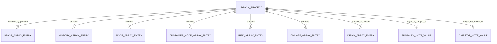
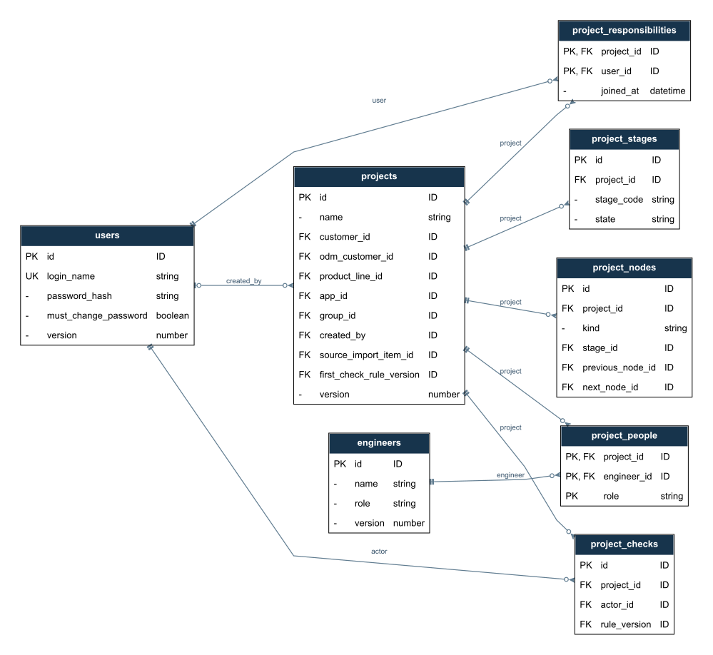
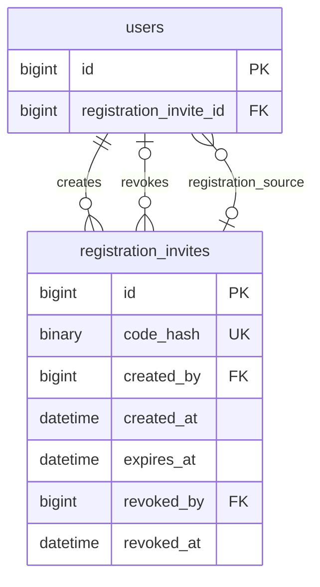
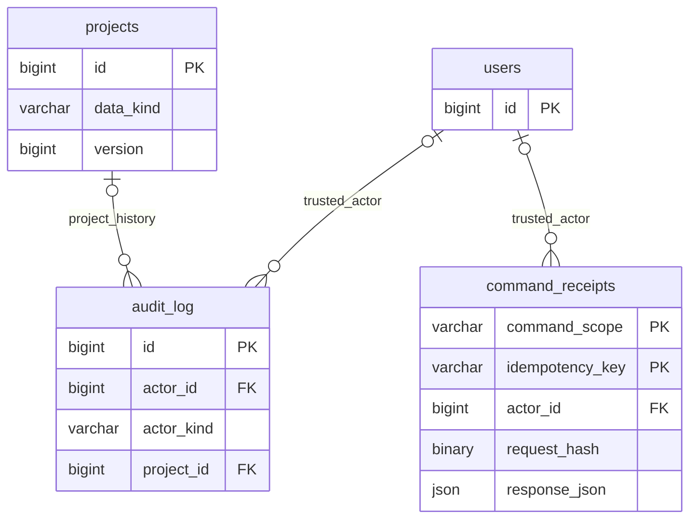

# 数据模型与实体关系（ERD）

版本：D0.73；日期：2026-10-10；状态：0001初始34表/313列/55条引用，0002基线34/314/55，0003两端实际34/315/55；E03最小身份、责任和会话复用现有实体，无新结构。DEC-107节点恢复增量归5.8，已加一列并接有效过滤，删除/恢复写入尚未实施；DEC-108日期未知复用现有可空列。实际约束核对范围见[F02/F03 实际报告](../testing/reports/2026-10-08-e01-f02-f03.md)。第5.6节由0002-trial-save实现，实际结果归系统真相及保存报告，不以设计批准新自动化。

本文分清三类来源：**B** 是真实 V1.044 备份中观察到的结构，**C** 是 V1.050 源码的读写或归一化结构，**T** 是服务器目标表达。旧系统是 JSON 与浏览器存储，下面的实体名称不代表旧系统已有 MySQL 表。字段反推完成的范围是本次备份与七个运行文件；不证明备份覆盖全部业务数据，也不替代剩余业务规则确认或可执行 DDL。

脱敏字段清单、计数及来源哈希见[字段核查证据](../evidence/2026-09-30-field-inventory.json)。代码位置均相对忽略目录 `source-review/AIGeekDashCX/geekdash-system-builder/releases/GeekDash1050/`，方便本地复核；真实内容不上传。业务行为正文只维护于[规格书](../specifications/specification.md)，待决索引见[决策](../decisions/decisions.md)。

## 1. 现有数据：实际容器与关系

### 1.1 备份顶层

| 容器/字段 | B 实测 | C 来源和解释 |
|---|---|---|
| version、appVersion、exportedAt | schema 2、V1.044、导出时间文本 | `projects-data.js:707～722` 构造备份头部；导出时间不是任何项目的创建时间 |
| projects | 27 项，每项 29 字段 | 项目对象聚合阶段、节点、风险等数组，没有数据库外键 |
| customers、engineers、productLines、apps、tags | 各 0 项 | 空库不代表项目未引用这些名称，也不证明此版没有资料功能 |
| groups | 3 项，id/name | 本次项目没有 group 字段，不能按分组库存在替项目补分组 |
| chips | 13 项，id/name/originalModel/manufacturer/firmwareVersion | 项目 chips 数组全空；不能把资料库全部芯片自动分配给项目 |
| company | fullName/shortName/manager/namePrefix | manager 是展示文字，不是认证身份或维护权限 |
| preferences | 12 个字符串键值 | 部分字符串内含 JSON；不是全部都属于个人页面偏好 |

备份共 13 个顶层键。V1.050 `buildBackupData` 仍导出这些容器。`validateBackupData:740～787` 能为缺失集合给默认值；原数据未修改，本轮没有通过该函数重写备份。

图中节点/风险/变更/延期及芯片统计备注部分由 C 证明，B 样本为空或缺失；纪要备注则 B 已有 27 项。客户、人员、产品线、APP、芯片和标签以**名称**联系项目，无法画成已经成立的 ID 外键。

### 1.2 项目：B 中全部 29 字段

来源为 B 全部项目键，与 C `project-detail.html:3197～3364` 的保存/新建对照。下表目标字段是逻辑映射，空串或占位符须保留原值并在审查时识别，不能悄悄补造成事实。

| 旧字段 | B 类型/数量 | T 映射与迁移限制 |
|---|---|---|
| id | integer，27 | 来源 ID → import_items.source_key；正式 projects.id 另生成 |
| name | string，27 | projects.name，保留名称原文 |
| customer | string，27 | projects.customer_id；8 个不同来源名称，而客户库为空，需人工确认资料映射 |
| productLine | string，27 | projects.product_line_id；14 个不同来源名称，产品线库为空 |
| odmFactory | string，27 | projects.odm_customer_id；非空名称 4 种，来自客户库的 ODM 候选或自由输入，不是独立供应商库的证据 |
| app | string，27；全空 | projects.app_id；源码允许已有 APP 名称及自由输入 |
| proposalDate | string，27；全空 | projects.proposed_on；DATE 可空，不用导入日补造 |
| filingDate | string，27；5 个日期文本 | projects.filed_on；其余为空，须校验日期而非只匹配文本形式 |
| startDate | string，27；全空 | projects.started_on；项目启动日，不等于阶段实际开始日 |
| dueDate | string，27；15 个日期文本 | projects.current_due_date；original_due_date 是否相同需人工核对，不能证明原始计划 |
| priority | string，27 | projects.priority；按 SPEC-018 解释，不转为风险等级 |
| signal | string，27 | projects.signal；人工灯色，见 SPEC-017 |
| signalNote | string，27 | projects.signal_note；灯色说明 |
| status | string，27 | projects.status；状态和阶段完成分别核对，见 SPEC-003 |
| marketExpectation | string，27 | projects.market_expectation；业务文字 |
| statusDesc | string，27 | projects.status_description；多行原文；不伪造描述更新人/时间 |
| hwOwner | string，27 | project_people.role=hardware_owner；业务人员，不等于登录账号负责人 |
| swOwner | string，27 | project_people.role=software_owner；同上 |
| pm | string，27 | project_people.role=pm；同上 |
| participants | string[]，共 76 项 | project_people.role=participant；13 个不同名称，人员资料库为空；不自动授予系统权限 |
| chips | array，全部空 | project_chips；有值时按名称建立映射，不能按现有库推断引用 |
| tags | array，全部空 | project_tags；有值时按名称映射 |
| stages | object[]，共 189 项 | project_stages；每项目 7 项，数组位置映射 S1～S7，详见下节 |
| nodes | array，全部空 | project_nodes.kind=project；C 支持，不可声称用户没有节点能力 |
| customerNodes | array，全部空 | project_nodes.kind=customer；客户节点与项目节点保留区别 |
| risks | array，全部空 | project_risks；C 字段见下节，处理规则待 Q-012 |
| changes | array，全部空 | project_changes；业务需求变更，非本系统发布日志 |
| statusHistory | object[]，共 162 项 | legacy_project_history；混合操作与状态文字，保留来源及顺序，不冒充可信审计 |
| lastCheckAt | integer，27 | 受控来源记录保留 legacy 时间戳；不生成可信 project_checks，理由见 SPEC-005 |

项目客户库为空但存在 8 种客户名称，工程师库为空但硬件/软件/参与者等字段有姓名。匹配只产生候选；不能根据同名自动认定人员身份、把业务 PM 变成负责人，或合并未经确认的资料。

### 1.3 C 中增加的 10 个项目字段

B 中均缺失。保存与新建来源同上；closeReason 另见 `project-detail.html:2083`。这不是断言所有 V1.050 项目都具有这些字段。

| 旧字段 | C 结构/用途 | T 映射或保留方式 |
|---|---|---|
| group | string，分组名称 | projects.group_id；不因 B 分组库有值而补填项目 |
| isProductionMaintenance | boolean | projects.maintenance_enabled；与结案组合见 SPEC-003 |
| statusDescUpdatedAt | 本地时间文本 | 保存来源文字；可验证后映射描述业务更新时间，不能作为服务器审计时间 |
| detailNote | string | projects.detail_note，与纪要备注及芯片统计备注分别保存 |
| delays | object[] | schedule_changes；实际日期调整与说明记录分开，原始日期待核对 |
| isDelayed | boolean | 原始来源保留；曾映射projects.manual_delayed，现按DEC-098退出正式业务，兼容结构与移除见5.7 |
| createdAt | 本地时间文本 | 保存来源创建时间，不伪造可信 created_by；服务器入库时间另记 |
| closeReason | string | 历史结案说明；closure_type 未提供，不能只凭字段存在判为某种结案 |
| flowLinks | 新建从草稿透传数组 | 所读当前连线操作实际写 nodes.prevId/nextId；此数组保留受控来源，不能假设已确定元素契约 |
| milestones | 新建从草稿透传数组 | C 有兼容归一化结构，但未发现所读页面调用该归一化器处理实际节点操作；保留原内容，不自动转成返工子项目 |

### 1.4 嵌套对象完整字段

C 来源：`projects-data.js:984～1105`。B 只有 stages 和 statusHistory 的对象可核对；其他数组为空，不能据源码声称存在真实样本。

| 结构 | B | C 字段及语义 | T 表达 |
|---|---|---|---|
| stages | 每项仅 days:string、done:boolean | days、done、note、doneDate、startDate、expectedEndDate；按七阶段位置对应，无对象 ID | planned_days、state、note、completed_on、started_on、expected_end_on；工期字符串先校验，不能无条件转数字；done=false 不证明已开始 |
| statusHistory | 每项 date/text，162 项 | date、text；归一化仅保留这两项，丢弃空 text 项 | legacy_project_history.source_date_text/body/source_sequence；保存原条目，不凭文字推断 actor |
| risks | 空 | id、content、level、createdAt、resolved、resolveMethod、resolvedAt | project_risks；解除标记与处理结果都保留，不从缺失解除时间反推未解除 |
| changes | 空 | id、source、content、status、reason、createdAt | project_changes；旧 status 原文映射目标 decision 的具体枚举待 Q-012 |
| delays | 缺失 | id、reason、newTargetDate、measures、createdAt | schedule_changes；无日期的说明仍保留，不制造改期次数或计划 |
| nodes | 空 | id、name、stage、stageId、targetDate、output、doneDate、prevId、nextId、x、y | 项目节点的阶段引用、成果、日期及位置；节点来源 ID 只在同项目映射 |
| customerNodes | 空 | id、name、targetDate、doneDate、note | 客户节点不强补阶段引用；note 不覆盖项目节点 output |
| milestones | 缺失 | id、stageId、name、startDate、expectedEndDate、actualEndDate、note、prevId、nextId、x、y、children | 兼容结构保留来源，映射和展示入口待核实 |
| milestones.children | 缺失 | id、name、startDate、expectedEndDate、actualEndDate、note | 源码支持这种兼容形状，不等于已确认增加子节点功能 |

连线实证：`project-detail.html:2532～2534/2648～2649` 渲染 nextId；`:2773～2809/2819～2820/2833～2839/2947～2951` 创建、删除和拖拽修改 prevId/nextId。目标保留同项目单前/单后节点引用，校验悬空/互不对应来源边；前置完成和禁止新循环由DEC-103/106确认，行为只归SPEC-005。节点不驱动阶段，不从数据模型增设分叉/层级或业务自动化。

七阶段 B 样本均缺少实际日期。导入已完成标记时保留完成事实和缺失日期说明，未完成部分的当前状态须人工核对；禁止用导入时间、自动计算工期或页面旧“进行中”文字补造实际开始/完成日期。

### 1.5 基础资料字典

来源：`data-manage.html:889～903/959～973/1046～1087/1213～1254/1282～1330/1449～1456`。id/name 在资料集合中使用正整数及名称校验，但项目使用名称，不是 ID 引用。

| 集合 | 字段（B/C） | T 关系与限制 |
|---|---|---|
| customers | C：id/name/tags/contact/background | customers + customer_tags；项目 customer 与 odmFactory 可分别引用同一客户库；ODM 候选为名称标签包含 ODM 的资料，也可自由输入；不是按 type 外键过滤 |
| engineers | C：id/name/role | engineers；role 是业务资料角色，不是账号权限；同一人可在 project_people 担任不同项目角色 |
| productLines | C：id/name | product_lines；项目多对一可空 |
| apps | C：id/name/version/desc | apps.app_version；旧 version 为 APP 资料版本，不是项目并发 version |
| tags | C：id/name | tags + project_tags/customer_tags；名称数组存在自由输入，客户标签来源需核对 |
| groups | B/C：id/name | project_groups；项目多对一可空 |
| chips | B/C：id/name/originalModel/manufacturer/firmwareVersion | chips + project_chips；名称不是天然唯一标识；NFKC/大小写/空白归一化只辅助匹配，不默认合并资料 |
| company | B/C：fullName/shortName/manager/namePrefix | system_configuration 单例企业信息；展示负责人不授予权限，namePrefix 是命名配置 |

`projects-data.js:514～522` 对旧 customer.type 转成 tags 后删除 type；这是兼容转换，不能据此为真实 B 备份补造字段。原始未知字段留在受控导入项，不直接采用旧归一化器丢弃字段。

### 1.6 浏览器状态与业务内容

V1.050 的备份白名单共 25 键，见 `projects-data.js:22～31`。下表为完整分类，键名均省略公共前缀 `hw_project_board_`；完整键及 B 是否出现见证据 JSON。

| 类别 | C 键 | T 归属及边界 |
|---|---|---|
| 个人显示 | theme、display_mode、meeting_float、zone_settings、activity_settings、filter_settings、filter_collapsed_default、welcome_dismissed、kb_auto_sync | user_preferences；旧来源不证明属于哪个登录用户，分配/默认使用边界待 Q-017 |
| 检查显示/规则 | check_mode、check_rule | check_mode 的个人显示与 check_rule 的公共业务设置分别处理；不能导入某浏览器值直接改写服务器公共规则；SPEC-019 |
| 纪要布局 | summary_order、summary_hidden、summary_sort、summary_show_note、summary_show_node | user_preferences 的对应 scope |
| 芯片统计布局 | chipstat_order、chipstat_hidden、chipstat_sort、chipstat_show_note、chipstat_show_node、chipstat_colvis | user_preferences 的对应 scope |
| 页面业务备注 | summary_notes、chipstat_notes | projects.summary_note / projects.chipstat_note；两者都按项目 ID 存储，并不是按芯片名称存储；同项目两份备注互不覆盖，服务器修改按项目负责范围 |
| Bug/建议 | feedback | C `settings.html:631～664`：id/type/author/date/content；author 是手填文字，不是可信用户；保留来源，服务器 feedback_entries 的处理流程待确认 |

B 中 summary_notes 的 27 个键全部能对应 27 个项目的来源 ID；C `project-status-summary.html:545/618～620` 和 `chip-statistics.html:562/634～636` 分别证明两类备注按项目索引。迁移时先改成正式项目 ID，不按对象遍历顺序配对。

**旧备份的覆盖缺口：** `GeekDash.html:3972～3985` 的会议运行态位于 `hw_project_board_meeting`，结构为 status/startTime/elapsed/resumeAt/endTime（计时 elapsed 为毫秒）；该键不在上述白名单。IndexedDB 存 JSON/会议目录的文件句柄，也未导出；句柄是本机访问能力，不能移成服务器文件路径。浏览器草稿、返回上下文及已输出文件也不能凭这份 .bak 证明覆盖。服务器版完整备份要求见 SPEC-016；若需迁移这些额外内容，应另取真实来源并核对，不能把 13 个 JSON 容器当作覆盖一切的证据。

## 2. 服务器目标关系（T）

实体框显示关键字段，完整字段、SQL 类型及约束见第 3～5 节。PK 为主键，FK 为外键，UK 为唯一键；同表多个 PK 行表示联合主键；联合唯一键只在字段字典中整组标明，不给其中单列标注独立 UK。图中类型为便于阅读的简称，以第 3 节物理字典为准。该图是首版施工设计，迁移执行与真实数据约束验证仍未完成。

[核心关系 PNG](../evidence/diagrams/geekdash-core-erd.png) · [完整目标 SVG](../evidence/diagrams/geekdash-target-erd.svg) · [完整目标 PNG](../evidence/diagrams/geekdash-target-erd.png)。图示由本节 Mermaid 实体/关系派生，用 Graphviz 的表格节点和乌鸦脚绘制；图源唯一维护于本节，派生产物不要手工改写。首版 34 张表，合并/撤除说明见第 4 节；jobs 不在首版图中。

```mermaid
erDiagram
    USERS ||--o{ SESSIONS : user
    USERS ||--o| SYSTEM_CONFIGURATION : maintenance_user
    USERS ||--o| SYSTEM_CONFIGURATION : updated_by
    USERS ||--o{ CHECK_RULE_REVISIONS : saved_by
    CUSTOMERS o|--o{ PROJECTS : customer
    CUSTOMERS o|--o{ PROJECTS : odm_customer
    PRODUCT_LINES o|--o{ PROJECTS : product_line
    APPS o|--o{ PROJECTS : app
    PROJECT_GROUPS o|--o{ PROJECTS : group
    CHECK_RULE_REVISIONS o|--o{ PROJECTS : first_check_rule_version
    USERS o|--o{ PROJECTS : created_by
    IMPORT_ITEMS o|--o{ PROJECTS : source_import_item
    PROJECTS ||--o{ PROJECT_RESPONSIBILITIES : project
    USERS ||--o{ PROJECT_RESPONSIBILITIES : user
    PROJECTS ||--o{ PROJECT_STAGES : project
    PROJECTS ||--o{ PROJECT_NODES : project
    PROJECT_STAGES o|--o{ PROJECT_NODES : stage
    PROJECT_NODES o|--o{ PROJECT_NODES : previous_node
    PROJECT_NODES o|--o{ PROJECT_NODES : next_node
    PROJECTS ||--o{ PROJECT_PEOPLE : project
    ENGINEERS ||--o{ PROJECT_PEOPLE : engineer
    PROJECTS ||--o{ PROJECT_CHIPS : project
    CHIPS ||--o{ PROJECT_CHIPS : chip
    PROJECTS ||--o{ PROJECT_TAGS : project
    TAGS ||--o{ PROJECT_TAGS : tag
    CUSTOMERS ||--o{ CUSTOMER_TAGS : customer
    TAGS ||--o{ CUSTOMER_TAGS : tag
    PROJECTS ||--o{ LEGACY_PROJECT_HISTORY : project
    IMPORT_ITEMS ||--o{ LEGACY_PROJECT_HISTORY : source_import_item
    PROJECTS ||--o{ PROJECT_RISKS : project
    USERS o|--o{ PROJECT_RISKS : actor
    PROJECTS ||--o{ PROJECT_CHANGES : project
    USERS o|--o{ PROJECT_CHANGES : actor
    PROJECTS ||--o{ SCHEDULE_CHANGES : project
    USERS o|--o{ SCHEDULE_CHANGES : actor
    PROJECTS ||--o{ PROJECT_CHECKS : project
    USERS ||--o{ PROJECT_CHECKS : actor
    CHECK_RULE_REVISIONS ||--o{ PROJECT_CHECKS : rule_version
    USERS o|--o{ AUDIT_LOG : actor
    PROJECTS o|--o{ AUDIT_LOG : project
    USERS ||--o{ USER_PREFERENCES : user
    USERS ||--o{ PROJECT_DRAFTS : user
    PROJECTS o|--o{ PROJECT_DRAFTS : project
    USERS ||--o{ MEETINGS : created_by
    USERS ||--o{ REPORTS : created_by
    MEETINGS o|--o{ REPORTS : meeting
    USERS ||--o{ IMPORT_BATCHES : created_by
    USERS ||--o{ IMPORT_BATCHES : current_handler
    IMPORT_BATCHES ||--o{ IMPORT_ITEMS : batch
    PROJECTS o|--o{ IMPORT_ITEMS : target_project
    USERS o|--o{ IMPORT_ITEMS : corrected_by
    USERS o|--o{ IMPORT_ITEMS : reviewed_by
    USERS o|--o{ FEEDBACK_ENTRIES : created_by
    IMPORT_ITEMS o|--o{ FEEDBACK_ENTRIES : source_import_item
    USERS ||--o{ COMMAND_RECEIPTS : actor
    USERS {
        ID id PK
        string login_name UK
        string password_hash
        boolean must_change_password
        number version
    }
    SESSIONS {
        string token_hash PK
        ID user_id FK
    }
    SYSTEM_CONFIGURATION {
        ID id PK
        ID maintenance_user_id FK
        string full_name
        number version
        ID updated_by FK
    }
    CHECK_RULE_REVISIONS {
        ID version PK
        number deadline_weekday
        date effective_week
        ID saved_by FK
    }
    PROJECTS {
        ID id PK
        string name
        ID customer_id FK
        ID odm_customer_id FK
        ID product_line_id FK
        ID app_id FK
        ID group_id FK
        ID created_by FK
        ID source_import_item_id FK
        ID first_check_rule_version FK
        number version
    }
    PROJECT_RESPONSIBILITIES {
        ID project_id PK, FK
        ID user_id PK, FK
        datetime joined_at
    }
    PROJECT_STAGES {
        ID id PK
        ID project_id FK
        string stage_code
        string state
    }
    PROJECT_NODES {
        ID id PK
        ID project_id FK
        string kind
        ID stage_id FK
        ID previous_node_id FK
        ID next_node_id FK
    }
    PROJECT_PEOPLE {
        ID project_id PK, FK
        ID engineer_id PK, FK
        string role PK
    }
    CUSTOMERS {
        ID id PK
        string name
        string contact
        number version
    }
    ENGINEERS {
        ID id PK
        string name
        string role
        number version
    }
    PRODUCT_LINES {
        ID id PK
        string name
        boolean enabled
        number version
    }
    APPS {
        ID id PK
        string name
        string app_version
        number version
    }
    PROJECT_GROUPS {
        ID id PK
        string name
        boolean enabled
        number version
    }
    TAGS {
        ID id PK
        string name
        boolean enabled
        number version
    }
    CHIPS {
        ID id PK
        string name
        string original_model
        number version
    }
    PROJECT_CHIPS {
        ID project_id PK, FK
        ID chip_id PK, FK
        number sort_order
    }
    PROJECT_TAGS {
        ID project_id PK, FK
        ID tag_id PK, FK
        number sort_order
    }
    CUSTOMER_TAGS {
        ID customer_id PK, FK
        ID tag_id PK, FK
        number sort_order
    }
    LEGACY_PROJECT_HISTORY {
        ID id PK
        ID project_id FK
        ID source_import_item_id FK
    }
    PROJECT_RISKS {
        ID id PK
        ID project_id FK
        string content
        ID actor_id FK
    }
    PROJECT_CHANGES {
        ID id PK
        ID project_id FK
        string source
        ID actor_id FK
    }
    SCHEDULE_CHANGES {
        ID id PK
        ID project_id FK
        string kind
        ID actor_id FK
    }
    PROJECT_CHECKS {
        ID id PK
        ID project_id FK
        ID actor_id FK
        ID rule_version FK
    }
    AUDIT_LOG {
        ID id PK
        ID actor_id FK
        string actor_display_name
        ID project_id FK
    }
    USER_PREFERENCES {
        ID user_id PK, FK
        string device_key PK
        string scope PK
        number version
    }
    PROJECT_DRAFTS {
        ID id PK
        ID user_id FK
        ID project_id FK
        string client_draft_id
        ID base_version
        number draft_version
        string state
    }
    MEETINGS {
        ID id PK
        string title
        string state
        ID created_by FK
        number version
    }
    REPORTS {
        ID id PK
        ID created_by FK
        ID meeting_id FK
    }
    IMPORT_BATCHES {
        ID id PK
        string source_hash
        string source_file_ref
        ID created_by FK
        ID current_handler_id FK
        number version
    }
    IMPORT_ITEMS {
        ID id PK
        ID batch_id FK
        string item_kind
        ID target_project_id FK
        ID corrected_by FK
        ID reviewed_by FK
    }
    FEEDBACK_ENTRIES {
        ID id PK
        string type
        string author_text
        ID created_by FK
        ID source_import_item_id FK
        number version
    }
    COMMAND_RECEIPTS {
        ID actor_id PK, FK
        string command_scope PK
        string idempotency_key PK
    }
    SCHEMA_MIGRATIONS {
        string version PK
        string checksum
        datetime applied_at
    }
```

图中列出全部首版实体，每个框只省略部分普通字段以保持可读；第 1 节定义旧数据的完整迁移范围。报告快照不依赖项目日后的存活或名称，因此不强制画成实时项目外键。

## 3. 首版完整物理字段字典（施工设计，未建表）

本节与图源共同构成当前唯一数据模型。原 37 实体中合并四个重复/单例结构、暂不建 jobs，再补两张必需技术表，收敛为 **34 张表**。表数不作为验收目标；每张表需证明职责、字段来源、读写路径及删除后损失的能力。不能声称每张表只有一种表达方式。

### 3.1 类型、空值与默认

- `I` = BIGINT UNSIGNED；作为独立 `id` 主键及 check_rule_revisions.version 时由 MySQL AUTO_INCREMENT 分配（system_configuration 单例除外）。外键符号/宽度一致，API ID 使用十进制字符串，避免 JavaScript 精度损失。
- `R` = BIGINT UNSIGNED，NOT NULL，初值 1；`N` = INT UNSIGNED，`S` = SMALLINT UNSIGNED；计数/序号非负。`D` = DATE；`T` = DATETIME(3)，连接与写入统一 UTC，业务日按 Asia/Shanghai 解释。
- `Vn` = VARCHAR(n)；`X` = TEXT；`J` = JSON；`H` = BINARY(32)（SHA-256 原始摘要）；`U` = CHAR(36) ASCII 精确比较的 UUID；`DEC` = DECIMAL(12,3)。
- 尾缀 `?` 表示允许 NULL，默认 NULL；其余 NOT NULL。缺失业务日期、未知创建人和未验证来源不补造。新建文本空值由服务明确填空串；JSON 写入方提供已验证对象/数组，不在数据库塞整套默认项目。
- `B` = TINYINT，CHECK 限制 0/1。enabled 首次为 1，must_change_password 为 1；manual_delayed/maintenance_enabled 新建为 0。新项目 status=proposal、priority=mid、signal=green；具体业务默认来源见 SPEC，不从通用默认推出业务通过。
- created_at/updated_at 是服务器入库/提交时间；旧时间文字保留导入原文。scope、枚举、幂等键、登录名使用 ASCII 精确比较；业务文字使用 utf8mb4。名称不能作为认证身份或资料合并键。
- 空串日期不是 DATE；未知时间不是 0000-00-00。校验拒绝或留待审，不截断超长字符串。TEXT 的 UTF-8 字节上界纳入输入校验；1 MiB 草稿容量已按 DEC-055 确认，不等同于允许任一 TEXT 超过其 SQL 容量。

### 3.2 每张表的全部首版字段与必要性

下表字段包括公共列；逗号分隔的是独立列。FK 的具体目标由第 2 节及本节约束说明给出。NULL/默认按上节，业务条件不能只靠这一字段表批准。

| 表 | 完整字段与类型 | 主键、唯一键、索引及约束 | 当前独立职责与不可省略的理由 |
|---|---|---|---|
| users | `id:I`、`login_name:V64`、`password_hash:V255`、`display_name:V128`、`enabled:B`、`must_change_password:B`、`version:R`、`created_at:T`、`updated_at:T` | PK(id)；UK(login_name)，登录名采用 ASCII 小写；enabled/must_change_password ∈ {0,1}。 | 独立身份与凭据；按登录名定位，负责关系不能替代账号。 |
| sessions | `user_id:I`、`token_hash:H`、`csrf_hash:H`、`created_at:T`、`last_seen_at:T`、`absolute_expires_at:T`、`revoked_at:T?` | PK(token_hash)；IDX(user_id,revoked_at)，IDX(absolute_expires_at)。 | 多设备会话、单独撤销及重启恢复，用户一行无法表达多个独立会话。 |
| system_configuration | `id:I`、`maintenance_user_id:I`、`full_name:V255`、`short_name:V128`、`manager_text:X`、`name_prefix:V128`、`version:R`、`updated_by:I`、`updated_at:T` | PK(id)，单例 id=1（不使用 AUTO_INCREMENT）；维护人与企业信息同一配置聚合。 | 一个公共配置入口；合并旧 company_profile，避免两个单例表互相同步。 |
| check_rule_revisions | `version:I`、`deadline_weekday:S`、`effective_week:D`、`saved_at:T`、`saved_by:I` | PK(version)，AUTO_INCREMENT 单调递增修订号；CHECK(deadline_weekday BETWEEN 1 AND 7)；IDX(effective_week,version)。 | 截止修订必须追加，不能用当前配置覆盖旧周和报告依据；version 同时是修订 ID。 |
| projects | `id:I`、`name:V255`、`customer_id:I?`、`odm_customer_id:I?`、`product_line_id:I?`、`app_id:I?`、`group_id:I?`、`created_by:I?`、`source_import_item_id:I?`、`source_namespace:V64?`、`source_key:V128?`、`status:V16`、`version:R`、`proposed_on:D?`、`filed_on:D?`、`started_on:D?`、`original_due_date:D?`、`current_due_date:D?`、`manual_delayed:B`、`priority:V16`、`signal:V16`、`signal_note:X`、`market_expectation:X`、`status_description:X`、`status_description_updated_at:T?`、`detail_note:X`、`summary_note:X`、`chipstat_note:X`、`closure_due_date:D?`、`resume_status:V16?`、`pre_close_status:V16?`、`closure_type:V16?`、`closed_on:D?`、`closure_note:X`、`remaining_work_note:X`、`maintenance_enabled:B`、`first_check_week:D?`、`first_check_rule_version:I?`、`created_at:T`、`updated_at:T` | PK(id)；UK(source_namespace,source_key)，两个来源字段同时空或同时有值由模块校验；IDX(status,id)、IDX(customer_id,status,id)、IDX(current_due_date,id)。 | 项目聚合根、统一版本及筛选字段；两份固定页面备注并入项目；来源身份防止同库重复新增。 |
| project_responsibilities | `project_id:I`、`user_id:I`、`joined_at:T` | 联合 PK(project_id,user_id)；IDX(user_id,project_id)。 | 当前修改授权，与业务 PM/工程师不同；退出历史由审计承接，不再复制历史表。 |
| project_stages | `id:I`、`project_id:I`、`stage_code:V2`、`state:V16`、`planned_days:S?`、`note:X`、`started_on:D?`、`completed_on:D?`、`expected_end_on:D?` | PK(id)；UK(project_id,stage_code)，UK(project_id,id) 支持节点的同项目复合外键；七阶段完整性/前置状态在项目事务校验。 | 七阶段的独立状态、工期与实际日期；查询按 project_id 一次取七行，不把状态存在页面偏好中。 |
| project_nodes | `id:I`、`project_id:I`、`kind:V16`、`stage_id:I?`、`title:V255`、`target_date:D?`、`completed_on:D?`、`output:X`、`note:X`、`previous_node_id:I?`、`next_node_id:I?`、`x:DEC?`、`y:DEC?`、`sort_order:N`、`source_key:V128?` | PK(id)；UK(project_id,id)；IDX(project_id,kind,sort_order,id)。阶段、前后节点分别用(project_id,引用ID)复合 FK；来源 ID 非正式 PK。 | 此行是0001/0002既有列；合并两种节点，保留不同业务字段和布局，节点恢复新增列只定义于5.8，不另建连线/子节点实体。 |
| project_people | `project_id:I`、`engineer_id:I`、`role:V32`、`sort_order:N` | 联合 PK(project_id,engineer_id,role)；IDX(engineer_id,project_id)。pm/hardware_owner/software_owner 每角色最多一人由项目事务校验；participant 可多行。 | 业务人员的角色与排序；同一人员可任多角色，不能把参与人员写成逗号字符串或授予登录权限。 |
| customers | `id:I`、`name:V255`、`contact:X`、`background:X`、`enabled:B`、`version:R`、`created_at:T`、`updated_at:T` | PK(id)；IDX(enabled,name,id)；名称不设未经确认的唯一约束，不按归一化名称自动合并。 | 客户背景/联系方式与 ODM 引用；不是账号或标签。 |
| engineers | `id:I`、`name:V255`、`role:V64`、`enabled:B`、`version:R`、`created_at:T`、`updated_at:T` | PK(id)；IDX(enabled,name,id)；名称不设未经确认的唯一约束，不按归一化名称自动合并。 | 业务工程师可多于五个账号且未必登录，不能并入 users。 |
| product_lines | `id:I`、`name:V255`、`enabled:B`、`version:R`、`created_at:T`、`updated_at:T` | PK(id)；IDX(enabled,name,id)；名称不设未经确认的唯一约束，不按归一化名称自动合并。 | 产品线与 APP/分组具有不同选择与引用语义。 |
| apps | `id:I`、`name:V255`、`app_version:V64`、`description:X`、`enabled:B`、`version:R`、`created_at:T`、`updated_at:T` | PK(id)；IDX(enabled,name,id)；名称不设未经确认的唯一约束，不按归一化名称自动合并。 | APP 业务版本和描述；app_version 不承担并发保护。 |
| project_groups | `id:I`、`name:V255`、`enabled:B`、`version:R`、`created_at:T`、`updated_at:T` | PK(id)；IDX(enabled,name,id)；名称不设未经确认的唯一约束，不按归一化名称自动合并。 | 项目分组的独立选项与停用引用。 |
| tags | `id:I`、`name:V255`、`enabled:B`、`version:R`、`created_at:T`、`updated_at:T` | PK(id)；IDX(enabled,name,id)；名称不设未经确认的唯一约束，不按归一化名称自动合并。 | 标签身份同时供客户和项目复用。 |
| chips | `id:I`、`name:V255`、`original_model:V255`、`manufacturer:V255`、`firmware_version:V128`、`enabled:B`、`version:R`、`created_at:T`、`updated_at:T` | PK(id)；IDX(enabled,name,id)；名称不设未经确认的唯一约束，不按归一化名称自动合并。 | 芯片型号、厂商与固件资料；项目可选多颗芯片。 |
| project_chips | `project_id:I`、`chip_id:I`、`sort_order:N` | 联合 PK(project_id,chip_id)；IDX(chip_id,project_id)。 | 项目与芯片多对多，支持引用影响查询和 FK 保护。 |
| project_tags | `project_id:I`、`tag_id:I`、`sort_order:N` | 联合 PK(project_id,tag_id)；IDX(tag_id,project_id)。 | 项目标签引用；与客户标签不同目标，合成多态表会失去直接 FK。 |
| customer_tags | `customer_id:I`、`tag_id:I`、`sort_order:N` | 联合 PK(customer_id,tag_id)；IDX(tag_id,customer_id)。 | 客户标签（包含 ODM 来源标识）不能误作项目标签。 |
| legacy_project_history | `id:I`、`project_id:I`、`source_import_item_id:I`、`source_sequence:N`、`source_date_text:X`、`body:X` | PK(id)；UK(source_import_item_id,source_sequence)；IDX(project_id,source_import_item_id,source_sequence)。 | 旧混合文字历史没有可信账号/时间，独立保留来源及数组顺序；按来源分页，不能冒充新审计。 |
| project_risks | `id:I`、`project_id:I`、`content:X`、`level:V16`、`resolved:B`、`resolution:X`、`resolved_at:T?`、`actor_id:I?`、`created_at:T`、`source_key:V128?`、`sort_order:N` | PK(id)；IDX(project_id,resolved,sort_order,id)；level 与 priority 分开，旧不明日期留在原始导入项。 | 人工风险内容与解除结果，不能从灯色推导；保留原规则及人工纠正入口。 |
| project_changes | `id:I`、`project_id:I`、`source:V255`、`content:X`、`decision:V16`、`reason:X`、`actor_id:I?`、`created_at:T`、`source_key:V128?`、`sort_order:N` | PK(id)；IDX(project_id,sort_order,id)。decision 使用 accept/reject 对应原版接受/拒绝，不新增审批状态。 | 客户等业务需求变更，与系统发布日志、审计不同。 |
| schedule_changes | `id:I`、`project_id:I`、`kind:V16`、`old_date:D?`、`new_date:D?`、`reason:X`、`measures:X`、`actor_id:I?`、`created_at:T`、`source_key:V128?` | PK(id)；IDX(project_id,id)。有效改期与说明分开；未来日期可作计划，实际日期约束不套到计划。 | 计划变化的业务记录与说明；不能从项目一个当前日期还原历史。 |
| project_checks | `id:I`、`project_id:I`、`actor_id:I`、`checked_at:T`、`week_start:D`、`conclusion:V16`、`note:X`、`rule_version:I`、`observed_version:I`、`result_version:I` | PK(id)；IDX(project_id,week_start,id)、IDX(week_start,project_id,id)。不设 project/week 唯一，允许真实多次检查。 | 已确认的检查事实和当时规则/版本，不能从浏览记录或普通保存推定。 |
| audit_log | `id:I`、`actor_id:I?`、`actor_display_name:V128`、`actor_kind:V16`、`action:V64`、`entity_type:V32`、`entity_id:I?`、`project_id:I?`、`version_before:I?`、`version_after:I?`、`before_json:J`、`after_json:J`、`request_id:V64`、`created_at:T` | PK(id)；IDX(project_id,id)、IDX(entity_type,entity_id,id)；actor_kind 区分可信 user 和受控 system，不写密码/会话哈希。 | 业务提交、纠错、回退和维护的追加证据；当前状态描述的修改历史直接由本表生成，撤掉重复 status_updates 表。 |
| user_preferences | `user_id:I`、`device_key:V36`、`scope:V96`、`value_json:J`、`version:R`、`updated_at:T` | 联合 PK(user_id,device_key,scope)；device_key=global 表示账号偏好，其余为随机设备标识；scope 白名单。 | 账号偏好、设备阅读位置及本人导入选择分别 scope，避免增加每页状态表和 selected_by 的共享选择列。 |
| project_drafts | `id:I`、`user_id:I`、`project_id:I?`、`client_draft_id:U`、`form_kind:V32`、`base_version:I?`、`draft_version:R`、`client_sequence:I`、`payload_json:J`、`state:V16`、`submitted_project_version:I?`、`created_at:T`、`updated_at:T` | PK(id)；UK(user_id,client_draft_id)；IDX(user_id,state,updated_at,id)、IDX(user_id,project_id,state,id)。 | 私人未提交输入、独立修订及迟到请求保护；不能并入正式项目或用偏好表承载业务底稿。 |
| meetings | `id:I`、`title:V255`、`state:V16`、`started_at:T`、`ended_at:T?`、`elapsed_ms:I`、`resumed_at:T?`、`minutes:X`、`project_ids_json:J`、`created_by:I`、`version:R`、`updated_at:T` | PK(id)；IDX(created_by,state,id)。state 沿用 running/paused/finished；project_ids_json 是有序去重 ID 数组，保存时验证项目存在。 | 会议计时/正文独立生命周期；有限项目范围留在本记录，不为当前无查询需求的会议成员另建表。 |
| reports | `id:I`、`created_by:I`、`meeting_id:I?`、`format:V16`、`scope_json:J`、`source_versions_json:J`、`snapshot_schema_version:S`、`snapshot_json:J`、`status:V16`、`artifact_ref:V512?`、`artifact_sha256:H?`、`artifact_bytes:I?`、`created_at:T` | PK(id)；IDX(created_by,id)、IDX(meeting_id,id)。快照创建后不改；ready 需可下载，文件字段同时齐备或为空。 | 所选范围/字段和当时事实的固定输出；不能用一个 data_version 冒充多个项目/设置版本。 |
| import_batches | `id:I`、`source_hash:H`、`source_file_ref:V512`、`source_bytes:I`、`source_schema_version:V32`、`source_app_version:V32?`、`exported_at_text:V128?`、`source_namespace:V64`、`mapping_json:J`、`created_by:I`、`current_handler_id:I`、`version:R`、`created_at:T` | PK(id)；IDX(source_hash,id)、IDX(current_handler_id,id)。原文件不可变；批次总体结果由 items 汇总，不再存可独立失真的 result_json/status。 | 文件来源、原上传人、当前处理权和映射，不能复制到每张卡片。 |
| import_items | `id:I`、`batch_id:I`、`item_kind:V32`、`source_sequence:N`、`source_key:V128?`、`target_project_id:I?`、`expected_project_version:I?`、`review_version:R`、`source_payload_json:J`、`corrected_payload_json:J?`、`validation_json:J`、`corrected_by:I?`、`corrected_at:T?`、`reviewed_by:I?`、`reviewed_at:T?`、`status:V16`、`result_json:J?` | PK(id)；UK(batch_id,item_kind,source_sequence)；IDX(batch_id,status,id)、IDX(target_project_id,status,id)。来源 ID 不唯一也须能保留待审，不能在上传时丢掉重复来源。 | 卡片原值、人工修正、版本和逐项结果；pending/committed，失败仍待审，个人选择归 preferences。 |
| feedback_entries | `id:I`、`type:V16`、`author_text:V128`、`reported_on:D?`、`content:X`、`created_by:I?`、`source_import_item_id:I?`、`created_at:T`、`version:R` | PK(id)。type 沿用 bug/suggestion；手填作者与可信创建身份分别保存。 | 原版 Bug/建议是系统级内容，不能放到某个项目风险中；不增处理审批流程。 |
| command_receipts | `actor_id:I`、`command_scope:V96`、`idempotency_key:V128`、`request_hash:H`、`response_code:S`、`response_json:J`、`committed_at:T` | 联合 PK(actor_id,command_scope,idempotency_key)。scope/key 使用 ASCII 精确比较；业务 ID 与版本保存在 response_json，不再重复列。 | 断线或响应丢失后确认真实提交、防止重试新建重复项目；回执与业务/审计同事务，登录和自动草稿不写本表。 |
| schema_migrations | `version:V64`、`checksum:H`、`applied_at:T` | PK(version)，version 精确比较；同版本 checksum 不同停止执行。 | 数据库结构版本及迁移校验；应用版本或 Git 提交不能替代 schema 执行事实。 |

### 3.3 字段来源和生命周期

- **B/C 业务字段**：第 1 节的旧字段反推是来源清单，逐字段映射到本节；源名称与最终列名可不同，原值完整保留于导入源文件/卡片。工程字典不是已存在数据的证明。
- **T 用户确认字段**：认证与会话、负责关系、统一版本、阶段独立状态/实际日期、计划历史、检查依据、审计、偏好、草稿、待审卡片等，对应 SPEC-001～009/014～019。不能增加未确认业务自动化。
- **T 工程字段**：主键、排序、版本、来源键、哈希、提交回执和迁移校验，分别为稳定关联、保留原数组顺序、阻止覆盖、导入对账、防重复和可恢复升级服务。每个新增工程字段必须能指向这里的一条真实用途；没有消费者不建。
- 普通保存不传原始来源、actor、created_at 或 version 新值；后端生成并限制可写列。app_version 是原 APP 资料的业务版本，apps.version 才是资料并发版本。
- sessions.last_seen_at 用于空闲期限，仅由服务器接受的有效活动推进；期限归 SPEC-001/DEC-054。旧每 5 分钟更新建议已在 F03 讨论中重新收敛，活动分类、精度和实现方式引用 SPEC-001/执行文档，不在 ERD 独立规定。SQL 字段存在不代表期限校验已实现。
- check_rule_revisions 不再同时保存 id 与相同含义的 version；以 version 为主键。project_checks.week_start、projects.first_check_week/first_check_rule_version 是可复核的业务周期及原始规则依据。首次正式启动事务依据服务器该次保存时间固定应检周与当时规则版本，与业务started_on分别保存；之后不能按最新截止反推，历史不明可空并待审。准确建立与生效行为只归SPEC-005/019、DEC-093。
- audit_log 保存变化所需的旧值/新值及涉及子记录快照，不在每次保存中复制未变的整项目；敏感凭据不进审计。来源旧历史独立分页，不混成可信审计。
- import_batches 只保存来源/权属/映射；批次状态与成功数由逐项结果汇总。import_items.source_payload_json 不可变，corrected_payload_json 只保存待审修正；原文件保留原始字节与哈希，涵盖未知字段和浏览器配置。

### 3.4 逐字段用途审查

下表逐列回答“删除会损失什么”；SQL 类型/空值只维护于第 3.2 节，读写模块见第 5.3 节和架构。已列明用途不等于已通过 MySQL 实测。逐列读写路径及未执行标记由本文派生到[设计核查证据](../evidence/2026-09-30-data-model-design-check.json)，不得独立修改证据以改变模型。表数和字段数是核查计数，不是不可变产品目标。

| 字段 | 当前保留用途 / 删除后损失 |
|---|---|
| users.id | 稳定对象标识；供关联、定位及游标使用 |
| users.login_name | 认证查找键；只改名称不改账号 ID |
| users.password_hash | 验证密码的单向摘要；不存明文、不进审计 |
| users.display_name | 显示操作人与编辑者；不作为授权键 |
| users.enabled | 停用开关；保留旧引用，同时禁止新选或登录 |
| users.must_change_password | 首次认证受限标志；重启不能绕过强制改密 |
| users.version | 聚合并发修订；旧页面不能覆盖新提交 |
| users.created_at | 服务器入库时间；区分来源旧日期并支撑查询排序 |
| users.updated_at | 最后成功提交时间；用于状态展示及恢复列表 |
| sessions.user_id | 归属账号；限定会话、授权或本人私有数据 |
| sessions.token_hash | 会话主键及验证摘要；数据库不存原始登录令牌 |
| sessions.csrf_hash | 写请求防伪校验摘要；与登录令牌区分 |
| sessions.created_at | 服务器入库时间；区分来源旧日期并支撑查询排序 |
| sessions.last_seen_at | 空闲期限依据；活动记录节流，避免每次读请求写库 |
| sessions.absolute_expires_at | 绝对到期边界；活动不能无限延长会话 |
| sessions.revoked_at | 已撤销事实；退出/停用后旧令牌不能恢复 |
| system_configuration.id | 唯一公共配置行 id=1；不自动生成多公司配置 |
| system_configuration.maintenance_user_id | 唯一指定维护账号；公共维护的授权依据 |
| system_configuration.full_name | 企业完整名称；资料页面与历史输出消费 |
| system_configuration.short_name | 企业简称；页面和纪要展示 |
| system_configuration.manager_text | 负责人展示文字；原值保留，不当认证身份 |
| system_configuration.name_prefix | 原名称前缀；原版创建/展示字段消费 |
| system_configuration.version | 聚合并发修订；旧页面不能覆盖新提交 |
| system_configuration.updated_by | 配置最后提交人；维护页面与审计核对 |
| system_configuration.updated_at | 最后成功提交时间；用于状态展示及恢复列表 |
| check_rule_revisions.version | 追加规则修订主键；与已执行检查和首次义务关联 |
| check_rule_revisions.deadline_weekday | 自然周截止星期；供当前周判定与用户设置 |
| check_rule_revisions.effective_week | 本次保存所属自然周；过去周查询仍使用旧修订 |
| check_rule_revisions.saved_at | 设置保存事实；区分同周先后修改 |
| check_rule_revisions.saved_by | 可信设置提交人；追溯规则更改 |
| projects.id | 稳定对象标识；供关联、定位及游标使用 |
| projects.name | 业务显示名称；供选择、搜索、纠正与输出，不充当身份 |
| projects.customer_id | 客户资料引用；支撑筛选、标签或引用影响 |
| projects.odm_customer_id | ODM 客户引用；与项目客户分别选择及展示 |
| projects.product_line_id | 产品线引用；看板分类和筛选 |
| projects.app_id | APP 资料引用；详情与输出 |
| projects.group_id | 项目分组引用；保存分组及筛选 |
| projects.created_by | 创建操作身份；供归属和权限核对，旧身份未知可空 |
| projects.source_import_item_id | 原始待审来源；回溯导入原值和映射结果 |
| projects.source_namespace | 来源库身份；与 source_key 一起防重复导入 |
| projects.source_key | 原项目 ID；与来源库共同绑定正式项目 |
| projects.status | 提案/进行/暂缓/结案生命周期；限制允许动作 |
| projects.version | 聚合并发修订；旧页面不能覆盖新提交 |
| projects.proposed_on | 提案日期；DEC-108明确日期未知纠错复用NULL，规则归SPEC-003 |
| projects.filed_on | 立项日期；DEC-108明确日期未知纠错复用NULL，规则归SPEC-003 |
| projects.started_on | 实际启动日；日期未知用NULL，启动事实仍由status/原审计表达，校验归SPEC-003 |
| projects.original_due_date | 原始计划事实；与当前计划/改期次数分开。DEC-097明确误录纠正可置空，原值留审计；导入原始未知不能被新当前计划填成已知 |
| projects.current_due_date | 当前有效计划；全页面一致计算当前超期。DEC-097明确纠正为未定时置空，遗漏/补说明不清空；查询不从历史最后一条重算该列 |
| projects.manual_delayed | 0001既有旧人工延期列；DEC-098取消其目标业务用途，当前实际列尚在，退出次序见5.7；不再补新写入口或参与超期 |
| projects.priority | 人工紧急程度；排序与重点项目消费 |
| projects.signal | 人工红黄绿；展示与筛选，不由日期自动重写 |
| projects.signal_note | 人工灯色说明；解释选色 |
| projects.market_expectation | 市场预期原文；详情与纪要字段 |
| projects.status_description | 当前多行进展描述；历史由审计读取 |
| projects.status_description_updated_at | 描述最近业务更新时刻；旧值需可验证，不冒充服务器审计 |
| projects.detail_note | 项目详情备注；保留原版独立说明 |
| projects.summary_note | 状态纪要中的项目共享备注；受同一项目版本保护 |
| projects.chipstat_note | 芯片统计中的项目共享备注；不覆盖纪要备注 |
| projects.closure_due_date | 当前有效结案的计划快照；普通改期不重写。按PROP-011建议重开后置空，旧结果从追加结案/更正审计读取；导入缺失快照保持未知，不能取今日计划补造 |
| projects.resume_status | 暂缓前状态；恢复时不能猜成进行中 |
| projects.pre_close_status | 当前有效结案前状态；本次重开消费后按PROP-011建议置空。来源暂缓时保留resume_status供后续恢复；旧来源未知不根据进度推断 |
| projects.closure_type | 当前有效的人工正常/终止类别；重开后建议置空，旧类别及更正留审计；导入无依据可未知，进度不代替类型 |
| projects.closed_on | 当前有效实际结案日；DEC-108明确未知纠错用NULL且保留结案事实，SPEC-004消费待核对结果；重开清空与未知纠错意图由审计区分。DEC-096保留原历史日期，入库时间不替代 |
| projects.closure_note | 当前有效结案说明；重开后建议空字符串（现有列NOT NULL），原文及更正保留审计，不覆盖普通项目备注 |
| projects.remaining_work_note | 当前结案遗留处置说明；重开后建议空字符串并保留历史，节点/风险等原记录继续存在，不因清除结案投影删除 |
| projects.maintenance_enabled | 量产维护开关；不误重启研发阶段 |
| projects.first_check_week | 首次应检自然周；改截止不反推新义务 |
| projects.first_check_rule_version | 首次义务所用规则；可解释为何从本周或下周开始 |
| projects.created_at | 服务器入库时间；区分来源旧日期并支撑查询排序 |
| projects.updated_at | 最后成功提交时间；用于状态展示及恢复列表 |
| project_responsibilities.project_id | 所属正式项目；供项目聚合读取、授权与外键隔离 |
| project_responsibilities.user_id | 归属账号；限定会话、授权或本人私有数据 |
| project_responsibilities.joined_at | 加入负责范围时间；用于责任呈现，不替代退出审计 |
| project_stages.id | 稳定对象标识；供关联、定位及游标使用 |
| project_stages.project_id | 所属正式项目；供项目聚合读取、授权与外键隔离 |
| project_stages.stage_code | 固定七阶段身份；项目内唯一，不靠展示名称匹配 |
| project_stages.state | locked/ready/active/completed；串行推进真实依据 |
| project_stages.planned_days | 该阶段计划工期；计划展示与原版计划计算 |
| project_stages.note | 该对象的业务说明；供详情/检查阅读与明确保存 |
| project_stages.started_on | 实际开始日；DEC-108明确未知纠错用NULL，真实开始由state/审计保持，校验归SPEC-003 |
| project_stages.completed_on | 实际完成日；DEC-108明确未知纠错用NULL，完成事实/进度仍取state，不从日期非空推断阶段已完成 |
| project_stages.expected_end_on | 阶段预计结束日；保留计划值，区别实际完成 |
| project_nodes.id | 稳定对象标识；供关联、定位及游标使用 |
| project_nodes.project_id | 所属正式项目；供项目聚合读取、授权与外键隔离 |
| project_nodes.kind | 项目/客户节点类别；复用表并保留不同业务字段 |
| project_nodes.stage_id | 可选阶段归属；复合外键阻止跨项目引用 |
| project_nodes.title | 节点名称；详情流程图与输出 |
| project_nodes.target_date | 节点计划日；区别实际完成日 |
| project_nodes.completed_on | 当前实际完成日；NULL表示未完成，完成前置及明确依赖纠错规则引用SPEC-005/DEC-103/105，原完成由追加审计保留 |
| project_nodes.output | 节点成果原文；返工不丢既有成果 |
| project_nodes.note | 该对象的业务说明；供详情/检查阅读与明确保存 |
| project_nodes.previous_node_id | 直接前置节点引用；保留原双向链路，按SPEC-005参与完成前置校验，不由阶段或显示顺序代填 |
| project_nodes.next_node_id | 下一节点引用；渲染连线及双向校验 |
| project_nodes.x | 人工节点横坐标；刷新后布局不丢 |
| project_nodes.y | 人工节点纵坐标；与横坐标组成位置 |
| project_nodes.sort_order | 来源或人工排列顺序；读取不能依赖数据库返回顺序 |
| project_nodes.source_key | 旧数组类别/对象ID的来源定位，原始值在受控来源保持；项目/客户数组同为1不能合并为正式ID1，按项目+kind+来源映射，正式ID由MySQL分配 |
| project_people.project_id | 所属正式项目；供项目聚合读取、授权与外键隔离 |
| project_people.engineer_id | 业务人员资料引用；支撑分工及改名影响 |
| project_people.role | PM/软硬件负责/参与分工；单人角色与多人参与分别校验 |
| project_people.sort_order | 来源或人工排列顺序；读取不能依赖数据库返回顺序 |
| customers.id | 稳定对象标识；供关联、定位及游标使用 |
| customers.name | 业务显示名称；供选择、搜索、纠正与输出，不充当身份 |
| customers.contact | 客户联系方式原文；资料维护与查看 |
| customers.background | 客户背景原文；资料维护与查看 |
| customers.enabled | 停用开关；保留旧引用，同时禁止新选或登录 |
| customers.version | 聚合并发修订；旧页面不能覆盖新提交 |
| customers.created_at | 服务器入库时间；区分来源旧日期并支撑查询排序 |
| customers.updated_at | 最后成功提交时间；用于状态展示及恢复列表 |
| engineers.id | 稳定对象标识；供关联、定位及游标使用 |
| engineers.name | 业务显示名称；供选择、搜索、纠正与输出，不充当身份 |
| engineers.role | 业务分工；供资料选择/人员呈现，不授予账号权限 |
| engineers.enabled | 停用开关；保留旧引用，同时禁止新选或登录 |
| engineers.version | 聚合并发修订；旧页面不能覆盖新提交 |
| engineers.created_at | 服务器入库时间；区分来源旧日期并支撑查询排序 |
| engineers.updated_at | 最后成功提交时间；用于状态展示及恢复列表 |
| product_lines.id | 稳定对象标识；供关联、定位及游标使用 |
| product_lines.name | 业务显示名称；供选择、搜索、纠正与输出，不充当身份 |
| product_lines.enabled | 停用开关；保留旧引用，同时禁止新选或登录 |
| product_lines.version | 聚合并发修订；旧页面不能覆盖新提交 |
| product_lines.created_at | 服务器入库时间；区分来源旧日期并支撑查询排序 |
| product_lines.updated_at | 最后成功提交时间；用于状态展示及恢复列表 |
| apps.id | 稳定对象标识；供关联、定位及游标使用 |
| apps.name | 业务显示名称；供选择、搜索、纠正与输出，不充当身份 |
| apps.app_version | APP 的业务版本号；不承担并发修订 |
| apps.description | APP 资料说明；保留原字段及展示 |
| apps.enabled | 停用开关；保留旧引用，同时禁止新选或登录 |
| apps.version | 聚合并发修订；旧页面不能覆盖新提交 |
| apps.created_at | 服务器入库时间；区分来源旧日期并支撑查询排序 |
| apps.updated_at | 最后成功提交时间；用于状态展示及恢复列表 |
| project_groups.id | 稳定对象标识；供关联、定位及游标使用 |
| project_groups.name | 业务显示名称；供选择、搜索、纠正与输出，不充当身份 |
| project_groups.enabled | 停用开关；保留旧引用，同时禁止新选或登录 |
| project_groups.version | 聚合并发修订；旧页面不能覆盖新提交 |
| project_groups.created_at | 服务器入库时间；区分来源旧日期并支撑查询排序 |
| project_groups.updated_at | 最后成功提交时间；用于状态展示及恢复列表 |
| tags.id | 稳定对象标识；供关联、定位及游标使用 |
| tags.name | 业务显示名称；供选择、搜索、纠正与输出，不充当身份 |
| tags.enabled | 停用开关；保留旧引用，同时禁止新选或登录 |
| tags.version | 聚合并发修订；旧页面不能覆盖新提交 |
| tags.created_at | 服务器入库时间；区分来源旧日期并支撑查询排序 |
| tags.updated_at | 最后成功提交时间；用于状态展示及恢复列表 |
| chips.id | 稳定对象标识；供关联、定位及游标使用 |
| chips.name | 业务显示名称；供选择、搜索、纠正与输出，不充当身份 |
| chips.original_model | 原始芯片型号；保留迁移和选芯资料 |
| chips.manufacturer | 芯片厂商；资料与统计字段 |
| chips.firmware_version | 固件版本；原资料与项目输出消费 |
| chips.enabled | 停用开关；保留旧引用，同时禁止新选或登录 |
| chips.version | 聚合并发修订；旧页面不能覆盖新提交 |
| chips.created_at | 服务器入库时间；区分来源旧日期并支撑查询排序 |
| chips.updated_at | 最后成功提交时间；用于状态展示及恢复列表 |
| project_chips.project_id | 所属正式项目；供项目聚合读取、授权与外键隔离 |
| project_chips.chip_id | 芯片资料引用；供项目选芯与统计反查 |
| project_chips.sort_order | 来源或人工排列顺序；读取不能依赖数据库返回顺序 |
| project_tags.project_id | 所属正式项目；供项目聚合读取、授权与外键隔离 |
| project_tags.tag_id | 标签资料引用；供项目/客户分类及引用保护 |
| project_tags.sort_order | 来源或人工排列顺序；读取不能依赖数据库返回顺序 |
| customer_tags.customer_id | 客户资料引用；支撑筛选、标签或引用影响 |
| customer_tags.tag_id | 标签资料引用；供项目/客户分类及引用保护 |
| customer_tags.sort_order | 来源或人工排列顺序；读取不能依赖数据库返回顺序 |
| legacy_project_history.id | 稳定对象标识；供关联、定位及游标使用 |
| legacy_project_history.project_id | 所属正式项目；供项目聚合读取、授权与外键隔离 |
| legacy_project_history.source_import_item_id | 原始待审来源；回溯导入原值和映射结果 |
| legacy_project_history.source_sequence | 原数组或条目顺序；保留重复来源而不丢数据 |
| legacy_project_history.source_date_text | 旧历史日期原文；不造 UTC 或可信操作时间 |
| legacy_project_history.body | 旧历史正文；按原序展示、可核对原备份 |
| project_risks.id | 稳定对象标识；供关联、定位及游标使用 |
| project_risks.project_id | 所属正式项目；供项目聚合读取、授权与外键隔离 |
| project_risks.content | 业务内容原文；供对应页面编辑与报告消费 |
| project_risks.level | 人工风险等级；供风险展示，与灯色和优先级分开 |
| project_risks.resolved | 人工解除状态；不由灯色自动关闭 |
| project_risks.resolution | 人工解除/处理说明；保留可纠正结果 |
| project_risks.resolved_at | 可信解除时刻；旧未知为空而不补造 |
| project_risks.actor_id | 新风险最初正式录入的可信账号，后续解除/纠错不覆盖；旧未知保持空。解除/撤销及更正实际人按PROP-017沿目标审计读取，不从业务姓名推断 |
| project_risks.created_at | 服务器入库时间；区分来源旧日期并支撑查询排序 |
| project_risks.source_key | 旧对象 ID 原值；用于迁移定位及对子记录核对 |
| project_risks.sort_order | 来源或人工排列顺序；读取不能依赖数据库返回顺序 |
| project_changes.id | 稳定对象标识；供关联、定位及游标使用 |
| project_changes.project_id | 所属正式项目；供项目聚合读取、授权与外键隔离 |
| project_changes.source | 需求变更来源文字；原版详情消费 |
| project_changes.content | 业务内容原文；供对应页面编辑与报告消费 |
| project_changes.decision | 原版接受/拒绝决定；不扩展审批状态 |
| project_changes.reason | 人工原因；供变更或计划历史的解释及纠错 |
| project_changes.actor_id | 最初正式录入变更的可信账号，纠正决定/文字不覆盖；旧未知保持空，更正实际人留目标审计 |
| project_changes.created_at | 服务器入库时间；区分来源旧日期并支撑查询排序 |
| project_changes.source_key | 旧对象 ID 原值；用于迁移定位及对子记录核对 |
| project_changes.sort_order | 来源或人工排列顺序；读取不能依赖数据库返回顺序 |
| schedule_changes.id | 稳定对象标识；供关联、定位及游标使用 |
| schedule_changes.project_id | 所属正式项目；供项目聚合读取、授权与外键隔离 |
| schedule_changes.kind | 调整日期或补充说明；补说明不能清空当前计划。沿PROP-012保留原业务类型，有效纠正/撤销从关联审计读取，不能按原行数统计实际改期 |
| schedule_changes.old_date | 调整前有效日期；历史对账 |
| schedule_changes.new_date | 调整后日期；解释提前/延期且允许未知 |
| schedule_changes.reason | 人工原因；供变更或计划历史的解释及纠错 |
| schedule_changes.measures | 计划调整的措施说明；原版延期记录消费 |
| schedule_changes.actor_id | 可信操作身份；历史未知保持空，不从业务姓名推断 |
| schedule_changes.created_at | 服务器入库时间；区分来源旧日期并支撑查询排序 |
| schedule_changes.source_key | 旧对象 ID 原值；用于迁移定位及对子记录核对 |
| project_checks.id | 稳定对象标识；供关联、定位及游标使用 |
| project_checks.project_id | 所属正式项目；供项目聚合读取、授权与外键隔离 |
| project_checks.actor_id | 实际保存检查的可信账号，现有列NOT NULL；旧检查人未知不生成本表记录，只保留来源，不从业务姓名推断 |
| project_checks.checked_at | 服务器记录的检查时间；DEC-099当前周首次记录判断按时，各次记录仍保存自己的时间，不由客户端补录 |
| project_checks.week_start | 检查归属自然周；当前/历史周查询 |
| project_checks.conclusion | 显式检查结论；不是普通保存自动生成 |
| project_checks.note | 该对象的业务说明；供详情/检查阅读与明确保存 |
| project_checks.rule_version | 当时检查规则引用；后改设置仍可追溯原依据 |
| project_checks.observed_version | 检查核对的项目版本；并发时拒绝过期事实 |
| project_checks.result_version | 检查保存后的版本；DEC-099当前周最新记录判断后来是否又有更新，避免首次版本误报 |
| audit_log.id | 稳定对象标识；供关联、定位及游标使用 |
| audit_log.actor_id | 可信操作身份；历史未知保持空，不从业务姓名推断 |
| audit_log.actor_display_name | 操作人姓名快照；改名后历史称谓保留 |
| audit_log.actor_kind | user/system 来源类型；受控恢复与人工操作区分 |
| audit_log.action | 明确动作类别；历史筛选与纠错解释 |
| audit_log.entity_type | 受影响实体类型；非项目公共维护也可追溯 |
| audit_log.entity_id | 受影响实体标识；与类型共同定位历史 |
| audit_log.project_id | 所属正式项目；供项目聚合读取、授权与外键隔离 |
| audit_log.version_before | 提交前版本；并发和纠错证据 |
| audit_log.version_after | 提交后版本；回读及版本链证据 |
| audit_log.before_json | 本次变更旧值；不复制未变整项目、不记录凭据 |
| audit_log.after_json | 本次变更新值；形成准确变更对照 |
| audit_log.request_id | 服务请求关联号；定位异常与一次提交 |
| audit_log.created_at | 服务器入库时间；区分来源旧日期并支撑查询排序 |
| user_preferences.user_id | 归属账号；限定会话、授权或本人私有数据 |
| user_preferences.device_key | 账号全局或随机设备身份；设备位置不能互相覆盖 |
| user_preferences.scope | 白名单页面/偏好范围；小粒度更新与隔离 |
| user_preferences.value_json | 当前范围的个人状态；禁止放正式共享业务或令牌 |
| user_preferences.version | 聚合并发修订；旧页面不能覆盖新提交 |
| user_preferences.updated_at | 最后成功提交时间；用于状态展示及恢复列表 |
| project_drafts.id | 稳定对象标识；供关联、定位及游标使用 |
| project_drafts.user_id | 归属账号；限定会话、授权或本人私有数据 |
| project_drafts.project_id | 所属正式项目；供项目聚合读取、授权与外键隔离 |
| project_drafts.client_draft_id | 页面草稿实例 UUID；多标签/多设备不静默合并 |
| project_drafts.form_kind | 草稿表单类别；选择正确恢复/校验入口 |
| project_drafts.base_version | 草稿基于的正式项目版本；过期只能复制重核 |
| project_drafts.draft_version | 草稿自身 CAS 修订；两个请求不能相互覆盖 |
| project_drafts.client_sequence | 本页面输入序号；迟到同步不能覆盖更新输入 |
| project_drafts.payload_json | 本人未提交底稿；自动同步不改正式项目 |
| project_drafts.state | active/committed/discarded；拒绝终态后的迟到请求 |
| project_drafts.submitted_project_version | 该稿正式提交的项目版本；恢复列表区别已提交输入 |
| project_drafts.created_at | 服务器入库时间；区分来源旧日期并支撑查询排序 |
| project_drafts.updated_at | 最后成功提交时间；用于状态展示及恢复列表 |
| meetings.id | 稳定对象标识；供关联、定位及游标使用 |
| meetings.title | 会议标题；会议信息与报告来源 |
| meetings.state | 原版 running/paused/finished；计时恢复依据 |
| meetings.started_at | 会议初始启动时刻；展示来源 |
| meetings.ended_at | 明确结束时刻；未结束为空 |
| meetings.elapsed_ms | 已累计时长；暂停/继续不能由起止差推断 |
| meetings.resumed_at | 本次继续运行起点；重载后累计当前时间段 |
| meetings.minutes | 会议纪要正文；独立于项目当前进展 |
| meetings.project_ids_json | 有序参与项目范围；当前没有反向成员检索，保存校验存在性 |
| meetings.created_by | 创建操作身份；供归属和权限核对，旧身份未知可空 |
| meetings.version | 聚合并发修订；旧页面不能覆盖新提交 |
| meetings.updated_at | 最后成功提交时间；用于状态展示及恢复列表 |
| reports.id | 稳定对象标识；供关联、定位及游标使用 |
| reports.created_by | 创建操作身份；供归属和权限核对，旧身份未知可空 |
| reports.meeting_id | 可选会议来源；支持一场会议多份输出与历史定位 |
| reports.format | 输出格式；决定正确渲染/下载入口 |
| reports.scope_json | 本次所选范围及字段；历史结果按当时选择解释 |
| reports.source_versions_json | 多项目/公共设置来源版本集合；不能由单个总版本替代 |
| reports.snapshot_schema_version | 快照格式版本；升级后仍能读历史结构 |
| reports.snapshot_json | 生成时固定业务事实；改名/改项目不回写报告 |
| reports.status | 输出生成/失败/可取状态；恢复和结果入口 |
| reports.artifact_ref | 受控下载产物位置；认证后读取，禁止任意路径 |
| reports.artifact_bytes | 下载产物字节数；完整性及容量观察 |
| reports.created_at | 服务器入库时间；区分来源旧日期并支撑查询排序 |
| import_batches.id | 稳定对象标识；供关联、定位及游标使用 |
| import_batches.source_hash | 原文件摘要；用于来源核对，不自动把重传视为已审核 |
| import_batches.source_file_ref | 受控原始文件位置；保留未知字段及原始字节 |
| import_batches.source_bytes | 原文件长度；上传完整性与备份核对 |
| import_batches.source_schema_version | 原导出结构版本；选择相应映射而不猜最新 |
| import_batches.source_app_version | 原应用版本；区分 V1.044 备份与 V1.050 源码 |
| import_batches.exported_at_text | 原导出时间文字；不替代任何项目创建时间 |
| import_batches.source_namespace | 人工明确的来源库身份；防止跨旧库同 ID 误覆盖 |
| import_batches.mapping_json | 维护确认的旧 ID/名称映射；待审项复用批次映射 |
| import_batches.created_by | 创建操作身份；供归属和权限核对，旧身份未知可空 |
| import_batches.current_handler_id | 当前批次处理人；显式接管后权限依据 |
| import_batches.version | 聚合并发修订；旧页面不能覆盖新提交 |
| import_batches.created_at | 服务器入库时间；区分来源旧日期并支撑查询排序 |
| import_items.id | 稳定对象标识；供关联、定位及游标使用 |
| import_items.batch_id | 所属原文件批次；权限、分页与回溯 |
| import_items.item_kind | 来源实体类别；区分项目/资料/附加状态条目 |
| import_items.source_sequence | 原数组或条目顺序；保留重复来源而不丢数据 |
| import_items.source_key | 旧对象 ID 原值；用于迁移定位及对子记录核对 |
| import_items.target_project_id | 拟更新或已新增的正式项目；不按名称自动认定 |
| import_items.expected_project_version | 审查时正式版本；批量逐项拒绝旧版覆盖 |
| import_items.review_version | 待审卡片 CAS 修订；原值修正并发保护 |
| import_items.source_payload_json | 不可变解析原值；与原文件逐项对账 |
| import_items.corrected_payload_json | 待审修正副本；明确保存仍未写正式项目 |
| import_items.validation_json | 本修订预检问题及依据；不冒充正式审核通过 |
| import_items.corrected_by | 可信修正人；权限与追溯 |
| import_items.corrected_at | 修正保存时刻；恢复及核对 |
| import_items.reviewed_by | 实际入库保存人；新项目自动负责的身份依据 |
| import_items.reviewed_at | 逐项正式提交时刻；部分成功结果恢复 |
| import_items.status | pending/committed；未通过项继续待审 |
| import_items.result_json | 本项提交/冲突结果；断线重进逐项查询 |
| feedback_entries.id | 稳定对象标识；供关联、定位及游标使用 |
| feedback_entries.type | 原版 bug/suggestion；对应反馈入口 |
| feedback_entries.author_text | 手填作者原文；不冒充可信账号 |
| feedback_entries.reported_on | 原反馈日期；与服务器入库时间分开 |
| feedback_entries.content | 业务内容原文；供对应页面编辑与报告消费 |
| feedback_entries.created_by | 创建操作身份；供归属和权限核对，旧身份未知可空 |
| feedback_entries.source_import_item_id | 原始待审来源；回溯导入原值和映射结果 |
| feedback_entries.created_at | 服务器入库时间；区分来源旧日期并支撑查询排序 |
| feedback_entries.version | 聚合并发修订；旧页面不能覆盖新提交 |
| command_receipts.actor_id | 幂等回执身份键；其他账号不能读取结果 |
| command_receipts.command_scope | 动作范围键；同 UUID 不误匹配另一类动作 |
| command_receipts.idempotency_key | 同一次保存的重试标识；响应丢失不重复业务写入 |
| command_receipts.request_hash | 规范化提交摘要；同键不同输入被拒绝 |
| command_receipts.response_code | 已提交响应状态；重试返回确定结果 |
| command_receipts.response_json | 已提交结果，包括业务 ID/版本；不另存重复列 |
| command_receipts.committed_at | 真实事务提交记录时刻；回执查询与维护依据 |
| schema_migrations.version | 精确迁移版本键；与应用/Git版本分开登记 |
| schema_migrations.checksum | 已执行迁移内容摘要；发现同版本文件被回改 |
| schema_migrations.applied_at | 实际迁移执行时刻；源码存在不等于执行过 |

## 4. 实体收敛与替代方案审查

| 原候选 / 可能合并 | 首版结论 | 原因、代价及保留方式 |
|---|---|---|
| project_status_updates | 撤除 | 当前描述在 projects，可信修改在 audit_log，页面历史由审计生成；不再维护第三份同一描述 |
| project_view_notes | 合并入 projects | 只有 summary/chipstat 两个固定项目备注，且共享同一授权/version；使用 summary_note/chipstat_note，不做没有当前需求的通用视图备注实体 |
| company_profile | 合并入 system_configuration | 单公司单例，维护人和企业展示信息同一公共配置；历史输出仍快照保留 |
| meeting_projects | 撤除，范围并入 meetings.project_ids_json | 当前没有按项目统计会议成员的查询需求；范围是有限有序 ID 数组，保存校验存在性，输出范围另在 report.scope_json 冻结；此取舍放弃逐成员 SQL FK，需服务校验，若将来出现反向查询再以实测决定关联表 |
| jobs / Redis / outbox | 首版不建 | 当前普通保存、草稿和受控批次提交不需要异步任务；SSE 遗漏由版本复核补足，不伪造空任务体系 |
| users 与 engineers | 保持分开 | 登录身份、停用/改密与业务工程师资料生命周期不同，历史姓名不能授予权限 |
| responsibilities 与 people | 保持分开 | 自选修改范围是授权；PM/软硬件负责/参与人是业务分工，不能相互替代 |
| project_nodes 与 customer_nodes | 一张 project_nodes | kind 保留两种业务字段差异；项目连线/坐标与客户节点说明同属项目聚合；不另建兼容 milestones/flowLinks 表 |
| audit_log 与 legacy_project_history | 保持分开 | 新审计有可信服务器身份/版本，旧历史只有文本和来源顺序；合并会要求大量无语义空列或把旧内容误报为审计；独立表可按旧顺序分页，原始卡片仍保留完整来源 |
| 偏好、草稿与正式项目 | 三类持久结构 | 恢复位置、保护未提交文字、修改正式业务具有不同权限、版本和失败语义，不能共用“自动保存项目”入口 |
| seven reference libraries | 保留七张资料表 | 客户、工程师、芯片、APP 有实际专属字段，产品线/分组/标签有不同引用和维护语义；不采用含大量空列或任意 attributes_json 的多态资料表。简单名称表也需稳定 ID/停用/版本，三张简单表的代价是少量相同公共列 |
| project_chips/project_tags/customer_tags | 保留三张关联表 | 两种目标与两种资料均有明确多对多关系，联合唯一和 FK 直接保护引用；通用 link(entity_type,id) 将失去直接数据库外键 |
| reports 与 meetings | 保持分开 | 活动计时可更新，已生成输出依据不可更新；合并无法表达一场会议多份不同范围/格式输出及历史下载 |
| import_batches 与 import_items | 保持分开 | 上传来源/处理人是一批属性，纠正/冲突/结果是逐项属性；合并不利于持久审查和部分成功 |
| command_receipts 与 audit_log | 保持分开 | 回执唯一键供断线重试确定返回结果；审计供追加追溯。不能从审计文字猜幂等结果，也不为自动草稿写业务回执 |
| sessions.id、command_receipts.id | 撤除 | 会话按 token_hash 定位/撤销，回执按身份/动作/幂等键定位；没有独立数字 ID 的消费者，直接使用现有唯一标识作 PK |
| command_receipts.resource_type/resource_id/result_version | 撤除重复列 | 本次确认的结果只按幂等键回读，业务对象及版本已在 response_json；没有按这些列检索的需求，不维护第二份结果 |
| projects/feedback_entries.deleted_at | 首版不建 | 回收站仍未确认，首版不提供删除项目入口；恢复方案明确后再做兼容迁移，不能为了猜测需求预置字段 |
| schema_migrations 与 Git 版本 | 保留迁移登记 | Git 提交存在不等于对应 schema 已执行；迁移校验防止回改已执行文件 |

“不可替代性”在本项目指删除/合并是否损失当前确认的职责或使约束明显更弱，不指数据库只能有一种建模方式。若实际测量证明可合并且不损失能力，仍可再收敛；不能为固定表数保留结构。

## 5. 约束、事务与性能核验

### 5.1 SQL 与业务模块各自负责

- MySQL 负责 PK、联合唯一、真实 FK、类型范围、可确定的本行枚举/布尔 CHECK。外键默认阻止破坏引用，账号/资料不物理删除。FK 的父键必须是明确主键/唯一键，特别是同项目节点与阶段的复合键。
- 项目事务负责七行阶段完整性、前阶段完成、启用负责人数、来源映射正确、节点连线双向一致及完成前置/明确影响集合（SPEC-005）、资料类型与启用状态、实际日期不在未来及权限。以上跨行、身份或当前时间约束不能假装是普通 CHECK。
- 节点跨项目关系通过复合FK阻止；自连/双向修正及DEC-106循环检验由模块校验；客户节点不强加阶段和链路。DEC-107恢复目标表达见5.8，删除状态不是普通FK能检验的有效引用，模块须拒绝指向已删除节点；0003已按5.8仅新增可空列并接有效过滤，删除恢复写入未实施。不新增节点驱动阶段或自动消除风险。
- 项目状态 code：proposal/ongoing/paused/closed；priority 与风险 level：high/mid/low；灯色 green/yellow/red；阶段 locked/ready/active/completed；结案 normal/terminated；计划记录 reschedule/note；检查 checked/follow_up；草稿 active/committed/discarded。显示文案与旧值映射由已确认 SPEC/旧源码决定；不能把旧非法值静默当合法默认。
- 原版 changes 接受/拒绝、会议 running/paused/finished、feedback bug/suggestion 已由源码核查；首版不增审批队列。历史导入允许已完成阶段缺实际日期、旧创建身份未知；新动作的必填限制按 SPEC，不写一条会拒绝真实遗留数据的全表 CHECK。
- 项目软删除/回收站恢复列已从首版移除，会议修改权限、草稿清理等未确认体验不能由字段存在推定获准；开通前按规格标明候选并确认。首版不开物理删除项目/账号/被引用资料的入口。

### 5.2 完整保存和重试

1. 会话认证、输入白名单与格式校验；同用户/动作/幂等键先查已提交回执，同键不同规范化请求摘要拒绝。
2. 开始短事务，按稳定顺序锁定需要校验的账号/批次及项目聚合根；项目统一 expectedVersion 约束。负责范围变化、子记录与检查共用同一根版本，不能只锁某个子表。
3. 写入本次明确变更、必要子记录与根版本、审计及 command_receipts；对应草稿修订终态按 SPEC-007 同事务处理。任一步失败整体回滚。
4. 提交后通知 SSE，返回实际结果；响应丢失用原幂等键确认，不换键重新新建。普通详情快照读取使用短一致性事务，不持锁等待用户。
5. 导入按项目短事务部分成功，待审项结果与正式写入同事务；批次状态从已提交项派生。无有效来源绑定时仅给候选目标，不能按名称自动覆盖。
6. 空账号停用、最后负责人退出、批次接管等竞态按 SPEC 做真实两用户测试。锁顺序按账号 ID、批次 ID、项目 ID 的固定次序组织；死锁回滚只允许有界同键重试，不吞掉失败后显示成功。

### 5.3 查询与索引按实际链路收敛

| 路径 | 查询/载荷策略 | 初始索引及校验 |
|---|---|---|
| 看板/筛选/统计 | 显式选择摘要列，不返回长说明、全部子记录、审计或原始 JSON；统一过滤集合；进度由七阶段统一计算 | projects 状态/客户/交期索引；先用真实查询 EXPLAIN ANALYZE，再决定组合索引是否保留 |
| 项目详情 | 根记录、七阶段及所需子表按 project_id 批量读；历史按 ID/来源顺序游标分页；不每条子记录查人员 | 子表 project_id 前缀、人员/芯片反查索引；核查无 N+1 查询 |
| 资料改名影响 | 反查外键与关联表，准确计数；保留稳定 ID | project_chips/chip_id、各项目引用列及 tag 反查索引；无需扫描所有项目 JSON |
| 草稿/偏好 | 每次仅当前 scope 或一份草稿，按本人隔离；同步去抖/节流；草稿列表不含 payload | preferences 联合 PK、drafts 的 user/state/project 索引；观察四人持续输入的写入量 |
| 导入卡片 | 按批次/状态游标分页，卡片按需读原值与修正；一次已选择提交限额以测量定 | items(batch_id,status,id)；混合冲突/成功和重复请求验证；不加载整批文件供每张卡片重复解析 |
| 幂等恢复 | 唯一键一次定位回执，再核对可信身份及实际结果 | command_receipts 联合 PK；不能靠轮询全部审计猜是否保存 |
| 周检查 | 以项目及自然周找真实记录，规则按生效周/修订查询 | checks(project_id,week_start,id)、rule(effective_week,version)；跨日/修改本周不全库重写派生状态 |
| 历史输出 | 从固定 snapshot 渲染/下载，显示源版本与规则；不实时拼接已变化项目 | reports 的用户/会议索引，认证和文件哈希/大小核对 |

只为明确查询加索引，不给所有布尔/长文本/JSON 字段机械建索引。普通数据不足以显出性能差异时，补代表性增长数据再测；增加的索引必须能解释收益及额外写入成本。

### 5.4 字段与表的“实践考验”如何成立

当前证据：B 备份结构、C 实际读写与函数诊断、T 已确认目标。**本地初始 MySQL 表与完整结构已核验，实际范围见 F02/F03 报告；含数据升级、逐字段业务消费、执行计划、读写性能和四人验收仍未执行。** 禁止把“使用常见 SQL 类型”写成“字段性能已通过”。

当前已逐列登记用途与模块读写路径，共 313 列；第 1/3.3 节区分 B/C/T 来源，第 3.2 节记录空值/类型/约束。施工生成迁移时须核对列级来源映射与真实调用，没有消费者则再移除。按完整业务链路验证字段，而不是每字段各写一个浅层测试：输入 → 同事务写入 → 新请求回读 → 页面/报告消费 → 纠错/失败/并发恢复。

数据库验收必须具备：34 表的可执行迁移及 INFORMATION_SCHEMA 实际结构对照；所有 FK/唯一/NULL 边界的反例；原备份全部字段及未知原值保留对账；27 项实际规模及代表性增长规模下真实 SQL 执行计划；四用户混合读写/SSE/草稿同步的 p50/p95、错误率、连接/内存/磁盘观察；备份与隔离恢复后重复上述关键读取。测试设计归 TEST-032，不产生虚构通过报告。

技术边界参照 [MySQL CHECK 限制](https://dev.mysql.com/doc/refman/8.4/en/create-table-check-constraints.html)、[外键与父索引要求](https://dev.mysql.com/doc/refman/8.4/en/create-table-foreign-keys.html)。跨表和 NOW 等非确定性判断不能放在 CHECK；自增 ID 不写进 CHECK 条件。

### 5.5 邀请码注册的目标增量模型（2026-10-08，DEC-064 已确认，未迁移）

已确认多人邀请码注册、7 天及业务人数不设固定配额的行为归 SPEC-001；下面仅给出所需实体表达。现有 MySQL 仍为 0001 的 34 表/313 列/55 外键，不能改其字节或写成新表已创建。目标新增一个 registration_invites，并在 users 添加一列 registration_invite_id；不再新建重复的使用明细表。

| 目标变化 | 字段/约束 | 必要性及消费者 |
|---|---|---|
| registration_invites | id:I、code_hash:H、created_by:I、created_at:T、expires_at:T、revoked_by:I?、revoked_at:T?；PK(id)、UK(code_hash)，created_by/revoked_by → users.id；撤销两列同时空或同时有值 | 持久验证邀请码、生成/撤销历史、后台分页；明文不能重建，状态由时间/撤销派生；不存重复 status、used_count、max_uses、角色或项目范围 |
| users.registration_invite_id | I?，FK → registration_invites.id；IDX(registration_invite_id,id)；初始化/历史账号可空，新注册由服务器写入 | 同一码多个新账号的稳定来源、后台注册结果/数量；密码重置、改名、停用不改变来源，不能靠日志猜注册关系 |

目标共 35 表/321 列/58 外键，属于目标设计计数，没有实际创建证据。新版本迁移需建邀请表、增加可空来源列后补 FK，避免与 users 创建者引用的循环依赖；旧 users 保留 null，不能伪造邀请码来源。新字段/表必要性及含数据升级由 TEST-032/034 验证。

局部目标 ERD，未合入旧 0001 的图示快照：

用户行不物理删除，邀请码历史保留，统计注册来源不受停用影响。源图在本节，旧派生 SVG/PNG 仍只对应已执行初始模型；没有重新渲染或验证新图。审计复用 audit_log，原文不进入 before_json/after_json 或 command_receipts 的响应。

### 5.6 测试项目共享保存的目标增量（2026-10-08，已确认、未迁移）

本节标题保留讨论时的日期和锚点；当前实现版本为 0002-trial-save，运行范围见[系统真相](../status/current-system-truth.md)。DEC-073～075 已确认临时共享范围和四项文字保存主干，DEC-076 确认本节最小模型与 W00 接入方案。已撤回的额外 actor_key/历史搬迁不恢复，复用现有作用域和操作编号；以下为 0002 的增量定义，目标为 34 表/314 列/55 外键；0001 原始资源保持 34/313/55 不变；E02 邀请码目标 5.5 继续后置，不混入此次迁移。

目标只新增一列、调整现有来源/回执约束，不新增表：

| 目标对象 | 已确认字段及约束 | 不可替代的用途及旧行处理 |
|---|---|---|
| projects.data_kind | V16，ASCII 精确比较，非空、默认 business；CHECK ∈ {business,trial} | 服务端判定当前项目是否在匿名试用范围，页面显示测试标记；既有行取 business，避免把未知/真实来源自动当测试。与 source_namespace 的导入溯源职责不同，公共保存不可修改本列 |
| audit_log.actor_kind | 原列不变，CHECK 扩展 user/system/anonymous | 准确区分可信用户、系统任务和未认证人工操作。anonymous 的空 actor_id 与“未认证操作”显示名由保存模块统一生成，本轮不增加组合来源键/检查字段 |
| command_receipts.actor_id | 改为可空，保留 users 外键；保留/显式建立 actor_id 前缀索引 | anonymous 回执留空，未来可信账号仍关联真实 users；旧 ID 原样保留。独立索引是新主键不再以 actor_id 开头后维持外键的必要支持，先建立再切主键 |
| command_receipts 主键 | 改为 (command_scope,idempotency_key) | 当前由服务器生成 anonymous:project:<id>:text 或 anonymous:project:<id>:ordinary 作用域，随机操作编号只标识本次提交；同次重试沿用。未来可信账号可在作用域中加入实际账号 ID，再与 actor_id 核对归属，不增加一列复制账号范围。scope/key/hash/result/time 类型不变 |

接入 0002 前曾核实没有旧回执或业务行；该前提不能用于后续环境，实际增量见系统真相。后续升级保留已有行；不做历史回填框架。若发现已有待保留回执，先核对其作用域再处理，不丢弃或清空。不能把可空 actor_id 继续放在主键；服务端构造 command_scope，不信任客户端自报来源/账号。操作编号用于防止重复提交，不识别人，也不是登录凭证。

本单元独立目标计数为 **34 表/314 列/55 外键**，不是实际执行结果；索引与 CHECK 清单随固定目标资源核验。未来若再接 5.5 邀请码增量，两项均采用时才合并计算，不改写此前单独目标计数。没有新增匿名 users、每人测试账号、独立匿名审计表或回执表。

局部增量 ERD（结构实现对应 0002-trial-save；实际迁移范围见系统真相）：

图中 command_receipts 与 projects 没有直接外键，项目 ID/提交版本仍在既有结果 JSON；不能为画图补一条不存在的关系。当前正式图及派生图仍对应原 0001，本节未实际创建或渲染验收。

### 5.7 旧人工延期能力退出（2026-10-09，DEC-098，未迁移）

目标正式业务不再需要projects.manual_delayed，超期由SPEC-004日期事实派生。第3节0001字段清单及既有默认/CHECK仍描述实际基线，不能因取消功能修改已经登记的0001或声称当前少了一列。

- 先改查询、共享类型、看板及其他已接入消费者，移除人工延期标签/筛选/输出和后续写白名单计划；所有超期消费者使用F07-G日期结果。未经处理的旧客户端字段不得悄悄参与新判断。
- 旧文件isDelayed留在受控原文件和不可变import_items来源JSON；正式导入不把它映射为超期、风险或信号灯。现有列若有需要保留的值，移除前以受控完整备份核对，不能静默丢弃来源。
- 实际代码不再依赖旧列后，用后续独立兼容迁移退出列及对应CHECK；先验证旧构建的回退依赖，按运维流程保留兼容窗口，不直接改0001/0002。该迁移尚未编写或执行，0002基线为34表/314列/55外键；当前0003实际结构见5.8。
- 不新增replacement延期布尔列、超期状态表或人工预警实体。结构缩减后的最终计数须以真实迁移及新连接查询报告为准。

### 5.8 节点可恢复删除与实际日期未知（2026-10-09确认；0003兼容已固定迁移，删除恢复写入待实施）

业务范围由DEC-107/108确认，规则正文归SPEC-003/004/005；本节只定义目标字段、约束和迁移边界。原节点保留稳定ID及原字段，按PROP-019增加以下一列，不另建节点回收表：

| 新增目标列 | 类型/默认 | 唯一用途及已有行处理 |
|---|---|---|
| project_nodes.deleted_at | T?，DATETIME(3)可空，默认NULL | NULL表示有效节点，非空表示服务器正式保存删除时刻；支撑有效读取/可恢复记录列表/端点资格。已有行全部NULL，未保存占位不产生删除行；删除/恢复实际人、原因及原关系复用追加审计，不加重复操作者/恢复时刻列 |

同项目FK及原ID保持；删除时清空有效邻居引用和目标自身前/后引用，原关系留审计。恢复将删除标记置NULL，旧线不从历史自动回填；明确选择的新线按SPEC-005复核。所有节点读取/统计/端点选择必须区分有效行；已删除列表按项目请求，复用现有项目前缀索引，是否追加过滤索引依据实际SQL/延迟，不预置全局扫描和清理任务。

仅此增量接在0002后、其他增量未采用时，独立目标为**34表/315列/55外键**；本机/云端常驻两库已验证为34/315/55。新建独立兼容迁移及目标清单，禁止修改0001/0002原始字节；既有行默认有效。先安装可空列，再接有效过滤及删除/恢复能力；旧0002构建严格校验结构，0003加列后即无法健康验证；不得直接回退到旧0002或缺有效过滤的构建。应用回退须保留过滤兼容性，不能为回退清卷、物理删节点或覆盖发布后数据。独立隔离实例新库/含数据升级/DDL死亡续跑及有效查询已执行，常驻两库已固定迁移并保留原业务/两历史，备份隔离恢复和正式删除/恢复写入未验；证据归[兼容报告](../testing/reports/2026-10-10-node-migration.md)，5.5邀请码及5.7旧列退出不混算为此单元。

DEC-108复用projects.proposed_on/filed_on/started_on/closed_on及project_stages.started_on/completed_on现有可空DATE列。日期未知、字段省略、动作撤销分别由有限业务意图和审计区分，状态字段表达真实动作；不增加每日期未知标记，不用特殊日期。project_nodes.completed_on的NULL仍表示未完成，本列语义不改变。现有迁移文件已观察到上述日期可空，但目标保存/查询/派生消费仍未实施或验收。

## 6. 来源映射与迁移次序

1. 收到原文件后校验哈希并保存受控原始字节，解析生成批次/卡片；不可变文件与对应 JSON 原值纳入完整备份，未知字段不经旧归一化器丢弃。
2. 用户明确同一旧数据库的 source_namespace；稳定来源 ID 与正式 ID 分开。有效 (source_namespace,source_key) 唯一绑定正式项目。同名、不同旧库相同数字 ID、无稳定来源 ID 均不能自动合并；无可靠绑定时人工选择目标。每张卡片保留原 ID、数组顺序和映射结果。
3. 客户/工程师资料为空而有名称引用时提出待确认映射；只有维护账号能保存共享资料。普通提交者复用已维护的映射，未解决项留待审。昵称、NFKC/大小写或空白归一化只辅助搜索，不成为身份或合并事实。
4. 七阶段按位置/旧阶段码映射，缺日期留 NULL；非法连续性报告，不能自动补完成。dueDate/延期原文与原始计划不确定性保留；旧 lastCheckAt 不生成新检查；旧混合历史按 source_sequence 原样留存，不补 actor。
5. 先创建无循环依赖的账号/资料/配置/批次表，再创建 projects（来源 FK 暂后加）、import_items、项目子表、草稿/会议/输出及审计/回执；最后补 projects.source_import_item_id 与 import_items 的循环 FK。正式新项目入库顺序为已有待审项 → 项目 → 子记录/负责关系/历史 → 待审结果，均在该项目事务完成。
6. 旧基础资料重建 ID 映射后再迁移项目关联和节点前后引用；节点先插入全部对象，再设置连线。空资料、坏引用、重复来源不因 FK 建表顺序被忽略。
7. 首次建库、含数据升级、失败中断恢复和隔离备份恢复分别执行。DDL 可能隐式提交，不声称多文件建表能靠一次 ROLLBACK 撤回；迁移逐文件验证 checksum/实际结构及恢复入口，详见[MySQL 隐式提交](https://dev.mysql.com/doc/refman/8.4/en/implicit-commit.html)。

本轮交付是可审查的完整施工设计与实体必要性审查。下一步生成并验证版本化 SQL 迁移；性能与实践通过必须以真实执行报告证明，不能在讨论阶段提前标记。

## 独立本地1051结案字段补充（2026-10-09）

仅描述`geekdashdesktop/projects-data.js`的本地JSON结构，行为归SPEC-L1051；不改变服务器ERD/迁移或导入审查规则。

| 项目字段 | 本地类型与旧数据映射 |
|---|---|
| closureType | 可选字符串，completed/early；旧文件缺失时不补写，兼容显示依据见SPEC-L1051 |
| closedProgress | 可选number，0～100；新中途结案进度快照，整体结案/重开删除；旧缺失仍可派生显示 |
| stageCloseBefore | 可选对象，status/isProductionMaintenance/closeReason；当前结案前状态快照，撤销时消费，不伪造旧缺失状态 |

三个字段由原项目扩展字段保留路径进入全数据JSON，schema仍为2；不改变原stages、risks、changes或历史结构。
