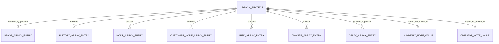

# 数据模型与实体关系（ERD）

版本：D0.24；日期：2026-09-30；状态：真实备份与 V1.050 源码字段反推已完成，服务器逻辑模型仍为候选；未创建表、未执行迁移。

本文分清三类来源：**B** 是真实 V1.044 备份中观察到的结构，**C** 是 V1.050 源码的读写或归一化结构，**T** 是服务器目标表达。旧系统是 JSON 与浏览器存储，下面的实体名称不代表旧系统已有 MySQL 表。字段反推完成的范围是本次备份与七个运行文件；不证明备份覆盖全部业务数据，也不替代剩余业务规则确认或可执行 DDL。

脱敏字段清单、计数及来源哈希见[字段核查证据](../evidence/2026-09-30-field-inventory.json)。代码位置均相对忽略目录 `source-review/AIGeekDashCX/geekdash-system-builder/releases/GeekDash1050/`，方便本地复核；真实内容不上传。业务行为正文只维护于[规格书](../specifications/specification.md)，待决索引见[决策](../decisions/decisions.md)。

## 1. 现有数据：实际容器与关系

### 1.1 备份顶层

| 容器/字段 | B 实测 | C 来源和解释 |
|---|---|---|
| version、appVersion、exportedAt | schema 2、V1.044、导出时间文本 | `projects-data.js:707～722` 构造备份头部；导出时间不是任何项目的创建时间 |
| projects | 27 项，每项 29 字段 | 项目对象聚合阶段、节点、风险等数组，没有数据库外键 |
| customers、engineers、productLines、apps、tags | 各 0 项 | 空库不代表项目未引用这些名称，也不证明此版没有资料功能 |
| groups | 3 项，id/name | 本次项目没有 group 字段，不能按分组库存在替项目补分组 |
| chips | 13 项，id/name/originalModel/manufacturer/firmwareVersion | 项目 chips 数组全空；不能把资料库全部芯片自动分配给项目 |
| company | fullName/shortName/manager/namePrefix | manager 是展示文字，不是认证身份或维护权限 |
| preferences | 12 个字符串键值 | 部分字符串内含 JSON；不是全部都属于个人页面偏好 |

备份共 13 个顶层键。V1.050 `buildBackupData` 仍导出这些容器。`validateBackupData:740～787` 能为缺失集合给默认值；原数据未修改，本轮没有通过该函数重写备份。

图中节点/风险/变更/延期及芯片统计备注部分由 C 证明，B 样本为空或缺失；纪要备注则 B 已有 27 项。客户、人员、产品线、APP、芯片和标签以**名称**联系项目，无法画成已经成立的 ID 外键。

### 1.2 项目：B 中全部 29 字段

来源为 B 全部项目键，与 C `project-detail.html:3197～3364` 的保存/新建对照。下表目标字段是逻辑映射，空串或占位符须保留原值并在审查时识别，不能悄悄补造成事实。

| 旧字段 | B 类型/数量 | T 映射与迁移限制 |
|---|---|---|
| id | integer，27 | 来源 ID → import_items.source_key；正式 projects.id 另生成 |
| name | string，27 | projects.name，保留名称原文 |
| customer | string，27 | projects.customer_id；8 个不同来源名称，而客户库为空，需人工确认资料映射 |
| productLine | string，27 | projects.product_line_id；14 个不同来源名称，产品线库为空 |
| odmFactory | string，27 | projects.odm_customer_id；非空名称 4 种，来自客户库的 ODM 候选或自由输入，不是独立供应商库的证据 |
| app | string，27；全空 | projects.app_id；源码允许已有 APP 名称及自由输入 |
| proposalDate | string，27；全空 | projects.proposed_on；DATE 可空，不用导入日补造 |
| filingDate | string，27；5 个日期文本 | projects.filed_on；其余为空，须校验日期而非只匹配文本形式 |
| startDate | string，27；全空 | projects.started_on；项目启动日，不等于阶段实际开始日 |
| dueDate | string，27；15 个日期文本 | projects.current_due_date；original_due_date 是否相同需人工核对，不能证明原始计划 |
| priority | string，27 | projects.priority；按 SPEC-018 解释，不转为风险等级 |
| signal | string，27 | projects.signal；人工灯色，见 SPEC-017 |
| signalNote | string，27 | projects.signal_note；灯色说明 |
| status | string，27 | projects.status；状态和阶段完成分别核对，见 SPEC-003 |
| marketExpectation | string，27 | projects.market_expectation；业务文字 |
| statusDesc | string，27 | projects.status_description；多行原文；不伪造描述更新人/时间 |
| hwOwner | string，27 | project_people.role=hardware_owner；业务人员，不等于登录账号负责人 |
| swOwner | string，27 | project_people.role=software_owner；同上 |
| pm | string，27 | project_people.role=pm；同上 |
| participants | string[]，共 76 项 | project_people.role=participant；13 个不同名称，人员资料库为空；不自动授予系统权限 |
| chips | array，全部空 | project_chips；有值时按名称建立映射，不能按现有库推断引用 |
| tags | array，全部空 | project_tags；有值时按名称映射 |
| stages | object[]，共 189 项 | project_stages；每项目 7 项，数组位置映射 S1～S7，详见下节 |
| nodes | array，全部空 | project_nodes.kind=project；C 支持，不可声称用户没有节点能力 |
| customerNodes | array，全部空 | project_nodes.kind=customer；客户节点与项目节点保留区别 |
| risks | array，全部空 | project_risks；C 字段见下节，处理规则待 Q-012 |
| changes | array，全部空 | project_changes；业务需求变更，非本系统发布日志 |
| statusHistory | object[]，共 162 项 | legacy_project_history；混合操作与状态文字，保留来源及顺序，不冒充可信审计 |
| lastCheckAt | integer，27 | 受控来源记录保留 legacy 时间戳；不生成可信 project_checks，理由见 SPEC-005 |

项目客户库为空但存在 8 种客户名称，工程师库为空但硬件/软件/参与者等字段有姓名。匹配只产生候选；不能根据同名自动认定人员身份、把业务 PM 变成负责人，或合并未经确认的资料。

### 1.3 C 中增加的 10 个项目字段

B 中均缺失。保存与新建来源同上；closeReason 另见 `project-detail.html:2083`。这不是断言所有 V1.050 项目都具有这些字段。

| 旧字段 | C 结构/用途 | T 映射或保留方式 |
|---|---|---|
| group | string，分组名称 | projects.group_id；不因 B 分组库有值而补填项目 |
| isProductionMaintenance | boolean | projects.maintenance_enabled；与结案组合见 SPEC-003 |
| statusDescUpdatedAt | 本地时间文本 | 保存来源文字；可验证后映射描述业务更新时间，不能作为服务器审计时间 |
| detailNote | string | projects.detail_note，与纪要备注及芯片统计备注分别保存 |
| delays | object[] | schedule_changes；实际日期调整与说明记录分开，原始日期待核对 |
| isDelayed | boolean | projects.manual_delayed；与自动逾期分别表达 |
| createdAt | 本地时间文本 | 保存来源创建时间，不伪造可信 created_by；服务器入库时间另记 |
| closeReason | string | 历史结案说明；closure_type 未提供，不能只凭字段存在判为某种结案 |
| flowLinks | 新建从草稿透传数组 | 所读当前连线操作实际写 nodes.prevId/nextId；此数组保留受控来源，不能假设已确定元素契约 |
| milestones | 新建从草稿透传数组 | C 有兼容归一化结构，但未发现所读页面调用该归一化器处理实际节点操作；保留原内容，不自动转成返工子项目 |

### 1.4 嵌套对象完整字段

C 来源：`projects-data.js:984～1105`。B 只有 stages 和 statusHistory 的对象可核对；其他数组为空，不能据源码声称存在真实样本。

| 结构 | B | C 字段及语义 | T 表达 |
|---|---|---|---|
| stages | 每项仅 days:string、done:boolean | days、done、note、doneDate、startDate、expectedEndDate；按七阶段位置对应，无对象 ID | planned_days、state、note、completed_on、started_on、expected_end_on；工期字符串先校验，不能无条件转数字；done=false 不证明已开始 |
| statusHistory | 每项 date/text，162 项 | date、text；归一化仅保留这两项，丢弃空 text 项 | legacy_project_history.source_date_text/body/source_sequence；保存原条目，不凭文字推断 actor |
| risks | 空 | id、content、level、createdAt、resolved、resolveMethod、resolvedAt | project_risks；解除标记与处理结果都保留，不从缺失解除时间反推未解除 |
| changes | 空 | id、source、content、status、reason、createdAt | project_changes；旧 status 原文映射目标 decision 的具体枚举待 Q-012 |
| delays | 缺失 | id、reason、newTargetDate、measures、createdAt | schedule_changes；无日期的说明仍保留，不制造改期次数或计划 |
| nodes | 空 | id、name、stage、stageId、targetDate、output、doneDate、prevId、nextId、x、y | 项目节点的阶段引用、成果、日期及位置；节点来源 ID 只在同项目映射 |
| customerNodes | 空 | id、name、targetDate、doneDate、note | 客户节点不强补阶段引用；note 不覆盖项目节点 output |
| milestones | 缺失 | id、stageId、name、startDate、expectedEndDate、actualEndDate、note、prevId、nextId、x、y、children | 兼容结构保留来源，映射和展示入口待核实 |
| milestones.children | 缺失 | id、name、startDate、expectedEndDate、actualEndDate、note | 源码支持这种兼容形状，不等于已确认增加子节点功能 |

连线实证：`project-detail.html:2532～2534/2648～2649` 渲染 nextId；`:2773～2809/2819～2820/2833～2839/2947～2951` 创建、删除和拖拽修改 prevId/nextId。目标首版应保留同项目节点引用，校验悬空/互不对应的来源边；是否允许环、分叉及节点驱动阶段尚待确认，不能利用数据模型擅自增加自动化。

七阶段 B 样本均缺少实际日期。导入已完成标记时保留完成事实和缺失日期说明，未完成部分的当前状态须人工核对；禁止用导入时间、自动计算工期或页面旧“进行中”文字补造实际开始/完成日期。

### 1.5 基础资料字典

来源：`data-manage.html:889～903/959～973/1046～1087/1213～1254/1282～1330/1449～1456`。id/name 在资料集合中使用正整数及名称校验，但项目使用名称，不是 ID 引用。

| 集合 | 字段（B/C） | T 关系与限制 |
|---|---|---|
| customers | C：id/name/tags/contact/background | customers + customer_tags；项目 customer 与 odmFactory 可分别引用同一客户库；ODM 候选为名称标签包含 ODM 的资料，也可自由输入；不是按 type 外键过滤 |
| engineers | C：id/name/role | engineers；role 是业务资料角色，不是账号权限；同一人可在 project_people 担任不同项目角色 |
| productLines | C：id/name | product_lines；项目多对一可空 |
| apps | C：id/name/version/desc | apps；version 为 APP 资料版本，不是项目并发 version |
| tags | C：id/name | tags + project_tags/customer_tags；名称数组存在自由输入，客户标签来源需核对 |
| groups | B/C：id/name | project_groups；项目多对一可空 |
| chips | B/C：id/name/originalModel/manufacturer/firmwareVersion | chips + project_chips；名称不是天然唯一标识；NFKC/大小写/空白归一化只辅助匹配，不默认合并资料 |
| company | B/C：fullName/shortName/manager/namePrefix | company_profile 单例；展示负责人不授予权限，namePrefix 是命名配置 |

`projects-data.js:514～522` 对旧 customer.type 转成 tags 后删除 type；这是兼容转换，不能据此为真实 B 备份补造字段。原始未知字段留在受控导入项，不直接采用旧归一化器丢弃字段。

### 1.6 浏览器状态与业务内容

V1.050 的备份白名单共 25 键，见 `projects-data.js:22～31`。下表为完整分类，键名均省略公共前缀 `hw_project_board_`；完整键及 B 是否出现见证据 JSON。

| 类别 | C 键 | T 归属及边界 |
|---|---|---|
| 个人显示 | theme、display_mode、meeting_float、zone_settings、activity_settings、filter_settings、filter_collapsed_default、welcome_dismissed、kb_auto_sync | user_preferences；旧来源不证明属于哪个登录用户，分配/默认使用边界待 Q-017 |
| 检查显示/规则 | check_mode、check_rule | check_mode 的个人显示与 check_rule 的公共业务设置分别处理；不能导入某浏览器值直接改写服务器公共规则；SPEC-019 |
| 纪要布局 | summary_order、summary_hidden、summary_sort、summary_show_note、summary_show_node | user_preferences 的对应 scope |
| 芯片统计布局 | chipstat_order、chipstat_hidden、chipstat_sort、chipstat_show_note、chipstat_show_node、chipstat_colvis | user_preferences 的对应 scope |
| 页面业务备注 | summary_notes、chipstat_notes | project_view_notes(project_id, view_kind)；两者都按项目 ID 存储，并不是按芯片名称存储；同项目两份备注互不覆盖，共享/权限细则待确认 |
| Bug/建议 | feedback | C `settings.html:631～664`：id/type/author/date/content；author 是手填文字，不是可信用户；保留来源，服务器 feedback_entries 的处理流程待确认 |

B 中 summary_notes 的 27 个键全部能对应 27 个项目的来源 ID；C `project-status-summary.html:545/618～620` 和 `chip-statistics.html:562/634～636` 分别证明两类备注按项目索引。迁移时先改成正式项目 ID，不按对象遍历顺序配对。

**旧备份的覆盖缺口：** `GeekDash.html:3972～3985` 的会议运行态位于 `hw_project_board_meeting`，结构为 status/startTime/elapsed/resumeAt/endTime（计时 elapsed 为毫秒）；该键不在上述白名单。IndexedDB 存 JSON/会议目录的文件句柄，也未导出；句柄是本机访问能力，不能移成服务器文件路径。浏览器草稿、返回上下文及已输出文件也不能凭这份 .bak 证明覆盖。服务器版完整备份要求见 SPEC-016；若需迁移这些额外内容，应另取真实来源并核对，不能把 13 个 JSON 容器当作覆盖一切的证据。

## 2. 服务器目标关系（T）

```mermaid
erDiagram
    USERS ||--o{ SESSIONS : owns
    USERS ||--o| SYSTEM_CONFIGURATION : maintains
    USERS ||--o{ USER_PREFERENCES : owns
    USERS ||--o{ PROJECT_DRAFTS : owns
    USERS ||--o{ AUDIT_LOG : acts
    USERS ||--o{ PROJECT_RESPONSIBILITIES : responsible
    PROJECTS ||--o{ PROJECT_RESPONSIBILITIES : managed_by
    USERS o|--o{ PROJECTS : created_by
    CUSTOMERS o|--o{ PROJECTS : commissions
    PROJECTS ||--o{ PROJECT_STAGES : contains
    PROJECTS ||--o{ PROJECT_NODES : contains
    PRODUCT_LINES o|--o{ PROJECTS : groups
    APPS o|--o{ PROJECTS : used_by
    PROJECT_GROUPS o|--o{ PROJECTS : groups
    CUSTOMERS o|--o{ PROJECTS : odm_factory
    PROJECTS ||--o{ LEGACY_PROJECT_HISTORY : preserves
    PROJECTS ||--o{ PROJECT_VIEW_NOTES : annotates
    PROJECTS ||--o{ PROJECT_TAGS : classified
    TAGS ||--o{ PROJECT_TAGS : referenced
    CUSTOMERS ||--o{ CUSTOMER_TAGS : classified
    TAGS ||--o{ CUSTOMER_TAGS : referenced
    PROJECTS ||--o{ PROJECT_PEOPLE : assigns
    ENGINEERS ||--o{ PROJECT_PEOPLE : participates
    PROJECTS ||--o{ PROJECT_CHIPS : uses
    CHIPS ||--o{ PROJECT_CHIPS : referenced
    PROJECTS ||--o{ PROJECT_STATUS_UPDATES : records
    PROJECTS ||--o{ PROJECT_RISKS : tracks
    PROJECTS ||--o{ PROJECT_CHANGES : records
    PROJECTS ||--o{ SCHEDULE_CHANGES : reschedules
    PROJECTS ||--o{ PROJECT_CHECKS : checks
    PROJECTS ||--o{ PROJECT_DRAFTS : drafts
    MEETINGS ||--o{ MEETING_PROJECTS : covers
    PROJECTS ||--o{ MEETING_PROJECTS : discussed
    USERS ||--o{ REPORTS : creates
    USERS ||--o{ IMPORT_BATCHES : imports
    USERS ||--o{ IMPORT_BATCHES : handles
    IMPORT_BATCHES ||--o{ IMPORT_ITEMS : stages
    USERS o|--o{ IMPORT_ITEMS : reviews
    PROJECTS o|--o{ IMPORT_ITEMS : targets
    USERS o|--o{ JOBS : requests
```

图中省略企业资料和部分运行实体以保持可读；第 1 节定义旧数据的完整迁移范围。报告快照不依赖项目日后的存活或名称，因此不强制画成实时项目外键。

## 3. 服务器目标字段（T）

| 实体 | 关键字段建议 | 约束和用途 |
|---|---|---|
| users | id、login_name、password_hash、display_name、enabled、version | 四个业务使用账号及一个额外维护账号；唯一维护账号由 system_configuration 指定，账号修改受版本保护；停用保留历史 |
| system_configuration | id、maintenance_user_id、version | 目标新增单例配置；唯一启用维护账号引用，换任原子替换；首批身份待用户指定，非旧备份实体 |
| sessions | id、token_hash、user_id、expires_at、revoked_at | 原始随机令牌仅在 Cookie；索引 user_id、expires_at |
| projects | id、name、customer_id、odm_customer_id、product_line_id、app_id、group_id、created_by、source_import_item_id、status、version、proposed_on、filed_on、started_on、priority、signal、signal_note、market_expectation、status_description、status_description_updated_at、detail_note、original_due_date、current_due_date、manual_delayed、closure_due_date、resume_status、pre_close_status、closure_type、closed_on、closure_note、remaining_work_note、maintenance_enabled、created_at、updated_at、deleted_at | 日期/生命周期见 SPEC-003/004；来源时间和服务器入库时间分开；version 原子递增；资料外键可空，但必须报告未映射来源 |
| project_responsibilities | project_id、user_id、joined_at | 项目与登录账号多对多、联合唯一；当前负责关系，加入/退出历史归审计；行为见 SPEC-014 |
| project_stages | id、project_id、stage_code、state、note、started_on、completed_on、expected_end_on、planned_days | project_id + stage_code 唯一；业务日期 DATE，可空不等于未开始/未完成；独立状态见 SPEC-003；旧 days 必须校验后转换 |
| project_nodes | id、project_id、kind、stage_id、title、target_date、completed_on、output、note、previous_node_id、next_node_id、position_json | kind 区分项目/客户；业务日期 DATE；项目节点引用同项目节点，客户节点不强补阶段/连线；原 x/y 保留；环/分叉待确认 |
| customers / engineers / product_lines / apps / project_groups / tags / chips | 第 1.5 节来源字段 + id、enabled、version、created_at、updated_at | 名称纠正保持 ID；引用与停用联动见 SPEC-006，来源自由名称先审查映射 |
| company_profile | id、full_name、short_name、manager_text、name_prefix、version | 单例企业展示及命名资料；不与唯一维护账号混淆 |
| project_tags / customer_tags | project_id 或 customer_id、tag_id | 联合唯一；保留来源标签，不静默把客户自由标签丢掉 |
| project_people | project_id、engineer_id、role | 相同项目/人员/角色不能重复；单负责人角色的数量需约束 |
| project_chips | project_id、chip_id | 联合唯一；迁移旧名称时建立映射 |
| project_status_updates | id、project_id、body、actor_id、created_at | 新系统明确保存描述的业务历史，身份和时间来自服务器；旧混合历史不强塞入本表 |
| legacy_project_history | id、project_id、source_import_item_id、source_sequence、source_date_text、body | 保留旧数组顺序、原时间文字及来源；不补 actor，不当作 audit_log |
| project_view_notes | project_id、view_kind、body、version、updated_by、updated_at | 项目 + view_kind 唯一；summary/chipstat 两份内容分开；旧作者未知，来源在导入项；目标权限待决 |
| project_risks | id、project_id、content、level、resolved、resolved_at、resolution、actor_id、created_at、source_key | 保留解除标记和处理结果；旧 createdAt/resolvedAt 另保留来源文本，不伪造服务器 actor |
| project_changes | id、project_id、source、content、decision、reason、actor_id、created_at、source_key | 旧状态原文及来源保留，目标 decision 枚举待讨论；不代替系统更新记录 |
| schedule_changes | id、project_id、kind、old_date、new_date、reason、measures、actor_id、created_at | kind 区分有效改期与补充说明；说明记录日期可空，改期记录具备有效目标；当前计划与记录同事务，纠错审计独立留痕，行为见 SPEC-004 |
| project_checks | id、project_id、actor_id、checked_at、conclusion、note、rule_version、observed_version、result_version | 追加记录；业务周期按 SPEC-005 解释；操作者及时间来自服务器，版本表达检查依据及后续更新 |
| audit_log | id、actor_id、action、entity_type、entity_id、before_json、after_json、request_id、created_at | 与业务同事务；历史保留显示名称；应用界面不提供无痕修改 |
| user_preferences | user_id、scope、value_json、updated_at | user_id + scope 唯一；只保存个人配置 |
| project_drafts | id、user_id、project_id、client_draft_id、base_version、payload_json、updated_at | 新建草稿 project_id 可空；同用户/草稿键唯一 |
| meetings | id、title、state、started_at、ended_at、elapsed_ms、resumed_at、minutes、created_by | 服务器持久计时状态；来源不在本备份，完整会议规格待 Q-012 |
| feedback_entries | id、type、author_text、reported_on、content、created_by、created_at、source_import_item_id | 旧手填作者与服务器身份分别记录；目标处理权限/流程待确认 |
| meeting_projects | meeting_id、project_id | 会议项目范围；是否固定讨论时快照待确认 |
| reports | id、created_by、scope_json、snapshot_json、data_version、status、artifact_ref、created_at | 固定所选范围和输出依据；结果下载需认证 |
| import_batches | id、source_hash、schema_version、mapping_json、result_json、created_by、current_handler_id、version、status、created_at | created_by 保留原上传账号；current_handler_id 初始为上传者，明确接管后记录处理人，version 保护接管及处理资格；保存进度和汇总结果，见 SPEC-009 |
| import_items | id、batch_id、source_key、target_project_id、expected_project_version、review_version、source_payload_json、corrected_payload_json、validation_json、selected_by、reviewed_by、reviewed_at、status、result_json | 待审原值与纠正值分开；审查版本防止覆盖待审修正；目标项目可空，新增提交成功后记录实际 ID；字段为目标候选；保存完整来源和未知兼容字段，物理类型尚未定稿 |
| jobs | id、type、requested_by、business_key、status、attempts、result_ref、error_code、created_at | 仅当确定异步任务时实施；business_key 用于必要的去重 |

project_responsibilities 是服务器新增授权关系，不等于原业务 PM、工程师及 project_people；不能按旧名称自动授予权限。新项目 created_by 来自登录账号；历史创建人未知时保留未知与来源，不能伪造。在线编辑心跳是短期运行态，首版不建持久业务表，不推进项目 version。

阶段模型增量（DEC-023）：started_on 为目标业务日期字段，不等于审计中的保存时间；业务日期精度已按 DEC-024 确认为 DATE，本轮已统一 started_on/completed_on 的逻辑命名。旧 done=false 不能证明阶段已开始，原备份缺失的实际日期不能根据旧页面“进行中”标签或导入时间伪造。迁移映射须将不确定项报告并确认；字段来源已对照第 1 节，剩余不确定项须经审查确认。

真实返工的最小数据表达：复用 audit_log 的动作及 before_json/after_json 记录来源阶段、目标阶段、原因和状态/日期变化，以 action 区分阶段回退与信息纠错；每次追加，历史可从项目中查看。不为这一入口先建返工子项目或独立工作流表。业务实际日期与审计时间分开，重做时本轮日期不得覆盖原轮次的历史事实；按 DEC-026，回退后目标及后续的当前有效实际日期为空，原日期保留审计；重新开始时写本次实际日期。阶段业务日期可空不能单独用于判断历史是否曾经开始或完成。

项目生命周期的目标字段增量：started_on/closed_on 为业务 DATE，resume_status 保存暂缓前提案/进行中状态，pre_close_status 保存结案前状态；从暂缓结案再重开时仍需保留 resume_status。closure_type 区分正常完成/中途终止，说明和遗留事项记录本次结案；再次重开及结案前的旧值写入追加审计，不能覆盖历史。本轮统一逻辑字段名，物理约束仍待迁移设计，动作规则唯一正文为 SPEC-003。

交期模型增量（DEC-030）：original_due_date/current_due_date 为可空 DATE，manual_delayed 独立保存旧人工标记；当前超期与天数按 SPEC-004 派生，不与人工值共用字段。closure_due_date 保存本次结案的有效计划快照，与 closed_on 推导历史结果；重开及再次结案的旧快照保留追加审计。schedule_changes.kind 区分改期和说明，方向由日期关系派生；逻辑映射见第 1 节，物理约束待迁移设计。本段定义数据表达，规则正文仅维护于 SPEC-004。

旧 dueDate 与 delays 不能机械映射成完整历史原始计划：dueDate 曾可直接编辑，末条记录也可能只有说明。迁移应保留原字段和记录，预检展示可证明的日期及不确定项，由人核对原始/当前计划；禁止用首次导入日期补造计划、按旧数组长度制造延期次数或把人工 isDelayed 转成自动超期事实。

检查数据表达按 DEC-031 补充；旧 lastCheckAt 只保留 legacy 来源，不伪造可信检查人。独立导入审查的 import_items 为服务器新增目标实体，不能冒充旧备份已有表；原始与修正内容、目标版本和提交结果支持 SPEC-009，待审数据持久化并纳入完整备份。来源 ID 仅用于映射，不能机械当作正式 ID。首次入库负责、待审权限及最后退出按 DEC-034/035/036 表达：保留上传账号与各动作身份，首次入库项目和提交者负责关系同事务建立，退出事务维护已确认前置；账号/全局维护资格及批次接管按 DEC-037～040 表达；交接资格由当前负责关系和 users.enabled 按 DEC-041 校验，不另存容易过期的“已交接”布尔值；公共检查规则的适用周、本周修订版本与追加历史按 SPEC-019/DEC-044 表达；批量部分成功按 DEC-033/SPEC-009，各待审项与正式结果同事务记录，批次汇总可由逐项结果得出；物理字段和状态枚举尚未锁定。

共享业务设置保存带 version、effective_from 的规则值及有效区间，规则修订的物理结构在未来默认范围确认后定稿；检查历史引用对应有效规则，不用浏览器本地配置覆盖公共设置。本周修改以当前自然周及服务器保存时间记录立即生效；保存原规则修订历史，已结束周保持规则快照。每周默认与仅本周覆盖如何存储仍待本轮问答，不能将 effective_from 固定为下一周一。原始上传人、当前处理人和实际提交者有不同数据职责；接管原因与处理人变更复用追加审计，不单独建立审批工作流。维护资格改为单例 maintenance_user_id 候选，不再由多个用户独立布尔标记授予；额外维护账号按 DEC-045 创建，不预建通用角色权限平台。

## 4. 来源保留与待决边界

第 1 节是唯一旧字段字典；目标建表不能仅凭本节实体存在就批准新增功能。以下仍需要下一步明确：

- 基础资料空库但存在名称引用：审查映射和新建资料授权按 SPEC-006/009；未知项在卡片中列出。
- 风险、需求变更和节点的处理完成标准、删除/纠错联动归 Q-012；兼容 milestones 与 flowLinks 原值受控保留，不能静默弃掉或改成新自动化。
- 纪要/芯片统计备注、会议、反馈及已输出文件的共享范围与操作权限待确认；不因它们原存 preferences 就全部变为个人偏好。
- 时间文本原时区、工期字符串、非连续阶段与缺失实际日期都应在迁移预检报告；没有证据时保持未知。
- 原始与未知内容只在受控 import_items.source_payload_json/批次来源保存，业务历史另提供可消费的 legacy_project_history；不公开原始客户数据到 docs/evidence。

## 5. 数据约束

1. ID 由服务器生成，API 对 ID 的序列化采用统一约定，避免 JavaScript 大整数精度问题。
2. 数据库存业务时间点使用统一 UTC；业务日期使用 DATE。业务日期展示与超期计算按 SPEC-004 已确认的 Asia/Shanghai 解释。
3. 当前逾期、当前阶段、整体进度优先由统一规则派生，避免多个字段互相矛盾。基于“今天”的结果必须随日期重新计算。
4. 业务记录和审计同事务；并发通过 project.version 条件更新。具体子对象冲突粒度先按项目统一，后续有证据再细化。
5. 基础资料有引用时优先停用，不级联删除项目历史。项目软删除不清除审计和报告快照。
6. JSON 用于偏好、审计差异、快照和流程位置等结构；常用筛选字段和关键关联使用列与关联表。
7. 核心索引候选：projects(status, deleted_at, updated_at)、project_stages/project_nodes 等子表的 project_id 索引、audit_log(entity_type, entity_id, created_at)。最终依实际查询和执行计划确定。

## 6. 旧数据迁移

旧 JSON → 校验 schema 和语义 ID → 基础资料映射 → 异常阶段/日期报告 → 独立卡片审查及纠正 → 选择通过项并确认保存 → 事务写入 → 新请求读取并对账 → 看板、详情和导出核对。

人员和芯片原本按名称引用，必须保存来源名称与映射结果。无法确定的引用进入待处理清单，不自动丢弃。旧历史的操作人或时间无法可靠证明时标记为 legacy/来源时间，不伪造为当前账号操作。

本文不提供可直接执行的 DDL。字段来源反推已完成；待 Q-007/012/016/017 等剩余关键语义与映射明确后生成版本化迁移文件，并执行升级与恢复演练。
