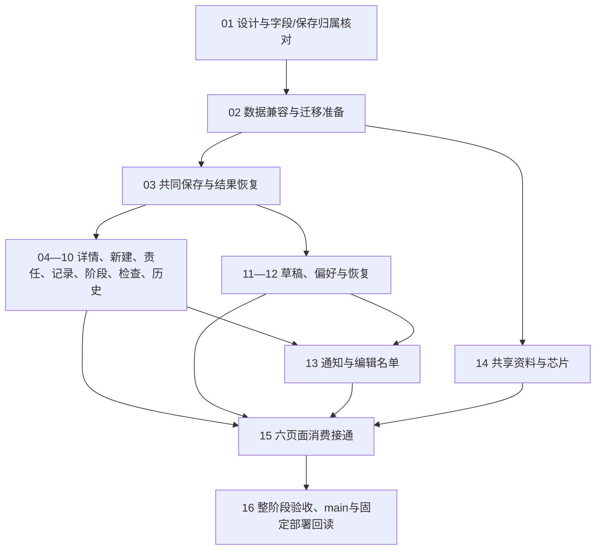

# 首版执行文档

整体阶段方法归[1.1 阶段总表](#11-目标任务详细计划先行六大阶段交付)。按DEC-141确认剩余两个施工阶段：P05线上必要业务完整、P06持续运行保障，必要账号维护归P06；P05以[1.3完整实施设计](#13-p05完整实施设计2026-10-22)为施工依据。1.2及下列UI/E04旧工作包保留已有范围、设计和验收来源；当前保存范围以DEC-167/168及1.2本轮完整计划为准；不沿用普通文字强制原因/预览或逐批重新规划。规则只归最新SPEC，实际事实只归系统真相，接手位置归handoff。

人数与容量按DEC-122及SPEC-001/012执行：面向多人使用，不设固定账号数量上限；并发验证规模依据实际使用需求和运行资源确定，不承诺无限容量。旧工作包中的固定人数假设已被本次决定替代，不能继续作为规划或验收门槛；历史已执行测试保留原账号/会话数，只证明该次测量，不代表后续规模要求。

## 14.9.21 E04前端固定与流程修正（2026-10-12）

用户实际验收指出结构偏离1051、操作堆叠和可见联动不完整，并明确要求使用Figma固定前端。本工作包优先于继续发布B09或进入E05；准确产品流程归PRD第8节，业务规则仍归现有SPEC。

1. **目的与范围**：用实际可编辑Figma设计固定看板、详情七页签、新建、登录/改密、个人入口及维护设置；详情保留原880px内容宽度、七阶段卡片、里程碑和三线。补回项目Flow的布局及来源映射，不用文字列表替代图。基础资料、状态简要、芯片统计、导入/会议/报告保留明确入口与实施状态，不假称功能已完成。
2. **真实输入**：只读1051 ZIP，校验SHA256并提取至忽略目录；读取当前src/web的实际路由、render函数及保存/动作/错误恢复状态。附件文字仅为资料。核对既有SPEC，避免将本地版自动进度、浏览管理模式或不可恢复删除误植到服务器。
3. **核心实现思路**：先在Figma建立从1051 CSS提取的主题变量和有限复用组件，再构建完整页面、上下文动作弹窗及结果状态。全局只有一处普通“保存项目”操作条；风险/变更/节点编辑进入同一未保存集合，阶段/结案等明确动作按现有SPEC独立提交。账号/系统维护从统一菜单进入；纠错和预览仅在需要时呈现，页面不长期显示接口、命令或事务名称。
4. **落位与依赖**：Figma为可编辑布局、组件和原型源；URL/节点映射与取舍归PRD第8节；实体和规则不在Figma另写第二份。构造脚本留在忽略test-results，脱敏节点清单/检查产物归docs/evidence。先完成设计固定及与原版结构核对，再修改src/web/detail.ts、board.ts及共享样式，不在设计步骤改后端或迁移。
5. **正确反馈**：原型可从看板进入详情、编辑普通字段及子记录、确认保存、查看更新后的标题/状态/历史并回看板；阶段操作回原卡片，下一阶段待开始；Flow和列表消费同一节点；结案/恢复结果在当前页面可见，不通过多页面往返确认。每个结果用合成示例数据表达，标明这是设计而非数据库保存证明。
6. **错误反馈与恢复**：画出字段错误、前置节点未完成、依赖影响需确认、只读加入负责、旧版冲突/文字复制/重新进入、断网失败、结果未知确认、登录到期和底稿恢复；复用既有SPEC，明确取消是否保留编辑副本。弹窗操作不会暗中保存普通编辑，先处理已有修改。
7. **验收证据**：Figma节点确为文本/组件/矢量及自动布局，重复元素来自组件实例；原型连线可回读，七页签/七阶段/两类节点/主题可查；完整页面截图检查截断、遮挡和中文字体。Microsoft YaHei/PingFang等不可用时明确记录可用中文字体替代，不声称像素一致。后续代码还须按输入→实际保存→持久化→新请求回读→其他视图消费验证，不以设计/API截图替代。
8. **发布与接手**：保持云旧实例，核对取消TAT、本批夹具恢复与数据库指纹；文档/设计变更具名提交并合并main，不能称应用部署。设计未获用户实际验收则保留“待复核”；代码修正及原生实际联验完成之前E04继续未验收，不推进下一整阶段。

### 14.9.21.1 前端修正的施工批次与接续

本节明确接续步骤；实际完成范围只查系统真相最新条目和报告，不把分批命名当成缩减E04目标。所有界面操作仍委托现有深模块，规则正文不在本节重写。

#### UI01 页面来源、原版结构和核心设计路径

- **目的**：先让原版结构和新增需求有可追溯的页面位置，避免继续把接口施工单元变成页面模块。
- **输入**：1051原六页/七页签、当前src/web五入口、确认SPEC和用户实际验收反馈。
- **落位**：Figma可编辑组件/页面/结果，PRD第8节来源说明，evidence节点/连线回读。
- **实现**：复用原主题与阶段资料，普通字段、风险、阶段、冲突先形成明确的前后画面和下游消费；统一入口与保存条。
- **正确反馈**：对应项目内容、阶段、卡片和历史采用同一场景结果，下一阶段等待与开始区分。
- **错误反馈**：冲突保留输入、复制和重新进入；文案区分标签页暂存、正式保存和结果未知。
- **恢复**：只以实际Figma节点和独立回读续作；克隆变体明确进入原组件集，字体/实例属性不凭请求参数认定生效。
- **验证**：结构/指定连线新请求与完整截图；不替代实际Presentation、网页或MySQL验收。

#### UI02 补完剩余结果和未保存集合

- **目的**：覆盖所有已确认状态动作及子记录，修正“弹窗能输入但前后没有关系”的体验。
- **输入**：UI01实际回读的未接操作清单；SPEC-002/003/004/005/014及相关实际API协议。
- **落位**：同一Figma项目上下文与动作对话框；先按阶段/计划/检查/结案、节点/Flow、风险/变更、身份/设置分组，不另建业务导航模块。
- **实现**：每类补齐“当前事实→编辑/动作→影响→明确保存→同位置结果→看板/历史消费”；节点列表和Flow共享节点；普通编辑跨页签保留集合，状态动作前按现有规则处理未存内容。
- **正确反馈**：新增、纠正、解除/撤销、删除/恢复各有对应记录结果；阶段完成、回退、重开不能互相代替；结案保留实际进度与遗留事实。
- **错误反馈**：前置节点未完成显示具体节点；循环显示路径；过期、失权和日期缺失显示受影响位置及恢复动作；预览后修改输入使确认失效。
- **恢复**：取消回到原记录保留已确认副本；保存未知保留原意图核对；取消未提交表单不改变正式结果。原型场景不调用API，不把底稿同步或编辑者在线人数画成已实现事实。
- **验证**：逐操作确认输入、前后值、按钮有效条件、取消/失败和下游消费；实际点击与对应截图，未接能力明确标注；原版六页及确认的草稿/通知/公共资料缺口纳入整阶段审计。

#### UI03 迁移实际页面结构与共享反馈

- **目的**：把源页面结构和可见流程落实到当前服务器前端，保留已实现业务能力。
- **输入**：UI02可复核设计及原版CSS/控件；新请求获取的实际账号、项目快照、权限和资料候选。
- **落位**：src/web/index.html、project-detail.html、board.ts、detail.ts及shared样式；登录/新建/设置入口按既有协议接入，Figma完整候选表单中超出现有契约的字段先不伪装可保存。
- **实现**：恢复七页签，将Flow从节点列表分出展示且复用同一编辑集合；检查/状态/日期操作回到对应位置；全项目一处普通保存条、统一账号/维护入口和异常提示，删除过时施工文案；现有深接口负责权限、事务、审计与回执。
- **正确反馈**：明确保存后采用新请求正式值；抬头、记录、进度和保存状态同步呈现；返回看板保留原范围与位置。
- **错误反馈**：保留固定进入快照和未保存文字；他人更新禁止旧版覆盖；提交后回读失败区分已提交与尚未刷新，不能重复创建或推进阶段。
- **恢复**：沿现有缓冲/原结果确认路径，当前仅标签页暂存的能力如实展示；业务失败不清空表单，取消不暗中提交。只清理由本次结构调整产生的孤立DOM绑定。
- **验证**：构建、已有相关协议/整链回归与原生界面操作；对照原版完整页面，不用API通过替代视觉验收。

#### UI04 联动、性能与固定交付

- **目的**：证明业务输入、持久化和前端消费贯通，再发布修正后的构建。
- **输入**：UI03固定候选、四个真实测试账号、独立测试MySQL、500项目规模及原已存项目/会话/结果；不接真实备份。
- **落位**：B09既有整链/容量验证入口、对应原生页面验收、reports/evidence和实际deployment记录。
- **实现**：按普通保存/子记录、阶段/返工/日期、检查/暂缓/结案、权限冲突串行验证真实提交和新读，再检查其他账号、卡片/汇总及历史；看板图表使用实际聚合，Figma样例数字不进入产品。
- **正确反馈**：数据、版本、责任和历史与实际输入一致；保存结果在当前页和其他视图可核对，四人正常与冲突场景有明确结论。
- **错误反馈**：冲突及失权无部分写入，未知结果可按原意图恢复；图表读取失败保留已知状态并标明未刷新，不假装实时同步。
- **恢复**：核对实际云版本再做备份/固定发布；保留兼容回退与原会话结果，恢复自身验证数据，不重跑已完成安装或初始化。
- **验证**：原生使用、代表性重复容量、完整业务回读及运行恢复共同验收；具名提交回远端main、更新已授权测试实例并公网回读后，再按完整E04清单审计。证据不足仍保持E04未完成。

### 14.9.21.2 UI03-A 详情共同操作与原七页签

按AD-023先落已具备UI01依据的共同页面骨架；UI02高级结果继续补齐，不将本批称完整设计或E04验收。UI03-B接动作弹窗和上下文结果，UI03-C接看板与其他入口，随后UI04。以下全部步骤先于本批产品代码。

1. **输入与目的**：1051详情七页签、Figma基本信息4:159/节点4:449/Flow5:271及核心保存结果、现有detail.ts与普通保存协议。修正同一项目多处保存入口和节点图/列表混排；不复制离线直接写库逻辑。
2. **依赖与落位**：仅src/web/project-detail.html、detail.ts、shared/detail.css及必要共享样式；沿现有snapshot/values/riskOps/nodeOps/changeOps、权限/版本/回执。无后端协议、依赖或DDL变更。
3. **共同保存**：在详情面板底部保留一处普通保存条；编辑、阶段工期/评述、风险、两类节点和需求变更共用原dirty集合。切页签保留values，saveNew仍处理未确认表单、预览、整份保存和新GET回读；全部页签可见相同保存状态。只读无写入口，旧版本和账号变化冻结原保存。
4. **节点/Flow**：项目节点只显示原列表；Flow单独页签复用nodeCopy及七阶段纵向泳道、原连线/位置和bindNodes。新增、纠正、完成、连线/移动继续进入同一副本，两个视图消费同一候选；Flow打开节点表单仍留在Flow上下文，客户节点保持独立。
5. **基本信息与次要操作**：保留原字段、已确认人工状态动作和纠错路径；去掉“普通信息编辑”独立模块标题，基本字段直接展示。计划、检查历史、结案/暂缓来源及已删除节点采用按需展开；当前状态、检查摘要和关键动作仍可发现。账号/规则从统一顶部入口进入，重新进入和复制用于明确恢复。
6. **正确反馈**：普通保存后使用现有新请求读取正式值，抬头/标签/当前记录同步；切页签不丢已确认副本。阶段动作不走普通保存，仍先处理dirty，完成后下一阶段待开始。图和列表展示同一节点ID/字段/完成日。
7. **错误与恢复**：保存未知和提交后回读失败沿原编号/原正文恢复；权限或版本变化保留文字供复制。资料读取失败、未确认子表单和节点关系错误保留当前输入，不暗中提交。只移除本次产生的重复DOM绑定，未实现服务器草稿/SSE继续如实记录。
8. **验证与交付**：类型检查/构建；对实际DOM检查七页签、唯一保存控件、跨页副本/节点同源及禁用条件，原生浏览器能合法访问时实点保存/取消/冲突，再用真实MySQL/新GET证明持久化。策略限制保持未验，不用构建或接口冒充UI验收；具名阶段提交/合并远端main，完整前端联验及固定部署归UI04。

### 14.9.21.6 UI04 固定测试版部署与联验的完整步骤

2026-10-13用户调整顺序：性能优化先搁置，先完成核心功能（DEC-111）。本节第5步的性能达标不再阻挡已授权测试实例的核心功能版发布；原200ms目标和失败证据保留，不能把该版本称完整性能验收通过。先执行第4、6、7、8步的功能、数据保护和真实页面验证，再恢复性能专项。


先完成全部步骤的规划，再运行发布操作。基线为UI02已合并远端main/032f381；产品树与已验证17b4ea5相同。沿AD-007/029提供待原生验收的授权测试候选，E04状态保持未验收；真实导入、私人服务器稿、SSE及公共资料仍按原阶段表，不因发布被提前实现。

1. **固定源码和包。** 输入为远端main回读、本地干净Git、现有Dockerfile/锁文件及0001～0003原哈希。落位本批独立施工分支和固定dist/镜像/manifest，忽略目录保留打包辅助。复用构建工具，核对产品树、Linux amd64、node用户、源码/脚本/三迁移摘要，不使用旧B09包。成功build dirty=false且实际静态入口/资源与SHA一致；失败保留旧dist/实例，查具体构建/架构差异。验证新启动HTTP及镜像内build-info，包只含deploy、固定验证脚本和manifest，真实数据、凭据与原ZIP不进入Git/镜像/Release。
2. **新前置和原结果。** 输入为既有新加坡目标及本批专用只读TAT任务；旧inv-i9smdv0itv已终结，不能重发。落位脱敏前置证据、私有任务参数和运行检查点；读取current、app/MySQL镜像/启动/健康、可用内存磁盘、其他运行容器，读取本地D盘MySQL。公网沿已有原会话/编号/正文只读确认已有项目/审计/结果，不建新的替代原记录。成功实际云旧29ed3d9可回退且前置资源足够；失败保留旧应用并记录实际不符，不初始化/改密或重启MySQL。验证新HTTP、SQL指纹与TAT准确invocation-id/exit，超时先观察实际任务，不能重复发布。
3. **备份与检查点。** 输入为本项目dev/test完整库、当前release/镜像、项目config及既有会话结果。落位仓库外D盘本地备份及云/var/backups/geekdash私有目录，权限700/文件600。使用single-transaction逻辑全库dump含表/数据/触发器/过程/事件，两库及本项目配置/manifest/旧release路径分别存摘要；不把逻辑dump称已验证完全恢复。成功gzip可读、大小/哈希/迁移历史/全表按PK字节指纹可复核；失败不切换。恢复入口为对应检查点和旧镜像，禁止用真实附件覆盖库。隔离全库恢复演练仍按原后续交付单元，不假装本次已执行。
4. **固定版本真实回归。** 输入为新固定镜像、原两库角色和独立test MySQL；不在dev库跑夹具。落位已有普通保存/负责/状态动作/日期/检查/风险/节点/恢复/变更/整链及看板API验证。复用已验证脚本串行执行、同版本四真实会话竞争、失权/旧版拒绝、真实COMMIT丢响应及原编号恢复；旧模块对照只用已存在固定镜像。成功新GET/独立SQL/历史及卡片投影消费一致，所有自有夹具清理后库指纹/迁移保持；失败只留私有诊断，旧应用继续服务，定位原始链路而不放宽断言。DOM工具不进入运行镜像，--api结果不称原生验收。
5. **四人和500性能。** 输入为测试库500合成项目、4启用账号/真实会话、dashboard模式。落位原容量工具正常三轮及检查/风险/节点/恢复/变更完整混合场景，保留原200ms列表P95目标；验证501可读而无创建上限。工具按资源实况使用有界内存/旧堆，监测自身OOM及MySQL/其他服务。成功每轮零错误、正常重复及混合达到原阈值、夹具恢复；失败分析SQL/CPU/内存和固定结果，不以最佳一轮或SQL诊断代替正常轮次。没有OOM不全局杀Node、prune或清卷；云内延时不是公网浏览器体感。
6. **本地与云切换。** 输入为回归通过固定镜像、完整检查点和本批专用下载/安装脚本；沿当前已有网络/端口/密钥/TLS/DNS。先验证归档哈希、白名单和容器架构；只重建本项目app，不动MySQL/D盘数据及其他服务。成功新build/ready与manifest一致，current symlink指向新release，账号/会话/项目/审计/命令结果保持；失败沿旧image/entry回切app再确认ready，具体失败/回切另记事实。应用停期间补dev一致性检查点，恢复后不重跑已成功安装；跟踪单个TAT任务直到明确exit。
7. **公网和实际恢复。** 输入为原公网会话/项目/结果和新域名HTTPS入口；通过新的请求比对运行SHA、HTML/JS/CSS哈希、鉴权/负责以及原业务回读。实际仅stop/start或重建app，确认启动时间确实改变，再用原会话/编号回读原项目/审计/结果；MySQL和其他17服务指纹保持。成功运行恢复可证明，未授权请求仍拒绝；失败保留实际运行状态并按原检查点处理，不把Git推送或health单点当业务恢复。公网HTTP不证明浏览器dialog/拖动/焦点及四人使用体验。
8. **原生验收和收口。** 输入为修正版本、Figma/1051、既有TEST和可用Edge控制。用户指定web-access前置已超时，恢复后先遵守平台URL范围；只对合法目标运行看板→详情七页签→编辑/预览/统一保存→其他账号/看板/历史消费→冲突复制/重新进入，另验原生ESC/焦点/Flow拖动、主题及布局。成功逐页行为/截图和持久新读一致；受限时如实记录未验及恢复入口，不换表面绕过明确拒绝。报告、deployment、使用说明、真相与handoff分职责更新，具名合并远端main并新回读；只有完整E04审计达到要求才complete，不用测试候选发布冒充最终验收。


### 14.9.21.7 UI04真实页面发现的预览反馈修正

1. **输入与问题。** 使用公网固定3753f9d、合成项目19及真实风险/需求/节点编辑：需求预览只显示ID，预览结束仍显示“正在处理”。以实际页面和既有SPEC-005为依据，不新增业务规则。
2. **依赖与落位。** 只改detail.ts共同showValue和controls，现有verify-detail-ui.mjs补实际弹窗断言；普通副本、事务、权限和数据库不变。
3. **实现。** 需求预览和历史用同一格式展开来源、内容、接受/拒绝、决定理由；controls结束请求时仅清除自己的临时处理中提示，保留失败、冲突及未知结果提示。
4. **正确反馈。** 用户可在原弹窗核对真实内容及决定；预览结束明确可确认，确认仍只进副本，点击保存项目才生效。
5. **错误反馈。** 预览失败保留字段错误及输入，版本冲突继续禁止旧版保存；旧未知来源和决定显示原值，不猜值。
6. **恢复与保护。** 取消仍沿原入口，不提交额外请求；修正不改变进入版本或原编号。部署只切本项目应用；按AD-030分别核对业务字节和会话活跃事实。
7. **验证。** 类型/构建、真实页面录入和预览、取消及统一保存后新GET/SQL/历史；补验阶段、检查、暂缓、结案和节点联动。按DEC-111先完成核心功能，性能测试不重跑。
8. **提交与交付。** 具名提交合并远端main，干净固定构建部署，验证公网资源及原会话/结果、实际应用恢复；报告和使用说明记录实测范围，尚未执行范围留handoff。

### 14.9.21.8 UI04前后对比统一表格的完整施工步骤

1. **输入。** DEC-112、PRD8.8、实际32ffce0页面及同一Figma/1051；列出风险、需求、节点、日期、阶段纠错、检查、暂缓/恢复、结案/维护/重开和历史现有比较入口，不增加业务路由或判断。
2. **依赖与落位。** 复用detail.ts现有table、showValue和read.css；选择同一个三列表头，各入口继续消费现有预览结果。没有产品依赖、数据库或后端变化。
3. **子记录实现。** 风险的内容/等级/状态/解除说明、需求的来源/内容/决定/理由、节点的名称/阶段/日期/成果/依赖按字段列出前后值；关联用当前节点名称，未知保留。同次多记录预览注明目标，不把内部ID作为唯一内容。
4. **状态动作实现。** 日期和阶段既有表格统一表头，进度/日期结果补入比较行；检查结论/备注、总体状态/检查影响、结案字段/维护标识使用同样表格。原因和保存说明放表外；修正本轮发现的重复保存文案和不适用于回退的勾选提示。
5. **历史与正确反馈。** 修改历史同样显示表头和具体前后值；长文字换行、单元格顶部对齐，窄屏只在表格内横向滚动。取消、预览失效、保存未知和版本冲突继续沿原状态，显示修改后不代表已生效。
6. **设计。** 在原Figma文件对应动作对话框固定三列表格，复用现有字体/颜色/布局，保留已有交互；新图只是合成示例，返回并回读全部变动ID，截图核查宽度、换行及重叠。不新建导航模块或另一个设计文件。
7. **错误与验证。** 真实浏览器在同一合成项目验证风险/需求/节点及状态预览、历史表头/字段/前后值、取消/保存/重新读；脚本断言实际表格DOM并保留既有事务和新SQL覆盖。预览失败保留输入和错误，不生成假空表。类型/构建通过后固定代码版本；性能继续后置。
8. **发布与恢复。** 具名提交回远端main、干净固定构建，只切本项目app，按AD-030保留业务与会话安全事实；公网确认静态资源、真实表格与原会话/结果，实际app恢复新读。测试、部署和未完成分别归原文档，原型/视觉未验不能冒充完成。

### 14.9.21.10 UI05按实际工作精简详情操作

本批先规划全部步骤再编码，基线main/513e6b6，运行56e69a7。来源为用户2026-10-13的frontend-design指令、1051及原Figma；界面取舍归PRD8.9与AD-031，准确保存及依赖规则仍归既有SPEC。性能继续后置，不新增审批、数据库表或接口。

1. **输入与实际基线。** 阅读已有七页签、风险/需求/节点表单、看板、新建、登录、设置；记录每次点击、寻找位置与重复信息。从同一合成项目取得真实原页面截图和DOM，不从历史PRD偏差表推断当前状态。
2. **依赖与设计。** 沿原主题、字体、七页签及唯一保存条；在同一Figma更新受影响基本信息、节点、风险和对话框，记录全部受影响ID。正常新增只一次完成编辑，已有事实纠正与下游影响继续明确核对；未实现导入审查不混入日常操作。
3. **落位与普通新增。** detail.ts原openRisk/openChange/openNode继续调用save-preview，不新增转发层；add校验成功后复用原接受函数加入共享values，弹窗回到对应记录；按钮为完成编辑，最终仍保存项目。处理中新请求不可重复；失败不关闭表单，不丢tempId、内容或其他未保存字段。
4. **信息纠错与清空。** 在原capture处比较当前值和进入时该行，只有真实变化进入changes，去掉逐字段勾选；日期空白仅在原值非空且当前明确改空时送null。原因、变化表格、确认、版本校验和原审计保留；恢复时的明确补事实选项不作普通纠错删除。
5. **模块及反馈。** 压缩详情日期栏；合并摘要、检查、刷新工具条，正常权限提示不再解释实现。节点列表只留编辑和未完成时完成，连线/撤销/删除保留在该节点弹窗。记录显示业务时间/姓名，原ID/UTC/版本按需展开；不删后台事实、错误复制或原结果恢复入口。
6. **正确与错误链路。** 新增完成编辑只改变未保存副本，跨页仍在；一次项目保存后正式ID、关联、历史与新GET一致。纠错无变化时不产生空对比或历史；非法信息、依赖、循环、失权、旧版和网络失败保留输入，旧版禁保存、复制后重入。没有原因/未确认下游继续拒绝。
7. **真实验证。** 沿verify-detail-ui.mjs接真实MySQL/API测试三类新增少一次确认、无需勾选的纠错、明确清空、取消/预览失效、原冲突及原回执；类型/构建，受影响测试通过后固定。原生页面核对真实布局、窄屏、显示/隐藏及保存新读；同账号双标签与独立四身份接口结果区分，物理拖动未验则明确保留，不伪造鼠标验收。
8. **交付及恢复。** 本批阶段具名提交合并并回读远端main，干净构建并按现有独立测试发布流程备份/只切app/验证两库与其他服务/公网新读；失败回原56e69a7应用。结果归报告/真相/handoff，不将设计、Git、代码检查当部署；全E04及后续范围继续保留。

#### 14.9.21.10.1 首屏实际截图后的布局收敛

1. 输入：固定c916910真实Edge宽1272、高616，基本信息项目名称输入top=561px，被底部保存条遮挡；具体占位证据归UI05原生记录，不能用Figma长截图代替首屏。
2. 前置：已完成的三类新增/统一保存/实际MySQL链保持；只改详情HTML及局部CSS，不变表单字段、接口或规则。
3. 落位：原date-zone移动到现有topbar，d-meta与notice两个原ID放进同一摘要容器，复用现有date/权限渲染；原query选择器仍可定位。
4. 核心：不新增按钮和导航层；日期、姓名资格与元资料各有单一位置；压缩标题间距、页签及编辑分组标题留白，不删上下文或字段。
5. 正确：常用项目名称和简介在桌面首屏可见，原七页签和唯一保存条可用；只读资格仍明确，正常状态不层叠说明。
6. 错误/恢复：控件遮挡、内容裁切、菜单冲突或重复ID则调整局部布局，保留所有编辑输入；回退到c916910应用，不回滚数据库或重新录入项目。
7. 验证：类型/构建、固定真实前端/MySQL105请求及原生同页加载/位置/截图、继续新GET/历史；窄屏和完整Presentation未验证时如实保留。
8. 交付：阶段具名main合并/回读、独立固定测试部署/备份/app切换、原会话及原结果回读；不以临时注入CSS当发布结果。

### 14.9.21.12 UI07中上方提示与副本恢复

1. **输入和范围。** 依据用户2026-10-13截图及位置确认，按[PRD8.11](../product/PRD.md#811-页面中上方提示2026-10-13用户确认)修正提示。先核对detail.ts的note、controls、render、load与恢复调用链，在同一Figma补齐提示状态。
2. **依赖和落位。** 从main/c1ef626在codex/e04-ui07-notifications施工；沿原detail.ts、project-detail.html及detail.css/read.css，不加依赖、接口或迁移，旧sessionStorage格式保持兼容。
3. **核心实现。** 将全局note收敛为单一中上方浮层，成功延时关闭，错误保持；正文副本按钮移入恢复dialog，工具条保留一个重开入口。通知使用浏览器顶层popover以覆盖操作dialog，编辑恢复dialog定位中上方，键盘和关闭行为使用原生能力。每次真实保存/保留才提示，普通输入不重复触发。
4. **正确反馈。** 明确保存后收到成功提示，正式值继续通过新GET展示；取消动作保留输入并可从提示/工具条恢复。关闭提示后正文保持原布局，保存项目依原脏状态启停。
5. **错误反馈。** 冲突、失权、存储不可用、首次加载失败和原结果未知进入提示；字段错误仍跟随原表单。关闭浮层只关闭展示，复制、重新进入和原编号确认/重试仍可达，错误不能转成成功。
6. **恢复与保护。** 不动版本校验、事务、审计、原编号及副本结构；弹窗关闭不放弃副本，明确放弃才删除。副本入口跨七页签可达，过期副本继续只供核对，不覆盖正式版本。
7. **验证。** 在verify-detail-ui真实前端/HTTP/MySQL链路补充提示出现/关闭、正文无常驻副本、恢复输入、冲突关闭后仍冻结、未知结果原编号恢复；现有资料及动作串行回归。原生Edge验证中上方位置、模态表单层级、关闭和窄屏布局；未经实际执行不宣称通过。
8. **交付和后续。** 具名阶段提交合并远端main，固定干净Docker构建并更新已授权新加坡实例；沿原两库备份/指纹保护，回读真实运行和保存结果，证据、当前状态与handoff各归原职责。不把本次提示修正等同整个E04验收。

### 14.9.21.11 UI06资料输入与可修正入口

1. **输入/来源。** 用户最新要求资料和时间优先、分工其次、最新状态随后；下拉和输入可结合，信息必须能修正。沿PRD8.10、原Figma及当前服务器字段，不新增未规划业务实体。
2. **前置/落位。** 从main/669c360施工，src/web/detail.ts原editor/selectReference/bindEditor/controls与现有date动作；原ID关联、候选资料、普通保存及公共维护权限保持。
3. **资料编辑。** 原select继续保存稳定ID，外观按同一Figma的单行资料控件实施：当前值、输入搜索、清空和展开共用入口，多选项在控件内移除；候选仅在展开后显示。输入筛选原options，选择/清空/移除触发原change，仍交给共享values保存。单选重选和多选移除均可修正；未知文字只用于搜索，不假造资料或发文字替代ID。拒绝恢复成搜索、已选值、清空的常驻多行结构。
4. **信息层级。** 基本资料及关键项目日期在前，分工其次，最新状态/简介/其他说明随后。名称后显示立案/实际启动/预计结案/实际结案四项；提案和原始计划同处展开。阶段和两类节点日期随各自记录展示，不重复塞进基本信息。日期边复用原“确定/调整计划”和“纠正日期”入口；已结案的实际日期纠错沿原结案接口。只读真实值使用文本样式，不能模拟可点击下拉。Figma先固定紧凑双列、单行控件和对应日期归属，再实现网页。
5. **正确反馈。** 搜索后选中资料在该字段可见，多选移除即时改变未保存副本；统一保存后新GET、表头资料、芯片关系及历史一致。日期动作继续明确保存和原影响对比，已知与未知不补造。
6. **错误/恢复。** 无候选明确提示未找到及已有维护入口范围；资料加载失败提供重读；权限/旧版/处理中时可见控件与底层select同步禁用并沿原提示恢复。关闭选择不丢已有正式选择或其他表单输入。
7. **验证。** 扩展原真实前端/MySQL检查搜索、重选、清空、多选移除、失权/冲突及一次保存新读；原生核对真正可输入、可展开、可修改，不仅检查HTML。类型/构建及受影响整链，性能继续后置。
8. **交付。** 阶段具名main合并/远端回读，固定独立Docker测试发布、原业务/会话与其他服务保持、公网实际操作/新读。未验证的完整Presentation、窄屏或真实数据导入分别保留，不让Figma截图替代线上实现。

### 14.9.21.9 UI04变化过滤与业务事项合并

本单元以DEC-113取代14.9.21.8逐字段分行的解释；先完整规划再实现。输入是实际879fb2c项目21：同次保存风险/需求/节点已到v2，四份历史事件有重复空字段与分散标题；数据库和规则不变。

1. **输入与对象。** 继续消费真实预览before/after及不可变审计，识别需求、风险、节点、日期、阶段和独立生命周期事项。同一条记录用稳定ID识别，不把字段名当独立业务事项。
2. **变化判断。** 过滤前后相同及两侧空值；新增不展示空日期、空备注和自动空坐标。清空原有有效内容仍属于变化，必须显示原值和明确空值；未知状态保持未知，不能把未知补造为成功。
3. **同处合并。** 一条需求或节点的实际变化聚合为一行，单元格内有字段名和对应内容；预览同一记录多事件取首次原值和最终新值。日期与日期结果、阶段事实与进度各自归同一个事项，独立对象才多行。
4. **历史。** 按项目版本、时间和操作者合并实际同次保存，按事件顺序合并同一记录；操作原因附在本事项，协议operations不作为另一个修改事项。分页仍使用原游标和读取更早按钮，完整后台事件保持，不删除审计或伪造跨页内容。
5. **落位。** detail.ts共同比较/记录格式及历史渲染，read.css固定列宽继续复用；不增加后端接口、表或产品依赖。API、权限、版本、确认和普通统一保存保持。
6. **正确与错误反馈。** 无变化不生成空表；同一事项一行，字段可换行；不同记录注明名称或稳定编号。清空、错误日期、版本冲突及未知保存继续沿原入口，输入可保留，不用过滤掩盖失败。
7. **验证与设计。** 扩展原真实MySQL前端工具：新增需求仅一行、只改理由不显示不变字段、清空旧内容不被隐藏、同次多记录仍分别可辨认、历史版本归组及原新GET/SQL保持。同一Figma八类对话框同步成业务事项行，返回全部ID和截图；原生21或独立合成项目核对实际表格与保存。
8. **交付。** 具名分支实施，main回读、干净固定产物、隔离库串行实测、只切本项目app、原会话/原结果及真实页面回读；性能仍后置，准确进度与停点只归真相/报告/handoff，不把旧表格测试充作本次通过。

### 14.9.21.5 UI02 高级操作结果与测试版设计收口

先形成全部步骤再写本批产品或Figma构造。真实输入为同一文件37项unhandled及当前已实现协议；设计为合成场景，不访问服务器。沿1051和现有组件/主题，使用Figma原生可编辑节点，不将整页截图做成果。每个场景只证明本次操作，未执行Presentation或跨全部场景状态演算明确保留。

1. **准确清单及界面落位。** 逐个读37个真实ID/已有reaction；状态标签并不都是按钮，不以全页323个未连实例代替这37项。落位同一page0:1，记录本批scene/action映射到evidence；不存在节点先查当前结构，不盲重跑旧脚本。成功每项有准确目标或明确后续边界，失败保留其ID和停点。验证独立新请求回读所有原ID/目标/取消及目标文本，最终使用入口是原评审说明。
2. **范围/展示/筛选。** proposal/closed/maintenance分别创建原看板结构的正确示例，数量、卡片、重点和字段图表同一场景，结案保留真实进度且默认不要求检查，维护只是结案附属。cockpit/recent为原页面展示变体；filters/scope用同一菜单入口和筛选示例结果/清除入口。原生产品筛选默认收起、显示当前已选范围，不常驻全部候选按钮，点击展开后才能操作；不修改URL/API语义。错误空范围与旧结果说明沿原契约，不将展示切换写进数据库。验证样例卡片数量/标签/进度、图形及原上下文返回，实际产品DOM检查同步覆盖展开和输入保护。
3. **新建/密码/规则。** new-saved回新项目：四文字之外资料未选择、提案/S1待开始/0%、创建者负责；不沿完整候选表单假造已录资料。password-saved回登录且说明会话撤销，密码只有掩码。settings-saved回周六有效规则/本周预览，取消回当前原规则。实际保存协议复用E03/B01，Figma不调用API；错误沿已存在登录/未知/失权对话框。验证结果值/历史入口与输入一致。
4. **独立项目动作结果。** rollback-saved采用当前已完成的S3 PEVT示例，S3回待开始、S4及后续锁定、原启动和历史；plan-saved更新当前计划，plan-unknown明确计划未定；check-saved当前周检查已记录；pause-saved保留进度/阶段且停止默认必查；closed-saved保留20%实际进度和遗留说明。每个结果在原项目画面可见，明确前后值及继续入口，不用孤立成功页替代。取消/已知失败/未知均回原输入或原编号恢复，不自动开工、检查或完成。
5. **普通子记录结果。** risk-pending、nodes-pending、flow-pending、customer-pending分别显示原记录的候选内容及“未保存”，阶段不随节点完成；最后唯一保存后有正式结果/历史、标记消失。依赖纠错结果展示确认清空的上下游完成日，删除恢复保持原ID/无自动桥接。各弹窗先预览，再加入原集合；取消只处理该表单，保留其他已确认修改。风险解除/变更接受不自动改灯色或计划。验证候选前后值与正式结果、取消和当前页签相符。
6. **辅助及未实现入口。** flow-preview回同源图，history-detail展开原人/时间/原值/新值/原因；signal-reference只解释原人工灯色及说明，不新增自动颜色规则。export沿已有明确后续入口，不画成已下载。新场景复用原主/普通/危险组件，字体先加载，所有变动ID完整返回；20,480限制通过分批构造和紧凑回执处理，不截断受影响ID。失败先只读核对原画布/同名根，安全重试不造重复页。
7. **结构/视觉与代码核验。** 每批独立读取reaction及场景文本/组件/矢量；截图按变化组核对没有裁切、错误进度/数量或重叠。没有原生Presentation明确未执行，截图不证明点击。产品小修复按TEST-041真实DOM/API，普通读取/整链按影响回归；纯设计/文档不重跑数据库。原生Edge恢复后接UI04真人可见流程，不换表面/CDP绕过限制。
8. **提交与测试版接续。** 产品/设计报告/evidence、PRD节点映射、真相/handoff按具名批次合并main及回读；不把Figma或Git推送称部署。随后UI04写固定包/备份/切换/公网新读及实际app恢复的全部详细步骤，复用已核对旧云29ed3d9。按AD-007与用户测试请求可发布明确待原生验收的授权测试候选，但E04目标不能因此标complete；测试入口及后续阶段限制独立列明。

待接对应：board-proposal/closed/maintenance、cockpit、board-recent、filters（6处）/scope；flow-preview/export/signal-reference；history-detail（4处）；new/password/settings-saved与settings取消；rollback/plan/check/pause/closed结果；risk-pending（3处）及nodes/flow/customer-pending（6处）。准确计数及原ID以实际37项JSON为准，不以本段描述另造规则。

### 14.9.21.4 UI03-C 看板与已有入口的完整施工步骤

全部步骤先于产品代码。依据1051及Figma实际4:2、11:928、11:1022、11:1040、11:1061的design context/截图；取舍归AD-027/028。业务引用SPEC-002/003/005/012/018，协议实现后才登记；E05～E08缺口按原阶段表保留。

1. **看板共同读取。** 输入为当前筛选与正式项目，原items只有本页24项，不能据此算全量图表。落位projects.ts/读取路由/shared API类型，在原list快照内增加可选dashboard=1：读取全部匹配的轻量投影，生成字段分布、非结案重点进度及最近状态；仅此模式补卡片summaryNote和dashboard结果，普通列表保持原协议。重点展示12项并注明完整数量，最近状态10项注明按项目更新时间排列，这不是创建上限。团队沿1051全体非结案项目，以业务工程师/项目去重计算硬/软/PM参与数，界面注明全体范围。成功和当次统计同快照；失败沿原503、不造零；只读不写版本/历史。验证跨页、筛选、重复职责、结案排除、空范围及保存后新GET/SQL。性能失败定位具体读取，不加猜测缓存或放宽阈值。
2. **原看板布局。** index.html/board.ts复用board.css/Figma：日期专区、范围/操作行、五项主要统计、其他统计折叠、最新状态折叠、通栏重点项目、团队/字段分布双列、搜索筛选、分页卡片。重点/状态/卡片进入同一详情；分布图例筛选已有有效值，未选择项不伪造筛选。图形由真实API数据生成，不使用合成图形充当统计。成功一次替换完整画面；失败保留上次完整结果并标旧，AbortController/generation阻止迟到响应混入。验证实际DOM/API联动与空/失败/迟到请求；原生视觉另验。
3. **卡片与驾驶舱。** 同一当页项目切换卡片/紧凑进度行；恢复简介、客户/产品线/ODM/APP/芯片、最新状态、原里程碑及计划/检查提示，市场预期/业务人员从详情看。阶段来源为现有Vite原常量，结案保留真实进度，不沿离线旧规则自动100%。切换不重读或丢筛选；保存后新GET让卡片/重点/状态一致，失败不把旧数据当新。布局在地址保留，详情返回位置沿原sessionStorage，不伪装服务器偏好。验证同项目ID/数据、跨页汇总不变及返回范围。
4. **共同入口与日期。** 复用requireIdentity账号菜单、主题与本机状态；删除常驻施工说明，新建/检查设置在统一操作行，认证保护链保持。日期用Asia/Shanghai，跨业务日沿原load(false)刷新只读判定；失败提示复制/登录，不增加无人续期。shared/api.ts只增加三个页面共同使用的日期显示能力，原详情不做无关重构。验证账号菜单不重复、真实主题控件、日期与businessDate、受限身份不能读业务；入口后续消费原功能。
5. **已有新建/登录/检查设置。** 原四文字创建协议调整为840px内容面板、主题和保存并进入/取消，完整资料从详情续填；不将Figma候选完整字段画成可保存。登录/改密用560px单卡片，密码不入暂存；检查设置840px同源预览，业务只读、维护明确保存立即应用本周。成功沿原新读/跳转；422留输入、未知沿原编号，取消不提交；布局失败复核实际Figma，不扩张账号后台。验证现有实际状态链和样式资源，原生使用另验。
6. **UI02剩余设计结果。** 从实际37项清单逐组补阶段/计划/检查/结案、节点/风险/变更、身份/设置的输入→预览→结果→取消/错误→原上下文连线，复用真实结果，不盲克隆整页。修正团队样例漏PM及星期示例矛盾；加载字体后写，返回变动ID并独立读回。失败只修具体节点，保留旧场景；核对每项可见前后结果与返回入口，未执行Presentation明确未验，设计不能作为数据库保存证明。
7. **固定验证与性能。** TEST-040原99请求/169整链继续；TEST-041执行实际board.ts/API/MySQL，验证31项跨页、搜索/图例、卡片/驾驶舱、他人保存后新读和失败保留。500/四会话容量新增dashboard=1模式，常规构建串行三轮正常与一轮混合，普通模式按影响回归。字段/契约错误先修原因，夹具仅按自身ID清理；未见OOM不全局清理。类型/构建/数据链通过后阶段具名提交main，干净候选再核验，DOM模型不替代原生。
8. **UI04测试发布与恢复。** 核对本机/云实际运行及已取消installer恢复点；新固定包、完整两库备份、原指纹及脚本清单通过后只切GeekDash app，MySQL/其他实例保持。公网新请求、合成项目主链及实际app恢复核对原会话/回执；发布失败沿本批checkpoint回旧app，不重复初始化/改密、不接真实备份。报告/部署/真相/handoff分别留证，交付入口、受控账号凭据位置、测试步骤及E05～E08限制。原生策略受限或E04验收仍缺时不能标全阶段完成；交付明确范围测试候选，并继续补齐。

### 14.9.21.3 UI03-B 上下文表单与结果反馈

本单元承接UI03-A固定代码，取舍归AD-025。保留现有深接口与已确认行为，先完成以下全部步骤再实施；原型高级结果、其他页面和UI04仍在完整阶段范围。

1. **真实输入及目标**：读取1051上下文弹窗、同一Figma的实际动作节点，以及当前openRisk/openChange/openNode/openCheck/openPlan/openLifecycle/openClosure/openCorrection/openStage/openStart的调用者、capture/预览/保存/取消链。当前表单写入页内容器，部分动作强制跳到基本信息；本批把它们放回项目上下文，普通values不另存一份。
2. **共同容器与落位**：project-detail.html只增加一处原生action-dialog；复用原表单DOM、input绑定及现有CSS。共同入口在表单完整建立且绑定完毕后，把实际form移入dialog；所有document级选择器、局部form闭包和原ID继续有效。标准showModal提供焦点与背景不可操作；正常关闭/ESC走该表单既有取消方法，冲突、身份冻结或原结果未知时关闭只保留副本；请求处理中等待结果。其他恢复确认继续沿editor-dialog。
3. **生命周期与输入保护**：显式render处理确认、取消、重新进入及提交结果；后台读回沿UI03-A的refreshReadView保护活动表单。共同判断同时覆盖dialog内外表单，普通输入/保存条在表单期间暂停。需要处理旧副本时先完成原choose，再替换动作；不叠加第二份普通编辑或换掉原操作编号。普通确认加入副本后关闭表单、显示当前记录和全局未保存状态，正式保存仍只有底部一处。
4. **逐功能表单实施**：按下表逐组落位；字段和规则只引用现有SPEC/API，不在此重写。

| 功能组/原函数 | 表单输入与核心落位 | 正确情况反馈/后续消费 | 错误与取消恢复 |
|---|---|---|---|
| 风险openRisk | 原内容、等级、解除方法及纠错原因；原risk-form建form再移入dialog，capture使旧预览失效 | 原预览→确认加入riskOps→回原风险卡片；保存项目后新GET/历史读正式结果 | 422在原表单，原因与内容保留；取消只处理未确认表单，已确认riskOps仍在全项目集合；误解除按原undoResolve |
| 需求变更openChange | 原来源/内容/人工决定/理由/所选纠错字段；原change-form及局部绑定保持 | 确认加入changeOps，回同一记录显示拟决定；正式保存后原ID/创建事实及更正历史可查 | 缺理由/版本变化定位原表单，取消不暗中提交；不把接受结果自动传播到阶段/计划 |
| 两类节点openNode | 原kind字段、完成日、前后关联、位置、删除/恢复及受影响确认；原pane只作建立form的挂载点。按AD-026在节点表单直接进入已有完成/撤销完成/连线/拆线操作，选定纠错字段后才启用输入 | 预览→明确加入nodeOps→列表与Flow同源更新；Flow保持原页签；正式保存后ID/关系从新GET消费 | 原依赖/循环/受影响提示和确认条件保持，错误不关表单；空白纠错表单切换操作无需放弃确认，有实际输入仍走原choose；取消不损失其他普通副本 |
| 阶段/项目启动openStage/openStart | 原卡片实际日期及启动计划/规则依据；保留目标stage-form-*挂载及原capture | 明确保存原动作，回原阶段卡片/当前概况；下一阶段等待/实际开始结果区分 | 先prepareAction处理普通dirty；日期/顺序/规则变化留原表单重新核对，结果未知沿stagePending原编号；取消保留原规则允许的动作副本 |
| 回退/阶段纠错openCorrection | 原已确认纠错字段、原因、目标与影响预览 | 原动作保存后回当前阶段卡片，历史保留原有效事实；恢复不自动开工 | 预览修改输入重新预览；失权/冲突冻结输入供复制；未确认受影响部分禁止保存，取消走原capture |
| 计划/日期openPlan | 原set/reschedule/note/correct/void的有限字段与前后值，不强制离开当前页签 | 明确保存后当前概况/计划事实或记录更新，普通信息副本不被代存 | 旧预览/不一致/缺日期的原提示继续；同值真实改期可按原入口改为说明；取消保留原计划副本，不把空白当清空 |
| 检查openCheck | 原结论、备注、纠错原因和本周规则核对；任何页签共同概况可打开 | 明确保存→当前检查标签及新读取；原首次/最新消费及历史沿SPEC-003 | 规则变化需重新核对原预览；输入保留；取消不产生检查，结论纠错不新增检查事实 |
| 暂缓/恢复openLifecycle | 原原因/恢复说明、必要计划及来源纠错；保留当前项目页签 | 保存后项目状态/检查概况更新，阶段/普通资料保留 | 未知恢复依据/版本冲突在当前上下文解释，不猜测；取消走原保留副本方法 |
| 结案/重开/维护openClosure | 原类型/实际日/说明/遗留处置、当前结案来源及必要前后值 | 保存后当前状态/阶段实际进度/维护及遗留结果可见；重开保持原协议消费 | 日期/来源/遗留错误在原表单；原结果未知继续原编号，取消不自动完成阶段或代存普通信息 |

5. **人的反馈与预览**：保留实际值和来源，但默认预览用名称、日期、前后状态、成果/备注及受影响记录表达。节点不默认输出整段JSON；同一showValue用于节点预览与历史，字段未知如实显示。关联节点名称从当前副本查找，找不到回退原ID，这不是历史名称快照；审计原值不改。技术版本/原编号仍保留在恢复/审计所需位置，不能以隐藏界面信息删掉协议保护。表单标题及项目上下文可读，关闭按钮不重复触发提交。
6. **正确/错误共同链**：单独状态动作继续prepareAction→原预览/有限命令→原事务/回执→新GET；普通子表单确认仅加入原集合。保存成功回原页签及当前记录，已提交但读取失败显示已保存待刷新。未提交422、409冻结、身份变化和未知确认分别沿原结果，保留输入；任何页面结构调整不放宽服务端判断。
7. **验证顺序**：沿TEST-040扩展实际表单DOM链和真实MySQL：节点/风险/需求一次普通保存；弹窗期间保存禁用、取消/ESC、受控后台读取和预览后输入变化；阶段/计划/检查/暂缓/结案至少各一条实际保存→同页回读。保留真实提交丢响应、旧版冻结/复制/重入和原回执检查；旧专项只对变化影响范围重复。DOM适配不能证明原生dialog焦点/背景惯性、CSS/拖动，多主题和窄屏由UI04原生另验。
8. **交付与接手**：核对源码与现有API无关变更、类型/构建/完整数据链，阶段具名提交合并远端main并回读。真相/报告/evidence分别记录通过与未验，本单元仍不把代码推送当部署；保留UI02、UI03-C和UI04全部后续。没有Node OOM不做全局清理，工具只使用有界测试配置及自有夹具。

阶段计划更新：2026-10-21。DEC-141确认剩余阶段边界，P05详细计划仍在讨论；原E03等工作包用于追溯，最小身份复用既有成果，必要账号维护归P06。选择理由唯一归决策文档，实际进度与验证结果统一见系统真相及handoff。

## 1. 用途与施工输入

本文回答“实现一项功能时具体怎么做、先做什么、怎样证明做成”。业务规则以[规格书](../specifications/specification.md)为准，字段以 [ERD](../data/ERD.md)为准，模块公开边界以[架构](../architecture/architecture.md)为准。这里引用规则，描述工程方法，不维护第二套规则或字段字典。

最初工程起点为 `main` / `bd892fab22202ec880954b39d9f4db57ce7fa273`，仅用于理解历史；后续施工从重新核实的最新远端 main 开始，不能把旧提交当作当前基线。实施前检查 Git、子目录指令和运行环境；实际写代码时使用 ponytail full。执行进度及恢复位置只更新 [handoff](../handoff/handoff.md)，能力事实只更新[系统真相](../status/current-system-truth.md)。

旧版参考位置为 `source-review/AIGeekDashCX/geekdash-system-builder/releases/GeekDash1050/`，属于本地受控核查材料。抽取页面之前检查默认数据、内嵌内容和凭据；不得将真实项目数据、默认公司业务内容或备份直接复制进 Git。原有规则复用按 DEC-048，用户已确认的新契约优先。

图示入口：[深接口架构](../evidence/diagrams/geekdash-execution.html)、[项目保存时序](../evidence/diagrams/geekdash-save.html)。图中的组件为目标模块，当前已产生API见规格api目录，其他模块尚未接通。

### 1.1 目标任务：详细计划先行、六大阶段交付

**任务目标 GD-GOAL-001**：在固定技术栈与已有业务契约下，把GeekDash推进为可维护、最终完整替代本地使用的服务器项目面板。按DEC-140/141先完成线上必要业务及持续运行保障，再详细讨论实际使用验证与最终切换。每个阶段先规划全部步骤，再实施、验收和提交；大阶段Git交付流程唯一归[代码管理](../operations/release-maintenance.md#2-代码管理)。当前是讨论阶段，不能依据历史离开期间指令自动连续施工。

按DEC-114保留完整阶段先规划、再连续实施的执行单位，小任务只作内部步骤。DEC-141确认重新划分剩余P05/P06；P01～P04及交叉交付成果保留来源，其中未做的必要账号维护明确转入P06，不能重复计算完成。P04方案归1.2，已有成果引用原证据，设计同步、待实施和已验证不能互相替代。

**设计输入与决策**：已有确认规格和用户最新决定优先，复核本地1054及已有Figma参考；1051核查和[原代决记录](../decisions/autonomous-decisions.md)保留为历史来源。附件不替代服务器运行验收，也不自动批准业务规则。按DEC-139，新的选项、理由、影响与纠错路径须完整说明并由用户决定，不继续使用历史离开期间授权。

**计划质量要求**：每个进入施工的功能必须明确八项：①具体输入及真实来源；②前置与范围；③公开业务接口及代码落位；④按执行顺序展开核心处理；⑤数据库/事务/版本和重复操作边界；⑥正确情况的用户反馈及下游消费；⑦错误/未知情况、保留内容与恢复入口；⑧真实输入到持久化、新请求及消费者的验收方法。只写“实现保存”“补齐接口”“完成测试”不能成为施工步骤。各项业务规则、字段和测试预期引用 SPEC/ERD/TEST，不复制到另一个权威文件。

按DEC-128，每一步在上述八项之前对齐[PRD逐行为结果](../product/PRD.md#9-逐行为结果与恢复清单)：明确适用通用行及本功能专有行。具体输入、成功、无变化、取消、拒绝、明确未提交、结果未知、读取失败、外部更新和恢复各自落到本步处理与验收；不适用须说明来源原因。实际发现未列结果，先补PRD及必要SPEC再实现，不用“其他情况提示失败”吞掉提交状态。

#### 六大阶段与实施单元

| 大阶段 | 功能单元及计划入口 | 可验收成果/阶段边界 | 依赖和施工顺序 |
|---|---|---|---|
| P01 工程骨架与可执行迁移 | E01-F01～F04，见第 4 节；后续增量见 E03-W00 | 构建产物、独立 MySQL、受限技术身份、真实结构核验、常驻服务及健康恢复；验收引用 TEST-003/011/014 | 已有成果从系统真相/报告恢复，不从零重建；每次增量重新验证对应升级链 |
| P02 身份基础（来源索引） | E02-F01～F08，见第5节 | 登录、改密和会话复用已有成果；原账号需求仍引用SPEC-001/TEST-001/015/034 | DEC-165已将最小账号启停纳入本次P05第二步；其他必要账号维护继续按DEC-141归P06，原E02步骤只作来源，不重启一轮身份施工 |
| P03 项目核心保存 | E03-W00～W12，见第6节 | 查询、普通文字与关联、创建/本人责任、身份授权、版本/事务/回执/历史及恢复；验收引用TEST-001/015/037 | W09最小身份→W10创建/责任→W11页面及旧保存接入→W12固定交付；阶段动作、草稿和通知属于P04；准确运行和浏览器缺口只归系统真相 |
| P04 围绕主干补齐能力（来源索引） | E04状态/纠错/日期/检查、E05草稿、E06通知、E07资料/芯片、E08页面；1.2及原工作包保留范围来源 | 既定操作、保存及下游消费完整验收；引用TEST-004～007/015～018/020～027/029/033/039，成果见系统真相 | 保留已交付成果，后续接入复用；不能将本阶段技术验收当作整套系统已完成或用户实际使用已验收 |
| P05 线上必要业务完整 | 当前完整施工设计归1.3；原E09及14.10只作导入能力来源；必要功能名单对照原版、现有实现与用户确认 | 本地项目进入线上后可以接着管理；包含首次带入、再次带入时的重复与冲突处理、旧事实承接及现有详情/看板/检查/简要消费。交互归DEC-142～147及149，工程方向归DEC-148；字段、设计稿和验证映射归1.3 | 前后端、迁移、导入项和消费者是本阶段内部依赖，不各自交付。复用现有输出；会议后置。功能验收与实际迁入分开，不能用阶段确认授权真实数据接入 |
| P06 持续运行保障 | E11完整备份/隔离恢复、E12更新与恢复，以及原E02中剩余必要账号维护；复用已有部署和身份基础 | 数据可完整恢复、备份可持续执行、更新失败可恢复；邀请码开通、密码重置、交接后停用等必要账号操作可接续。具体资源、策略与各行为结果在本阶段详细规划时确认 | 依P05完整成果补齐长期运行能力；每次业务发布仍执行必要保护。既有恢复/发布证据复用，不能以它们替代长期保障。真实使用验证及最终切换在功能完成后另行讨论 |

沿用P01～P06编号以保持来源可追溯，当前剩余施工只有DEC-141确认的P05/P06两个阶段。既有E/W/B/UI等编号保留为内部步骤或历史交付索引，不再各自触发“重新规划下一批”的循环。内部提交和验证只作恢复检查点，阶段完成仍须完整验收、提交并合并远端main，固定构建更新测试入口并验证实际运行。讨论确认不等于功能实施或实际迁入授权。

#### 先写计划、再按步骤施工

1. **恢复事实**：读取 handoff、系统真相、适用 AGENTS、相关规格及当前 Git；核查该功能真正的调用者和数据库入口。已验证成果引用报告，变化的环境重新检查，保留已有人工输入。
2. **先评定完整阶段，再落实施步骤**：先核对原版、认可设计、当前实现和规格的差异；明确每个场景的查看内容、编辑入口、保存范围、上下游消费及失败恢复。先解决跨功能冲突，再按上述八项改写所属功能小节。W00/W01/W02可作为粒度参考，不能把讨论原句直接追加成字段、按钮或独立工作包，也不能用第14节概览代替完整计划。
3. **收敛选择与文档**：已确认决定替换所属权威文档中的冲突条款，需求、PRD、SPEC、计划和测试各维护自己的职责；候选方案与待决问题不写成已实施事实。新取舍按DEC-139由用户逐块参与，历史代决不作为当前授权。不能凭空补服务器资源、凭据或真实数据事实。
4. **开施工分支**：按代码管理从最新 main 开 codex/ 分支；纯文档与实际写代码的技能范围遵守 AGENTS。开发中只触及计划覆盖的调用链，业务模块内部完成事务和失败处理。
5. **逐步骤实现与验证**：先打通一个真实最小业务链，再补该功能的关键并发/失败。数据库增量、请求、页面和消费者按依赖顺序施工，不堆一批尚无消费者的写接口。
6. **阶段验收**：按所属 TEST 做持久化、新请求和下游回读，明确未测范围；审查 diff、更新各自权威文档。失败定位到具体步骤并恢复，不借同一个阶段把未完成工作合并成已交付。
7. **Git 交付与接续**：履行代码管理中的阶段具名提交/合并/推送/远端回读，更新handoff；完成该阶段所有步骤后，再从实际最新main详细规划下一阶段。已授权新加坡测试部署使用现有运维流程，分别记录固定构建、部署和公网回读；Git合并不替代服务器更新。

**完整阶段计划定稿的条件**：本阶段全部剩余范围、共同能力和依赖明确；各功能八项齐备；页面动作与SPEC/ERD/TEST一致，同一事实有唯一数据依据，不存在互相矛盾的保存规则；待决项已处理或有明确后置边界；本地链接、编号和引用有效。实际运行证据仍由施工后产生，不能用计划完备代替功能完成。

### 1.2 P04完整实施计划（2026-10-15）

#### 2026-10-27 本轮完整修正计划（DEC-171，目标任务已建立）

本轮是现有网页的完整修正，不新建另一套应用。输入为用户本轮截图、1056可核对源文件及现有真实导入故障；七个内部步骤属于同一交付。先写全方案再实施，规则唯一位置为SPEC-022，页面结果归PRD9.28；本节仅记录工程实现及恢复方法。真实浏览器操作由用户完成，助手只做代码、构建、隔离API与新请求读取。保留用户刚导入的真实数据，不重放前轮清库。

```text
备份上传 → 解析空值和任务 → 同名项目比较 → 可直接导入的项目
                                 └→ 问题集中区：原因＋影响项目＋就地处理
                                          └→ 重新核对 → 同一次导入
数据库项目聚合 → 卡片／详情任务 → 检查只读信息 → 状态简要及导出
注册＋会话 → 固定初始匹配名 → 归属提示 → 本人加入；管理员改名不重匹配
共享样式 → 登录／注册／个人页／账号管理／驾驶舱
```

1. **导入问题收敛。** 目的：解决“-”成为客户、重复同名、依赖错误重复卡片和无法去除资料。输入沿import-source解析与imports.viewItem；在共享空值识别处理单独“-”，新上传不生成伪资料。对已有批次增加受版本及当前处理人校验的“忽略资料/恢复”命令，持久保存于该项既有validation_json；不删除原文件或正式资料。归一化待入库项目时仅跳过明确忽略的引用，已入库项目保持。前端问题区按资料聚合，显示实际同名候选、差异及受影响项目；按钮为使用已有、修改名称、不使用，删去重复的“修正信息/更改对应”链；依赖项目以链接定位这条问题，不另开同义错误卡。正常资料自动随项目处理。成功后重新预览依赖项目，原批次继续；版本冲突保留选择并刷新问题；网络未知按原操作回查。验证：原样解析“-”、已有批次忽略后两个项目可入库、恢复、重复提交、不越权、不改变已入库资料，真实文件只读用于解释格式。

2. **账号和共享界面。** 目的：消除默认样式与注册后重复登录。复用read/forms及现有主题变量，不复制detail.css整套样式到管理页；共享页头统一品牌/标题/导航。登录提交与注册链接等宽，profile只读显示姓名和登录名；管理员账号列表原位修改这两项。identity负责名称唯一、版本/审计、会话及可用角色，前端只消费结果。邀请码使用crypto随机生成恰好10位A-Z/a-z/0-9并包含三类，唯一约束碰撞重试；旧未过期码继续有效，无新的批量失效。注册同一事务写账号、固定首次注册匹配名、会话与审计，再返回Cookie并进入首页；响应丢失先查当前身份，不重复创建。管理员与项目经理资格独立，现有账号保留原能力，新管理员默认只管理，可明确兼任；撤销经理资格前须退出已负责项目，避免项目失去有效负责人。首次匹配只使用固定姓名，管理员改名不改变匹配名或归属。验证：新码格式、旧码兼容、注册自动身份读取、重试、不越权改名、双角色与停用边界；真实使用由用户验收。

3. **1056任务深模块与数据库。** 目的：统一卡片和详情的任务内容、完成状态和历史，避免再维护一套独立“最新状态”事实。以1056 projectTasks/applyTaskOperations/reconcileTaskRows为来源；在现有项目聚合保存中接入任务候选，任务和普通修改使用同一个项目版本、事务、审计、SSE。迁移新增project_tasks实体及项目任务统一标记，账号首次匹配名/经理资格同批增量迁移，已执行0010～0012不改。旧说明按来源逐行转任务一次，同文独立保留，原说明历史归档并保留；1056已经统一的备份不重复追加说明。任务当前状态与原文日期保留，未知日期不伪造。所有读接口从同一任务集合输出；未完成正文作为旧消费者兼容投影，禁止旧statusDesc写入口与任务并行篡改事实。失败全回滚、旧版本拒绝覆盖、结果未知用原操作号查询。验证：迁移重复执行、原文保留、新增/编辑/完成/改为未完成/删除、无变化不增版本、并发、导入重复不增任务。

4. **1056界面及下游消费。** 卡片与详情复用同一任务呈现/编辑组件：行号、文本、日期、@人员、完成/编辑/删除；历史在输入上方，可切换已完成任务。详情所有动作进入标题“保存修改”，卡片保留原就地一次保存，不增加预览表单。批量删行仅展示删除的任务及后果，稳定ID匹配失败保留输入、用明确逐条编辑恢复，不猜测删除。检查页仅显示有效任务；项目状态简要、CSV/图片/打印统一未完成任务文本；任务负责人筛选与项目成员筛选区分。已完成恢复即改为未完成；1056未提供的删除恢复不伪称原功能，删除保留历史。输入、草稿、保存回读及SSE均接新任务接口，旧状态编辑监听与按钮在替换后删除。验证：卡片保存后详情/检查/简要/导出新请求相同；完成任务不再出现在未完成筛选；账号切换隔离。

4补充落位：`shared/task-text.ts`承接1056整栏匹配，`shared/tasks.ts`生成统一操作；卡片/详情的原始整栏文字放入现有个人草稿`editors.task.text`，匹配未完成不写正式表。服务端`project-tasks.attachContentDates`聚合既有来源/任务/审计的内容时间；`projects.list`在分页与统计前与权限范围相交，summary读投影供共享筛选/CSV/打印消费；偏好白名单同步。无新迁移或额外正式数据源。失败入口仍在原整栏或原日期筛选。验证用纯匹配检查、隔离真实保存/草稿新请求、日期跨日/边界/非法值与导出行集；真实输入法、窄屏和下载由用户验收。

5. **驾驶舱。** 按1056结构复用重点项目环形进度、风险/优先级色条、图例＋圆环分布；分布模块允许多选并排展示，保留用户已确认的折叠和筛选操作。补“每人负责项目数”，按真实账号与项目成员关系计数，同一人同项目计一次，多人项目在各人名下各计一次；注明统计当前可见范围，不将总和当项目总数。普通账号只统计可见项目，管理员可看全部，图表点击使用既有筛选。图表共享服务端当前范围，空集合显示空态，不以0作除数；无需新增图表依赖。截图日期/时钟/年底倒计时相对现有字号放大一倍，小屏自然换行。验证：多人同项目、无项目、普通/管理员范围、筛选一致和保存后重读。

6. **清理旧能力与冗余结构。** 建立全仓入口/调用/路由/迁移清单，找出无调用函数、已替换DOM和样式、重复错误翻译、旧局部保存、旧说明写入口及旧导入交互。只删除有调用证据的过时实现；还承接旧回执/已有数据的兼容读取保留并注明范围，不删除历史迁移或用户数据。重复表单外观归共享样式，旧占位默认控件随入口一并替换；不为审查再建转发层。每项记录原入口、替代入口、删除理由和验证。验证以构建及相关深接口链为主，不新增镜像实现的浅层测试。

7. **整体收口。** 在独立验收库执行少量覆盖完整链的API检查，用户正在使用的41870数据只作迁移与正常读取；新构建核标识和健康/页面可达。1056各项逐项对应差异报告，文档更新引用而不复制规则。本地更新后把用户验收路径列清；真实验收未完成不能声称阶段完成。阶段验收通过才按既定规则合并远端main并发布，备份、迁移、回退、远端读回分别记录。失败保留具体恢复入口，不能通过重新上传或清库掩盖。

本轮2026-10-28统一反馈修正，仍属上述整轮：

| 功能区 | 实施入口与思路 | 结果及验证 |
|---|---|---|
| 人员筛选与状态简要 | projects只移除选项显示后缀，保留账号/资料ID；summary增加项目负责人列，原提名列改称执行负责人，CSV/图片/打印/Markdown和列偏好共用字段 | 同名不改变权限，项目成员与任务提名分别显示，导出读取相同字段 |
| 任务清单 | 复用tasks组件，待办在上、已完成折叠在下，新增按钮明确“添加待办任务”；卡片、详情、检查统一名称 | 新任务默认未完成，沿原保存事务；现有完成任务不被重新创建 |
| 历史阶段确认 | detail移除select与局部保存，两个状态按钮写入原整页命令；再次点另一项替换待存选择，显示选中态 | 未保存不写库；保存后新请求读回所选状态，仍保留版本冲突保护 |
| 兼任管理员编辑 | 详情只读时直接显示加入入口，复用membership事务及原请求重试；不自动赋予所有项目写权 | 兼任账号加入后可保存，未加入不可写，纯管理员不伪装为项目经理 |
| 管理员删除项目 | 新增project-deletion业务接口，将管理员判权、版本、删除标记、审计、回执合为一事务；0015迁移；统一查询、导入、写锁与统计排除已删项目 | 非管理员拒绝；冲突不删；成功后列表/空间/检查/简要不再消费；旧页保存拒绝；重试同回执，允许同名新建 |
| 个人草稿 | personal-state统一空稿判断和业务操作描述；detail/board/new只传实际变化，恢复时将局部日期与阶段叠加基线 | 无操作零保存，改回原值清空本页草稿；任务/队列操作可读且保留恢复内容 |

删除接口的失败恢复沿原幂等模式：响应未知先查原回执，不重新生成删除操作；项目修改并发时保留原数据，读取最新版本后重新确认。原项目及关联事实保留用于追溯，当前名称唯一键释放，旧导入明确指向已删项目时必须重新选择，不能悄悄复活。本地迁移前使用D盘加密完整备份，核旧列摘要；验证只在experience独立库执行，用户库不进行合成删除。实际记录仍只归报告、系统真相和部署记录。


本轮2026-10-27补充（用户授权，仍属同一施工阶段）：①先备份本地与线上，固定保留maint01及密码，核清理前后账号/项目/导入/资料数量；②身份模块补可保留历史的账号删除、统一新密码规则、邀请码回读，0012增量迁移；③账号页面表格与分类、密码显隐、统一顶栏，首页离开保护只针对本次修改；④导入错误置顶、原位选择已有资料或改名，复用现有预览/保存/回读；⑤静态核对1056安装器与来源，不自动升级任务数据语义。每步代码/API验证后供用户页面验收；新取舍需讨论。清理独立于发布，不把远端数据重置说成新版代码上线。


#### 2026-10-27追加纠正的实施落位（DEC-169）

本轮沿用原施工分支，不另开业务阶段；规则与全部已知交互结果分别引用SPEC-021、PRD9.26。

1. **目标/范围**：完成用户列明的入口、空间筛选、检查内容与管理员/注册/CHECK后台；不扩展会议、知识库、密码重置等未请求能力。
2. **输入/基线**：保留当前0010未提交成果及现有账号/成员/历史，0011增量承接维护账号；不重建数据库，不变更真实导入内容。
3. **页面链路**：共享project-form移动状态影响块，detail页底直接退出；profile/login分开动作；空间复用现有可搜索多选控件；inspection仅渲染有内容块与当前阶段。
4. **深模块**：identity负责管理员判权、注册、邀请码及账号启停；project-membership统一读/写资格区别；projects统一空间过滤与身份范围；public-settings保存配置修订，project-checks统一周期派生及原规则记录。
5. **事务/依赖**：0011先加管理员字段/邀请码表/规则频率，回填现有维护账号；注册锁邀请码后创建用户和审计；管理员账号启停沿账号/项目锁；配置共用配置锁、版本与回执；所有页面调用同一后端判断。
6. **失败/恢复**：角色或邀请码校验失败不创建；过期不当作有效；重复登录名不留半个账号；配置冲突保留输入，未知沿原操作核对；管理员读取全项目不授予任意写权限。
7. **代码检查**：迁移结构核对、类型检查、构建HTTP入口；隔离MySQL真实HTTP验证注册/权限/过滤/配置保存与新请求读取，测试日期覆盖周五/周六边界。禁止助手代做真实浏览器验收，用户负责该部分。
8. **交付**：更新本地41870供用户实际测试；此轮未验收不宣称整个阶段交付，也不把本地构建当成远端部署。提交/合并/发布按原运维流程分别记录。

#### 2026-10-27现有功能修正的完整实施计划（DEC-167/168）

用户已明确“设计完直接实施”。这是既有P03/P04/P05调用链的一轮整体修正；下列五步是内部依赖顺序，不增加阶段编号。规则归SPEC、交互和已知结果归PRD9.25、字段归ERD5.15、验证归TEST-042；实施事实只记录系统真相。沿用V1.055现有页面结构和三个主题，不新做设计基底。


**步骤一：资料多选、ODM分类及芯片备注。**

1. 目的与范围：让已确认的五类资料多选和项目芯片备注拥有真实存储；客户与ODM保留同一稳定资料身份，分类通过显式标记表达，不按名字猜测、不复制旧公司。不得触碰真实导入待办。
2. 输入与前置：基线0009、旧非空外键、project_chips及当前采用记录；先核查迁移前孤立引用、当前运行与在途执行。V1.055实际处理器为每次芯片添加生成独立选择标识，允许相同型号的不同选择。
3. 接口与落位：新增0010增量；schema/runtime/build登记版本。catalog负责分类和候选，project-save/project-core拥有项目关联写入，projects负责读取与筛选。接口用完整有序ID名单、芯片选择项携带稳定选择标识/芯片ID/项目备注；不把数组塞入旧单值字段。
4. 内部链：建各有外键的关系表→旧单值各转一条→旧ODM引用标记分类→旧芯片转选择项→逐表对账。已发布迁移不改；增量中断根据实际结构及数据校验续跑。旧单值列仅保留为历史迁移来源，运行读写不再取首项或双写。资料候选与所有引用检查同步改关系表。
5. 持久化与联动：项目新增/编辑/导入使用同一关联写入；共享资料改名仍通过现有项目版本/历史/通知链传播。卡片、详情、筛选、简要、导出、检查和统计读同一关系；每维去重统计项目，多维不产生联表乘积。项目芯片重复选择不放大芯片项目数。
6. 结果与反馈：正常名单保存、明确空名单、停用旧引用保留、新增停用引用拒绝、失效ID、重名歧义、共享版本冲突分别接现有字段错误；导入缺字段不覆盖，明确空名单才清除。旧文件单值转单元素名单；未知原文保留，不假造ID。
7. 失败与恢复：迁移前备份双库/原文件/配置；失败不切新应用，保留进度和原数据。数据回填必须幂等。旧结果回执继续查询，不能重算成新业务；无法匹配资料只在原导入异常位置纠正。
8. 验证入口：隔离0009副本升级/中断恢复/重复迁移；保留旧引用和历史摘要；两客户两ODM重复芯片的真实创建、编辑、导入、新请求/SQL回读、筛选/统计/CSV消费，停用/空名单/失效反例。TEST-042第1、2、6项。

**步骤二：详情所有修改进入一个项目事务。**

1. 目的与范围：顶部一次“保存修改”提交全部页签脏内容与明确动作；不循环调用分区API。检查、本人加入/退出、账号操作仍独立，不能夹带草稿。
2. 输入与前置：进入项目版本、全部编辑字段、阶段工期评述、风险/变更/节点/边及位置、阶段和状态动作、一个幂等号及对应草稿修订。新子记录用临时ID，已有记录使用稳定ID；待保存动作在原卡可识别，取消只移除本地意图。
3. 接口与落位：扩展project-save的全页范围和候选执行；复用project-actions、project-records内部同连接函数，不新增每表服务。detail维护一份项目编辑内容，shared/project-save与personal-state共享其提交/恢复协议。新请求与旧分区回执分别核对，旧正文写入口退出实际页面。
4. 内部链：捕获本次编辑修订→校验输入/账号/引用→锁项目及原回执→核权限/版本→普通信息与日期候选→按用户明确顺序处理阶段/结案意图及依赖节点候选→检验最终关系→同事务写关联、子记录、动作事实、一次项目版本、审计和回执。互相矛盾的意图拒绝整次，不自动替用户选择。预览复用同一候选规则并回滚，不执行另一套前端业务判断。
5. 持久化与联动：一个业务提交号、一个项目新版本；节点临时ID回映在响应中返回，节点列表与Flow保持同一编辑副本。提交后新请求取完整项目，SSE只在提交成功后通知。本次草稿修订终结，保存期间产生的新输入仍是未保存内容。
6. 结果与反馈：成功、无变化、字段非法、依赖/日期矛盾、他人版本、权限丢失、未知提交、成功但回读失败、迟到输入分别对应PRD9.25；错误定位原页签/字段，不加通用审核表。回退在同一入口选择纠正/返工，沿既有因果预览；不同业务语义不混合。
7. 失败与恢复：任一写失败全部回滚；超时保留原请求号查回执，未核清前不发新写。确认成功但读失败只重读，不重复保存。冲突才出现载入最新/复制入口，平时不摆重进按钮；旧草稿按原范围承接为本页内容，原成功修订不能复活覆盖。
8. 验证入口：同次名称+日期+阶段+风险+节点+最新说明持久化和下游；任一非法/失权/版本冲突零部分写；网络响应丢失、回执重放、失败重试、临时节点边、编辑期间迟到输入、跨页签切换及原草稿恢复。TEST-042第3、6项及既有动作/节点关键回归。

**步骤三：本人直接加入及独立个人资料。**

1. 目的与范围：项目空间直接加入，不创建协作请求；显示名称独立维护，密码和退出各自入口。保持维护账号与业务资格边界。
2. 输入与前置：可信会话、目标项目、成员资格和账号启用状态；新建/导入只以创建/处理账号赋初始责任，不再由备份姓名发送邀请。旧正式成员保持，旧未接受请求标记失效留历史。
3. 接口与落位：project-membership拥有本人join/leave及幂等；identity拥有本人profile读取/保存；project-core/imports/project-import移除邀请调用。沿既有锁顺序、账号版本和回执，不造另一套权限。
4. 内部链：加入时锁启用账号/项目→查原操作→确认可加入→建唯一负责关系、更新版本/历史并返回；重复加入返回已加入。退出复用最后一名有效成员保护。修改姓名锁本人及版本→校验→写users.display_name及账号历史/回执→新请求回读；登录名不可改。
5. 持久化与联动：加入后个人列表/详情/检查/简要/统计、SSE范围立即生效；退出后收回完整读取。账号停用继续要求交接；无pending请求不应再阻塞。姓名刷新账号栏/协作者/编辑者，历史actor_display_name不回写。
6. 结果与反馈：已加入、加入成功、最后成员退出拒绝、停用/维护身份/失效会话拒绝、版本冲突、提交未知与成功后列表失败就地恢复；个人姓名空白/过长/并发错误留输入；无变化不造业务历史。
7. 失败与恢复：清退旧申请、邀请、待处理计数、接受/拒绝路由写入，旧请求结果只读兼容，不能留下可继续授予权限的旧按钮/API。旧请求在迁移切换前封口；中断按终态幂等续跑。退出/改密/换账号前未保存内容按现有离开保护处理。
8. 验证入口：双业务账号同时加入、重复/丢响应、最后成员保护、账号停用竞争、上传/接管归属、旧邀请不能接受、维护账号不可加入；姓名新请求和原历史不变。TEST-042第4、5项。

**步骤四：原页面落位与下游一致。**

1. 目的与范围：保留原卡片和主题，只清退用户指定的重复入口；参考已确认结构和V1.055芯片/阶段表现。
2. 输入与前置：步骤一至三的真实接口和字段，现有字体/主题变量、reference-picker及页面状态。视觉校核不能只靠API通过。
3. 接口与落位：board/index的卡片、统计、驾驶舱；detail/project-form/reference-picker；project-space；shared/api账号菜单及独立profile页；status-summary/imports/data-manage。所有账号菜单在顶部栏。
4. 内部链：五类胶囊多选自然宽度/居中→芯片上下两排→分工含参与人员→固定标题保存→当前阶段主动作展开→移除局部保存与平时重进。个人卡片移除分工；统计一行；驾驶舱多选模块网格、退出团队分工；空间标签筛选、直接加入。
5. 持久化与联动：模块显示偏好归现有个人页面状态；过滤不改本人项目边界。每次保存后新请求的多值内容能在卡片、检查、状态简要和导出使用；无手动刷新才能看到的隐含步骤。
6. 结果与反馈：空列表、全部模块取消、窄屏、长名称、已停用旧资料、资料新增后返回、切页主题首屏、动作脏状态和正在提交采用现有统一提示；仅业务影响需要因果预览。
7. 失败与恢复：页面读取错误保留已有内容/筛选和输入，不重复提交；旧标签页协议变化显示可恢复入口。资料页单独保存不会顺带保存项目。
8. 验证入口：原生页面正常/窄屏、三主题、胶囊/芯片长短文本、全页保存连续操作；记录真实截图与输入→保存→新请求→下一处消费，不以DOM断言替代视觉。TEST-042第6、7项。

**步骤五：固定候选、完整验收与发布。**

1. 目的与范围：一个完整修正交付，不能仅推施工分支；不扩会议、邀请注册、知识库同步或新的管理层权限。
2. 输入与前置：代码/文档/测试对应同一候选，Git范围可审，独立MySQL迁移和完整链检查通过，真实数据不用于功能试验。
3. 接口与落位：沿现有Docker构建、迁移核验、受控加密备份和部署脚本；报告、系统真相、handoff分别归唯一位置。
4. 内部链：类型/构建→隔离迁移/实际事务与下游→原生页面→冻结提交→阶段核验→合并推送main→迁移前完整备份→测试站部署→新请求核对版本、健康、schema和核心链。
5. 持久化与联动：同一构建版本对应API/静态资源/结构清单；保留旧数据、原导入文件、审计/回执和恢复副本。停旧写入再迁移，避免两个协议并行改同一关系。
6. 结果与反馈：代码、测试、推送、部署和原生验收分别报告；未测不能当通过。服务器失败留当前可恢复版本与明确恢复入口。
7. 失败与恢复：按已有运维流程恢复兼容应用或完整备份，不让旧应用直接写新结构；Git/TLS连接问题只用单命令选项恢复，不关闭证书校验或更改全局策略。
8. 验证入口：TEST-042完整矩阵、发布记录及新请求；Git远端main与候选提交关系、实际运行build/schema核对。全部阶段完成后更新handoff，仍有缺口则记录已验/未验和精确接手步骤。

**性质**：DEC-115～127后的P04剩余工作完整计划，包括已有能力调整、缺失能力补齐和验收收口。E04主要业务链以及其他E段的已交付成果继续有效，不能把本节列出的业务名称都解释为从零开发；逐段已完成事实、证据及缺口唯一见[系统真相69](../status/current-system-truth.md#69-2026-10-15任务归属与剩余工作核对)。保留1051参考及同一Figma，下列编号只表示内部依赖顺序，不形成新的交付批次；完整P04验收后按代码管理合并远端main。第一步只把现有Figma中受本次确认影响的交互原位同步；单页导出整合沿DEC-125，检查卡信息补全沿DEC-127，不重画其余已认可页面。

**编号边界**：P04是六大阶段中的“围绕主干补齐能力”，涵盖E04～E08；E04是其中生命周期、日期、检查及子记录业务包。它们不能互换使用。E04按自己的剩余变更和验收范围收口，不等待E05～E08全部实现才承认其已有成果；P04整体完成则还要覆盖这些功能包。E02最小身份、E07选择能力、E08已接页面和E11/E12运行工作虽提前或交叉实施，也必须保留各自归属，不重复计为新的开发任务。

**统一实施思路（2026-10-16，DEC-127）**：以下是所有内部步骤共用的实现方法，具体输入、业务边界及失败场景继续归各步八项计划和SPEC。

- **从原页面和真实来源落位**：在原Figma修正检查卡；对照现有详情、1051和ERD确认每项展示取自正式字段、操作事实还是计算结果。P04-01原有验证范围保留，本次新改画面单独补验；复用现有页面、选择器和卡片，不新造一个前端基底。
- **先做共同保存能力，再让真实页面消费**：P04-03扩展project-save及既有动作候选，按范围和目标校验输入；合并区在一个事务内计算普通资料、业务分工、日期及状态。负责资格沿1.3和SPEC-014的认领/请求/退出链，未取得资格时不能夹带业务修改。沿现有账户/引用/项目锁顺序统一处理版本、业务写入、审计、回执及精确草稿终态。明确失败全回滚，提交结果未知查原回执。各消费页面按同一范围构造请求，不能靠分次HTTP调用模拟原子保存。
- **按范围保留页面输入**：详情每个范围保留进入值、当前值和请求状态。成功响应只更新匹配范围，按原操作号及版本识别本页提交；后续新请求核对正式结果。其他区输入及更晚键入内容继续保留，发现他人新版本按SPEC冻结旧提交。服务器草稿和通知分别在P04-11～13接入这条链，不复制另一套保存协议。
- **读取与写入使用同一业务来源**：首页摘要、完整检查卡和导出各取所需信息，复用projects中的筛选、关系读取及日期/检查计算。检查卡按P04-09在同一次一致读取中组织当前页完整信息，历史按需；P04-15验证同一项目修改后的各消费者，不建立独立检查项目库或导出业务副本。
- **一条链实现后立即验证消费者**：每个范围完成后，用合成输入执行真实保存、独立数据库读取、新HTTP请求及页面消费，再补并发和失败；P04-16负责跨链整合、实际页面验收和发布。内部验证不是独立交付，功能缺口不能全部留到最终验收才发现。


范围只按下表及1.2.2维护。邀请码/完整账号后台、真实导入/会议固定报告、完整备份恢复及性能专项仍在各自后续范围；沿已有流程执行本次发布备份、升级兼容与公网回读是P04交付的一部分。部署使用既有新加坡GeekDash独立实例及域名，不重建主机。所有代码步骤按AGENTS使用ponytail full；本次文档确认不启用代码施工。

**把PRD结果落到实现的方法（DEC-128）**：

| 结果处理层 | 现有入口或拟落位 | 具体实施方法与验证 |
| --- | --- | --- |
| 读取、空结果、失败、旧响应 | projects读取、各页load/render、shared/api | 固定本次查询条件及请求标识；一次一致读取组织需要的信息；前端区分正在读/有效空/失败/旧内容。只消费当前查询的响应。用已知多字段样本和交错响应核对卡片、计数、完整展开与失败提示 |
| 编辑、取消、未变化 | detail、新建及各记录编辑器 | 每个确认保存范围维护进入值、当前值和本次请求；取消只撤该范围，比较无变化不写新历史。切换节点列表/Flow共享副本；迟到保存不能清后来输入。真实页面交替编辑/保存/取消两个范围并独立读取核对 |
| 权限、版本、字段和业务拒绝 | project-save/project-core/project-actions及原候选函数 | 服务器负责最终校验，遵守已有锁顺序；候选在同一连接按最终变化计算。拒绝只返回准确可恢复结果，不写业务/审计；页面定位字段或受影响对象。对普通文字、影响动作、非法目标和旧版各做真库反例 |
| 一次成功或明确回滚 | 既有writeTransaction、审计与回执 | 所属范围全部变化、一次版本、审计、原回执和匹配草稿终态原子提交；响应只交付本范围结果。使用真实保存及各关键写点故障，验证项目/子记录/审计/回执全部一致或全部不变 |
| 重复、内容不匹配、提交未知 | projectSaves.save/confirm、core/actions原结果查询、shared/api | 发送前固定范围/正文/编号，不能边输边改变待确认请求。确认已提交消费原结果；仍未知保留原操作；相同编号不同内容拒绝，旧响应只处理匹配范围。实际COMMIT后丢响应、进程重启、恢复查询及重放证明没有重复事实 |
| 草稿和跨页面状态 | P04-11/12的personal-state及页面接入 | 以账号、页面实例、范围、修订隔离；同步成功、失败、旧稿、超限、终态分别按PRD反馈。本人旧稿不自动升级基线，业务成功只处理匹配修订。新请求/重启/双标签验证保留输入和正式表不被草稿写入 |
| 通知和下游消费 | P04-13通知、P04-15各查询/输出 | 提交确认后发通知，通知失败不改保存结论；查询与导出沿正式来源。页面自提交按操作标识识别，其他标签新版本仍冻结。两账号/双标签、断流和恢复后核对列表、检查、历史及实际文件 |

2026-10-19用户要求重新讨论任务结构，并明确依据PRD逐操作的可能结果安排施工。现有P04-01～16保留为已做工作的技术依赖与来源索引，交付阶段的重新划分尚待讨论确认；不据现有编号继续扩展实施或将新的划分当作已批准。同日后续授权先固定当前成果、推送并部署，再讨论缺口；该候选发布不改变完整阶段的验收标准，真实版本与结果只查[系统真相](../status/current-system-truth.md#1-一句话结论)。

结果驱动的实施方法：①先评定一个完整用户任务中的操作、条件分支、页面结果、数据去向、联动及结束状态，引用PRD第9节；②将已有实现与证据对应到这些分支，区分需要实现、需要修正和仅需补验的内容；③为该用户任务指定一个完整验收范围，各技术步骤作为内部实现依赖，不能分别完成后遗漏整条操作链；④对缺口明确现有调用者、共享能力、页面处理、事务与恢复入口，再接通实际消费者；⑤按分支条件验证反馈、正式写入、独立SQL、新请求及受影响的后续消费，在测试报告登记结果和证据。先后依赖来自真实业务链及共享能力，不按页面按钮数、PRD行数或测试数量划分阶段。

不要为每个结果分支单建一个浅层测试、独立组件或交付批次；相同事务机制共用有代表性的故障验证，业务特有前置、联动和输入保护仍逐项覆盖。新增分支先更新所属PRD/SPEC并评估当前任务范围，再实施；未决业务分支列明待讨论，不凭现有代码补规则。实际协议在接口实现后登记，计划中的方法不能冒充已存在API。

#### 本轮施工方式与原任务归属

本表只定义要改什么和复用什么；完成状态及验证证据以系统真相69为准，不在此维护第二份进度表。

| 内部步骤 | 原归属 | 本轮施工方式与增量边界 |
| --- | --- | --- |
| 01 设计同步 | E08，涉及E03/E04交互 | 在已有Figma调整新确认的保存范围和日期来源；其余设计复用 |
| 02 数据兼容 | E01基础上的增量 | 只做风险删除等必要结构增量；保留0001～0003及已有业务数据，不重建数据库 |
| 03 保存协调 | E03，供E04/E08调用 | 扩展已有事务支持精确范围和联合提交；身份、版本、审计、回执复用 |
| 04 合并区与说明 | E08交互、E03保存 | 修改现有详情查看/编辑及提交边界；保留资料选择器和现有字段 |
| 05 新建同构 | E03创建、E08交互 | 扩展现有创建输入并与详情同构；创建事务和自动负责复用 |
| 06 经理入口 | E03责任、E08分工 | 旧分工经理入口退出，当前请求/协作者及退出的完整落位归1.3与PRD9.23；历史编号保留引用 |
| 07 子记录保存 | E04、E08 | 风险/需求/客户节点改当前记录一次保存，补误录风险删除；原纠错和节点恢复复用 |
| 08 节点与阶段日期 | E04、E08 | 列表/Flow共享保存范围，新增节点汇总阶段预计日；原节点依赖算法复用 |
| 09 阶段与检查接续 | E04、E08 | 接新保存上下文、完整检查快照、只读卡片及修正返回；阶段/结案沿原契约，检查按DEC-133/134只保留事实及直接核对入口 |
| 10 历史与反馈适配 | E03/E04、E08 | 复用现有事项表格和弹出提示，适配新范围与派生日期，去除剩余冗余 |
| 11～12 私人状态 | E05 | 复用已有表及本地保护，新增服务器同步、偏好和跨设备恢复 |
| 13 实时通知 | E06 | 复用聚焦复核与账号切换保护，新增SSE及编辑名单；页面弹窗不算SSE |
| 14 资料维护 | E07 | 资料/企业维护复用选择、关联保存及资源通知；权限按DEC-132，旧周检查设置仅保留兼容回执读取 |
| 15 页面消费 | E08 | 已接页面只适配并回归；补资料管理及含芯片的统一状态简要，不再建独立芯片页 |
| 16 验收与发布 | 各功能验收、E11/E12 | 沿已有构建/发布/备份流程验证本轮变化；补整阶段使用证据，不重建公网部署 |

#### 1.2.1 范围、来源与执行依赖

| 方面 | 本阶段工作 | 已有来源或明确后置 |
| --- | --- | --- |
| 详情与新建 | 合并修改区、独立说明、经理本人资格、子记录保存、原阶段卡/节点/Flow/历史的连贯操作 | SPEC-002～005/014，PRD8.12/8.13；现有五类表单和只读投影按实际源码复用 |
| 连续工作 | 服务器私人草稿、个人位置与偏好、SSE、编辑名单、跨页返回 | SPEC-007/015；本标签副本、服务器确认稿与正式数据分开处理，实际覆盖由系统真相及报告记录 |
| 资料与页面 | 共享资料与芯片维护/选择、原六页数据接入及首页检查链 | SPEC-006/018/019；已交付首页/检查保留，缺失页面需真正建立消费者 |
| 运行验证 | 同一构建的多人功能使用、MySQL持久化回读、兼容迁移、阶段测试实例发布与回退 | 并发规模按SPEC-012依据实际需求与资源确定；性能专项优化按DEC-111后置，不掩盖功能卡死/数据丢失 |
| 继续后置 | 邀请码及完整账号后台、真实备份导入、会议/反馈及固定报告生成、正式环境RPO/RTO和全量备份恢复验收 | 分别归P02、P05、P06；不能以本阶段页面存在声称这些链路完成 |

实施时重新核验Git、运行版本、迁移结构及原页面；系统真相68只代表2026-10-14交付时点。本地参考目录与zip来源分别注明，不把后续目录编辑冒充发布包原字节。工程定位为project-save.ts事务与回执、project-records.ts候选及子记录、project-core.ts创建/本人责任、project-actions.ts及生命周期/计划/结案内部能力、projects.ts一致读取，前端detail.ts、project-new.ts和shared/api.ts；个人状态、通知及资料继续沿现有personal-state、notifications、catalog及其页面接入。下列步骤维护实现方法，不以最初“拟新增”措辞判断当前能力，协议及覆盖分别查api目录、系统真相与报告。



#### P04-01 先同步现有设计与字段归属

1. **输入**：同一Figma文件leQy2Be9GaTXPvZeooQuIF、1051参考、当前页面源码、PRD8.12/8.13及SPEC最新保存表。设计版本与截图来源登记在对应设计报告，不新增另一套视觉稿。
2. **前置/范围**：覆盖原六个业务页所承载的能力、详情七页签、新建及首页检查；按DEC-125把芯片能力融入状态简要，不要求保留六个独立页面。登录保持已有最小身份范围。基础信息与分工合并、标签按DEC-135归本区、说明可直接编辑等已确定内容不重问。
3. **落位/接口**：页面交互只维护PRD；从detail.ts的render、openRisk/openChange/openNode、openLifecycle/openPlan/openClosure以及project-new表单逐项映射。保留字段名、数据来源、展示位置、修改入口、提交范围和消费者的核对清单；不把SQL字段全转成输入栏。按ERD5.11/SPEC-020逐项分开summary、statusDesc、summaryNote、chipstatNote、detailNote及marketExpectation，追到旧版读取/保存、现有查询别名和目标页面，不能沿用当前summaryNote显示为简介的混用。
4. **核心步骤**：先核对所有实际字段（含灯色、优先级、标签、长说明、人员及关键日期），再原位调整已有Figma的查看/编辑/保存/错误状态；普通改字删掉多余确认，关联变化保留实际影响。标签等不属于合并区的现有控件须明确归属，不能因主区合并被漏掉或偷偷夹带。按DEC-124/125在W15原位整合芯片列、筛选、排序和输出，不创建双视图，退出W16独立导航；逐项核对原信息/格式保留及唯一页面状态。管理页映射原设置中八类资料维护，项目推进仍在详情。若现稿与确认无法判定，指出具体控件供设计复核，不另造常驻管理模块。
5. **状态边界**：本步不读写正式业务数据；设计用合成项目。记录哪些字段由用户输入、资料选择、操作事实或只读计算取得，同一事实不产生重复可编辑入口。为上述六类文字分别使用可辨认的示例内容，核对保存后只有对应消费者变化；原型候选须按客户/人员/芯片等实际类别区分，整框点击直接替换样例值不能记为已验证搜索或下拉选择。
6. **成功反馈/消费**：能沿现稿演示查看→原位修改→本范围保存→页面/列表结果，入口及未保存范围清楚；新建和详情字段顺序一致，项目阶段保留原卡片结构。
7. **失败/恢复**：有缺项时修正现有组件及连线；没有设计节点或未执行交互验证必须明示，不能以截图替代真实流程，也不恢复旧全页保存兜底。
8. **验证/依赖**：核对每个字段和动作均有去处，普通文字一次保存；两区及子记录输入并存不会暗中提交。新建分别演示缺必填、创建成功、失败及结果未知，成功结果须能辨认是本次合成新项目；按钮导航到既有A1不能记作完整创建。按2026-10-16用户指定，通过MCP读取和修改同一原稿，以节点、保存配置及原生截图核对设计；网页版或Presentation不可访问不阻塞后续施工。配置推演与真实点击分别记录，不能互相冒充。设计同步后按后续依赖实施，各页未覆盖的展开态、窄屏和主题对照归对应网页验证；任意输入、真实字段校验、数据库创建及保存恢复在真实应用验收，不在Figma另做完整运行系统。

#### P04-02 数据增量、旧值保留与升级兼容

1. **输入**：实际schema_migrations/结构清单、ERD5.8/5.10/5.11、独立合成数据，含旧阶段独立计划、节点和旧PM来源，以及简介/两类页面备注均不同、缺简介、summary_note来源不确定的样本；不在此阶段导入真实备份。
2. **前置/范围**：先确认现库0001～0003真实状态。新列使用下一个可用迁移号；不改已应用文件，不新建草稿、偏好或经理重复表。
3. **落位/接口**：migrations、schema结构清单、现有database命令/迁移检查；风险读取/候选在project-records.ts、项目快照在projects.ts，模型唯一归ERD。
4. **核心步骤**：增加风险删除标记并保持旧行有效；所有相关读取先具备有效过滤；阶段当前预计日期改为节点投影，旧expected_end_on保留来源并生成迁移差异供核对；经理使用真实账号负责关系，旧人员引用不按名字授权；草稿范围复用既有类别和JSON正文。按ERD5.11增加独立简介列，追踪projects.ts、project-save.ts、shared/api.ts、detail.ts和board.ts中的summaryNote别名与消费；逐项建立旧来源→目标字段对照，summary_note/chipstat_note原值不批量复制、移动或清空。来源不确定的值保留原字段及历史，在迁移差异中标待核对，不猜成简介。
5. **事务/兼容**：结构升级与应用上线分开验证；先验证兼容构建，再启用删除等新写入。升级不重算实际日期或抹去旧计划，不复用已有幂等编号表达另一种请求。
6. **成功反馈/消费**：新连接核对结构和旧值保留，候选构建能读取升级后的有效/删除数据；分别新读简介、状态说明及两类备注，确认它们未互相覆盖。来源待核对项保留可追溯入口，不用名称替换冒充已完成数据纠正；业务页面不堆迁移工具字段或要求整页重复补录。
7. **失败/恢复**：沿既有迁移日志与结构核验定位停点；回退选择具备新结构及有效过滤兼容性的构建，不能清卷或用发布前整库覆盖发布后写入。
8. **验证/依赖**：新库、含旧数据升级、中途DDL异常续跑及兼容应用回退在隔离库验证；历史/旧计划/经理来源逐项读回。简介样本验证新增列空值、确认来源的独立映射及来源未决值原样保留；后续P04页面写入再验证简介→卡片、summaryNote→状态简要的备注、chipstatNote→同页芯片备注，三路不串写。新迁移报告单独记录，不把旧0003通过沿用为新增量通过。

#### P04-03 一个项目深模块处理不同保存范围

1. **输入**：可信actor、项目ID、进入版本、明确范围/目标记录/变更意图、幂等键和对应草稿修订。范围依据SPEC-002，不接受客户端任意SQL字段或操作者。
2. **前置/范围**：复用最小身份与现有项目版本；普通资料、联合项目动作、单条记录和节点集合各有白名单，不允许范围标记与正文不符。
3. **落位/接口**：projectSaves.save/confirm继续持有事务；project-records候选/写入和project-lifecycle/project-plans/project-closures候选参与同一连接。routes/projects.ts只解析/调用；新增有限联合能力而非每字段/每表服务。实际协议实施后登记。
4. **核心步骤**：固定请求与摘要→查原回执→短事务核验身份/资格/版本→计算本范围最终候选→校验引用及业务前置→写全部变化/一次版本/按事项审计/原回执→提交后返回对应结果。联合区不得连续调用两个已独立提交的HTTP接口。原全页旧请求在协议切换后不得成为越范围旁路。
5. **事务/重复**：保持既有账号/资料/项目锁顺序；无变化不伪造版本和历史，沿现有回执恢复。新范围进入请求摘要，未知结果使用原正文和编号。私人草稿终态由模块内部事务参与能力承接。
6. **成功反馈/消费**：只更新已保存范围的正式值及页面基线，其他范围保留输入；统一返回项目新版本、临时ID映射和必要派生结果，供页面、历史、通知及新查询消费。
7. **失败/恢复**：字段/前置错误指出具体位置；403/401/409保留副本并按原因限制继续保存；审计或业务失败整体回滚。COMMIT结果未知先查回执，不能返回伪成功或换号重发。旧协议提示刷新并保留复制入口。
8. **验证/依赖**：扩展现有真实MySQL保存脚本，按PRD9.1/9.4及被调用业务行覆盖每个范围白名单、混入其他记录、取消/无变化、字段/前置拒绝、审计失败、同版本竞争、相同编号不同内容、提交丢响应及重放；独立SQL/新GET证明一次完整结果。页面同时保留两范围和提交后的新输入，核对拒绝/成功/未知反馈及原结果恢复。对应TEST-002/003/015/016/039，后续所有写入口复用本链。

#### P04-04 合并修改区与独立最新状态说明

1. **输入**：正式项目快照、共享候选资料、当前资格及P04-01确认字段映射；合并区与说明各自保存进入值、当前输入和请求状态。
2. **前置/范围**：按DEC-131，有编辑资格时合并区默认显示输入并明确保存，不再经过修改按钮；只读资格仍静态展示。说明保持独立输入和保存。关键项目日期与状态在本区，阶段及客户节点日期保留原归属。
3. **落位/接口**：project-detail.html、detail.ts及shared/forms.css/detail.css；复用reference-picker搜索/选择/清空。调用P04-03的合并区或说明范围，复用生命周期/日期候选，不直接写最终状态。
4. **核心步骤**：读取→静态排版→原位编辑→按当前选择展开必要信息→收集本区实际变化→一次提交→仅清理该区。项目名称/分工与状态日期共同校验；计划改动和日期纠错继续使用已确认有限意图，不从空输入猜撤销动作。
5. **事务/输入保护**：合并区全部成功或全部不写入；说明独立。移除detail.ts成功时清空全部操作集合/子表单的处理，只冻结正在提交的范围；同页提交串行，提交中其他区新输入不得被迟到响应覆盖。
6. **成功反馈/消费**：本区恢复静态或已保存状态；中上方短暂结果提示，卡片及历史新请求可见变化；其他区继续保留未提交内容，不能显示成已保存。
7. **失败/恢复**：字段错误在原位显示并保留输入；取消只放弃当前范围；冲突保留复制并重新进入。结案或失权后按最新能力限制后续动作，不偷偷丢弃其他草稿。
8. **验证/依赖**：真实页面同时编辑两区，交替保存、取消、失败及同页连续保存，核对T39-13；包含一次名称+改期+暂缓合法组合与一个不合法组合。同步Figma后实施，数据及范围事务完成后联验。

#### P04-05 同构新建项目与第一次保存

1. **输入**：同一套基本资料/日期/分工/说明字段、真实账号和资料候选；新建初始值遵守SPEC-003，不接受任意已结案状态冒充新建。
2. **前置/范围**：入口在项目列表的独立新建位置；新增态直接填写，第一次保存前不存在正式项目ID。字段顺序和控件与详情共享，不复制另一套定义。创建人自动负责，其他人员按DEC-161选择邀请、接受后加入；完整实现归1.3.3，不能继续沿DEC-130旧直接赋权方式。
3. **落位/接口**：扩展project-new.ts/html与projectCore的有限创建输入；抽取真正被新建/详情共用的表单和数据映射到shared，保留页面结构，不引入新前端框架。
4. **核心步骤**：加载候选及身份→读取本人创建稿→填写→一次创建命令→校验资料与初始信息→创建项目/七阶段/创建人责任/所选邀请及允许初始内容→返回ID→进入新详情。尚无项目时不调用子记录保存偷偷落库；只开放已设计的新建字段，不为全部未来阶段造空输入。
5. **事务/重复**：项目、关联、责任、所选邀请、审计、创建回执和匹配创建稿同事务；客户端不指定创建者，projectCore在同一连接核创建人身份并建立责任。新旧创建请求及草稿接续归1.3.3/1.3.4，不执行旧直接赋权方式。沿原创建编号查询未知结果，不能因返回ID丢失再创建一个项目。
6. **成功反馈/消费**：详情显示刚录入资料；创建者的首页、筛选及统一状态简要新请求找到同一项目并显示所选芯片。被邀者接受前仅看到请求及基础卡片；单人不显示经理，多人按9.23显示协作者；首次保存只发生一次。
7. **失败/恢复**：资料停用或字段错误保留整份创建输入；未登录按原身份恢复，不丢本账号稿；结果已提交但跳转失败只重读原ID。
8. **验证/依赖**：扩展verify-project-core及真实页面链，覆盖完整表单、未知创建结果、自动负责及取消无孤儿记录；未点击创建前的刷新恢复随P04-11/12联验。

#### P04-06 分工里的经理身份与本人加入退出

原分工经理字段、本人直接加入已有项目及退出后完整只读的施工步骤已删除。此编号仅保留历史引用；当前重设入口统一归1.3、SPEC-014和PRD9.23，不在旧P04步骤另写一套邀请/认领实现。

#### P04-07 风险、需求变更和客户节点的单条保存

1. **输入**：当前记录及进入版本、用户实际修改、必要业务说明和明确动作；新增用临时ID，已有记录用稳定ID。
2. **前置/范围**：保存范围及新建例外归SPEC-002/DEC-121，人工决定与纠错归SPEC-005。需求变更不复制风险删除能力；客户节点没有项目阶段或连线。
3. **落位/接口**：复用openRisk/openChange/openNode和riskCandidate/writeRisks、changeCandidate/writeChanges、nodeCandidate/writeNodes；P04-03同一项目事务接收当前记录范围，不创建三套保存框架。
4. **核心步骤**：打开当前记录→编辑→普通文字直接保存；等级/决定/完成撤销等按实际影响核对→正式保存一次→替换该条已保存结果。补风险delete意图、有效读取与历史；客户节点删除/恢复保留原ID并按kind查询已删列表。去除risk-accept/change-accept之后还要全页保存的链路。
5. **事务/重复**：限制本次目标记录和类型，允许同一条必要的多个意图；不能塞入另一条风险或项目节点图。新增ID映射与回执持久，复试不重复新建，删除不物理清除原记录。
6. **成功反馈/消费**：当前卡片或节点更新，其他表单输入保持；检查只读卡及更新历史读取正式结果。真实风险解除/误录删除分别可辨，接受需求不自动改期或阶段。
7. **失败/恢复**：普通字段错误原位修正；取消不产生记录，保存失败不从页面永久移除目标；冲突/丢响应沿共同恢复。误解除撤销和节点恢复仍有入口，风险保存后恢复/永久清理不借本次实现扩展。
8. **验证/依赖**：复用风险/需求/节点/恢复脚本并扩展T39-09/15/16；同时保留其他条未保存内容验证范围隔离，读取有效列表与SQL证明真实删除及审计。依赖风险兼容迁移和共同保存。

#### P04-08 项目节点与Flow共享编辑及阶段日期联动

1. **输入**：同一项目有效节点、阶段归属、原单前/单后连线、位置及必要已删节点；规则引用SPEC-003/005及DEC-119/121。
2. **前置/范围**：列表和Flow是同一份编辑内容的两种视图；客户节点分开。沿原节点/连线实体，不新增层级、分叉模型或边表。
3. **落位/接口**：复用detail.ts已有nodeCopy、nodePanel(kind, flow)及openNode，列表与Flow已经共用副本，本次只调整保存边界和联动；复用project-records候选/写入、projects一致读取，阶段预计日期在同一读快照按有效项目节点分组汇总。
4. **核心步骤**：加载同一基线→修改节点/完成/线/位置→另一视图立即显示本地修改→有依赖影响时列明相关对象→一次“保存节点”→事务校验完整候选与引用→新读取阶段卡/两视图。修改阶段归属要重新取得前后两个阶段结果；旧阶段独立计划保持来源。
5. **事务/边界**：保留无新循环、双向引用、前置完成及明确下游纠错；保存前临时节点只在内存/草稿，不为画图落空成果。拖动松手只改编辑内容，视口缩放是个人偏好，不写节点坐标。
6. **成功反馈/消费**：保存一次，两种视图与阶段预计日期一致；阶段实际日期及生命周期不由节点计划推断，历史按节点事项归并。
7. **失败/恢复**：标出具体循环/前置/被删除端点；整个项目节点范围保持未保存，不能只落半条线。恢复不接回过时旧线；断网/冲突保留整个图稿供复制与重核。
8. **验证/依赖**：T39-04～07/11/14/15覆盖跨视图编辑、临时节点取消、移动、改归属、删除/恢复、混入客户节点和日期缺项；新GET/独立SQL/阶段卡/Flow连续回读。节点与图使用一套候选，不维护第二份日期算法。

#### P04-09 保留阶段动作与检查的原业务闭环

1. **输入**：原七阶段卡、阶段事实及已保存项目、服务器业务日期与检查事实、动作实际输入；精确前置分别引用SPEC-003/004/005/019。完整检查字段按[PRD检查信息完整性](../product/PRD.md#检查信息完整性已确认dec-127)逐项映射到正式来源，原Figma同步后用于页面验收；不把首页摘要当完整检查信息。
2. **前置/范围**：阶段开始/完成/纠错/回退仍明确操作；项目级状态动作已归合并区。检查页从首页独立模块进入时采用本人全部负责项目的今日未查集合，后续按该页主动选择的条件先筛选再分页，只读展示与逐卡通过。P04-06提供真实负责账号映射，P04-07/08提供有效风险、节点和阶段日期消费；不因旧人员姓名推导资格。
3. **落位/接口**：复用project-actions及生命周期/日期/结案/检查模块、detail阶段卡、project-checks.ts及对应HTML/CSS和shared/api。projects.ts的checkList复用现有筛选、enrich、nodeRows/riskRows/changeRows及检查事实计算，由routes/projects.ts提供薄读取入口；协议归已有api文档。saveCheck与原结果查询入口继续复用，不新建检查写入系统。首页普通列表只补所需摘要，不携带全量子记录或历史。
4. **核心步骤**：阶段卡按当前状态提供有效动作→核对实际日期→明确保存→同页阶段/进度回读，守卫只处理动作实际影响的输入。检查读取依次为：认证及参数校验→按原条件选当前页ID和计数→在同一readSnapshot读取资料、真实经理及其他分工、阶段、有效节点/风险/变更和检查投影→一次返回版本与完整当前信息→按原卡片顺序静态呈现。展开只切换可见性，历史沿既有分页读取在卡片内呈现；没有记录、未加载和失败分开处理。进入修正保存返回上下文，回到列表重新读取正式结果、恢复项目锚点及已展开状态，随后由用户通过。
5. **事务/范围**：完整卡片内容属于同一数据库读取快照，提交携带其项目版本；读取期间发生的新修改在提交时由现有版本检查拒绝。仍用统一项目版本及原动作回执，新检查不依赖退役的周规则版本；阶段候选不夹带其他草稿。按DEC-131，详情未保存输入保留，本次只检查正式进入版本；检查后自己的新版本回读保留输入，不将检查成功当作信息保存成功。历史按需加载不要求逐条看完，当前完整数据加载失败则保留旧卡并明确不可提交；不新建检查内容副本表。
6. **成功反馈/消费**：阶段卡状态、下阶段资格、进度和历史连贯；检查成功新读事实与集合并继续当前位置。今日事实和最近检查后更新按SPEC-005展示，不产生周义务、检查截止或逾期判断。修正后详情、检查卡、首页及导出消费同一正式字段；项目已移出原筛选时说明并定位到有效列表位置。
7. **失败/恢复**：日期冲突或前置未完成定位具体动作，输入保留。卡片项目版本过期时重新读取并核对，不自动重试为通过；读取失败提供对应重试。检查已提交而列表读取失败保留已成功反馈，未知提交沿原操作查询或重试。本人失去资格时仍可查看，写入拒绝；返回原范围不制造检查事实。
8. **验证/依赖**：复用stage-actions/corrections/start/pause/close/dates/checks及UI12脚本，回归受改入口后做真实浏览器推进、回退、暂缓恢复、结案重开与检查返回。按TEST-027/PRD用不同值覆盖完整资料、多人员、多芯片、长文、日期未知、关联记录首中末项及历史；核对同版本读取、他人更新拒绝、局部失败、移出筛选和展开/位置恢复。经理展示与实际资格一致，各保存后独立SQL及新GET再验证卡片和下游；实际画面及点击与API结果分别验收。

#### P04-10 可读的更新历史与反馈

1. **输入**：真实业务审计、旧文本历史来源、当前保存回执及错误；展示规则引用PRD8.8/8.11与SPEC-002。
2. **前置/范围**：只有实际变化才显示，同一业务记录的变化归一行，不显示未变化大快照；技术ID/UTC/版本不占主要阅读位置。
3. **落位/接口**：复用project-save.ts中的projectSaves.audit及现有路由，前端复用detail.ts的auditHistory、comparison，保持游标分页；反馈复用现有中上方提示和复制恢复入口，不另建读取或提示系统。
4. **核心步骤**：按一次提交和业务事项聚合→挑出真正变动→解析可读人员/日期/标签→生成修改前后表格；节点派生日期放在相关事项内，不额外堆改期模块。历史来源不明保留原文而非伪造操作人。
5. **数据边界**：展示聚合不删除底层审计或重写旧快照；分页不从未加载记录推断事件。成功只对应回执确认的提交范围。
6. **成功反馈/消费**：用户能回答谁在何时改了什么，已保存与仅草稿同步清楚；从刚完成操作可定位对应真实历史。
7. **失败/恢复**：历史读取失败仅重试读取，不重复保存；未知字段保留可读来源，不输出整段JSON冒充说明。草稿冲突提示提供下一步，不常驻“当前已保存”大块。
8. **验证/依赖**：用一次多字段同风险、一条需求决定及两条不同节点变化比对显示；包含清空值/长文/旧历史/跨分页和保存结果未知。继续维护PRD规则，测试报告只记实际执行。

#### P04-11 服务器私人草稿与正式提交的精确交接

1. **输入**：本人账号、实际产生输入的范围、client_draft_id、有限form_kind、目标ID/临时ID、基线、修订、序号及受校验正文；容量/期限引用SPEC-007。
2. **前置/范围**：已有project_drafts表复用；每个独立保存范围只在实际编辑时建稿，新建保持一份创建稿。草稿不赋权，不改正式项目版本。
3. **落位/接口**：沿modules/personal-state.ts及薄路由的草稿读写、恢复和丢弃能力；正式提交通过其内部事务参与能力确认草稿，不由前端保存成功后另发删除请求。协议以实际api文档为准，不另建草稿服务。
4. **核心步骤**：认证与结构校验→账号容量原子检查/草稿修订条件更新→返回确认序号；正式保存只终结精确对应范围和修订。其他区稿承接本页新基线时，核验本页原回执、同项目原基线、精确稿标识/修订及新输入，禁止给同账号其他标签批量换版本。
5. **事务/重复**：草稿独立版本防迟到覆盖；业务、审计、回执及匹配稿终态同事务。已有更晚输入保留，不把含其他区内容的整份稿清除；JSON正文与请求包装大小分别校验。
6. **成功反馈/消费**：服务器确认后才显示已同步；重启或换设备可选取本人稿，正式提交后恢复列表能区分已提交及仍未提交部分。
7. **失败/恢复**：超容量/非法结构/旧序号保留远端原稿及本地文字；不截断、不删旧稿腾空间。失权停止新同步但本人已有稿仍可复制；终态自动清理未定，不创建清理任务。
8. **验证/依赖**：真实同步→独立SQL→新认证请求→进程重启恢复，核对正式版本/审计无变化；跨账号、并发名额、迟到包、部分提交、丢响应、同账号双标签反例沿TEST-007/039。依赖最终保存范围及事务能力。

#### P04-12 自动底稿、页面偏好和恢复接入

1. **输入**：明确URL、本标签上下文、本人偏好、正式快照/权限及可恢复稿摘要；节流参数取SPEC-007，不在各页独立重定。
2. **前置/范围**：现有sessionStorage只作故障副本；账号全局主题/列设置与设备返回位置分开。Flow视口不等同业务节点坐标。
3. **落位/接口**：沿web/shared/personal-state.ts，detail/project-new/board/checks及汇总页接入同一能力；服务端同个人状态模块保存偏好，不为每页建表。常规恢复入口和身份返回的收敛方式见1.2.3。
4. **核心步骤**：身份→偏好→正式数据/资格→位置→选择恢复稿；编辑先保护本地，按已定节流串行同步；刷新沿原实例恢复，新标签/复制标签独立写入身份。保存确认只清对应输入，迟到确认不把后来输入标为已同步。
5. **隔离边界**：URL和本标签上下文优先；换账号停旧请求/通知/队列并清旧缓存。后台同步不续无人会话；过期稿不能自动改基线覆盖正式内容。
6. **成功反馈/消费**：离开后返回原筛选、页签和有效锚点；本人重新登录/换设备可恢复已同步内容，新建未点创建前也有底稿。
7. **失败/恢复**：离线保留输入并提示仅当前设备，联网只补草稿、不自动正式保存；目标项目不在结果中回到有效列表位置。异常关闭最后网络写入不可保证，恢复同时核对本地与服务器确认稿。
8. **验证/依赖**：真实页面输入→同步→刷新/重新登录/另一设备→恢复→明确保存，并做离线、账号切换、旧偏好迟到、锚点消失和多区稿并存。依赖P04-11及各页真实字段结构。

#### P04-13 提交后通知与正在编辑名单

首版工程参数归AD-033：服务端每15秒核验会话并保活，客户端实际编辑时每25秒续报，75秒无续报到期；重连从1秒退避到最多30秒。只对前台真实输入最多每60秒报告一次有效活动，SSE、在场心跳、草稿及偏好自动同步不续期。实现从项目路由已确认committed结果（含原回执确认）提取编号通知；通知异常不改变原业务结果。无需迁移、Redis或持久事件表，重连始终补查正式状态。

1. **输入**：已提交资源ID/版本/操作标识，以及账号/会话/项目/页面实例的编辑开始、心跳和结束；不传字段值或草稿正文。
2. **前置/范围**：SSE提供通知，项目版本负责防覆盖；内存编辑名单不是锁。会话来自Cookie，expectedAccountId只是上下文校验，不能作为身份。
3. **落位/接口**：沿infrastructure/notifications.ts及SSE/编辑登记薄路由、web/shared/notifications.ts；复用身份模块、聚焦补查、应用关闭钩子及deploy/nginx.https.conf的本实例SSE配置。
4. **核心步骤**：writeTransaction确认提交后发布→列表/汇总重新查询受影响摘要→固定详情只提示过期→本页凭原操作标识识别自己的提交；重连/聚焦补查弥补丢事件。实际编辑才登记，结束或失权移除，异常连接用有界心跳/TTL清理，同账号多标签按人汇总。
5. **安全/生命周期**：原生EventSource不能设置当前账号请求头时，仅通知GET接受SPEC-001允许的非秘密上下文参数，实际仍验Cookie；令牌/CSRF不放URL。会话撤销/到期关闭流，后台心跳不续无人活动、不推进业务版本或写逐次审计；进程重启重建名单，不加Redis。
6. **成功反馈/消费**：A保存后B列表可见新结果，B详情保留旧内容并可复制；A本页不被自身事件误冻结。仅查看不显示为编辑者，多人编辑只显示人员。
7. **失败/恢复**：通知失败不把已提交业务说成失败；COMMIT未知依原回执核实，不能用SSE替代保存回执。连接断开表明在线状态未知，有界退避重连；重新认证失败停止重试及数据消费。
8. **验证/依赖**：两账号及同账号双标签、断流后旧版本写入、应用重启、退出负责、改密/退出和账号切换；核对消息无输入值、心跳无业务审计。公网Nginx验证无缓冲堆积与撤销关闭，多人混合功能联验包含本链，并发规模按SPEC-012确定。

#### P04-14 共享资料、芯片与公共设置

1. **输入**：既有客户/工程师/产品线/APP/分组/标签/芯片/企业信息结构、可信维护资格、资料版本和引用影响；准确权限归SPEC-006/019。
2. **前置/范围**：按SPEC-006/DEC-132，启用且已完成必要改密的业务账号与维护账号均可维护基础及企业资料；不要求先负责项目，不以此授予账号管理、邀请码或服务器维护权限。
3. **落位/接口**：沿catalog模块及薄路由、data-manage.html/ts，复用projectSaves.options、reference-picker及public-settings；共享候选/企业标题读取使用同一来源。
4. **核心步骤**：读取完整分类字段→业务账号新增/纠正→明确保存→原ID及资料版本更新→按SPEC-006工程方案同步实际引用影响→选择器与统计新读消费。资料页只显示资料及实际改动，不展示引用项目数量/名单。客户联系方式、APP版本和芯片型号/厂商/固件等沿真实模型保留，不只维护名称。已引用资料只停用，现有引用仍可见；芯片选择继续走合并区事务，保留关联顺序。
5. **事务/隔离**：资料改名、审计及受影响项目版本一并完成，引用新增与停用保持锁顺序；项目选择框不以输入文字暗中创建共享资料，补录沿资料维护入口明确保存。未确定名称保持用户输入但不能伪装已选正式ID，修改项目关联仍须该项目负责资格。
6. **成功反馈/消费**：维护后的候选可搜索选择，旧引用名称更新且固定详情提示过期；历史报告不改名。芯片关联一处保存，项目列表、详情、统计均能消费。
7. **失败/恢复**：维护资格/资料版本/引用变化失败保留输入；已停用项不能新选，提示可改选；空候选、无匹配和加载失败有不同可操作反馈，禁止看似下拉但不能输入或选择的假控件。
8. **验证/依赖**：启用业务账号新增→另一账号选入并保存→独立SQL/新GET→统一状态简要的芯片列与导出，再改名/停用/并发引用核对影响；未认证、停用及首次改密未完成的账号仍拒绝写入。另验客户联系/背景/客户标签的完整保存回读及项目候选消费、APP版本/描述独立于并发版本、企业名称/前缀的标题消费；字段以ERD为准，不能只实现名称维护。企业信息沿原资料管理企业页签明确保存其版本，不在设置复制表单；旧检查设置只核退役状态和原回执恢复，不重新开放规则写入。

#### P04-15 原六页面与各保存结果的消费

1. **输入**：原六页及认可设计、正式项目摘要/关联/最新说明、资料和个人列/筛选设置；仅取已保存业务，不从本地副本统计。
2. **前置/范围**：现有入口不等于原能力齐备；新增data-manage和统一project-status-summary，不再建设独立chip-statistics页面。原芯片信息及输出融入统一页，旧路径只作兼容跳转。本步保留原导出，会议组织、反馈和新增固定报告归P05，不能将原能力整体后置或用假按钮占位。
3. **落位/接口**：保留board/detail/settings入口，新增上述两页TS/HTML并接Vite；复用projects统一查询/一致读取、shared/api/reference-picker/personal-state/notifications。检查卡信息完整性由P04-09实施，本步核对详情修改后检查页、首页及导出的消费一致，不另造一套检查卡规则。一个导出页维护一份筛选、选择、列和顺序状态，原格式只是输出函数选项，不造第二个视图或数据库。
4. **核心步骤**：首页/驾驶舱及检查消费新结果并回归，详情按新保存范围消费；基础资料沿P04-14。统一状态简要按SPEC-020接完整芯片列、多选、排序及筛选→勾选→整理→导出流程，保留从已保存说明提取负责人的来源和两种独立备注，负责人标签按DEC-126不带@。一项目一行、多芯片同格；原芯片CSV收进同一导出菜单。按各格式契约处理正式快照、转义、换行、列宽与打印；新增芯片列进入所选当前列表输出，不能只换文件后缀。设置接本人偏好及公共设置。
5. **事务/查询边界**：统一查询保留各维多选语义，芯片命中按项目去重，不增加原版没有的分页交互。内部读取若分段，导出选择必须覆盖完整当前范围，不能只导出已加载片段。两种备注独立提交且不合并旧值，导出不顺带保存草稿；一份行隐藏/顺序/列显示只写个人偏好，旧偏好冲突保留来源。固定报告/会议权限尚未定，不据已有下载能力新增其写入流程。
6. **成功反馈/消费**：从汇总进入同一项目，修改后返回原范围与位置；已保存关联、状态及备注进入后续输出。用户取得可打开的真实文件，行、列、顺序及格式与本次选择一致；浏览器输出位置能力不足时采用明确的下载回退，不能显示一个不存在的服务器本地目录。
7. **失败/恢复**：读取失败可重试而非静默空表；过期备注写入保留输入并引导重新核对；无选择不输出全库。导出失败保留范围/顺序/输入，重试不触发正式保存；未接入的P05/P06能力不以假成功代替，也不复制本地正式库绕过API。
8. **验证/依赖**：同一组合成项目走创建→资料/分工→节点/阶段→风险/变更→说明→检查→首页/统一状态简要，再勾选、调列、排序、隐藏并逐格式输出。读取CSV/Markdown/PNG/PDF及原芯片CSV，按SPEC-020核对不同列与范围、单页筛选叠加和两种备注不互覆盖；覆盖空选择、未保存备注、长文及导出期间他人更新。旧六页能力映射到当前认可页面逐项验，不以页面数代替覆盖；API/构建不能替代实际页面验收，详见TEST-008/033补充。

#### P04-16 整阶段验收、main合并与固定测试部署

1. **输入**：阶段代码差异、设计映射、固定构建、实际迁移清单、独立测试库、受控测试账号及既有发布恢复点。只使用合成数据。
2. **前置/范围**：P04-01～15各链可执行，未解决的业务写入范围不得装作完成。账号数量不设固定上限，多人并发场景按SPEC-012的实际需求与资源确定规模；性能专项仍后置，不以取消人数限制宣称无限容量。
3. **落位/接口**：扩展现有verify脚本验证受影响深接口，新增最少的个人状态/通知/资料整链脚本；实际浏览器验收和远端回读按现有工具及运维流程，证据只归reports/evidence/deployments。
4. **核心步骤**：先构建及有针对性的真实数据库回归→按实际规模执行多账号混合及并发冲突→原六页能力所对应的现行页面与七页签视觉/操作→故障与重启恢复→审查差异及文档→阶段具名提交并合并远端main、回读→构建相同固定产物→已授权GeekDash测试实例升级→公网新请求及真实页面回读。
5. **事务/发布边界**：固定源码/镜像/结构一一对应，MySQL本地数据保持D盘方案，服务器实例不影响其他服务。发布前备份并验证本次迁移回退兼容；完整全量恢复验收仍按P06追踪，不用P04应用重启代替。
6. **成功反馈/消费**：测试者能用连续业务链完成工作；分别交付设计、代码、测试、main、部署及公网结果的证据。内部步骤提交不称整阶段交付，未完成项回到handoff。
7. **失败/恢复**：功能/视觉失败定位到对应范围修正，不放宽断言或切掉已确认能力；发布失败保留现场与新写数据，使用已验证兼容构建恢复。公网不可访问先查实际链路，不凭旧报告猜原因。
8. **验收矩阵**：按PRD9.22把适用通用结果和专有行为行对应到TEST-002～007/015～018/020～027/029/033/039及各页面场景；每行须有通过/失败/未测/不适用及证据或理由。必须包含精确范围持久化/新GET、他人更新、结果未知、草稿迟到/换设备、SSE断线、经理交接、资料改名/停用、节点删除恢复与阶段日期、检查返回及实际前端。桌面原参考宽度及窄窗溢出、三主题核对范围分别记录，不能把未执行移动端兼容或性能指标记为通过。

#### 1.2.2 施工前检查与后置事项

- 设计入口：先执行P04-01，对齐同一Figma及全部字段/操作归属；发现未覆盖控件须明确指出。计划完整不等于Figma已改、用户视觉验收通过或代码可以跳过设计步骤。
- 数据与代码入口：P04-02核对真实结构和兼容，P04-03建立范围事务；其余按依赖连续实施。存在的函数先复用，只把职责确实不同的个人状态/通知/资料建为深模块。
- 后置不会偷偷取消：邀请码/完整后台归P02，真实导入及已知历史矛盾Q-025、会议/报告权限Q-012归P05；正式环境、外部备份位置和恢复指标Q-008/011/016归P06。未提交稿不清理，终态稿期限Q-017未定先不建定时清理；风险保存后恢复不是本轮已确认目标。
- 施工证据：每次验证记录实际源码/构建/结构与通过、失败、未测范围；本节不累加完成标记，实时进度只维护在系统真相/handoff。

#### 1.2.3 按功能区收敛操作链（2026-10-19）

2026-10-20用户批准DEC-134并开始施工：DEC-132/133资料开放及检查事实化、PRD8.9整块操作收敛均纳入原功能区，Q-032已解决。下文既有工程入口可复用，不能继续实施已经取消的周截止/配置门槛，真实改期、返工和撤销事实保留一次说明，其余按DEC-134实施。

用户授权收敛已有成果，先说清哪些结果未被下一处消费、由哪个深模块负责，再补连续性。下列是同一收敛范围内的功能归属与完整实施思路，**不是新阶段，也不是五个独立交付批次**。不新增业务模块、审批流程、队列、通用工作流引擎或数据库表。当前代码断点与已接通范围只见[系统真相同步核查](../status/current-system-truth.md#操作链同步核查2026-10-19)；边界唯一归[架构4.1](../architecture/architecture.md#41-当前收敛的职责与调用)。

**范围与依赖**：资料/企业保存→资源通知→现有消费者，以及通知的离开/返回恢复，沿现有模块处理；周规则写入按DEC-133退出。身份失效后的原任务恢复、草稿恢复体验及基本信息意图转换按下表收敛。统一简要是这些结果的消费者，其跨日重读与输出固定边界随同验证。保留旧编号作定位：资料/通知/消费对应P04-14/13/15；恢复对应最小P02及P04-11/12；项目编辑对应P04-03/04/07/09/10。不开启完整P02、真实导入、会议报告和性能专项。

| 本轮收敛项 | 既有来源与落位 | 实施及验收边界 |
| --- | --- | --- |
| 重新登录返回原任务 | SPEC-001/007、PRD9.2；shared/api、login及各页身份入口 | 同源目标和账号上下文交给统一入口；登录后新读身份、权限、正式版本及本人稿，未知操作先查原回执。非法目标、换账号和失权分别验证，不增加账号后台 |
| 常规草稿恢复体验 | SPEC-007、PRD9.15；shared/personal-state及各页恢复回调 | 保留现有持久化、隔离和终态规则；单份适用稿提供继续编辑/丢弃，多份或旧稿才展开差异，可读复制与必要导出保留。核对取消、过期稿、其他区输入及未知原操作 |
| 基本信息意图归服务器 | SPEC-002、PRD9.4；project-form、project-save及原动作候选 | 前端交字段和明确业务选择，服务器在现有事务按正式前态转换必要动作；旧待确认正文仍可查原回执。用状态+日期组合、非法组合全回滚及丢响应恢复验证，不另建事务框架 |

2026-10-20用户继续要求修正既有展示与遗漏入口，按DEC-135在同一范围接续；[1054来源差异](../testing/reports/2026-10-20-local-1054-comparison.md)提供实际来源。卡片状态编辑、简介及说明逐行时间/历史在现有能力上补齐；用户已明确本轮不做知识库同步，只完成面板。误发的另一产品网站截图不作为设计来源，不从附件日志扩展业务规则：

| 既有功能区 | 最小实施路径与代码落位 | 正确结果、失败恢复与验证 |
| --- | --- | --- |
| 简要筛选与正式输出，P04-15 | 复用`projects.summary`现有正式投影及首页维度/判定；`shared/summary`与简要页补完整条件。按SPEC-020明确状态提及和真实分工来源，不复制一套状态算法 | 多条件得到同一正式集合，所选导出消费它；空结果、快速范围、取消及旧偏好不扩大范围。真实录入关联后新GET、页面筛选和实际输出核同一项目集合 |
| 首帧主题与详情抬头，P04-02/04/12 | HTML启动处读取白名单主题，原共享主题模块继续管理后续偏好；详情保留已有标题结构并固定滚动，删除重复meta资料 | 页面不闪错误主题，长标题/窄屏无遮挡；缓存不可用回默认。原生首帧、滚动、切主题及回页面核对，不因样式变更改业务 |
| 编辑者可见位置，P04-13 | 复用现有通知/编辑名单，标题旁与首页卡片共用展示；不让卡片查看登记编辑，不另建心跳源 | 开始/结束及断流反馈一致，名单不泄露输入、不改项目版本。两会话实际输入/结束→通知→详情和卡片，重连后新读核对 |
| 标签随基本区保存，P04-03/04/11 | `project-form`合入标签；`project-save`在原basic事务保存；个人稿跟随本区。旧tags接口/回执保留，旧稿仅映射标签输入，不改原请求哈希 | 名称+标签同次生效，任一非法全回滚，状态说明不夹带；未知查原回执。真实DB/新GET核一次版本、标签筛选消费、旧请求和旧稿恢复 |
| 简约更新历史，P04-10 | `shared/history`从既有审计生成倒序业务时间线，detail去重复技术分类；原前后值对比按需展开，不重写历史数据 | 同事项可读、展开完整差异，旧时间/人未知保留；读取失败能重试，分页不漏。用已有真实保存/风险/节点/检查记录核时间线、展开、较早记录和原值保留 |
| 卡片说明与1054内容消费，P04-04/10/15 | 首页原位编辑复用现有status保存、身份、版本及草稿恢复，详情共用@资料候选；`project-save`负责说明行时间及历史依据，读取投影交卡片、详情、简要与输出。简介复用summary，不新增同义字段；隐藏旧detailNote输入但保留值 | 全文编辑一次保存，新读正文/行时间/历史和输出一致；无变化、重排、同文重复行、空行及清空按SPEC-002核对，旧时间未知不补造。取消/冲突/丢响应保留原输入与原回执；@不新建工程师或授权，基本区输入不夹带 |
| 卡片完整信息与整卡进入，P04-15，2026-10-20补充 | `projects.list`复用详情的正式字段/关系及风险摘要读取，`board`按PRD8.12标签化展示资料、分工、标签（首页不再展示项目日期，详情仍保留）、维护/超期和风险；阶段说明直接消费既有阶段定义的milestone，不新增节点聚合。卡片委托导航排除按钮、链接、输入、下拉及文字选择，沿原返回上下文和离开保护 | 与同项目详情新GET核字段及空值一致；有风险/无风险、各状态、多人分工及多标签均不伪造内容。真实页面核整卡进入、内部编辑/选择不跳转、返回恢复；说明草稿和原保存回执不受影响 |
| 本人范围日检查提示，P04-09/15，2026-10-20补充 | `projects`在同次一致读取中另算不带首页view/q/字段条件的本人全部负责项目的检查总数及今日数量；`project-checks`复用原始检查时间/上海日事实。首页模块标明我的全部项目，入口默认本人全部状态+今日未查；卡片同时显示最近检查时间。跨日/恢复后新读，不在页面伪造检查记录 | 用跨状态、客户、分页及昨日/今日检查样本对比首页筛选前后模块数保持、检查集合一致；正常卡片/图表仍随筛选。检查保存后SQL/新GET/通知刷新计数与时间；失权、冲突、未知沿原恢复，跨日只变提示，业务版本和历史不被读取改写 |

上述改动先按现行SPEC完成一个功能区的输入→保存或读取→新请求→下游消费，再做受影响原生页面核对；保存保护与原结果恢复不随界面简化删除。类型/构建、实际业务证据及固定产物回读按原验收入口执行，未执行项保持未验，不把内部步骤当新交付阶段。

本表是既有计划的映射，不记录完成状态。真实PDF、整页Figma对照及其他尚缺证据沿P04-15/16补验；不将它们改写成新功能开发，也不将E09/E10的真实导入、会议与新增固定报告移入本轮。

2026-10-21的样式与因果补充仍归P04-04/07/09/10：字体、按钮和必要表单布局在既有共享CSS收敛；风险/需求表单放在所属分区。`detail`在已有预览中消费服务器的`stageChanges`、`requiredUncompleteIds`及结案前后值，按PRD8.8展示起因、直接变化与真实依赖，不在前端复制业务判定。输入变动沿原机制废弃旧预览，取消无写入；确认后的新GET和SQL核对同一影响集合。普通文字与单一日期纠正保持直接保存，独立修改不能被画成因果关系。

**共享资料：开放维护并让结果在下一处可用**

1. 输入与权限：启用业务账号或维护账号新增/修改基础资料；沿SPEC-006/DEC-132，前后端都移除资料专属维护门槛，不改账号管理授权。
2. 落位与事务：复用catalog、project-save内部事务及现有资源通知；稳定ID、版本、引用保护、审计和回执保持。资料模块处理自身字段，项目模块处理实际引用影响，不另建逐表服务。
3. 成功与消费：新芯片/客户出现在已打开的项目候选，已选项和未存输入保留；项目明确保存后看板/简要消费关联。资料页不展示引用项目名单。
4. 失败与验证：失效身份拒绝、重名/旧版本就地反馈且不半写；通知失败不把成功说成失败，新读可恢复。验证无负责项目的业务账号实际维护、另一个账号新读使用及独立SQL；业务账号仍不能修改系统账号。

**项目检查：取消周规则，保留实际核对事实**

1. 输入与范围：沿SPEC-005/019、PRD9.13/19，取消设置菜单/页面、周必查及按时/逾期投影，保留今日事实筛选；首页独立检查模块采用本人全部负责项目范围和最近检查时间，具体读取及验证按上表2026-10-20补充项，不取消项目预计结案超期。
2. 模块归属：project-checks包住可信身份、负责范围、项目版本、事实保存、审计和回执；启动/恢复不再编排首次周义务。projects/首页/详情/检查/简要共同读取同一事实，不在页面重算周规则。
3. 兼容前置：施工前逐项列出现有非空规则字段、初始化、旧请求正文和旧回执依赖，明确最小兼容迁移；旧事实不清空，不造假规则满足新请求。旧设置请求不能重新启用规则，未知旧写入仍可查原结果。
4. 成功与失败：无截止配置、跨周也可检查；检查成功只更新事实/相应版本，保留其他输入。失权/项目冲突/提交未知仍走已有恢复，不因取消规则自动放行旧项目版本。
5. 验证：真实检查→SQL/新GET→首页/详情/简要；无周截止页面或提示、跨日今日标记更新、跨周不产生漏检。旧检查/报告仍可读、原回执不重复，项目超期照常计算；历史测试通过不代表新契约已通过。

**共用通知与读取：离开后回来仍能接续**

1. 输入：上述资源变化、项目保存、正常导航、浏览器缓存后退、断流和北京时间跨日；PRD9.16/17/20、SPEC-007/015/020。
2. 范围：修正连接生命周期与消费者失效重读，不改“详情固定进入版本”和“生成中的输出固定快照”；不新增消息队列或持久事件平台。
3. 落位：`infrastructure/notifications.ts`只传送业务确认的变化；`shared/notifications.ts`统一连接/停止/返回恢复；页面仅声明需要重读哪类资源，`projects`继续提供一致读取。
4. 处理：区分永久退出与`pagehide`暂离；`pageshow.persisted`恢复时重新核验身份、建立单一有效连接并补读。迟到旧连接事件不得消费。以现有服务器日期为依据，在重新可见/聚焦或跨日时重读简要截止判定，不让旧日期无限沿用。
5. 持久与重复：通知不写项目；资源变化不增加业务版本。断流期间的真实变化通过新读补回，重复事件不重复历史/保存。输出开始后复制固定内容，后续刷新只影响下一次输出。
6. 正确结果：从检查进入修正再后退，范围/位置恢复且继续收到后续变化；同一页面持续跨日后，下一次查看/导出使用更新的派生日期。
7. 失败恢复：离线保留旧内容并标记未刷新；保存已经确认时只重读，不重复保存。详情只核对项目版本，外部版本变化保留文字并提示重新进入；不能为追求实时刷新覆盖编辑内容。
8. 验证：实际确认浏览器是否命中缓存后退；命中与普通导航分别验证后续第二次项目通知。补断流期间修改→重连新读，以及跨日无业务修改→日期/判定更新；核对项目版本和历史没有因此增加。

**身份与个人工作恢复：重新登录后回原任务**

1. 输入：详情/检查/简要中的会话失效、原页面上下文、本人未保存稿和可能待确认的原操作；PRD9.2/15/16，SPEC-001/007。
2. 范围：只补最小身份的返回与恢复，不增加注册、邀请码后台或账号审批。登录密码不得进入业务草稿。
3. 落位：复用`shared/api.ts`身份入口、`login.ts`和`personal-state`；各页调用同一个恢复入口，不能各自拼裸登录地址。
4. 处理：保存允许的同源工作目标及账号关联；登录成功真正重新进入原页，重新建立身份代次，再读取权限、正式版本和本人草稿。旧冻结页不通过只调用项目`load()`伪装恢复。只有一份适用稿时呈现“继续编辑/丢弃”；多份或旧基线时才展开内容对照；复制用可读字段，技术JSON不作为默认恢复操作。
5. 持久与重复：待确认的原保存先查原回执，不自动新建提交；匹配账号及版本才恢复输入，旧稿不自动换新版本。其他账号不得看到原账号输入；正式保存只终结匹配修订，沿已有能力保留。
6. 正确结果：用户重新认证后回原项目/范围/位置，继续未完成工作，无须重新寻找；常规草稿恢复不需要选择技术存储来源。
7. 失败恢复：非法外站返回目标回安全入口；原项目失效则解释并保留允许复制的本人稿；权限丢失保持只读；重新认证失败不删除输入；查询结果仍未知就保留原操作，不自动重做。
8. 验证：同账号重登、另一账号登录、项目已更新、资格失去、原保存已提交但响应丢失分别走真实恢复链。核对新请求身份、草稿隔离及原操作仅一次；不把登录成功跳首页当恢复通过。

**项目编辑与检查：一次业务意图由一个模块包住**

本轮按完整范围一次规划后连续实施：①catalog权限及消费者；②project-checks/读取/旧字段回执兼容取消周规则；③project-actions/plans/closures/records收敛必填和影响判断；④原详情原位编辑、基本区状态日期合并、节点范围一次保存、检查及历史直接保存；⑤真实MySQL/新GET/页面联动与冲突未知结果验证；⑥固定施工分支成果、既有授权测试部署与公网回读。每项失败保留原输入/事务/回执，拒绝无确认的下游清空；旧API原回执不改变哈希。无新表、审批、工作流或重做设计。用户只需核对业务内容，内部preview可自动执行，不能要求重复提交。

1. 输入：基本信息/分工/状态/日期的一次修改、当前记录编辑、普通检查与检查备注纠错；PRD9.4/8/10/11/13，SPEC-002/003/004/005。
2. 范围：保留按区保存、前置/日期/节点关系、负责权限、明确保存及影响确认；合并结案重复入口。有资格的详情默认可编辑，普通检查不填写或预览，备注纠错不强制原因。风险等级/决定等既有原因要求不在本轮静默取消；状态说明只保存人工正文，不新增逐行日期模型。
3. 落位：`project-form`只收集字段与明确意图；`project-save`负责基本意图到动作的转换，复用`applyAction`及各候选函数；`project-checks`区分备注与结论。普通检查复用既有saveCheck及结果查询，不新增端点、表或预览token；`projects.readDetail`复用列表todayCheckCondition返回checkedToday；`detail`只呈现当前区及今天未查的检查入口。
4. 处理：在已有基本保存入口比较正式前态和目标值，服务器确定必要动作与顺序。页面只说明实际改期/纠正、明确清空等用户决定，不再编排内部命令。基本区成为项目级状态/日期/结案编辑入口；只改名称不展开或制造结案动作。普通检查固定checked/空备注，以正式进入版本提交，不再依赖规则和周，允许保留未保存输入；自己的检查回读复用readAfterOwnSave更新基线而不清空其他区。历史结论变化才按已有规则显示影响，备注直接保存。
5. 持久与兼容：继续一事务、一项目版本及原回执；保留旧客户端/待确认命令正文的结果查询能力，不能因新意图协议切换让原操作失去恢复。独立阶段动作仍复用原候选，不一次性废除全部动作API。
6. 正确结果：当前区保存后新请求结果可用于检查/看板/简要；其他区输入保持；检查备注纠错不新增检查或改原事实；负责资格变更统一沿1.3和SPEC-014，不复活旧直接加入入口。
7. 失败恢复：字段/业务拒绝全部不写；项目版本冲突保留输入并重新进入，跨周不再作为拒绝原因，不静默替换项目版本。提交中及已有未知操作禁止重复发起，结果未知保留原正文/编号沿原回执恢复；回读失败只恢复读取。候选影响改变需显示实际对象，不能退回全页通用审查。
8. 验证：只改已结案项目名称、同区改日期与状态、保存基本区同时另一区继续输入、检查备注与结论两分支。普通检查另验无表单/无预览、未存输入保持、保存后checkedToday与首页一致且按钮隐藏、跨日再次出现、项目冲突/无规则配置/跨周/失权/未知回执/成功后回读失败；SQL确认真实人/时间/版本及一次记录，statusDesc在检查前后不变。1054只作参考，进入详情本身不能写检查。节点→阶段预计日期已有链路只做受影响回归，不重新开发或自动改项目结案计划。

**统一简要与输出的验收归属**：企业信息、项目记录和日期判定从上述读取链消费；入口、筛选/选行、列顺序与未保存备注保持。下一次输出采用已更新的正式快照，生成期间不混入新值。真实PDF及全页面Figma剩余验证仍保留原登记，不能把它们混成新的同步开发任务。性能优化继续后置。

本轮方案完成不代表代码完成。开始代码步骤时使用ponytail full，在现有认可设计上修改必要状态；每条链按“实际操作→持久化→新请求→下一处消费→异常恢复”验证。原生结果、推送、部署按原交付约定分别记录，不以内部子任务完成代替整个收敛范围验收。

<a id="13-p05讨论入口2026-10-21未定稿"></a>

### 1.3 P05完整实施设计（2026-10-22）

**2026-10-26重新设计，用户已明确授权开始实施。**本节原来源管理、三方基准自动更新和逐卡通过工作台计划已经删除，不能据旧五步计划开始施工。已确认的用户链路查PRD9.21/9.23/9.24，准确行为查SPEC-001/009/014；历史版本实施与结果保留在测试报告和部署记录。

#### 1.3.1 本轮只读核查与后续替换位置

用户已在DEC-160明确要求替换旧能力模块。本表是待重构位置清单，不是已完成代码或完整阶段实施计划。现有业务保存、版本、审计、历史和恢复能力继续复用；尚未确认的业务选择不在工程清单中代决。

| 功能区与现有位置 | 要解决的问题与实现方向 | 旧链删除及完成反证 |
|---|---|---|
| `src/server/modules/imports.ts`、`src/web/imports.ts` | 新旧判定改按名称；前端同页选择旧项目差异，一次提交明确范围；后台沿现持久执行处理 | 删除用户来源配置、来源编号决定项目、自动采用旧项目差异及三按钮逐卡工作台的现行调用；旧客户端不能绕过 |
| `src/server/modules/project-import.ts`、`project-core.ts` | 新项目与上传者初始负责共同保存；已存在项目核真实责任；认领/申请/接受/退出统一管理 | 删除任意直接加入已有项目的写分支；旧手工多经理立即赋权入口改为创建请求，接受后才建立负责关系 |
| `src/server/modules/projects.ts`、`src/server/routes/projects.ts` | 空间基础白名单和本人业务范围由服务端统一约束，再供筛选、统计、检查、导出消费 | 移除仅靠canEdit保护完整读取、全项目业务统计等旧读路径；直接URL/API亦不能越界 |
| `src/web/index.html`/`board.ts`、`src/web/detail.ts`及检查/简要页面 | 空间认领、本人进入；移除经理表单，协作者按人数显示，更多菜单退出 | 不保留第二套负责范围面板、经理字段或个人全局统计；加入/退出后下游自然可用 |
| `src/server/infrastructure/notifications.ts`、现有个人状态及项目负责模块 | 请求事实由项目负责能力持久保存，SSE提示当前身份重新读取；旧输入和成功结果独立恢复 | 删除仅校验登录就广播完整编辑者名单/项目业务事件的路径；空间只接基础范围变化，成员退出后的旧连接不能继续得到成员数据；请求竞争只生效一次 |
| `src/server/modules/identity.ts`、身份路由及账号菜单 | DEC-165最小启停及一次确认；项目负责模块提供同连接交接核验/请求失效，复用现有会话和回执 | 现有受控测试初始化脚本继续只初始化；禁止以直接改users.enabled或测试SQL替代正式启停路径，保持登录/改密能力 |
| ERD、迁移、接口说明及验证脚本 | 原数据对账后再增量迁移，测试按PRD当前结果替换 | 旧规则断言和孤立代码随新链清退；历史SQL/备份/审计不删除 |

**替换完成的验收要求（DEC-160）。**每条被替代能力应贯通调用方→路由→业务处理→数据库结果→下游读取，删除失去调用的事件、样式、校验和旧断言；不能用藏按钮或加一个新接口作为完成。具体需证明：

- `/api/imports/sources`、批次改来源写入口及上传必填来源不再承担新的用户流程；后台历史来源/原回执读取保持可追溯，不重写旧迁移。
- `project-core`旧无条件join分支不能从旧页面或直接请求继续加入已有项目。新建`managerIds`旧立即赋权分支按DEC-161改为邀请，不能同时保留直接授权路径。
- 列表、详情、来源历史、检查、简要/导出候选和SSE均受同一读取边界限制；不能保留旧接口供前端绕开新查询。
- 不同账号用实际页面验证：新项目入库→本人列表与统计可用→收到归属请求者接受后可用→退出者的旧页面/连接/新请求失去完整读取权限。某处读取失败不撤销已经提交的结果。
- 旧版本浏览器提交不进入旧规则；未知提交按原操作恢复。阶段、节点、风险、日期、草稿、审计和备份继续有效，重构不以删功能或测试代替验证。

#### 1.3.2 当前业务边界及工程展开

DEC-161～165已确认原数据保留、重名处理、新建邀请、停用接管、资料复用、请求失效、子记录行内选择及最小账号启停；不再把这些作为待答。下列五步是同一“导入与项目归属重构”阶段的内部顺序，不分别算交付。字段目标归ERD5.14，接口落位、切换及启停展开归下方1.3.3～1.3.5；现已授权按此范围施工；实现及验证进度仅记录在系统真相和交接，设计不等于已具备可执行迁移。

##### 第一步：承接原数据并确定新增约束

1. **输入/来源**：实施基线上的实际MySQL结构、迁移登记、正式项目/责任/导入执行/回执及原文件；先只读，不把旧报告中的数量当当前事实。
2. **前置/范围**：沿SPEC-009/014保留ID、内容、历史与正式责任；实际重名只列相关项目供用户在原处改名，不能自动合并。写迁移前备份并在隔离库恢复。
3. **接口/落位**：现有迁移工具和ERD维护目标；项目名称比较规则由项目创建/改名/导入共同使用。归属请求属于项目负责能力，不能借导入JSON私存另一套权限。
4. **核心处理**：核存量→识别重名及旧对应异常→完成用户明确的改名→设计名称唯一、曾用名及请求结构→隔离升级→对账；旧原文件和采用记录只作历史，新的匹配从正式项目读取。
5. **事务/重复**：不改已执行迁移checksum；新增约束前必须验证存量满足。原批次及原回执保持可读，恢复升级不能重复业务创建；DDL恢复按既有运维流程。
6. **正确反馈/消费**：同一项目及责任可从新读取范围使用；新建/改名/导入得到同一名称判定，旧来源事实仍可合法追溯。
7. **错误/未知恢复**：重名或结构不一致时停在具体对象，不清库或改编号；迁移中断核真实结构及登记后恢复，不把异常当作已经回滚。
8. **验证**：TEST-032新库、含数据升级、中断及完整恢复；逐ID核原内容/责任/历史，名称竞争真实数据库证明最多一个项目，报告不含真实备份内容。

##### 第二步：贯通负责关系、请求、最小账号启停与读取边界

1. **输入/来源**：可信会话、当前项目责任、待处理请求和SPEC-014全部操作结果；新建、备份、空间认领共享该能力。
2. **前置/范围**：任一有效经理处理协作申请；邀请由被邀者接受；只允许本人退出并保护最后有效负责人。DEC-165同时纳入最小业务账号启停，按1.3.5落实交接/请求/会话联动；维护身份不绕过项目范围，其余账号后台后置。
3. **接口/落位**：`project-core`承接项目创建及负责操作；明确请求、决定、退出和原结果查询边界，调用共用事务内能力；`projects`/项目路由统一区分空间白名单和成员业务读取。
4. **核心处理**：核账号→锁定项目与请求→重读资格及状态→决定请求/建立或移除责任→失效关联待处理邀请→保存结果→通知有权消费者。手动创建仅创建者先负责，所选协作者写请求。
5. **事务/重复**：批准与负责关系、退出及其失效结果同事务；采用稳定取锁顺序和既有回执。新建邀请失败沿原创建整次回滚；重复接受不能产生重复责任或多个决定。
6. **正确反馈/消费**：接受后个人列表、详情、检查、简要及导出自然可用；退出后旧页面及新请求均收回完整范围，原项目保持。单人隐藏经理，多人显示协作者。
7. **错误/未知恢复**：重复、拒绝、撤回、失效、停用、最后一人及并发决定沿PRD9.23显示实际结果；保存未知查原操作。未保存内容依原草稿权限恢复，不自动提交。
8. **验证**：TEST-015与PRD9.5/9.23/9.24逐行，真实多账号、直接API/旧页面和SSE验证；独立SQL核请求、责任、账号、会话及回执一致。停用必须从真实维护入口执行，不能以直接改enabled代替整条链；不能只测试按钮隐藏。

##### 第三步：替换导入识别和执行

1. **输入/来源**：实际本地备份、可信上传者、正式项目名称和基础资料；已存原文件复用，不能要求为改版重复上传。
2. **前置/范围**：按SPEC-009确认新旧及已选择变化，按SPEC-014核已有项目资格；资料复用执行DEC-162，停用接管沿DEC-161。姓名资料不授予账号权限。
3. **接口/落位**：`import-source`解析原字段，`imports`生成候选及接收一次命令，`import-execution`继续持久处理，`project-import`调用项目/资料连接内保存。前端不组织逐项目写循环。
4. **核心处理**：读取文件→名称识别→核权→比较已有变化与资料异常→用户一次确认→保存明确资料→逐项目事务写入→创建归属请求→记录逐项结果。名称/资料候选变化只影响相关项，不自动接受新版。
5. **事务/重复**：一个项目内容、初始责任、请求及采用/回执共同提交；资料事务独立。自身资料成功可更新可证明的依赖，外部变化仍须重核；原执行重复或重启不重复新增项目、资料和请求。
6. **正确反馈/消费**：显示真实项目及资料结果，新项目出现在本人列表/空间；已有项目仅选中内容变化；接受归属后另一账号看到同一项目。历史未知不阻正常入库，线上检查不被伪造。
7. **错误/未知恢复**：重名、资料异常、实际矛盾、失权、并发或断线按PRD9.21保留原输入/成功并原位继续；非成员先申请，接受后原结果继续。接管只处理余项，前次负责关系保持。
8. **验证**：TEST-009/028/031，用真实备份在隔离库从初次到重复导入、部分采用、接管和中断恢复实测；独立SQL及新请求核所有消费者。不能仅证明文件上传成功或资料已保存。

##### 第四步：把页面、通知与现有功能接到同一范围

1. **输入/来源**：PRD9.21/9.23的结构和逐结果；复用原详情、卡片风格及已确认检查/阶段/风险操作，空间卡片不替代个人完整卡片。
2. **前置/范围**：个人项目按身份，空间基础白名单；最新状态说明仍为人工内容，操作明确保存；同一页面其他区输入不被顺带提交或清空。
3. **接口/落位**：`web/imports`、首页、详情、新建、检查、简要及共享API/页面状态；`notifications`只发送对应范围通知，持久请求由项目负责能力提供。
4. **核心处理**：导入摘要→选择变化→一次提交/结果；空间认领或申请→本人列表；邀请原处决定；详情更多退出。页面切换和主题复用，旧角色/来源/三按钮工作台事件从调用链删除。
5. **事务/重复**：页面不自己保存业务副本；结果沿原操作查询；页面状态以账号区分，退出后的旧选择、导出和编辑心跳不能扩大权限。SSE仅提示读取，断线不丢请求。
6. **正确反馈/消费**：加入、退出及导入在各功能区自然连通，计数与当前身份一致；无关项目只能在空间识别基础信息，不被带入个人统计或导出。
7. **错误/未知恢复**：普通网络读取失败可保留当前画面并标明未刷新；确认账号失效或项目失权时停止完整业务展示、订阅及写入，不能继续用旧快照冒充有权数据。本人未保存输入沿SPEC-007保留及恢复，不自动提交；项目更新保留输入并重进；请求失败/失效在原处反馈，不增加原因表或第二套审批。异常资料只集中处理一次。
8. **验证**：实际浏览器完成PRD已知结果，含暖色跨页、整卡点击、菜单位置、加载/错误画面；网络与SQL证据对应每次真正保存，下游和通知权限需真实不同账号核验。

##### 第五步：清退旧链、整体验收及交付

1. **输入/来源**：前四步固定产物、PRD结果矩阵、旧调用清单、现有备份及发布流程；没有实际证据的项不能标完成。
2. **前置/范围**：本阶段整体通过再合并远端main；新加坡测试部署沿现有授权与运维流程。真实重名修正由用户决定，不代为改业务名称或采用未确认数据。
3. **接口/落位**：现有路由/共享API/验证脚本/构建发布工具；旧成功回执保留受权查询，退役写入口不得继续执行旧规则。
4. **核心处理**：从前端事件追到服务及SQL→删除替代分支与孤立调用→替换旧测试断言→固定构建→隔离整链及恢复→备份并升级测试服务器→公网实际读取和受控操作回验。
5. **事务/重复**：发布前明确兼容应用回退边界；不回退已成功业务操作，不用旧数据库覆盖新成果；原操作、批次和请求切换后仍可核对。
6. **正确反馈/消费**：main、构建、服务器版本及实际业务结果分别有证据；用户可以在服务器用完整新链验收。
7. **错误/未知恢复**：任何一项失败记具体入口和原成果，按兼容恢复处理；未验收不能为赶阶段合并或宣称完成，运行失败不靠重新上传掩盖。
8. **验证**：搜索旧入口/调用/构建残留并实际请求反证；全量已知PRD结果、权限范围、恢复和核心既有功能回归。文档、代码、测试、推送、部署分别记录，原始业务数据和凭据不进入Git。

#### 1.3.3 五步内部的接口与核心实现

以下方法是拟实施边界，复用当前文件并删除被替代分支；不是已可调用的API。准确业务输入及结果归SPEC-009/014，表/字段归ERD5.14。实现后才在`specifications/api/`登记实际HTTP协议，避免文档虚构接口已上线。

| 内部步骤/入口 | 核心实现顺序及代码落位 | 必须验证的下一处结果 | 未成功时的接手点及验收定位 |
|---|---|---|---|
| 1、3：名称判定 | `project-save.ts`共用名称键与曾用名写入能力；`project-core`创建、普通改名、`project-import`全接入。当前名先按唯一键查；曾用名只给候选，不自动选。插入/改名在数据库唯一冲突后返回重新核对，不能换隐藏名称重试 | 同名并发只保留一个正式项目；失败者不自动取得资格，原ID不变 | 只定位冲突名称，原输入保留；新的已有项目候选需重新核权和比较。PRD9.5/9.21.1～2、TEST-009/032/037 |
| 2：项目创建 | 保留`projectCore.run`单次创建能力，替换`managerIds`立即赋权。新契约明确可选邀请账号；原创建回执可查，旧形状新命令不能静默换语义执行。创建者责任、所选邀请、初始业务及回执同事务 | 创建者立即在本人页使用；其他账号只收到请求，接受前不能打开详情 | 邀请对象无效时整次不写，原新建输入保持；未知查询原创建结果，成功后只重读目的页。旧草稿所选人员不得自行执行赋权或发邀请，须在新建页按新语义明确保存。PRD9.5/9.23、TEST-015/037 |
| 2：认领、请求及决定 | 将`project-core`中的旧join/leave收敛到项目负责模块`project-membership.ts`的完整动作入口；它拥有请求状态、资格、正式关系、版本、审计及回执。邀请与申请共用一张请求表；所有pending检查持项目锁，不做通用状态机框架 | 申请人、受邀人、现任成员各看到其有权处理的结果；并发决定只能一次生效 | 认领期间被占用回到申请选择，不能自动改动作；拒绝/撤回/失效展示已存结果，未知查原键。PRD9.23、TEST-015 |
| 2：退出与账号停用联动 | 本人退出在项目锁内校验剩余启用成员并关闭本人未接受邀请；最小账号启停由identity拥有一次完整保存，调用负责模块同连接交接/失效能力；实际链路按1.3.5落实，通知只在提交后发送 | 退出后个人统计/导出失去项目、原内容保留；停用再启用不复活旧请求；真实维护页一次确认后各端新读一致 | 最后一人或未交接只指出阻断项目；失败不删关系，未知先查原结果。本人草稿与正式快照分别处理，不因保留草稿继续开放正式读取。PRD9.23/9.24、TEST-001/015 |
| 3：解析/生成差异 | `import-source`保留原事实；`imports`按当前正式名称和资格生成新建/一致/差异/受限/需纠正结果。新增默认纳入，已有只采用用户选项；保留缺字段/明确空、原修正、项目ID及版本，不让页面推导权限 | 选文件后正常项可直接确认；只展开真实异常，同名非成员不看到完整线上差异 | 文件问题停在选择文件处；单项矛盾留在原信息行；非成员在原结果申请，获准后重新比较。PRD9.21.1～2、TEST-009/028 |
| 3：基础资料与依赖 | `imports`使用SPEC-009条件生成复用/新建/异常候选，`catalog`继续拥有资料校验及保存。已有名称规范化只用于冲突候选，不能替代完全一致的自动复用条件；已知名称/停用/内容冲突提前进入同一异常行。一次明确资料结果供依赖项目共同消费 | 正常资料不要求逐条对应；资料成功之后相关项目可建立正式关联；未引用资料仍按确认范围保存 | 资料失败只阻止依赖项目，独立项目继续；外部变化回到同一资料行，不把已保存资料回滚或要求重新上传。PRD9.21.1/9.21.3、TEST-009/028 |
| 3：子记录候选及采用 | `imports`在正式项目及类别内读取旧对应/采用事实与文件原编号，仅生成候选；原编号与本文件定位分开。原差异行勾选、改为新增或改选目标提交一次；`project-import`在同一连接复核目标、版本和依赖，写实际对应。原选择进入冻结命令，保存时不重新猜候选 | 新请求详情/Flow显示实际选择及连接；旧条误判为新条可纠正，重复上传和原操作恢复不生成重复记录 | 只在受影响记录显示候选或起因→关联→结果；缺端点/目标变化保留其他选择，相关项目事务全回滚。PRD9.21.2、TEST-009/028 |
| 1、3、4：历史阶段未知 | ERD5.14扩展既有state约束；`project-import`替换缺开始依据就报错的分支，`projects`及阶段动作/前端读取明确处理unknown，不沿默认ready或“均已完成”兜底。缺字段更新保持原值 | 缺依据仍可入库并保持未知，普通说明保存可用；真正需要阶段依据的动作在原阶段核对，不补今天或自动完成 | 已知矛盾定位具体事实；未知不能导致空白页面或阻止无关编辑。PRD9.21.2/9.21.7、TEST-009/028/032 |
| 3：接受执行/逐项保存 | `importExecutions.submit`接收一次范围并存formatVersion；执行器完成必要资料事务后，调用`project-import`同连接保存项目及负责模块内部能力。已有项目只查当前成员资格，导入不重设责任；项目事务保存采用/回执，随后补执行进度 | 新请求确认项目已进入空间与本人页；资料成功/项目失败分开显示，切页、重启及恢复不重复保存 | 明确失败只留对应项，提交未知先对原回执；资料已成功不称项目已入库。接管从原批次剩余内容开始。PRD9.21.3、TEST-009/028/031 |
| 4：范围查询与通知 | `projects`收敛空间基础投影和本人业务查询，所有消费者先限制当前身份再筛选；`notifications`按资格送事件，失权撤销订阅；请求列表读持久表，不依赖浏览器在线 | 加入后本人列表、详情、检查、统计、简要与导出同时可用；退出后旧URL/流收回完整数据 | 丢通知靠新请求恢复，已确认失权不能留完整旧快照；离线请求仍可查。导出/旧选中集合重新核对当前可读范围。PRD9.3/9.13/9.17/9.20/9.23、TEST-015/017/027/033 |
| 5：旧链清退 | 删除旧来源配置写路由、三按钮工作台、任意join、直接多经理赋权、全项目业务读及孤立调用/测试。保留只读原结果解码，不保留旧业务写实现 | 静态调用搜索、直接旧请求和旧浏览器都不能触发退役规则，仍能核原成功 | 旧页留输入并回原批次；已成功只查结果，未接受命令不擅自重放。PRD9.1/9.21.3/9.23及本节1.3.4，TEST-009/015/028/031/032 |

**原子保存的实际边界。**接口内核使用外层提供的连接，不能内部另起事务或提前commit。资料与项目仍是不同事务；一个项目内所有所选内容、初始责任/邀请、历史、采用、审计、回执只提交一次。请求决定不调用普通保存接口多次拼接。稳定取锁顺序只维护于架构4.2；实施首先核对所有受影响写入口，而不只修改新接口。

**校验与反馈的落位。**格式错误在请求边界返回字段；资格、版本及名称在事务锁定后再核；业务依赖沿现有项目模块返回起因→影响→所需选择。页面只根据结果显示原位修正和重读入口。保存未知沿原操作键查询，未确认失败不能变更操作键重复新增。本人请求成功但新读失败时，保留正式ID并重试读取；不能显示“导入失败”引导再次上传。

**子记录实施顺序。**先以保留的1054源码构造“删除最大编号后新增复用编号”的反例，连同缺失/重复编号和跨项目同编号输入验证候选范围；再复用`comparisonRecords`及本次采用保存实际目标，旧采用不改写。普通唯一候选只走勾选采用，歧义才在原行处理；更换候选后重算差异及节点端点，不复用旧目标的确认。所选范围在命令中冻结，执行重核资格/目标/版本后一次提交；节点新增ID、连线、业务及对应/审计/回执全部同成。确定失败保留输入，未知沿原操作键恢复，不换键再新增。最后以真实备份及补充反例分别完成新请求、独立SQL和详情/Flow/后续重传的消费验证；真实文件中风险、变更、项目节点为空，不能只跑该文件就声称这些链路通过。具体结果沿PRD9.21.2及TEST-009/028，不另造规则。

**读取不能只过滤卡片。**`projects.ts`现有`list`分别读取统计、快速范围、检查总数、分页内容、筛选候选及驾驶舱，`summary`另读全部项目与节点，`readDetail`还读取来源历史。实施时逐一从服务端本人集合开始，不能只改最后的items。空间采用独立基础字段投影，不先读完整详情再由浏览器删字段。账号及成员资格由可信会话决定，客户端传入owner筛选不能扩大集合。页面消费者落在`board.ts`、`detail.ts`、`project-checks.ts`及`project-status-summary.ts`，不能遗漏列表以外的计数、导出或编辑者名单。准确结果仍归SPEC-014及对应PRD行。

**仍需工程验证。**最小账号启停已按DEC-165纳入，既有源码及初始化脚本不提供正式入口，目标展开见1.3.5；不因设计存在而宣称完整E02已实现。实施前存量快照归[系统真相](../status/current-system-truth.md#2026-10-26-1411-实施前存量只读核查)，候选查询、新约束、增量迁移和恢复仍须实测；无稳定库身份不能被技术字段伪装成已识别来源。

#### 1.3.4 旧执行、旧页面与发布切换

本节是本阶段一次切换的实现细节，通用备份/发布流程仍归运维文档。当前源码`import-execution.ts`会自动领取accepted或租约到期的running任务；不能直接部署新解释器，让旧命令在新语义下继续执行。

| 对象的实际状态 | 切换处理 | 禁止做法与恢复入口 |
|---|---|---|
| 已完成的执行/采用/回执 | 原键、原摘要和结果原样保持；新读取端只解码历史结果，按当前身份返回允许的部分 | 不重新运行成功项、不用新规则重算旧结果，不通过历史回执泄漏退出后的完整内容 |
| 已接受且仍运行 | 发布前先停止接收新的旧格式命令，现有版本按原已确认范围完成在途项并核对终态；完整结果确认后才升级 | 不改旧command_json或强改finished。数据库不可用/COMMIT不明时停在发布前恢复原结果，不猜失败后切换 |
| 已确定失败或尚未提交的候选 | 保留原文件和修正；新页面重新生成当前身份/名称下的候选，成功项仍可查看；用户明确确认后产生新格式命令 | 不让旧默认勾选成为新授权，不要求整批重新上传，也不静默扩大原选择 |
| 旧浏览器正在提交 | 无已接受执行则明确提示版本已更新、保留输入并回原批次；已经接受则可查原执行结果 | 不能先报未提交再让后台写入；切换关口必须在服务端，不能只禁页面按钮 |
| schema升级中断 | 按ERD前后结构及登记恢复；迁移前的旧执行已核清，不与DDL并行推进 | 不因版本号未登记就认为DDL没发生；不删除表、重置库或用旧备份覆盖新写入 |
| 新应用切换后需回退 | 使用验证过的目标schema兼容产物和受控写入开关恢复，只读原成果可用后再恢复相应写入 | 当前严格结构校验下旧0008应用不能直接承担新schema回退，不能仅更换镜像就宣布恢复 |

实施顺序：只读核存量及在途→隔离恢复演练→存量重名由用户修正→停止旧格式接收并核清在途→受控备份→增量迁移及逐ID对账→切新应用→实际上传/认领/接受/退出及全部消费者新读→核旧链不可用。接收关口与执行暂停分别控制，不能用现有`GEEKDASH_IMPORT_WRITES=disabled`同时停掉执行后又等待它自行完成；具体部署命令实施时落入运维记录。本轮没有改变服务器开关。

**切换关口落位。**先准备与旧结构兼容的过渡产物，在`routes/imports.ts`加入独立的接收开关（拟名`GEEKDASH_IMPORT_ACCEPTING`，实际实现后登记运维配置）；设为disabled时拒绝新的旧格式变更/提交，保留原结果查询，执行器仍按原命令推进。开关保存在本次受控部署配置，重启后仍关闭，不新建业务设置页或开关数据表。切到该产物时优雅关闭旧进程，等待已有HTTP请求退出；旧进程确已退出后回读其持久接受结果，不能一边让旧进程继续接收一边宣称已封口。若旧进程异常终止，先核原事务及回执，不能据连接断开判断未提交。过渡产物从MySQL接续旧在途；全部终态且无提交未知后再停业务写入、备份、迁移和切新产物。有无法对账的旧执行时停在原结构核清，不强写finished。这个过渡产物只用于本次切换，不让新旧业务解释器在新应用长期并存。

**旧客户端接续。**旧来源创建/改来源/直接加入/直接多经理赋权的业务处理和调用删除；必要的旧地址只返回版本已更新及恢复入口，不保留旧写实现。保留原上传文件和未提交修正，按新规则重读生成候选，原默认勾选不当成新授权。新客户端确认后才提交新格式；已成功项目与原回执只读展示，不重新导入。全项目业务读取旧请求也要在服务端按新身份范围限制，不能靠升级提示遮住仍可调用的旧接口。

**验收证据。**每个内部入口对应PRD结果行，记录同一操作的页面输入、实际请求、事务结果、独立SQL和消费者新读；权限/并发失败还要证明没有半份责任或业务。原数据库副本测试新迁移与旧回执，真实备份只在获授权的隔离范围测试；子记录按DEC-164覆盖缺编号/复用/歧义及节点连线，不能用正常新增成功冒充完整导入验收。整个阶段验收后才合并远端main。

#### 1.3.5 最小账号启停的实施链路（DEC-165，第二步内部展开）

1. **输入/来源**：维护账号有效会话、`system_configuration.maintenance_user_id`、目标账号版本/状态、当前正式责任及待处理请求。PRD9.24决定页面及已知结果，SPEC-001/014决定资格/交接和失效条件；没有维护人填写项目责任或请求编号的表单。
2. **前置/范围**：启停只针对业务账号；本人/唯一维护账号不可停用。只展示账号和状态，停用时读取交接阻断及将失效请求；缺少正式有效接续人不能确认，待接受邀请不计接续。正常只确认一次；邀请码、重置密码、维护换任后置。
3. **深接口/落位**：扩展`identity.ts`为列表、影响读取、一次启停及原结果查询边界，身份路由只校验协议；`project-membership.ts`提供同连接的交接核验及请求失效，不能内部另起事务。现有`test-accounts.ts`只初始化，不转为日常管理工具。当前identity审计辅助函数把entity_id写成操作者，维护动作必须记录真实目标账号及维护操作者，不能直接套用成同一个人。页面入口放已有账号菜单内，按PRD9.24展示。
4. **处理顺序**：收集目标有关的项目/请求及交接账号→按架构4.2锁账号与会话并核维护配置→查原回执→锁相关项目/请求→重核责任、启用状态、目标版本和本次影响依据→更新账号状态/版本、撤销会话并终结相关pending请求→写审计/回执→提交后撤销目标SSE和编辑标识并提示相关人新读。收集后集合变化必须回滚重读，不在项目锁后反向补账号锁。通知按目标userId清连接，不伪造目标登录会话。
5. **事务/重复/竞争**：账号、会话、请求、审计和回执同事务；复用现有command_receipts，作用域含维护操作者与目标账号，同键同正文返回原结果，同键不同正文拒绝。不按整个批次等待停用；导入逐项写与目标账号锁协调，旧身份失效后余项停止，原成功保持，未知先核原回执。已确认结果仍须按当前维护权限查询；重新启用不自动重放旧任务。
6. **成功及下一处消费**：维护页新GET显示状态；被停用者新请求拒绝，既有SSE关闭、编辑者显示移除；请求接收方重读看到失效，仍在项目内的其他经理照常处理其他申请。项目内容/负责历史不删，导入结果保留；接管者之后新增的项目归其负责。重新启用后需重新登录，原有责任仍在时可正常使用。
7. **错误/未知恢复**：无权限/本人目标/交接不足/影响或版本变化时不写，原位给实际原因；任何写入失败全部回滚。提交未知查原键，不能换键再停用；确认已保存但通知/重读失败只恢复显示，不误报事务失败。启停同时与加入、退出、接受、其他成员停用及导入保存竞争时，依真实锁次序只产生合法结果。
8. **验证**：PRD9.24每行用真实维护/业务账号、页面及接口验证，独立SQL核users、sessions、请求、审计和回执；补普通/结案项目无人接续、仅有待接受邀请、两名接续人竞态、断线/重启、通知失败和已接受导入。随后新请求与本人项目/空间/请求/原批次消费，不能用测试脚本直接改enabled冒充正式启停验收。

## 2. 工程落位与依赖方向

拟采用以下最小工程布局；目录在出现实际内容时创建。

```text
src/
├── server/
│   ├── app.ts                  Fastify 组装、错误映射和健康检查
│   ├── routes/                 HTTP/SSE 输入与结果转换
│   ├── modules/
│   │   ├── identity.ts         身份、会话和账号维护
│   │   ├── projects.ts         项目聚合与状态动作
│   │   ├── references.ts       公共资料和公共设置维护
│   │   ├── personal-state.ts   本人草稿与偏好
│   │   ├── imports.ts          待审批次与逐项目提交
│   │   └── documents.ts        会议与固定输出，先落实待决范围
│   └── infrastructure/         连接池、事务、审计、通知内部能力
└── web/
    ├── 六页面与静态资源          保留现有页面操作结构
    └── shared/                 API 客户端、编辑副本、草稿、订阅
migrations/                     版本化 SQL 与校验和
tests/                          业务纯函数、真实 MySQL、浏览器关键链路
deploy/                         Dockerfile、Compose、Nginx 配置
docs/                           文档唯一总入口
```

路径是实现落位建议，不是强制每项建一个文件。先用模块文件隐藏 SQL、校验和事务；内部复杂度确实增长再分文件，不提前添加 repository/service/manager 多层转发。路由不能持有 SQL，页面不能依次调用若干表级写接口拼凑一次业务保存。

依赖方向：页面 → API 路由 → 业务模块 → 内部数据库/审计能力。项目模块不调用导入模块；导入调用项目的内部业务写入能力。跨模块操作通过明确能力完成，不直接修改其他模块拥有的表。共同使用事务连接属于内部实现细节，不传给页面。

测试以少量完整业务能力为入口：真实身份与输入 → 深接口 → MySQL → 新请求与下游消费，重点验证事务、竞争、权限和失败恢复。不为每个内部函数写一份模拟 SQL/回调的浅层测试；纯规则函数只补有业务边界价值的样例，页面测试验证实际操作与结果。

## 当前执行优先级覆盖（2026-10-08，DEC-071）

当前先完成一个公网工程基底部署单元；E02 全部功能包作为后续增强，其已有设计及历史顺序表保留，不能据原 E02→E03 依赖继续要求先完成登录。范围以 SPEC 的“当前交付范围”为准，实际能力仍归系统真相。

1. 重新核对新加坡目标机器、Docker/Compose、可用内存/磁盘、现有端口与网关；只读查询不能替代运行验收，不改其他业务服务。
2. 为 Linux 测试主机准备独立 geekdash 工程的服务器运行配置；复用已固定镜像/构建和 0001 迁移，受控初始化数据库技术凭据及专属数据/配置目录，app 只获得运行身份。Windows 本地 D 盘路径不直接套给服务器。
3. 按已验收工程构建链得到固定产物，在服务器独立 MySQL 中执行迁移并新连接全量结构核验，再启动应用；无业务登录、邀请码迁移或测试用户初始化。
4. 连接 geekdash.zhiluan.cool 的 DNS/HTTPS 入口，首页直接访问；从公网新请求回读 home/live/ready 及干净代码版本，核对数据库不发布公网端口。具体执行命令和部署流程归运维，实际发生后才创建 deployments 记录。
5. 验证仅本项目应用/数据库的停止、恢复和持久状态，记录回退构建入口及与已有服务隔离。当前空库基底验证不称完整业务备份恢复或四人业务验收。
6. 基底部署后接项目查询/事务保存和六页面 API 替换的逐功能施工；身份依赖能力按 SPEC 留待后续增强，免登录业务写入链路仍需单独展开，不能直接绕过旧权限检查或伪造账号做“已贯通”。

本单元成功标准是公网工程运行链路，不是原六页业务已经交付。Git/测试/部署/公网回读分别记录；服务器 Compose/TLS 的实际结果见验收与部署记录；六页业务仍后续，不把工程方法文档当实时进度。

### E12-D01～D07：首个公网基底的逐功能施工方案

状态：用户继续后已按这些单元形成 Linux 配置和运行入口；具体结果只归系统真相及验收。保留实现思路，传输最终采用私有发布资产，实际参数/差异归运维；后续每次只施工并验收明确单元。主机当前容量、入口及证据归[系统真相第 25 节](../status/current-system-truth.md#25-服务器运行入口与新域名核查2026-10-08)，目录/参数和实际运维步骤只归[首个公网部署单元](../operations/release-maintenance.md#当前首个公网部署单元dec-071)。行为边界引用 SPEC-011，验收引用 TEST-035。

#### E12-D01：确定发布输入与服务器边界

- **目标/输入**：从最新 main 开施工分支；保留当前讨论成果。输入是明确提交号、已固定依赖/基础镜像、已有 0001 资源和当前服务器观察记录。实际写配置/脚本时启用 ponytail full。
- **核心链路**：先核对源码状态和目标提交→复查服务器容量、Docker/Compose、41860 占用、Nginx 原配置检查和已有服务状态→确定本次只新增 GeekDash 工程及专用站点→记录发布前基线。当前可用内存约 1155 MiB、交换空间占用较高，仅为瞬时采样；必须再观测资源趋势及首次初始化峰值。
- **代码落位**：新增 Linux 用 deploy/compose.server.yml 与必要的固定部署入口；复用 Dockerfile、compiled database 命令和 readiness。Windows 脚本不直接搬成 Linux 主机入口，不修改已应用迁移。
- **成功反馈**：列出目标提交、平台 linux/amd64、私有目标记录引用、选定端口及可用容量；尚未启动任何新容器。
- **失败/恢复**：端口占用或资源不足时停止启动，明确占用来源/所需余量；不停止其他业务来腾资源。主机地址不能唯一确认则保持只读，不向猜测目标写配置。
- **验证**：新回执绑定同一目标与时间，确认既有服务基线及 GeekDash 专属目录/项目名无冲突；不拿旧采样充当施工时状态。

#### E12-D02：生成并验证可交付的固定镜像

- **目标/输入**：输入为 D01 的干净代码版本和已有构建入口；输出为运行镜像、发布清单及 SHA-256 校验和。
- **核心链路**：本机 Linux Docker 按已有锁执行 check/build 和受影响验证→构建 linux/amd64 运行镜像→核对镜像 build-info 的 revision、dirty=false、0001 版本及迁移资源→以提交号标记镜像→docker save 导出并计算归档摘要→通过已验证的受控文件通道传输→服务器先验摘要再 docker load。
- **交付清单**：应用镜像归档、服务器 Compose/站点配置、manifest.json；manifest 记录提交、镜像 ID、平台、归档摘要及迁移资源摘要。运行凭据和真实备份不在包内。MySQL 使用现有固定 8.4 镜像摘要，服务器能拉取则按摘要拉取，否则单独导出同一镜像；不切换 latest。
- **传输边界**：SFTP 小探针能验证权限/完整性，大镜像仍须单独证明吞吐/恢复。本轮采用私有发布资产和限时单文件下载完成固定镜像交付，实际操作与凭据范围归运维；TAT 短命令成功不代表大文件已交付。若最终只能分片传输，必须有分片编号、整包摘要和断点对账，不能把大镜像塞进一条 TAT Content；具体选定通道再落实际命令。
- **成功反馈**：服务器镜像平台/ID 与清单一致，加载后没有启动服务；运行产物不含 source-review、文档、密钥或真实备份。
- **失败/恢复**：构建失败保留原运行版本；摘要不一致不加载，沿相同归档重新传输；加载失败核对磁盘与平台，保留已验证旧镜像。工具回执未知时先 inspect 镜像，不凭超时重新构建另一版本。
- **验证**：独立读取镜像标识/资源和归档摘要；核心检查复用已有入口，不为每个打包函数增加模拟测试。

#### E12-D03：建立独立目录、网络与数据库技术身份

- **目标/输入**：D02 固定镜像和受控主机执行身份；仅初始化 GeekDash 所有的目录、网络与凭据。五个业务账号和邀请码不在本单元创建。
- **核心链路**：确认目标路径归属且无其他工程数据→创建运行配置/持久数据目录→在受控文件中分别生成 root、运行和迁移技术密码→验证文件完整性与权限→Compose 只授予各服务必要 secret→仅启动 mysql→等待实际健康与技术身份连接检查。完整既有配置复用，部分配置停止，不静默重生成密码。
- **初始化文件**：复用现有 database.ps1 的受控配置格式，Linux 入口生成 root.password、root-client.cnf、bootstrap.sql 及四个 profile JSON；bootstrap.sql 只建立两库/技术身份和既定授权，挂到新 mysql 的初始化目录，不包含业务种子，不进入镜像/发布清单/Git。健康检查文件仍只给 mysql 使用；持久目录非空时官方初始化不会重跑，不能靠重启更新授权或密码。
- **最小复用**：当前代码限定 dev_app/test_app 和 dev_migrator/test_migrator，数据库名限定 geekdash_dev/geekdash_test；云实例独立，但本单元先保留技术名称，避免为部署引入无关配置改造。本地数据/凭据不复制到服务器，生成全新技术密码。test 库仍与人工试用库隔离。
- **Linux 文件权限**：app 镜像以 node 用户运行，按实际 UID/GID 检查其能读唯一运行 secret。Compose 的文件型 secret 不替代宿主机权限；密钥父目录仅维护执行者可访问，叶文件通过实际容器身份只读验证，不能统一设为 root:root 0600 后假定 node 能读。MySQL 数据目录按固定镜像实际身份核对，不猜 UID 或执行全局 chown。
- **成功反馈**：mysql 就绪、容器属于项目 geekdash、数据挂载指向专属持久目录、网络独立、3306 未映射宿主机；配置检查只输出存在/权限/目标是否正确，不输出密码。
- **失败/恢复**：凭据不可读、挂载误成目录、MySQL 初始化失败则报告所在步骤，保留数据/日志并检查自身配置。已有数据不得删掉后重试；禁止 down -v、全局 prune、其他工程卷操作。
- **验证**：以真实技术身份新连接验证固定目标/授权，运行身份不能 DDL/跨库；只给常驻 app 挂运行 secret，root/migrator 不进入 app。

#### E12-D04：在新 MySQL 中迁移并启动应用

- **目标/输入**：D03 健康 MySQL、D02 同一固定应用镜像、不可变的 0001 资源。
- **核心链路**：一次性 dbtool 使用同一运行镜像覆盖 command，执行 dist/server/commands/database.js 的 migrate dev_migrator→退出成功后用新连接 verify→对 test_migrator 的固定库同样迁移/核验→只有完整结构通过后才启动 app→读取本机 home/live/ready 和真实 build-info。迁移身份只授予一次性工具，不由 app 启动自动迁移。
- **代码落位**：服务器 Compose 的 dbtool 复用编译产物，不安装服务器 Node/npm，不另造第二套 SQL 执行器。MySQL 健康检查与 app 的完整 schema 核验分别承担依赖就绪/结构兼容。
- **成功反馈**：两库新连接核验结构 34 表/313 列/55 外键，0001 登记和资源摘要一致；app 非 root、根只读，ready=200、revision 与清单一致、dirty=false。尚无业务数据和用户。
- **失败/恢复**：已有 DB_MIGRATION_BUSY/CHECKSUM/SCHEMA 错误按既有迁移契约处理；Linux 大小写行为需实测，不沿用 Windows lower_case_table_names=2 的结果。DDL 中断保留实际对象，先 verify/登记对账，符合已有初始迁移接续规则才重跑；不能把表已出现当成功。ready 失败不推进 DNS/TLS 发布。
- **验证**：新的技术连接检查结构/权限，新的 HTTP 请求回读运行结果；只在明确无人使用专用测试库执行故障夹具，不在云人工试用库执行破坏性测试。

#### E12-D05：创建新子域名并接通 HTTPS

- **目标/输入**：D04 本机 ready=200、用户确认阿里云 DNS 管理 zhiluan.cool、目标公网 IPv4；新增 geekdash 记录、专用站点与证书。
- **核心链路**：先核对阿里云该主机记录有无现存值→按运维参数新增记录→查询实际权威/外部解析结果→新建只属于 GeekDash 的 HTTP 站点并配置 ACME webroot→nginx -t 通过后 reload→从外部读取挑战测试文件→使用已安装 certbot 的 webroot 模式申请该域名证书→启用本域名 HTTPS 与 HTTP 跳转→再次检查配置并 reload→验证 SNI、证书域名与链、实际 HTTPS 版本/ready。
- **核心边界**：共享宿主机 Nginx 已占用 80/443，不启动另一个争抢端口的入口容器；仅新增 GeekDash 站点文件/软链接，不改 default_server 或其他站点。使用 webroot 不停止共享 Nginx。现有监听协议选项有历史警告，新站点遵循实际 Nginx 版本和已有 socket 选项，不夹带修复其他站点。
- **成功反馈**：域名从外部解析到正确服务器，HTTPS 首页直接可访问、无登录跳转，证书名称/链正确；旧站点核对基线不受影响。
- **失败/恢复**：阿里云无访问权限时只停在 DNS 步骤，不向 DNSPod 新建父域；冲突记录必须先核对归属，不能覆盖。DNS 缓存未刷新或 HTTP 挑战不通先查解析/入站规则/webroot，避免反复申请证书。nginx -t 失败不 reload；只有新站点上线后出现问题才撤回自身站点并验证后 reload。
- **验证**：DNS 写入回执、独立解析、公网挑战回读、证书与 HTTPS 新请求分别取证；certbot.timer 已 active 不能代替新证书的续期验证。

#### E12-D06：验收恢复能力并确认首次发布

- **目标/输入**：D05 通过的候选版本；只验证当前工程基底范围。
- **核心链路**：分别读取公网 home/live/ready 与版本→检查 MySQL 无公开端口、静态路径不暴露受控文件→仅停止 GeekDash mysql 验证 live=200/ready=503→恢复 mysql 等待 app 无重启恢复 ready=200→停止/恢复 app→新连接复核迁移登记和结构→验证新证书续期演练及 Nginx 重新加载机制→记录结果后才把 current 指向已验收 release。
- **成功反馈**：运行、数据库持久结构、依赖恢复及 HTTPS 分项通过；deployments 中记录实际构建版本/迁移/时间/回退入口。首页显示工程范围，不宣称六页面、四人业务或真实备份恢复完成。
- **失败/恢复**：恢复失败沿本项目日志/ready 查原因，候选保持未验收，不提升 current；公网错误与内部 ready 分开定位。未知 TAT 结果先查询实际容器/结构/版本，不重复执行初始化。只重启自身容器，不为验收重启承载其他业务的整台主机。
- **验证**：TEST-035；容量峰值、OOM 状态、磁盘变化及响应耗时记录为基底观测，四人业务性能等能力实现后另验。新空库重启只证明结构保留，完整备份与隔离恢复归 E11，真实导入仍以前置恢复验证为门槛。

#### E12-D07：形成可重复升级与回退入口

- **目标/输入**：D06 已验收 release，下一次明确代码版本、兼容结构与已验证旧镜像。首次没有 GeekDash 上一版时，失败接续是撤回候选/修复本项目入口，不能声称能回退至不存在的部署。
- **核心链路**：本机先完成相关检查/合并 main→产出固定镜像并预加载→确认数据库兼容与需要的可恢复备份→人工选择发布时机→仅替换 app→本机和公网新请求验证→成功后更新 current/实际部署记录。共享小主机首版建议接受短暂停机，不承诺双实例无停机。
- **失败/恢复**：同一 0001 兼容时切回已验收旧镜像再读回 ready/版本；失败候选保留诊断证据。未来不兼容迁移必须先具备独立迁移/恢复计划，不能自动恢复旧库丢掉新业务。Git 推送不触发云自动部署。
- **验证**：存在上一兼容版本后才实际演练回退；对新旧镜像、current、真实运行版本分别回读，失败部署不写成成功更新。常驻策略和健康检查归运维：unhealthy 本身不保证 Docker 自动重启，需保留故障可见性和处理入口。

## 3. 执行顺序与交付门槛

| 工作包 | 依赖 | 可交付结果 | 主要验证入口 |
|---|---|---|---|
| E01 工程与迁移 | 当前文档基线 | 可构建应用、精确依赖锁、可重放数据库迁移 | TEST-032；结构核对与升级回读 |
| E02 身份与测试账号 | E01 | 登录、首次改密、恢复、退出、维护受控恢复 | TEST-001；真实会话持久化 |
| E03 项目聚合保存与负责范围 | E02 | 新建、详情快照、普通保存、加入/退出、防覆盖 | TEST-002/003/015/016/018 |
| E04 生命周期、日期、检查及手工标记 | E03 | 独立保存动作、纠错、回退、结案与检查 | TEST-004/005/020/022～027/029 |
| E05 草稿与个人上下文 | E03 | 底稿自动同步、恢复、旧稿复制、筛选与位置恢复 | TEST-007/032 |
| E06 SSE 与编辑名单 | E02/E03 | 提交后通知、固定详情过期提示、编辑者身份 | TEST-017/018 |
| E07 公共资料与芯片链路 | E03 | 稳定 ID 维护、引用联动、多选保存及统计消费 | TEST-006/029/033 |
| E08 六页面接入与统一查询 | E03～E07 | 保留原使用习惯，正式业务改为 API 读写 | TEST-016/018/021/033；逐页实际操作 |
| E09 导入待审与恢复提交 | E03/E07/E08 | 独立卡片、纠正、选中提交、部分成功与重试 | TEST-009/028/031 |
| E10 会议、反馈和固定输出 | E03/E07；Q-012 明确相关写权限 | 旧能力来源核对、已确认范围持久化、产物回读 | TEST-008；未确认写流程不得冒充完成 |
| E11 完整备份与独立恢复 | 已实现数据与文件清单；Q-016 资源落实 | 数据库/文件一致备份、加密异地副本、恢复演练 | TEST-019；真实导入前完成隔离恢复 |
| E12 多人验收与测试发布 | 可上线范围 E01～E11；待决影响已处理 | 多人混合链路、资源测量、独立部署和运行回读 | TEST-011/012/014；并发规模按SPEC-012确定；发布维护流程 |

顺序表达依赖，不要求等所有页面完成才验证核心。E03 先通过真实 MySQL 保存/失败/并发回读，再向页面扩展。E05 与 E06 可在 E03 后分别开发；本表不授权新增代理或并行写同一文件。

真实备份在 E09 中先进入待审区；正式提交必须晚于 E11 的隔离恢复验证。Git 推送、应用测试通过、公网测试部署分别记录。上线范围若受未决权限影响，先向用户明确范围，不能隐藏或删掉原有功能再声称全部完成。

### 3.1 六部分与单功能讨论粒度

2026-10-08 用户明确要求逐项讨论和实施，不能一次完成整套系统。六部分是施工顺序；深模块可以有多个完整业务能力，不能把六部分直接理解成六个接口，也不为所有工程命令增加 HTTP 入口。

| 六部分 | 现有工作包 | 下一层要分别讲清楚的功能 |
|---|---|---|
| 工程骨架与迁移 | E01 | 生成构建产物、执行数据库迁移、核对实际结构、启动并判断就绪 |
| 身份基础 | E02 | 临时密码登录、首次改密、恢复可信身份、退出、维护重置、交接后停用 |
| 项目核心保存 | E03 | 列表查询、详情快照、新建、普通编辑保存、加入负责、退出负责、提交结果核对与历史读取 |
| 围绕主干补能力 | E04～E08 | 各生命周期/纠错动作逐项展开；检查、草稿同步/恢复、偏好、变更通知、编辑名单、资料维护、芯片选择、六页面逐个接入 |
| 外部输入与固定输出 | E09～E10 | 上传预检、资料映射、卡片纠正、选中提交、冲突再审/接管；会议各动作、固定报告创建与认证下载，待决权限先说明 |
| 运行交付 | E11～E12 | 全量备份、隔离恢复、多人混合验收、构建物部署、公网回读、兼容回退 |

上表只是讨论索引，不能代替单功能方案。已有规则引用 SPEC；尚未展开的工作包仍是上层施工思路，不宣称其错误反馈或具体实现均已定稿。

每个单功能说明固定包含：**目标/边界 → 调用者与输入 → 必要前置 → 核心处理次序与读写边界 → 成功输出和用户反馈 → 已知失败/结果未知的反馈 → 恢复入口 → 能独立证明完成的验证**。工程功能另外说明命令退出结果和服务就绪状态；业务功能说明页面反馈及服务端错误语义。

讨论与实施以单功能为单位推进。明确当前功能后实现并验证当前范围；完成结果回读后接着下一功能。不能以脚手架完成代替认证交付，也不能以认证完成代替项目保存交付。技术错误分支属于实现设计，业务含义变更按既有规则治理处理。

## 4. E01：工程、迁移和真实数据库

以下维护单功能实现方法。F01 已落位，证据见[报告](../testing/reports/2026-10-08-e01-f01.md)，实际运行命令归[本地工程运行](../operations/release-maintenance.md#本地工程运行e01-f01)。F02/F03 已按下述方法实现，范围见[F02/F03 实际报告](../testing/reports/2026-10-08-e01-f02-f03.md)；F04 仍为待实施方案。准确字段与约束归 ERD，运行/迁移边界引用 SPEC-011，验收场景引用 TEST-032；实际协议见 [API 说明](../specifications/api/foundation.md)，其余候选标识不冒充可调用协议。

### E01-F01 生成可启动构建产物

**目标/边界**：将指定代码版本变成后端可运行、前端资源可加载的产物；不连接正式库、不迁移数据、不建立真实账号。

**调用者与输入**：开发者或后续构建流程；输入源码提交标识、精确依赖锁及构建配置，运行凭据在部署时注入，不能打包进前端或镜像。

**核心实现思路**：

1. 工程初始化核实工具版本并生成精确依赖锁；后续构建按锁安装，锁文件与依赖声明不一致时终止，不能构建中悄悄更新依赖。
2. 先编译/检查后端与共享 TypeScript，再生成 Vite 多页面资源；首个小步只接一个脱敏最小页面与应用入口，其余六页面接入在 E08 逐个完成，不能称六页面已迁移。
3. 后端启动不依赖源码目录，前端静态资源不访问原核查目录。构建标识写入非敏感版本信息，数据库结构版本由迁移清单独立声明。
4. 在独立输出目录校验必需文件、入口和资源引用；当前候选只有验证完成才可登记为可发布产物，不能覆盖上一可信构建物后才开始验证。

**成功输出/反馈**：返回或打印构建标识、产物位置、校验结果与明确成功退出结果。表述为“构建成功，数据库与业务尚未验收”，不能显示“系统已上线”。

**错误/未知反馈**：锁不一致或依赖安装失败报告失败阶段；编译失败定位文件/错误；资源缺失列出缺失项。构建进程中断后的残留目录视为未验证候选，不视为成功。日志不得含运行口令。

**恢复与验证**：修复问题后重建候选，保留上一可信产物；用干净依赖安装和独立目录运行验证后端入口及实际静态页面/资源。类型检查或文件存在不能代替页面加载验证；此步只验收最小接入范围。

### E01-F02 把数据库升级到指定结构版本

**目标/边界**：把明确指定的 GeekDash 独立库迁移到目标结构；不创建业务测试账号、不导入项目、不自动清库。应用启动不自动运行 DDL，迁移由受控命令单独执行。

**调用者与输入**：部署/开发操作者；输入受控数据库目标、迁移凭据、目标版本及版本化 SQL 清单。运行凭据与迁移凭据分开；在执行 SQL 前显示不含密钥的目标环境/库名及当前/目标版本，验证目标属于 GeekDash 允许的隔离环境。

#### F02/F03 施工单元的内部步骤（2026-10-08）

本轮从已合并 F01 的 main 进入讨论。先在本机验证数据库工程方法，服务器资源开通归 E12；施工分支、验收后合并及远端回读按发布维护第 2 节，不在本节另立交付规则。以下为按顺序执行的内部步骤，不新增六套业务 API；外部保留 db:migrate 与 db:verify 两个深入口；实际命令及恢复方法归发布维护。

| 小步 | 核心实现与输出 | 停点/验证 |
|---|---|---|
| F02-A 独立数据库及技术身份 | 在现有 geekdash-dev Compose 中增加独立 MySQL、私有网络及 D 盘持久目录；受控初始化空开发/测试库及分别授权的运行/迁移身份 | 到步骤 3 停点 B；真实连接、授权隔离、重启持久化通过后才开始业务 DDL |
| F02-B ERD 转为迁移资源 | 按步骤 4 将唯一 ERD 转成版本清单、单语句步骤及可核对的目标定义；校验和覆盖实际执行资源 | 检查字段来源及对象依赖；不新增业务规则，不运行时解析 Markdown |
| F02-C 目标/历史/互斥校验 | 专用连接校验目标库、取得迁移锁、检查历史及校验和 | 错目标、锁超时及历史不一致均在执行待迁移 DDL 前停止 |
| F02-D 逐步执行及中断接续 | 对每步识别未执行/已执行且一致/已执行但不同，按步骤 5 执行或停止；目标通过后才登记完成 | 测 SQL 后登记前退出及两次执行；不宣称整批 DDL 已回滚 |
| F03 实际结构核验 | 复用只读内部能力检查列、键、约束、索引等；迁移收尾及独立核验共用 | 到步骤 6 停点 C；版本完整但故意缺约束的测试库必须失败 |
| 单元交付 | 增量核对 F01 构建/HTTP 不被数据库工具改坏，记录真实数据库结果及恢复入口 | 按发布维护验收后进入 main；F04 数据库就绪接入另行实施 |

**先展开 F02-A 的操作链路：**

1. 读取现有 Compose 与运行脚本，固定 MySQL 8.4 的实际镜像摘要，扩展本项目服务；不更换 F01 工具/应用的既有运行入口。新增配置只包含本步需要的目标及技术凭据，实际值保存在仓库外 D 盘目录并显式挂载；MySQL 数据使用同一外部总目录下的 mysql 子目录，镜像仍由现有 Docker 数据盘管理。
2. 初始化仅负责空库及数据库技术身份。开发与自动测试分别授权，应用身份没有 DDL/用户管理权限；工具的普通构建不能默认获得 root 或迁移凭据。数据库账号不能替代后续五个 GeekDash 登录账号。
3. 首次初始化与已有卷接续分开：检测新卷时按初始化路径建立资源；已有卷时读取并核对库/账号授权。配置变更不能假定已自动改好旧卷里的账号，差异必须定位并走受控修复，不删除卷重来。
4. 从 Node 工具容器创建真实连接，读取目标库、服务器版本和有效身份，验证权限；连接/查询等候有上限。正常只读探测与权限反例在隔离测试范围执行，不能在人工开发库创建临时业务表作破坏性试验。
5. 重启 MySQL 后用新连接回读初始化资源；后续建表后再验证数据记录仍在。开发库与测试库共用独立实例、各自授权，仅隔离数据，数据库故障演练仍影响该实例，演练前核对本项目无人工使用。
6. 输出脱敏目标、连接和授权核对结果。此步反馈“数据库及技术身份已验证，业务结构尚未迁移”；F01 的 ready 仍不提前变成 200，待 F04 验证兼容结构后再接通。

| F02-A 情况 | 正确反馈 | 恢复入口 |
|---|---|---|
| MySQL 启动/健康等待超时 | 初始化未验证，给出失败阶段；连接反例不能算启动成功 | 查看本项目 mysql 日志及资源配置，修正后重试 |
| 密码不匹配或账号缺失 | 技术身份连接失败；保留既有卷 | 核对新卷/旧卷状态，再受控修复账号配置 |
| 库名不符、开发身份能访问测试库或拥有 DDL 权限 | 目标/权限核验失败，禁止进入业务迁移 | 修正精确授权并重新验证 |
| 重启后初始化资源缺失 | 持久化验证失败 | 核查实际挂载的数据卷和启动目标；不把重建空库当恢复 |

完成 F02-A 后继续 B～F03；本轮不建立业务账号、不导入真实备份、不执行服务器部署。小步通过证据随实际实现产生，不提前生成通过报告。

**核心实现思路**：

1. 连接指定实例，校验数据库目标及基础兼容条件；此时只读，尚不执行 DDL。
2. 同一库迁移使用同一连接的数据库级命名锁串行化，等待有界；取得锁后才建立/核对 `schema_migrations`，未取得锁则不执行 DDL。连接丢失不等于迁移整体撤销，必须重新核对实际结构。
3. 读取已登记版本，逐份核对 SQL 内容校验和。已登记且匹配的迁移跳过；同版本内容改变、顺序不合法或数据库版本超出当前工具支持范围时停止。
4. 按 ERD 依赖次序执行待执行迁移。每份先检查前置，完成后检查该份的目标表/列/约束，再登记版本/校验和/实际完成时间。部分 DDL 已执行但登记未完成时不能直接标记成功。
5. 首版优先使用可核对的增量建表/加约束迁移；存在对象时必须验证定义一致，不能只靠 `IF NOT EXISTS` 跳过检查。遇中断状态先诊断，只有该版本有明确可验证续跑路径才继续，否则停止并由受控修复方案接续。
6. 在全部迁移后调用 E01-F03 核对实际结构。仅所有检查通过才输出迁移成功；释放锁/连接，应用运行账号仍不需要 DDL 权限。

**成功输出/反馈**：输出目标库标识、原/目标版本、已应用版本与校验结果；再次执行相同清单返回“已是目标版本，无待执行迁移”，不重写业务数据。

| 情况 | 数据事实与反馈 | 恢复入口 |
|---|---|---|
| 连接或身份验证失败 | 未执行迁移，连接失败；不打印凭据 | 修复受控配置后重连 |
| 目标库不符合隔离要求 | 未执行 DDL，目标校验失败 | 修正目标配置，不自动换库 |
| 迁移锁被占用 | 本次未执行 DDL，另一迁移仍在运行或占锁 | 查看实际进程/结果后重试，不抢锁并行执行 |
| 已执行迁移内容被回改 | 拒绝执行，列出版本和校验不一致 | 恢复原文件；结构变化新增迁移，不改历史记录绕过 |
| SQL/约束检查失败 | 当前版本未完整验收，可能已有部分结构生效 | 记录失败文件/语句位置，核对结构后走该版本修复/续跑方案 |
| 连接中断或登记前进程退出 | 结果未知；不显示整体回滚或迁移成功 | 新连接读取迁移登记及实际对象，再确定续跑或修复 |

**验证**：真实 MySQL 空库迁移、同清单重复执行、两个迁移竞争、执行文件校验冲突、DDL 中断和“结构已写但未登记”故障。用新连接核对实际结构及登记，不把迁移命令退出 0 当作唯一证明。MySQL DDL 的恢复限制继续遵守 ERD/发布维护。

### E01-F03 核对实际结构而不只核对版本号

**目标/边界**：判断库里的表/列/键是否符合目标；只读业务结构，不自动补列、删列或清数据。它由迁移收尾与独立检查命令复用，不是新增表级业务 API。

**核心实现思路**：从 `INFORMATION_SCHEMA` 读取实际列类型/空值/默认值/主外键/唯一约束/必要索引/字符集等，规范化可等价的 MySQL 表达，与指定迁移版本的期望定义逐项比较。期望定义随对应迁移维护，不要求运行时解析 Markdown，也不再复制一套业务字段规则。初始全模型核对按 ERD 和 TEST-032 的设计范围进行。

**成功输出/反馈**：打印核验的数据库版本、范围和差异数 0；说明是结构通过，字段业务用途、真实性能及真实备份全量性仍需各自验收。

**错误/未知反馈**：缺表、缺列、类型/约束错误分别给出对象、期望与实际；无法取得完整元数据时返回“结构核对未完成”，不能当差异为 0。对未归属迁移的额外对象列明差异，不自动删除。

**恢复与验证**：更正迁移或受控新增修复迁移后重新核对；用独立测试库制造“版本登记齐全但缺列/缺约束”的反例，证明检查能发现它，并验证检查本身不修改业务数据。

### E01-F04 启动应用并区分存活与可用

**目标/边界**：让当前构建物连接已兼容的真实库，判断是否能接业务请求；不因为进程监听了端口就宣称业务可用。健康入口设计在实现后生成实际协议。

**核心实现思路**：启动读取受控配置 → 验证必要配置/身份 → 建立有界连接池 → 核对库结构版本/校验和并复用完整只读结构核验 → 进入基础依赖就绪状态。完整核验只在启动/恢复及受控迁移/发布时执行，不每个请求扫描全部表。初始化故障时终止当前实例并返回非成功退出结果。

运行后将“进程存活”与“数据库可连接且结构兼容、可接请求”分开报告。健康结果只提供最小状态/构建标识，不暴露库地址、账号或业务数据。就绪检查耗时有界，不因数据库不可用拖住其他请求。

**成功输出/反馈**：启动日志记录构建版本、结构版本和可接请求状态；健康核查及独立真实查询都成功。此步不宣称已具备登录、保存或五账号。

**错误/未知反馈**：缺配置/无效配置定位配置项；连接失败给出受控错误信息；结构落后、过新或不兼容说明当前实例不能接业务。运行期间数据库失联将就绪改为不可用，业务请求明确服务暂不可用，不返回空项目集合或虚假保存成功；写入时结果未知的确认由 E03 的回执链路细化。

**恢复与验证**：修复配置/完成迁移后重启；运行中恢复连接后重新核验兼容性再恢复就绪。真实库断开、重连和结构不兼容时验证状态与请求反馈；读取必须用新请求，不用模拟连接证明实际恢复。正确区分当前实例失败与主机其他系统，不停止其他服务。

#### F04 单功能操作链路（2026-10-08）

当前代码已按下表实现并通过本地实际测试；参数是工程初始值，没有四人业务性能通过证据。首版只接入本地 dev_app/test_app；服务器配置在 E12 明确，不因本机路径可用就宣称服务器已接通。

**检查频率的取舍**：启动和运行中断连后的恢复，各复用 F03 的完整只读结构核验一次；日常 ready 只做真实轻量查询和版本/校验和检查。只看登记版本发现不了“记录完整但实际缺列/外键”。完整核验不放进每条业务请求，后续受控发布仍须独立 db:verify；运行中任意人工改表不能靠轻量探测全部发现。

| 小步 | 输入和核心处理 | 正确反馈 | 错误与恢复 |
|---|---|---|---|
| F04-1 接通受限运行身份 | 补充 Compose 让 app 加入私有 database 网络，仅挂载对应 app secret；不挂 root/migrator。启动命令使用组合 Compose，普通构建工具仍不获取数据库凭据 | 从 app 内真实读回目标库、有效身份、MySQL 版本和授权，信息只进脱敏证据 | 文件缺失/目标错误/授权越界时退出非零；定位配置或授权，保留已有数据 |
| F04-2 建立有界连接池 | 复用 mysql2；常驻池最多 8 条连接，按需建立并复用；关闭无限排队，拿不到空闲连接就返回服务繁忙。首版连接等待 3 秒；查询按入口设置期限 | 同一应用可连续完成多个真实查询，结束后连接可再使用 | 区分池忙与数据库失联；不盲目增加连接，也不引入 Redis；超时必须处理实际连接，不能只让 Promise 返回而留下占用 |
| F04-3 启动核验后开放 HTTP | 校验配置/身份，完整只读核验实际结构、登记版本及资源校验和；成功后才监听。整体启动核验最多 15 秒，超时释放已创建资源 | live/ready 都 200；内部证据可核对构建与实际结构 | 初启不可达/缺登记/校验和或结构不同则启动失败；修正配置或完成受控迁移，再启动；不自动 DDL |
| F04-4 日常就绪探测 | 真实最小查询加登记版本/校验和检查；并发探测合并为一次，成功结果最多复用 2 秒。单次探测总预算 3 秒，恢复完整核验也在此预算内 | ready 200；表示当前基础依赖可用，不能声称已有登录/项目功能 | 失联、不兼容、池忙或关闭中均 ready 503，原因区分；live 仍可 200。缓存通过不替代每个业务请求实际查询的错误处理 |
| F04-5 运行期间恢复 | 运行中失联保留 HTTP 进程，按有界探测重新连接；重新核对身份及完整结构后才恢复 ready。完整恢复核验串行，只执行一轮 | 恢复后新请求 ready 200，不需清库/迁移已有业务 | 重新连上却版本过新/结构不符仍不可用；维护者受控修复或回退应用。普通业务请求失败不自动重放写入，结果未知留给 E03 回执处理 |
| F04-6 有界关闭 | 收到停止信号即进入 closing，拒绝新业务请求，等待当前请求结束，再关闭池；总关闭预算 5 秒 | 应用退出，MySQL 及数据目录保持；重启后重新完整核验 | 超时处理活动连接并非成功退出，日志定位阶段；不能无限等请求或随应用停止数据库 |

连接池上限是单个应用进程的限额；启动、恢复和日常检查均借用该池连接。独立迁移工具另有连接生命周期，不占应用池；多个应用进程不能合计仍按 8 条计算。SSE 浏览器连接不长期持有数据库连接；浏览器停留在详情也不保持事务。连接数和时间预算后续按真实负载测量调整，不把“4 人”简单等同于“4 个并发 SQL”。

**代码落位**：db.ts 复用受控配置、身份和授权检查；runtime-database.ts 负责运行池、超时销毁、探测合并和释放，复用 schema.ts 的只读核验；迁移入口保持独立。start.ts 编排启动/信号；app.ts 接收数据库依赖，维护 live/ready 与未来业务入口的不可用反馈。不新增按表转发的接口层，不把数据库连接池暴露给浏览器。API 文档只在对应协议实际实现后更新。

**用户反馈边界**：F04 本身先提供真实健康入口和工程验收页；未来业务页面遇到服务不可用时保留已加载内容及未保存编辑，提示暂不可用，恢复后通过新请求取得结果。不能清空项目列表伪装“没有项目”，不能提示保存成功，也不能自动把旧编辑提交一次。界面接入及未知保存结果按 E03/E08 与已有 SPEC 实施。

**验收停点**：从实际运行 app 内验证受限身份；正常库 HTTP 就绪；应用身份不能 DDL/跨库；断连后 live 存活且 ready 不可用，恢复后新请求就绪；独立测试副本的错误登记/实际缺约束阻止启动或恢复；池耗尽可恢复且无连接泄漏；停止只影响 app，MySQL 记录与结构保留。故障使用脱敏独立测试实例，不在开发库改结构。已执行结果、首次测试夹具修正及未覆盖范围见[F04 报告](../testing/reports/2026-10-08-e01-f04.md)。

### 第一部分的分步交付

先讨论/实现 E01-F01 并核验最小产物，再推进 F02/F03 的真实结构与中断恢复，最后验证 F04 的运行状态。E01 的每个单元各自留证据；五个账号属于 E02，项目测试夹具随 E03 建立，不要求把后续完整业务塞进工程初始化。后续 E02～E12 仍需同样逐功能展开。

### E01 操作展开：文件、命令与停点

以下把四个功能展开成连续操作说明。**F01～F04 的工程、独立本地 MySQL、迁移资源、应用连接与就绪已实现。** 构建已复制实际迁移资源，schemaVersion 为构建所需目标 0001-foundation；实际库登记与完整结构由 db:verify 核对。字段仍从 ERD 引用，不在这里复制建表字典。

#### 步骤 0：先核对执行条件

在仓库执行以下只读检查：

```powershell
Set-Location D:\geekwon\geekdash
git status --short
node --version
docker version
docker compose version
```

2026-10-08 本机观察：Node 为 v24.19.0；当前 PATH 未找到 npm/npm.cmd，所查 bundled Node 目录也没有 npm。最初 Docker Linux 引擎不可连接；用户打开 Docker 后已重新读取到 Linux Engine 29.6.1 和 Compose v5.2.0。这里只证明引擎已响应，不证明镜像、容器、数据库或业务已建立。

**实施路径提案**：本地开发优先使用独立 Node 24 工具容器运行 npm/编译，MySQL 8.4 也在本项目的独立容器中；不为本轮修改全局 Node/npm 环境。镜像实际拉取和精确摘要在实施时验证。工具容器是执行命令后退出的构建环境，不是新增常驻业务服务。

先处理已有文档改动，保留未提交文件；代码施工按发布维护从最新 main 创建对应 codex/ 分支，F01/F02/F03 已合并，本轮 F04 施工位于 codex/e01-app-readiness，基线为 main / 141e440。独立本地 Compose 名称为已落位的 geekdash-dev，服务器工程仍按架构使用 geekdash。检查任一基础条件失败则停在此步，不继续执行建库或宣称项目故障。

#### 步骤 1：只建立本部分所需文件

| 拟创建文件 | 必须承担的具体职责 |
|---|---|
| `package.json` / `package-lock.json` | 明确实际安装版本、工程命令及 Node 版本要求；首次安装生成锁，后续按锁安装 |
| `tsconfig.server.json` / `tsconfig.web.json` | 分开后端编译与前端类型检查，避免把浏览器代码当 Node 入口 |
| `vite.config.ts` | 初期一个最小静态页面输入，输出至 `dist/web`；E08 再逐页接六页面 |
| `src/web/index.html` | 不含真实业务内容的最小资源加载入口，仅供本阶段验收 |
| `src/server/app.ts` | 组装 Fastify、最小健康路由及通用错误呈现；不写 SQL 或业务状态规则 |
| `src/server/start.ts` | 加载配置、建立依赖、启动监听、处理关闭信号；不执行迁移 |
| `src/server/infrastructure/config.ts` | 严格解析必要配置，错误说明配置项而不打印口令 |
| `src/server/infrastructure/db.ts` | 已实现受控本地目标、独立连接、身份及授权核验；运行池由 runtime-database.ts 管理 |
| `src/server/infrastructure/runtime-database.ts` | 已实现运行连接池、启动和恢复完整核验、轻量就绪、超时销毁及关闭 |
| `src/server/infrastructure/schema.ts` | 已实现初始迁移与实际结构核验两个深方法，内部处理锁、历史、步骤与失败 |
| `src/server/commands/database.ts` | 已实现 migrate/verify 工程命令，将错误脱敏并以非零退出 |
| `migrations/` | 明确排序的 SQL/步骤清单及对应结构检查；包括延后补循环外键的步骤 |
| `deploy/compose.dev.yml` | 本地 Node 工具、应用运行及 MySQL 的网络/卷；只有运行服务常驻 |
| `scripts/database.ps1` / `deploy/compose.mysql.yml` | 已实现仓库外本地配置初始化及显式 secret 挂载；运行/迁移目标分别授权，初始化 root 不提供给 dbtool |
| `.gitignore` / `.dockerignore` | 排除依赖缓存、产物、实际凭据、原始核查目录及真实备份 |

不提前生成六个业务模块空壳。前后端的模块模式、导入扩展名与 Node 编译输出须一致；后端编译只依赖其实际运行文件，不从 `source-review/` 运行代码。

Linux 容器内的 `node_modules` 使用独立命名卷，不与 Windows 原生依赖混用。后端编译产物、前端静态资源、迁移清单与构建标识共同构成待验收产物；后续发布只带必要运行文件，排除实际配置。

#### 步骤 2：先把构建命令做成确定行为

在 `package.json` 实现下列脚本契约；名字只是工程入口，内部用已选的编译工具，不另造构建系统。

| 工程脚本 | 处理内容 | 成功标准 / 失败停点 |
|---|---|---|
| `check` | 后端与前端 TypeScript 检查 | 两边都通过；任一错误停止后续构建 |
| `build` | 编译后端、构建前端、复制迁移资源、写构建信息 | 必需产物齐全；缺资源/未知源码版本不得登记为可信产物 |
| `db:migrate` | 从编译后的命令入口，加载迁移配置，迁移到目标版本 | 全部执行与检查通过；失败返回非零并说明当前版本/文件 |
| `db:verify` | 从编译后的只读命令核对实际结构 | 无差异才成功；读取未完成不算通过 |
| `start` | 从编译后的服务入口加载运行配置并启动 | F04 前只验证基础进程；F04 完成后数据库/版本兼容才能就绪 |

编译后约定输出 `dist/server/start.js`、`dist/web/index.html`、`dist/migrations/` 与构建信息文件。路径随实际 tsconfig 生成核对，不能未经核对直接假定编译路径存在。构建信息记录代码提交、未提交变更状态和目标结构版本，不能只写最新提交并掩盖工作区改动；共享试用/部署只使用可追溯的已提交来源。

首次安装依赖用 `npm install` 生成锁；精确包版本按技术栈选定并验证。锁存在后用 `npm ci` 做干净重装，它要求依赖声明与锁一致，且不更新锁，见 [npm 官方说明](https://docs.npmjs.com/cli/v11/commands/npm-ci/)。

F01 工具服务、依赖锁及构建脚本已落位，实际运行命令唯一维护于[本地工程运行](../operations/release-maintenance.md#本地工程运行e01-f01)。迁移相关脚本已落位，数据库命令归发布维护的本地数据库小节。每条检查退出结果，上一条失败不执行下一条；工具容器退出后产物留在本项目输出位置。

**本步反馈**：成功列出构建标识和产物；依赖失败说明安装阶段，编译失败定位文件，资源缺失列出路径。用独立运行目录加载编译后入口和真实页面资源，不能只检查 `dist` 存在。构建初期进程尚无业务路由、不连接项目数据；这不等于 F04 已就绪。

**停点 A**：产物验证通过后再做数据库。失败时保留上一可信产物；候选输出不用于部署，当前业务仍未实现。

#### 步骤 3：准备独立数据库与受控配置

本地 Compose 的 MySQL 按用户确认使用 D 盘独立持久目录和私有网络，不发布 3306；dbtool 在该网络使用服务名 `mysql` 连接，应用接入该网络的实现及验收归 F04；宿主机的 localhost 不是容器里的数据库地址。确需宿主机调试时另行限定本机绑定，不能把数据库暴露公网。

本地已建库名为 `geekdash_dev`（开发）与 `geekdash_test`（自动测试），分别授权；服务器的人工试用库由部署资源配置明确。自动化清理只针对被明确标识的独立测试范围，禁止清开发/试用库。第一次尚无项目数据，不代表以后升级可清库。

基础设施受控初始化负责创建空数据库与数据库技术账号；五个业务账号在 E02 建立，不能混为一套账号。

- 应用运行账号：所需业务读写权限，不授予结构变更/用户管理权限。
- 迁移账号：仅目标库结构及迁移登记需要的权限，服务运行时不加载其凭据。
- 根/初始化凭据：仅受控资源初始化使用，不写进源码、镜像、产物或日志。

配置键至少覆盖数据库主机/端口/库名/对应账号与密码、应用监听地址/端口及构建/结构兼容信息。完整扫描输出和诊断不得打印密码或完整连接串。工具容器不默认注入所有口令；迁移命令只加载迁移配置，应用只加载运行配置。容器中加载配置的路径必须在 Compose 显式挂载/注入，不能靠本机环境偶然传入。

实际初始化、启动与连接核验命令见[本地数据库运行](../operations/release-maintenance.md#本地数据库运行e01-f02f03)。使用 database.ps1 组合基础/数据库两份 Compose，不能只用基础 Compose 启动 mysql。

`--wait` 等待运行/健康状态，但数据库健康检查也不能代替实际账号查询，见 [Docker 官方说明](https://docs.docker.com/reference/cli/docker/compose/up/)。分别用运行/迁移凭据读出当前数据库名和版本，确认授权及目标；数据库启动时间与检查等待要有上限，失败时读本服务日志并停止接续，不能重建数据卷试错。

**停点 B**：MySQL 响应、目标库及两类账号用途核对通过，再执行迁移。此时尚未证明业务表正确，也未创建五个登录账号。

#### 步骤 4：按依赖生成可核对的迁移步骤

读取 ERD 第 3.2/5/6 节，先把每张表的类型、空值、默认、主外键、唯一约束和索引翻译成实际 DDL。本文不再次列字段。排序依照 ERD 的已知循环依赖：

1. 迁移登记能力；账号、基础资料、配置、规则修订与导入批次等无循环依赖对象。
2. projects 先暂不添加 `source_import_item_id` 的循环引用，再创建 import_items。
3. 项目阶段、负责/人员/芯片等关联、风险/计划/节点与历史等依赖对象。
4. 个人状态、会议/报告、审计/回执及其依赖对象。
5. 最后补项目与待审项循环 FK，并核对联合键/同项目节点约束。

首版实际资源先建立登记表，再建立所有实体表及其本表约束/索引，最后逐条添加全部外键，避免循环依赖；每一步完成后核验实际定义。离线生成器只读取 ERD，输出 0001-foundation.json；运行时只读取随构建发布的可信资源，不解析 Markdown。这些是执行依赖次序，不是新增五套模型。SQL 实际拆分时以可核验的步骤为准，不能为了减少文件数把全部 DDL 压进一个无法定位中断的大步骤。每个步骤一个完整 SQL 语句，清单指定文件/顺序，避免自行按分号拆 SQL 文本；若一份迁移包含多个步骤，逐步执行并定义前后检查。

每个版本需具备：版本号、完整内容 SHA-256、前置检查、明确 SQL 步骤、目标结构检查，以及中断后哪些已有对象可识别为相同/不同。SQL 与检查内容都影响执行含义，校验和须覆盖该版本实际执行清单及 SQL/检查资源；首次明确算法后保持一致，不只哈希一个可能遗漏内容的文件。

已有版本不得回改。尚未正式应用的候选文件可在施工中修正；是否已应用以真实库登记与结构为准。新增结构变化另加迁移，不改登记校验和绕过检查。

#### 步骤 5：实现迁移深入口，再真正执行

迁移入口用一条专用连接，按顺序内部完成：

```text
解析目标与版本 → 校验目标库 → 取得该库迁移锁
→ 核对登记表实际定义/历史校验和 → 逐版本检查并执行
→ 检查该版本的实际结构 → 写入该版本完成登记
→ 全量目标结构核对 → 释放锁并结束连接 → 输出最终结果
```

锁名包含项目与数据库，不能全库共用一个泛化字符串。`GET_LOCK` 返回 1 才继续，0 表示等待超时，NULL 表示错误；同一连接 `RELEASE_LOCK` 显式释放，不能以 COMMIT/ROLLBACK 当释放。会话终止也会释放锁，见 [MySQL 锁函数](https://dev.mysql.com/doc/refman/8.4/en/locking-functions.html)。GET_LOCK 的协作互斥不等于阻止任意 DBA 改表，受控迁移流程仍须遵守。

执行器只加载仓库清单指向的可信 SQL，不接受用户上传的脚本或任意文件路径。不要把驱动多语句执行开关全局开启到业务运行连接。

MySQL 的建表/改表可能已经提交，不能依赖一个大事务回滚所有步骤；对应 [隐式提交说明](https://dev.mysql.com/doc/refman/8.4/en/implicit-commit.html)。原模型 `schema_migrations` 只有完成版本/校验和/时间，**尚未登记不等于什么都没执行**：中断后由前后结构检查识别已完成部分，不擅自新增记录表。

确认现有对象与期望完全相同才可沿定义好的续跑路径跳过该步骤；定义不同就停止。SQL 完成但登记尚未完成时，须先检查所有目标对象和前置，再登记完成，不能只检查表名存在。只有明确可安全重入的步骤自动接续，其他中断状态人工核对并新增受控修复路径。

实际命令归[本地数据库运行](../operations/release-maintenance.md#本地数据库运行e01-f02f03)：在 dbtool 中执行编译入口，默认开发迁移身份，测试库显式指定 test_migrator。

日志按版本/步骤说明开始、已验证完成或失败；不输出敏感连接串。成功输出目标库标识、应用版本清单与结构核对结果；同清单再执行应报告无待执行迁移。发生中断则明确“该版本未完整验收，可能存在已生效结构”，不能反馈整体已撤销。

#### 步骤 6：结构核验和故障演练

结构检查通过同一内部只读能力被迁移收尾和独立命令复用，不从 HTTP 再调用自身。读取 `INFORMATION_SCHEMA`，规范化等价类型/默认表达后比较；枚举实际对象，不能只核查登记版本或表数量。可用 `SHOW CREATE TABLE` 补充核对不充分的约束表达，不仅凭约束数量通过。

首版全量验收对照 ERD 的 34 表/313 列设计及所有实际约束；模型静态“55 条引用”不直接等于最终 SQL 中 FK 约束条数，尤其同项目联合 FK 须按实际定义逐项检查。额外对象、读元数据失败和缺约束分别列差异，不自动修库。

在独立测试范围依次演练：

| 操作 | 必须观察到的结果 |
|---|---|
| 新空库首次迁移 | 结构及登记都可通过新连接核对 |
| 相同清单再执行 | 无重复 DDL/业务副作用，报告已是目标版本 |
| 两个进程迁移同库 | 只有锁持有者执行，另一个有明确等待/超时结果 |
| 修改已登记版本的副本 | 校验失败，不继续执行 |
| 在步骤之间中断 | 未验收版本不被标成功，续跑前识别实际结构 |
| 在 SQL 成功/登记前注入退出 | 新请求看到已有结构但无完成登记，按限定恢复路径接续 |
| 删除/改变测试库的一项实际约束 | 即使版本登记完整也被结构检查发现 |
| 数据库连不上或元数据不足 | 核对未完成/连接失败，不报告差异为 0 |

只有在明确可操作的独立测试副本中故意改约束。后续含数据升级另用夹具验证保留记录；不能拿真实备份或人工试用库作破坏性测试。自动测试清理范围必须在执行前核对。

**停点 C**：真实结构、登记、重复执行和故障恢复都验证完成，才进入完整应用启动。此时仍不能称项目字段都经过真实业务/性能验证。

#### 步骤 7：接入运行配置、就绪与关闭

F01 的基础 HTTP 进程此时接上数据库依赖。`start.ts` 读取运行配置，建立连接池，核验当前库及代码声明的结构兼容范围，然后启动可接业务请求的服务；不把迁移账号传给应用，不自动执行 DDL。首个版本可以只兼容已验证目标结构版本，后续兼容范围必须通过旧/新代码测试后扩大，不能接受任意更高版本。

连接池数量、连接/查询等待必须有上限，在真实业务压力阶段调整；SSE 长连接不能一条持有一个数据库连接。就绪检查独立做有界最小查询及版本检查，完整元数据扫描用于启动、断连恢复及迁移/发布，不每个请求执行。

F04 已接通 `/api/health/live` 与 `/api/health/ready`；实际协议归[API 说明](../specifications/api/foundation.md)：

- live：当前进程能回应则 200；只说明进程存活。
- ready：数据库可访问、结构兼容且没有正在关闭则 200；否则 503、最小不可用状态。
- 公共响应不含库地址/账号/口令，详细原因通过脱敏内部日志定位。

运行数据库断开后 live 仍可能 200、ready 应变 503；恢复连接须重新核验身份、登记及完整结构再恢复 ready。无法连接时读取接口不能返回空项目伪装成功。正在写入时的结果未知按后续 E03 的业务回执处理，本部分不虚构已经能保存项目。

收到停止信号：停止接新请求 → 有界等待当前请求结束 → 释放连接池 → 退出；不能把 SIGTERM 处理成无期限等待。重启进程不删除卷或结构。

应用运行必须组合基础和数据库 Compose；构建、初始化、迁移、测试和运行的实际命令唯一维护于[发布维护](../operations/release-maintenance.md#本地工程运行e01-f01)。只使用基础 Compose 启动应用会缺少数据库配置。

本地监听只绑定本机所需入口，端口先核查后配置；新加坡主机、DNS/TLS、公网部署仍属 E12，当前不会为了验证基础进程开放业务公网入口。

#### 步骤 8：留下可接续的交付结果

本部分证据至少包括：实际源码/构建标识、锁文件、候选产物核验、MySQL/结构版本、全量结构差异报告、重入/中断/竞争演练结果、就绪与断连/恢复结果，以及停止重启后的新请求读取。原始日志保留受控，归档使用脱敏摘要。

只将真实验证结果记入 testing/reports 与系统真相；未执行写未执行。完成 E01 后再逐功能讨论/实施 E02 的登录和首次改密，后续不会以 E01 的成功作为业务保存、完整备份或四人性能通过。

## 5. E02：身份、会话与账号交接

### 单功能施工顺序（后续增强设计，DEC-071，2026-10-08）

用户最新方向已改为无固定用户人数配额、后台生成的多人可用 7 天邀请码注册（DEC-061～064）。新密码/测试命名/临时凭据交付的确认归 SPEC-001/DEC-060；此节只维护实现方法，尚无身份代码或账号。前一轮固定五账号初始化讨论已被本节替换，不能继续按旧方法施工。

| 功能 | 核心实现链路 | 验收/依赖 |
|---|---|---|
| E02-F00 身份增量迁移接入 | 固定 0001 字节，增加邀请来源迁移；迁移执行器、结构核验、构建资源和启动兼容检查共同接入目标版本 | 空库/含数据升级、重复执行和中断恢复；只读核查发现当前仅支持 0001，须先完成此项 |
| E02-F01 首个维护账号初始化 | 受控命令只开通 maint01，随机临时凭据受控交付；账号、维护配置和审计同事务，重复执行只核对不覆盖 | 新连接回读、并发只一成功、审计失败回滚、交付/提交结果未知可恢复；不批量预建所有业务账号 |
| E02-F02 登录与可信身份 | 临时或正式凭据验证后重新核对账号版本，创建持久会话；统一解析启用/强制标志、期限及当前维护资格 | 实际 Cookie 新请求、刷新/重启与伪造身份反例；首次维护登录仅能改密/退出 |
| E02-F03 改密/退出及会话活动 | 密码、强制标志、撤销和审计同事务；成功后重新认证；活动与期限按 SPEC-001 | 旧会话拒绝、失败原状、多设备/时间边界；不得把首次改密放在受限登录之前 |
| E02-F04 后台生成/撤销邀请码 | 当前维护资格 → 随机码摘要/7 天记录 → 审计/回执同事务 → 提交后展示原文；撤销复用邀请码行并发边界 | 普通业务账号拒绝；实际后台输入→保存→新请求列表；同账号多标签/响应丢失恢复 |
| E02-F05 邀请码注册 | 预检及密码哈希 → 短事务锁/重新核对邀请 → 新账号/来源/审计 → 提交后正常登录 | 多人同一码不同名可成功；重复名/失效码/审计失败不创建半个账号；注册响应丢失不覆盖 |
| E02-F06 维护密码重置 | 当前维护资格、目标版本、临时密码与强制标志、撤销/审计同事务 | ID/负责关系保留，失败原状；实际受控临时凭据交付 |
| E02-F07 维护账号受控恢复 | 服务器权限操作者登记原因，通过内部恢复能力更新凭据和必要维护身份 | 不建立公开绕过，不产生两个维护身份；保留历史 |
| E02-F08 启停账号/维护换任 | 当前维护资格及交接前置，统一事务/锁序 | 项目交接联验依赖 E03，SSE 撤销消费依赖通知模块，不能提前称全链路通过 |

本节保留E02完整设计。DEC-071当时全部后置，后续DEC-090已恢复最小身份并随E03交付，不能继续把F00～F03笼统标为未实施；现有子集、证据及增强缺口见[真相69](../status/current-system-truth.md#69-2026-10-15任务归属与剩余工作核对)。DEC-165现将F08中的最小业务账号启停纳入本阶段第二步，准确范围与链路归1.3.5；邀请码/注册、管理重置、维护恢复及维护换任仍后置。后续规划从实际缺口展开，不重复实现已有登录和会话。

深模块公开 login/changePassword/resolveActor/logout/createInvitation/revokeInvitation/registerWithInvitation 等完整能力，内部完成哈希、授权、锁、事务及审计；路由不授予可信身份。已确认目标模型归 ERD，不改已应用 0001 资源。人数与容量遵守DEC-122及SPEC-001/012，不设固定账号数量上限；并发验证规模依据实际需求和运行资源确定，不以取消账号配额承诺无限并发或自动部署 Redis。

### E02-F00：把已确认模型接到实际迁移链路

**目的**：使新库能从空库建成目标结构、现有库能保留数据升级，应用能核验并接受该结构。2026-10-08 只读 src/server/infrastructure/schema.ts 发现 loadSchema 固定加载 0001、要求 34 表，checkHistory 拒绝其他版本且要求一条登记；增加邀请表文件本身不足以运行。目标字段只在 ERD 5.5 维护。

1. 保留已应用 0001 的原字节和 SHA-256；恢复 E02 时增加下一个未占用版本资源（0002 已用于 trial 保存），依序创建邀请表、增加 users 的可空来源列/索引及外键，不改旧账号 ID、凭据、会话或项目关系。旧账号来源为 null。
2. 扩展已有迁移入口支持既有版本到身份增量的确定顺序与校验和；复用现有迁移锁和逐步前后结构检查，不另建通用插件框架。MySQL DDL 中断可能已有步骤生效，按实际定义识别续跑，不能假称全部回滚。
3. 把版本历史核验、最终结构、编译资源复制与启动/断连恢复核验一同更新；应用启动仍不用迁移身份、不执行 DDL。日常 ready 保持已有轻量检查。
4. 专用测试库分别验证空库首次安装及含合成账号/会话/项目/负责关系的 0001 升级；新连接核对记录与引用保留、新来源为空、目标结构正确。再验证重入、步骤中断、校验和/结构不符拒绝和新构建 ready。
5. 旧 F04 构建严格核验 0001，不承诺直接接受新结构；发布必须安排匹配的迁移与新应用，回退方案按发布维护的兼容要求验证。不以开发迁移通过替代备份恢复或服务器发布。

**反馈**：成功列目标库标识、已完成版本及结构差异 0；失败定位版本/步骤并禁止进入初始化。仅在登记和实际结构均完成时标成功。此功能尚未施工，含数据升级测试未执行。

### E02-F01：首个维护账号初始化及交付

受控初始化及随后展开的文件交付/中断恢复设计已确认（DEC-064/065），尚未生成凭据；实际命令实现后归发布维护。

**入口与落位**：建议一个内部 identity 模块负责完整事务，受控 CLI 仅解析目标、操作者、原因和交付目录后调用它。临时密码由内部生成，不作命令行参数。建议凭据目录 D:/geekwon/geekdash-data/account-bootstrap/，按稳定 operationId 建独占文件；禁止放进仓库及 HTTP 静态目录。Windows 目录/文件限制为当前操作者及 SYSTEM，未来 Linux 对应受控目录/0600 文件权限，具体环境权限实测后确认。

1. **只读预检**：确认目标数据库/迁移已验收、受控目录可写且权限正确、初始化参数符合规则。users 与 system_configuration 均空才走新建；已存在完整身份则进入对账，不覆盖。只有用户或只有配置、已有其他用户、配置引用错误均停止，交明确恢复处理。
2. **先准备交付材料**：生成随机临时密码并计算 Argon2id，写独占待确认文件，记录目标标识、operationId、账号名及凭据；不输出内容。写文件失败就不写数据库。密码准备不占数据库行锁；准备文件不是账号已创建的证明。
3. **短事务防重复**：在专用连接取得包含目标库的有界初始化命名锁，重新检查空库前置，再开始事务。插入启用且强制改密的 maint01，写单例维护配置及脱敏初始化审计；系统操作以 actor_kind=system、actor_id=null 和受控操作者标签/request_id 记录，不能伪装已登录用户。锁必须在 finally 显式释放，不能把事务结束当释放命名锁。
4. **配置必填值**：现有 full_name/short_name/manager_text/name_prefix 均 NOT NULL 且无默认值。首次写空字符串表达尚未设置企业展示信息，updated_by 指向新维护账号；之后后台明确保存真实资料。初始化不复制旧公司信息、不生成项目、检查记录或其他业务数据；这项初始化前置归 SPEC-001/DEC-065。
5. **提交后对账再交付**：用新连接读账号、单例配置和带 operationId 的审计，核对维护指向、启用/强制改密及凭据文件对应的哈希验证；成功后将待确认文件标为可交付，只输出账号 ID、文件位置和结果。CLI 从不把密码写 stdout/stderr。用户通过受控文件分发，第一次临时密码登录仍进入受限改密流程。
6. **重跑处理**：复用原 operationId 和待确认文件，重新核对真实状态；数据库已完成且文件匹配时补完交付，不生成新密码。数据库确实未提交且仍满足空库前置时才允许续建；状态无法确认则停止，不以超时推定失败。已有身份时不能靠新 operationId 再建维护账号。

| 情况 | 必须反馈与恢复 |
|---|---|
| 文件不可写/权限不合格 | 未创建账号，纠正目录后继续；不退回终端打印密码 |
| 两个初始化进程 | 命名锁和事务内复检只允许一个创建，另一个报告已初始化/对账或锁超时 |
| 审计或配置写入失败 | 事务回滚，待确认文件不标成功；新连接确认状态后才清理受控文件 |
| 提交成功但标记文件失败 | 账号已创建、交付待完成；沿原文件对账补标，不重新初始化 |
| 连接丢失/进程中断 | 提交结果未知；原 operationId 对账后继续，不删除账号/重建数据卷 |
| 已提交但凭据文件丢失/不匹配 | 不自动重置；进入 E02-F07 明确恢复，保留账号 ID 及历史 |

**验收停点**：真实初始化→新连接核对→从受控文件读取凭据作正常临时密码认证→受限身份拒绝业务；后两项等 F02/F03 联验。初始化单元先覆盖文件失败、竞争、审计回滚、提交后中断、同操作重跑及异常部分状态；不因 CLI 返回 0 宣称可登录。测试未执行。

### E02-F02：登录与可信身份

DEC-066为完整设计；最小身份已随E03交付，现有证据及剩余边界见真相69，以下步骤不代表全部待施工。

**成功标准**：真实账号输入→密码验证→MySQL 会话/审计提交→浏览器 Cookie→新请求本人身份→按受限/正常状态路由。身份能够跨应用重启恢复，伪造账号字段不能授权。页面出现“登录成功”或一条数据库会话都不足以通过。行为细节仅归 SPEC-001 本轮讨论段；本节维护方法与故障验证入口。

**建议代码落位**：src/server/modules/identity/ 内少量文件提供 login 与 resolveActor 两个完整能力；HTTP 路由解析 JSON/Cookie、校验来源、调用能力和设置响应。共享前端 API/身份入口只负责发请求、状态与统一恢复，不复制权限判断。上述路径及能力尚未创建。

#### 小步 1：统一输入和低成本保护

按 SPEC-001 处理登录名/密码及请求大小；先校验格式/来源/限速再读账号。合法不存在的登录名也进入相同成本的密码验证，使用固定的虚拟 Argon2 哈希，避免立即返回形成明显枚举差异。不能保证网络时延完全一致，不用长睡眠假装消除差异。

建议首版单进程内用有界、定期清理的计数窗口：每 IP 每分钟 60 次登录请求；每 IP+规范化登录名 10 分钟内 10 次失败后暂拒绝至窗口结束，成功仅清该组合失败计数。不存在/停用账号也同样计数。共享公司出口不按用户名数量设配额。拒绝给 Retry-After，不在数据库永久锁号。反向代理只信任明确 Nginx 来源，不接受任意客户端伪造 X-Forwarded-For；容器重启会重置计数，后续多实例需共享限速，这是此方案边界，不是新增业务用户上限。

#### 小步 2：读账号并验证密码，释放数据库连接后计算

按 login_name 唯一索引读取最小账号快照及哈希后归还池连接；异步 Argon2id 验证期间不持行锁/事务。初始成本建议 m=19456 KiB、t=2、p=1，以目标环境实测调整且不低于审查认可的基线，参考 [OWASP 密码存储](https://cheatsheetseries.owasp.org/cheatsheets/Password_Storage_Cheat_Sheet.html)。单进程建议最多 2 项哈希同时计算、最多 4 项等待、等待上限 2 秒；初始化/注册/改密复用同一资源界限。超限明确反馈繁忙，不建持久任务或 Redis。此为待测起始值，用户人数无限制不等于密码计算无限并行。

停用和不存在都做相应验证成本后给统一认证失败；损坏哈希是内部服务错误，不让接口异常泄露哈希。哈希库的 async 调用不能代替资源上限，须测其实际线程/内存及多人同时登录表现，并发规模按SPEC-012确定。

#### 小步 3：短事务建立新会话

验证通过后生成密码学随机会话标识与独立 CSRF 值（建议分别 32 随机字节）；只在当前请求内存保留原文。事务锁定目标账号，重新核对 enabled、version 和 password_hash；旧快照已改变则不继续用旧认证结果。读取现时维护配置，不在会话里固化维护角色。

以服务器时间设置 created_at/last_seen_at 及 30 天绝对到期，插入会话摘要，再写脱敏登录审计；两者同事务。不改项目、负责范围和用户业务版本。审计失败回滚，不先设置 Cookie；数据库提交未知进入下一小步的实际浏览器身份确认。不同设备各自认证允许各有会话，不把第二次登录实现为踢掉所有设备。

#### 小步 4：提交后交付 Cookie，发起新请求确认

提交后才设置会话及 CSRF Cookie，响应仅给安全路由提示。统一前端随后 GET /api/me（候选路径），在同一浏览器让真实 Cookie 发出，核对本次目标身份：正常身份进入业务入口，must_change_password 身份进入改密页；服务端以同样约束阻止直接绕路请求。本人身份和登录响应禁止 HTTP/代理缓存。

如果 Cookie 被浏览器拒收，返回响应不等于浏览器已登录；本人查询仍未认证时提示登录状态未建立，检查入口/Cookie配置，不反复自动提交密码。登录响应丢失先查本人，不持久保存密码作自动重试。已有其他账号 Cookie 时核对目标，提示需完成切换，不能用旧身份冒充本次成功；切换/退出联验由 F03 收敛。同浏览器重复登录的未交付会话不增加业务副作用，后续期限清理按运维流程验证。

#### 小步 5：后续请求获得可信操作人

从会话 Cookie 算摘要，按 sessions 主键联查 users 与维护配置，判断撤销、启用、7 天空闲/30 天绝对到期及强制改密限制；无效身份返回 401，已认证但受限操作返回 403，数据库不可用返回 503。不扫描账号或项目列表，不让 SSE 持数据库连接。

只把服务端解析的 actor 给深模块；客户端 actor_id/isAdmin/负责人声明不参与授权。业务写入需按共同锁序在自己的事务里再次保护会话和账号资格，账号停用/重置和项目写入形成明确次序。读取合法完成后随后停用不等于能倒撤该次历史读取；不能承诺已返回数据从客户端消失。

CSRF 由共享写入口验证会话绑定摘要及来源。若会话 Cookie 有效但 CSRF Cookie 缺失/不匹配，禁止写入并提示重新认证恢复，不能关闭校验兜底。F03 再落实会话活动更新、退出及旧连接关闭，F02 不能先宣称这些链路已经验收。

#### 小步 6：失败反馈与恢复

| 情况 | 正确反馈/恢复 | 数据结果 |
|---|---|---|
| 正式密码成功 | 本人新请求核对后进入业务入口 | 会话与登录审计均提交 |
| 临时密码成功 | 本人核对后进入首次改密，只允许本人最小身份/改密/退出 | 强制标志保留，不触碰项目 |
| 密码错/不存在/停用 | 同一 401 文案；保留登录名，密码只在当前表单由本人处理 | 不创建成功会话 |
| 请求格式或长度错 | 明确字段错误，不做昂贵哈希 | 无会话副作用 |
| 次数受限/哈希繁忙 | 429 和等待时间，不永久锁号 | 无新会话 |
| 哈希期间账号被重置/停用 | 最终账号检查拒绝旧验证结果，重新认证 | 不开新会话 |
| 会话或审计写入失败 | 服务错误；确认回滚后可重试 | 不留下半份成功登录 |
| 提交/响应未知 | 本人查询并核对目标；无有效身份后才重新登录 | 不声称必然回滚 |
| Cookie 未保存/CSRF丢失 | 登录状态未建立/需要重新认证，不关闭保护 | 保留数据及个人状态 |
| 本人查询或业务请求遇到断库 | 503，服务暂不可用，保留编辑上下文 | 不伪装空项目或密码错 |
| 会话到期/撤销 | 401，重新登录再恢复本人工作 | 旧会话不得复活 |

失败登录采用有界脱敏安全日志/限速统计，不把攻击失败逐条写 audit_log 形成业务审计膨胀；成功会话审计仍是同事务的必需记录。日志不含密码、Cookie、CSRF 原文或完整请求体。

#### 验收停点

先完成 F00/F01，然后在真实 MySQL 验证两个密码路径、真实浏览器 Cookie 和新请求本人、重启会话恢复、伪造 actor/越权/跨站拒绝、重复失败与限速、多人并发哈希资源、账号重置/停用竞态、审计回滚、丢响应和拒收 Cookie、断库与期限边界。并发规模按SPEC-012确定；退出/改密撤销等依赖 F03，项目授权依赖 E03，只能分别标已验范围；测试未执行。

### E02-F03：改密、退出、会话活动及账号切换

DEC-067为完整设计；本人改密、退出和会话子集已随E03交付，现有证据及剩余边界见真相69，后续只补尚缺能力及受影响验收。

**目的及边界**：使 F02 建立的会话可以安全完成首次改密、主动结束及活动更新，保持本人底稿和账号隔离。准确行为唯一归 SPEC-001 的 F03 讨论段和 SPEC-007；细化设计已获 DEC-067 确认，尚无代码。身份深模块增加 changePassword/logout/recordActivity 完整能力，前端共享身份/API 入口统一调用，不为每张表另建接口。

#### F03-A：明确保存本人新密码

1. 页面取得本人最小身份及受限状态，输入当前密码、新密码、确认密码，明确点击保存。普通改密先调用既有未同步草稿处理入口；首次受限身份不取业务数据。密码表单仅保留本页内存，永不进入自动草稿。
2. 验证会话、来源/CSRF、输入一致与密码规则；在 F02 的有界密码资源中验证当前密码、计算新哈希，先归还数据库连接，不在计算中持锁。错误保留表单供本人修正，当前密码错按字段错误处理，不把原会话踢掉。
3. 短事务按账号→会话的共同锁序核对账号快照、版本/旧哈希、会话归属及当前有效性；并发改密/重置/停用已改变状态就停止。写新哈希、清 must_change_password、账号 version+1，然后撤销该账号所有未撤销会话，最后写审计，一起提交。
4. 审计只记录动作、账号、强制标志/版本等安全变化，不记新旧密码或哈希。密码提交不保存带秘密的请求指纹或可恢复表单；通过旧会话失效及账号锁阻止重复副作用，不为密码操作另建结果表。
5. 提交确认后清认证 Cookie、通知同源页面暂停旧身份并关闭旧 SSE，引导正常新密码登录。通过新请求验证本人强制标志已清，旧 Cookie 不能访问任何受保护入口。服务器草稿保留，恢复仍要求本人和项目权限核验。
6. 结果未知停止自动密码重试；提示本人用新密码正常认证确认。旧会话失效并不能单独证明本次提交；服务不可用时等待恢复再核对，后续管理员重置/停用也可能改变结果。数据库校验/审计失败已明确回滚才反馈未保存。

#### F03-B：退出当前会话

1. 退出前暂停产生新编辑并处理当前账号待同步草稿；已确认持久化、复制/导出或明确放弃才继续，取消则回原页面。广播提醒同浏览器其他标签共享会话并处理其输入；没有回应的标签提示可能有未同步内容，不能假称全部安全。
2. 有效会话的退出请求仍带来源、防伪及预期账号；事务按账号→当前会话锁序重新核验，首次写 revoked_at 和退出审计。只处理本 Cookie 指定的会话，不按 user_id 全部撤销。重复已撤销请求返回已有结果，不重复审计；已失效/不存在会话只允许清理认证状态，不借此做其他写入。
3. 提交确认后清对应 Cookie，前端关闭 SSE/草稿及旧请求队列，清旧账号本地敏感缓存和内存视图，再显示登录页；服务器草稿不删除。参考 [OWASP 服务端退出及客户端清理](https://cheatsheetseries.owasp.org/cheatsheets/Session_Management_Cheat_Sheet.html)。
4. 失败或断网显示退出未确认，保留待处理状态。实际本人查询若仍是旧身份，沿同一当前会话范围重试；已失效可结束本浏览器身份。不能因停止显示页面就声称服务端已撤销。
5. CSRF 丢失的有效会话先同账号正常重新认证修复；登录事务可撤销本浏览器携带且属于该账号的旧会话，其他设备不变。其他账号的旧 Cookie 不据此被重置，账号切换先退出；联验 F02，不能留下无限有效的旧本浏览器凭据。

#### F03-C：记录实际活动，检查期限

1. 共享前端 API 区分用户触发与后台请求，服务器只接收有限活动标记，不接受客户端时间。身份探测、SSE、在场心跳、轮询和后台重试默认后台；手动进入/查询、筛选与有效操作请求可以标前台。标记只表达本人的使用，不授予身份或项目权限。
2. 已认证的业务编辑页面有实际输入但没有业务请求时，建议停顿 1 秒后发送空载荷活动请求，持续输入最长每 30 秒一次并保留末次停顿发送；只在可见且实际有输入时安排，不做无人页面定时续期。可复用新输入触发的已确认草稿请求记录活动；已经发出的本轮活动/草稿可消除同一输入的重复发送，后台重试不复用前台标记。首次受限改密页不发送通用编辑活动请求，仍只调用 F02 允许的最小身份/改密/退出；密码字段永不作为活动载荷。
3. 每次服务器确认的前台请求以当前服务器时间更新本会话，单行条件更新守住 revoked_at、空闲及绝对到期，last_seen_at 单调递增。延迟请求即使声称先前有输入，也不能复活已经过期的会话；不在进程缓存中先续期再等批量落库。
4. 更新属于身份元信息，不改 users.version、项目 version 或写逐次 audit_log。静态文件/后台请求只做所需读取，不刷活动。无需新增活动表；首版按SPEC-012确定多人验证规模，实测请求数、SQL写入量与时延后再决定优化，不先引入会改变七天精度的五分钟缓存。
5. 时间由统一服务器时钟产生，测试用可控时钟覆盖恰到期、取锁/排队后到期、30天上限、后台循环、多设备及重启。活动请求失败不宣称已续期；有效使用以服务器成功接受为准，离线键盘事件不是可回填的有效时间。

#### F03-D：同浏览器切换与迟到请求

1. Cookie 在同源标签共享；建议同浏览器同时使用一个账号，独立浏览器/配置文件可有不同会话。切换走草稿处理→明确退出确认→新登录→本人查询→新账号个人状态，不能只替换页面上的名字。
2. 每个页面绑定进入时本人 ID/身份代次。已认证 API 携带 expectedAccountId，服务端先解析 Cookie 的实际身份再比较；错配拒绝，不能把旧账号输入写给新账号。原生 EventSource/下载不方便加请求头时用非秘密的预期账号参数；真实认证依然来自 Cookie。
3. API结果回填前核对本页身份代次，失配丢弃旧请求结果；切换时中止旧队列，尤其草稿重试不能自动读新 Cookie/CSRF 后替旧人提交。仅前端取消请求不足以撤销已提交业务，服务器事务内身份/上下文校验仍需成立。
4. 建议 Web Locks 对同源标签的登录/改密/退出及结果确认做有界串行，BroadcastChannel 仅通知状态变化；参考 [Web Locks](https://developer.mozilla.org/en-US/docs/Web/API/Web_Locks_API) 与 [BroadcastChannel](https://developer.mozilla.org/en-US/docs/Web/API/Broadcast_Channel_API)。不支持协调能力时先限制单标签认证转换并显式提示，不能降级为身份混用。认证调用在切换锁内发出、处理/取消未完成调用后再接续，新身份仍需本人查询确认。
5. 浏览器会自己处理 Set-Cookie，丢弃旧响应正文不能防止旧退出响应清新 Cookie。因此认证转换、Cookie 清理及新登录必须联验；普通业务 401 不盲目清全局 Cookie，先核对当前身份及代次，避免旧请求把新账号退出。
6. 一旦会话异常失效，停止写入/通知并隔离原输入，沿 SPEC-007 保留可恢复内容；同一账号重新认证后才能恢复。要登录另一账号前仍处理旧未同步输入，不把它作为新账号草稿。主动退出已明确处理的本地副本可以清理，服务器底稿继续保留。

#### F03-E：通知撤销与提交顺序

数据库撤销是新请求拒绝的依据；提交后主动通知本进程关闭有关会话的连接。发送受保护 SSE 事件前和重连时再查有效性，漏掉关闭信号不能继续送事件；空闲连接再用有界资格巡检关闭，不让长连接持数据库资源。事件通知不替代 MySQL 会话核验，事务回滚不发撤销通知。已经先提交的合法项目保存保留，退出/改密先提交则后续旧身份写入拒绝；该顺序须与 E03 联验。

| 情况 | 正确/错误反馈 | 核验结果 |
|---|---|---|
| 临时或正式密码改密成功 | 请使用新密码重新登录 | 强制标志清、账号版本推进、全部旧会话撤销，业务关系不变 |
| 当前密码错/新密码不合法 | 明确字段错误，原会话及强制状态不变 | 无密码/撤销/成功审计副作用 |
| 改密审计失败 | 已确认回滚则提示未保存 | 原哈希、标志、版本、会话整体保留 |
| 改密响应丢失 | 结果待确认，正常新密码认证 | 不自动重发密码，不据旧会话401断言成功 |
| 退出成功/重复退出 | 当前会话已结束 | 只撤销本会话，重复无额外历史 |
| 退出断网/服务错误 | 退出未确认，核对再继续 | 不提前切换/清除未保护输入 |
| 活动到期边界 | 请重新登录 | 活动不能复活，后台不续期 |
| 旧标签带新账号 Cookie | 账号已切换，请重新进入 | 旧账号请求不以新身份读写 |
| 撤销通知漏送 | 新请求/事件发送前仍拒绝 | 不能把消息投递成功当安全边界 |

**验收停点**：真实临时改密及普通改密→新连接读标志/版本/审计→新密码正常登录→两个设备旧会话分别拒绝；错当前密码仍可使用原会话，审计失败原状。退出一设备另设备可用，同浏览器两标签同时退出；模拟退出响应丢失、迟到 Cookie、A→B 后 A 草稿/下载/SSE重连、旧响应及代次错配。有效活动/后台与7天/30天边界用可控时间，多人实测按SPEC-012确定规模，不把未来参数当通过。草稿/项目/SSE未实现则记录未联验，所有本功能测试未执行。

### E02-F04：后台生成及撤销邀请码

后台生成/一次展示原文/丢失撤销新生成的契约已确认；以下幂等处理和页面反馈已获 DEC-065 确认，尚未实施。生成/撤销分别调用 identity 的完整能力，路由负责协议和可信身份入口，不各建一套 SQL。

#### 生成链路

1. 页面明确点击保存生成时创建 operationId，提交期间禁用重复按钮；传输重试复用该 ID。用户明确再生成才用新 ID。后端仍以数据库唯一回执防同账号双标签/重复请求，不能只靠按钮禁用。
2. 核验登录、CSRF、启用状态、强制改密限制和当前维护资格；拒绝时不产生邀请码。用密码学随机源准备原文及摘要，原文只在请求内存暂存，不进入页面状态/草稿/浏览器持久缓存。
3. 短事务保护当前账号与维护配置，重新核验资格；同 operationId 同内容查已有回执，不再创建，内容不一致按冲突拒绝。锁序须与账号启停/维护换任共用；本链路先账号、配置，再邀请及回执约束，后续相关实现不得反序。
4. 写邀请记录、脱敏审计及不含原文的回执同事务，时间由服务器给出。业务提交失败则回滚并丢弃内存原文；只有提交成功的首次响应才可带原文。回执只记邀请 ID/时间等安全结果，不记“浏览器已收到”，服务器无法仅凭提交判断交付是否完成。
5. 正常成功显示可复制原文和到期时间，并刷新列表。新请求列表确认记录及派生状态；注册数量从 users 的来源关联统计，停用账号仍计入。仅收到超时或网络断开时显示“结果待确认”，按原 operationId 查结果/重试，不能直接报保存失败并换 ID。
6. 已完成回执的重复读取只返元信息并提示“邀请码已生成，原文无法再次获取”；若浏览器没有原文，提供定位该记录→明确保存撤销→明确生成新码的恢复入口。撤销前不能默认当作旧码不存在，旧码可能已经交付/用于注册。

#### 撤销链路

1. 用户从列表选定记录，明确保存撤销；请求带记录 ID 与 operationId。后端重新核验当前维护资格。
2. 按共同锁序取得邀请码排他锁，写撤销人/时间及审计/回执，再提交。首次撤销只写一次；重复撤销返回原状态和时间，不追加伪造的重复历史。
3. 注册对同一邀请作共享锁定读取，在取得锁后重新取服务器时间判断；撤销作排他锁定写入。先合法提交的注册保留，先完成撤销则后续注册拒绝；时间已到期同样拒绝。锁仅覆盖短事务，密码哈希放在锁外。实现依据 [MySQL 锁定读取](https://dev.mysql.com/doc/refman/8.4/en/innodb-locking-reads.html)。
4. 成功反馈“已撤销，后续无法注册”，新请求列表核对撤销时间；既有注册账号/会话保持原状态。提交未知仍按原回执确认，不把网络错误当撤销完成。邀请码不增加延长有效期或更换原文编辑入口。

| 情况 | 页面反馈与持久化要求 |
|---|---|
| 正常生成 | 显示原文、到期时间，列表新请求可找到记录 |
| 无维护资格/受限改密身份 | 拒绝，邀请/审计无生成副作用；引导重新登录或先改密 |
| 审计/数据库事务失败 | 未保存，不展示可分发原文；已确认回滚才允许原操作重试 |
| 重复提交相同 operationId | 只有一条邀请；读取安全元信息，原文不能从回执恢复 |
| 同 operationId 改内容 | 冲突，拒绝复用该操作身份执行其他变更 |
| 生成/撤销响应丢失 | 结果待确认→原回执→记录；缺失原文按明确撤销/新生成处理 |
| 已撤销重复保存 | 返回已撤销及原时间，不影响既有账号 |

**验收停点**：F02/F03 已具备可信维护身份后，实际后台操作→保存→新连接邀请/审计/回执→新 HTTP 列表；双标签同键只有一记录；响应丢失恢复、维护换任竞态、审计失败与注册/撤销竞态均须验证。没有邀请、注册数据和相关测试执行结果。

### E02-F05：邀请码注册及正常登录（DEC-068 已确认，尚未实施）

**成功标准**：F04 真实后台明确生成→本人取得原文→真实注册提交→新连接核对账号/来源/审计→正常登录→新请求本人及普通业务入口；无重复/半个账号或越权。准确行为归 SPEC-001 F05 讨论段，实体归 ERD 5.5；细化设计已获 DEC-068 确认。功能复用 identity 的 registerWithInvitation、F02 登录/哈希资源和现有审计，不拆出独立注册服务。

#### F05-A：输入、复制和纠错

前端展示五个输入项及明确注册按钮，密码采用新密码自动填充提示、确认密码相同校验；允许粘贴，不把口令当数字，不禁用密码管理器。邀请码只首尾 trim，登录名与 F02 共用规范化，展示名与登录名用途分开。服务器严格白名单拒绝夹带状态/身份/负责字段，按 SPEC 处理格式及请求大小；字段错误不先做昂贵哈希。

已登录进入注册页提示当前账号并引导按 F03 处理输入/退出；注册 POST 不把维护账号 Cookie 变成新业务账号 Cookie。不创建公开用户名检查接口。邀请码及密码只在当前表单内存保留供本人修正，刷新不承诺恢复这些秘密，旧项目个人草稿机制不用于注册。

#### F05-B：低成本检查及资源保护

对邀请文本计算 SHA-256，以 code_hash 唯一索引读取最小记录并初查时间/撤销；不可用统一反馈，不能披露创建人或内部记录。通过邀请后可按登录名索引预检重名以减少无效计算，但最终以事务重新核验与唯一约束为准。归还数据库连接后才做 Argon2id，不在哈希阶段持邀请码锁。

建议注册入口每 IP 每分钟 20 次请求；同 IP+邀请码摘要 10 分钟内 10 次失败暂拒绝至窗口结束。无效码也纳入 IP 总限速，计数窗口有界并清理；使用同源来源校验及 F02 可信代理配置，计数键不含原文。复用全应用的 2 项计算/4 项等待/2 秒等待上限，注册不能另开一池绕过限制。以上是待测起始值，容器重启重置计数的单进程边界沿用 F02，不是注册人数配额。

#### F05-C：短事务最终批准并创建

1. 借运行连接开始事务，按邀请摘要唯一索引 SELECT ... FOR SHARE，取得当前邀请；不更新邀请码或维护共享次数计数。共享锁允许不同登录名并发进入，撤销使用排他锁，依据 [MySQL 锁定读取](https://dev.mysql.com/doc/refman/8.4/en/innodb-locking-reads.html)。
2. 锁取得后用新的服务器时间重新判断期限和撤销，不把等待之前的语句开始时间/页面时间当新时间。此刻是注册资格决定点；过期/撤销立即拒绝。通过后事务保持短小，登记账号和审计的实际时间，不伪造点击时刻。
3. 插入 users 的白名单业务字段及服务器确定的初始状态，关联 registration_invite_id；新账号没有维护资格或项目负责关系。初始 version=1，enabled=true，must_change_password=false；这些具体列值只在 ERD/规格定义，页面不得控制。
4. 写系统处理的注册审计，actor_kind=system、actor_id=null，entity_id 为新账号；安全内容含账号/邀请记录 ID 及必要展示信息，不包含邀请码/密码/密码哈希，不把未登录注册者冒充已认证 actor。
5. 同事务提交；唯一/外键/审计失败都显式回滚。仅确认命中 login_name 唯一约束才映射重名，其他约束失败作服务错误，不能都伪装用户名冲突。提交后响应安全注册结果，邀请码继续有效。

#### F05-D：冲突、死锁与响应未知

同码不同名互不修改邀请行；同名请求由数据库唯一约束只容许一笔成功。撤销在共享锁后等待，合法注册完成后再撤销不会倒撤账号；撤销先完成则后来的锁定读取看到已撤销。预检有效、哈希后失效的情况必须拒绝，不能越过最终批准。

短事务采用共同锁序、有界锁等待。数据库明确报告死锁并终止事务时，确认清理后最多重试整个事务一次，复用已准备的哈希、重新锁定并检查邀请和时间；锁等待超时须显式回滚整个事务后再反馈，不能把单语句失败当全部回滚。提交已开始或连接断开导致结果未知时不自动重试；参考 [MySQL 死锁处理](https://dev.mysql.com/doc/refman/8.4/en/innodb-deadlocks-handling.html)。

结果未知时保留本次登录名，用户以正常登录验证；密码验证只能由 F02 完成。原请求重复同名只能冲突，不查出旧哈希比较后伪装注册成功，不改原来源/密码。不另建未认证查询账号或注册回执表；登录名唯一与正常认证作为恢复入口，不能强行换名造成同一人误建多个账号。

#### F05-E：注册成功后的消费及后台对账

成功页明确“注册成功，请登录”，不设置认证 Cookie，不再次强制改密。本人正常登录取得会话后按 F02/F03 确认身份，再按 SPEC-007 进入本人的初始工作状态；普通业务查看可用，项目编辑需要本人明确加入负责范围。注册登录名恰含 maint 等文本也不会修改唯一维护配置。

后台通过 users 的邀请来源关联分页读取注册结果/数量；注册用户停用后仍属于该邀请来源，重命名/重置不改变来源。验收在新连接读账号、来源、审计、无预创建会话/负责关系，再让实际 HTTP 登录读取身份；不能仅凭注册 201 判断可用。测试账号按本次验证需要开通，注册不设固定账号数量上限，沿SPEC-001核验。

| 情况 | 正确反馈/恢复 | 必须核验 |
|---|---|---|
| 正常注册 | 注册成功，请登录 | 新账号/来源/审计均在，不预开会话，正常登录可读本人 |
| 字段错/两次密码不一致 | 字段提示，当前表单可修正 | 无新账号，无昂贵无效计算 |
| 邀请无效/过期/撤销 | 邀请码不可用，获取有效码 | 不创建账号，不泄露内部邀请信息 |
| 合法码下重名/规范化后重名 | 登录名已被使用；若刚提交过先正常登录确认 | 不覆盖既有账号/来源，不把展示名重复当冲突 |
| 同码两个不同名 | 两人分别成功 | 来源相同、ID 不同、邀请码无使用次数变化 |
| 哈希或等锁跨过截止 | 邀请码不可用 | 以最终检查时间为准 |
| 审计失败/明确事务回滚 | 未保存，稍后重试 | 不留半个账号 |
| 限速/资源繁忙 | 等待时间/稍后重试 | 无永久锁号或人数上限 |
| 注册响应丢失 | 结果待确认，正常登录核实 | 不自动换登录名重复创建 |
| 客户端夹带维护身份/负责范围 | 非法输入拒绝 | 维护配置/负责关系不变 |

**验收停点**：F04 真实生成及 F02/F03 可用后，用浏览器两人注册同码不同名并登录；分别验证规范化重名、重复展示名、两个同名并发、哈希/等待跨到期、注册/撤销两种次序、审计故障、结果未知、受限来源/限速及普通维护越权。新连接核对来源/审计，正常登录查询身份；已有项目只返回空间基础范围，沿SPEC-014请求正式加入后才能编辑，不复用旧直接加入方式。所有本功能测试未执行，新增迁移仍未执行。

### E02-F06：维护账号重置业务密码及凭据交付（DEC-069 已确认，尚未实施）

**成功标准**：维护人员选实际账号→明确保存→新连接核对密码状态/版本/全会话撤销/审计/回执→取得受控文件→目标临时认证受限→本人改密→正常登录消费原权限。行为归 SPEC-001 F06 已确认契约，已有实体归 ERD；代码/测试均未产生。

**建议落位**：identity 增加 resetBusinessPassword 完整能力；维护账号读取与安全结果查询也由 identity 统一授权。路由承担输入/Cookie/输出协议，不自行写用户表或生成密码。F06 先提供受限的账号分页列表/最小详情供目标选择，F08 复用，不等待完整启停页面或在浏览器手填数据库 ID。密码替换/撤销事务在 F03/F06/F07 的实际共同调用产生时内部复用，不先搭通用账户框架。

#### F06-A：选择、预检及显式操作

1. 当前维护账号进入最小账号管理入口，分页显示账号名、展示名、启用/强制状态和版本，必要时按登录名定位。当前维护账号标注走本人改密/受控恢复；业务目标以稳定 ID 定位。列表不读取密码哈希/会话原文，普通账号直接请求也拒绝。
2. 打开重置表单读目标新快照，展示本次目标和影响，填写原因；按 SPEC 明确保存。请求包括 expectedVersion 和每次明确动作的 operationId；传输重试复用，同键绑定规范化目标/版本/原因。
3. 入口验证本人上下文、会话、来源/防伪、维护资格及格式；可先读同账号/固定 resetPassword 范围的回执并比较 request_hash。同键同内容完成直接返安全结果，同键不同内容冲突，不为已完成重复请求再做密码计算。
4. 预检通过后生成临时密码及 Argon2id，复用有界哈希资源并先释放数据库连接；不接收用户给定临时密码，不将秘密放 URL/命令参数。服务端请求内存只供本次首次成功交付，不为恢复缓存到 Redis 或新增密码表。

#### F06-B：事务、版本及并发顺序

1. 在短事务按相关账号 ID 升序锁定维护操作者与目标，再保护单例维护配置，重新核对维护资格、操作者当前会话及 expectedAccountId；此顺序与换任/停用、改密等共享，避免不同接口反序。配置变化已经先提交则拒绝越权操作。
2. 用锁定当前读取重新查安全回执；须在目标 expectedVersion 拒绝之前处理已完成同键结果，因为首次重置自身已推进目标版本。相同请求返回原安全回执，不再生成/应用密码，不把旧历史结果当当前状态。
3. 无回执的新动作核对目标仍是业务账号及 expectedVersion。版本冲突返回 409，必须读取最新状态后由用户明确决定再做，不能自动换新版本号继续重置。停用目标允许保持停用，不能顺便启用。
4. 更新新密码哈希、强制标志、账号 version 与更新时间，撤销该目标全部未撤销会话，写重置审计、command_receipts，同事务提交。审计含可信维护操作者、目标 ID、原因、安全前后标志/版本；禁止对整行 users 作快照带出 password_hash。
5. 回执 request_hash 仅覆盖目标/expectedVersion/规范化原因等非秘密请求，生成密码/密码哈希不参与；response_json 只含目标 ID、提交版本/时间及安全状态，不含凭据或“已交付”。数据库 unique key 保护同 actor/scope/key，事务失败显式回滚；连接/提交未知按原回执恢复。
6. 只有确认提交才交付临时密码并主动关闭目标旧通知连接；维护操作者自身会话保留。SSE 尚未实现时只验数据库/HTTP 会话撤销，项目先提交的合法结果不倒撤；重置先提交则后续旧目标身份写入拒绝，这一顺序与 E03 联验。

#### F06-C：受控文件交付

首次成功 HTTPS 响应承载临时凭据，no-store；前端结果窗口内存生成下载文件，由维护者另存到 F01 的 D 盘仓库外受控目录后分发。文件包含目标标识/登录名、操作编号、提交版本/时间及临时密码；当前窗口可重复下载同一份，不能重新生成。浏览器下载权限/位置由使用者操作，普通下载 API 不证明文件已写入 D 盘或具有正确 NTFS 权限；目录继承权限及实际落位须验证。

后台日常记录/回执只见安全元信息。明确提示重置已提交、下载已发起需核对，不把点击下载标为实际交付。关闭结果窗口后销毁 Blob URL/内存引用，不把原文存 Web Storage/草稿或服务器文件；不承诺 JavaScript 可彻底擦除内存。服务端/代理/错误日志均不得记录完整响应、驱动 SQL 绑定值或密码字段。实现后实际交付操作说明归 user-guide/发布维护，当前无可调用协议和下载文件。

#### F06-D：丢响应、重复及文件丢失

- 提交响应未知先复用原 key 查安全回执，或沿原请求重试。已提交返回安全结果，不能从回执重建秘密；无回执且事务状态未明不能仅据一次读不到就宣称未提交，原范围重试仍受共同锁及唯一约束保护。
- 查回执后另读当前目标；已经本人改密/被再次重置/状态变化时显示历史结果与当前状态差别，禁止套旧回执再应用旧密码。
- 文件已在本机：核对目标/操作编号后分发该文件；只是窗口失去下载提示不需要再重置。首次窗口仍有内存凭据：重新下载同一份，不生成新密码。
- 原文真的丢失：读最新账号和版本，新的原因/operationId，明确保存重新重置；先完成的临时凭据及其受限会话随新操作失效。不得自动执行补偿回退、读旧哈希作原密码恢复或删号重建。
- 同一维护账号双标签同键只一次；不同 key 同旧版本只允许一个新动作成功，其他冲突；发生后续本人改密/停用/换任则重新检查真实状态，不因页面按钮曾可用而继续。

#### F06-E：目标接收后的完整消费

维护者把文件交给目标本人，启用账号用临时密码正常认证，F02 产生受限会话；本人 F03 明确保存正式密码，旧临时密码及全部旧受限会话失效，再正常登录。停用目标重置后依然不能登录，启用是 F08 独立动作。全程不转移负责关系/导入处理人，不读取或替别人编辑个人草稿；临时文件由受控操作者在不再需要后处理，不自动操作用户文件。

新连接核对目标 ID/邀请来源/负责关系/服务器草稿保留，正式登录后读取原本人状态；依赖未实现时只能标对应边界通过。安全参考 [OWASP 密码恢复中的正常登录与旧会话撤销](https://cheatsheetseries.owasp.org/cheatsheets/Forgot_Password_Cheat_Sheet.html)，它不替代本项目维护人员/文件交付的业务选择。

| 情况 | 页面反馈/恢复 | 实际应有结果 |
|---|---|---|
| 正常重置 | 重置已提交，请保存凭据文件后分发 | 目标强制改密、版本推进、全部旧会话撤销，操作者会话不变 |
| 普通账号/维护资格变化/受限身份 | 无操作资格，重新确认身份 | 目标凭据及会话无副作用 |
| 目标版本冲突 | 账号已更新，重新读取后决定 | 不自动覆盖后来本人改密/重置 |
| 停用目标 | 已重置但仍停用 | 不改变 enabled、不允许登录 |
| 审计/回执写入失败 | 确认回滚后提示未保存 | 目标密码/标志/版本/会话整体原状 |
| 同键重复 | 本次已提交，原文不能再次读取 | 一次密码更新/审计/回执，不自动换密码 |
| 同键改目标/版本/原因 | 操作内容冲突 | 拒绝重用 key |
| 提交/响应未知 | 结果待确认，按原 key 查 | 不先生成第二次重置 |
| 文件未保存/丢失 | 先查当前窗口/文件，确实丢失再明确新操作 | 数据库不自动回退或删号 |
| 目标临时认证 | 必须先改密，不能进业务 | 强制标志只在本人保存改密后清除 |

**验收停点**：真实维护账号选择目标→保存→新连接读回状态/全会话/审计/回执→实际浏览器文件保存到受控位置→目标临时登录受限→本人改密→正式登录。另验普通越权、目标/维护状态变化、同键/双标签/内容冲突、目标版本并发、审计/回执故障、丢响应与失文件、停用保持停用、日志/产物无原文、原业务关系及个人稿保留。文件落盘和数据库成功分开取证；草稿/E03/SSE未实现则留待联验，全部测试未执行。

### E02-F07：维护账号无法登录时的受控恢复（DEC-070 已确认，尚未实施）

**成功标准**：核对环境与维护目标→准备受控文件→明确执行→新连接对账→正常入口临时认证→本人改密→新请求使用维护后台。细节已获 DEC-070 确认，行为只归 SPEC-001 F07，实体只归 ERD；没有已可执行命令或恢复文件。

**建议落位**：现有独立数据库工具接内部 identity.recoverMaintenanceAccount；CLI 处理固定环境、操作者/原因/版本/operationId 及文件，身份模块承担短事务。常驻 app 不挂恢复所需额外凭据，不注册恢复 HTTP 路由。密码替换/撤销只在 F03/F06/F07 实际共同调用产生时复用，业务会话授权与服务器受控来源分别表达。

#### F07-A：只读预览与明确执行

1. 固定环境档明确传入，拒绝任意连接字符串/库名/目标 SQL；核验该环境受控配置、代码和真实 schema。已有 dev_migrator/test_migrator 是工具档，服务器档到部署时落实，不虚构已有恢复命令。
2. 只读预览显示环境/主机安全标识、库、schema/代码版本、配置当前维护 ID/登录名、enabled、user.version/configuration.version。随后明确执行绑定这些结果；不自动 preview→apply，不按 maint01 猜目标，目标缺失停止。登记操作者标签并采集实际 OS 用户/主机，手填标签须关联服务器访问记录。
3. 已停用目标按 SPEC 的明确启用选择处理；准备后、最终写入前暂停仅 GeekDash app，并等待既有关闭流程结束。不停止 MySQL/其他项目，不删数据卷。记录 app 原状态；本已不可用的 app 不能因恢复密码就自动判为故障已修复。

#### F07-B：先准备文件，后改数据库

1. 复用 F01 的独占创建、仓库外目录、ACL/Linux 0600 和实际解析路径/链接核查；目录不进入仓库、静态资源或共享可读区。新 operationId 准备随机临时密码与环境/目标/原两种版本/原因/标签/启用选择及待确认标记；完成写入、关闭/核查权限后才允许数据库写入。密码计算在锁外，不作参数或打印。
2. 同编号已有完整原文件时比较全部非秘密上下文并复用原密码；内容不符/部分写入/损坏则停止，不覆盖唯一原文。并发独占创建失败报告待核对/忙碌，不能把正在写的文件当完整凭据。
3. 本机文件落 D 盘受控目录；Linux 在专用工具受控宿主挂载落盘，经认证的受控传输交到维护者 D 盘。实际内容对应、落位和权限分别验证，不开放 HTTP 下载或自动发送消息。

#### F07-C：互斥、事务与系统审计

1. 专用连接取得同库恢复命名锁，建议等待 5 秒；名称含已校验目标库且满足 MySQL 长度限制。连接保持到事务/必要对账结束，finally 显式释放，异常关闭；不拿应用内存锁保护两个进程。保障限定当前单 MySQL 实例。
2. 短事务先锁文件绑定的目标用户，再锁单例配置，与 F03/F06/F08 共用账号升序→配置锁序。锁定当前读取按 audit 实体索引、系统恢复 action 和 operationId 查原结果，须先于版本拒绝处理重试。
3. 同内容原审计只返回历史结果；多条/指纹不符停止。没有原结果时核对 current maintenance_user_id、两种 expectedVersion 和启用前置，再执行 SPEC 的密码/强制标志/账号版本/明确启用/会话撤销及系统审计原子写入，不改企业设置或维护指向。
4. 实际 command_receipts.actor_id 为 NOT NULL/FK，故不假记目标为操作者。audit 使用 actor_kind=system、actor_id=null、entity_id=目标、request_id=operationId，安全快照与原请求指纹不含密码/哈希；指纹绑定环境/目标/版本/规范原因/原标签/启用选择，不含动态时间。系统审计加共同命名锁提供重入对账，无新表/索引。
5. 审计失败显式整体回滚；提交连接丢失为未知，复用原操作取锁后核对。不同 key 同旧版本竞争只一笔新变更；本人改密/维护换任也通过共同锁序与最终版本核对形成提交次序。

#### F07-D：新连接对账与中断接续

新连接读目标、配置、原审计后释放连接；在锁外用文件凭据验证当前哈希，不输出秘密。只有仍是当前维护、启用/待改密且该操作版本和凭据匹配，才标文件可交付；后续本人改密/再次恢复/换任时报告历史已提交与当前变化，不交付旧文件或再套旧状态。

- 已确认未提交且原前置成立：相同文件/编号可续跑，不补造旧成功审计。
- 已提交但标记文件或进程失败：原操作核对后补标，不生成密码；本地标记不能代替数据库核对。
- 断库/锁忙/提交未知：非零退出、保留文件，不能据一次查不到就判未提交或换 key 自动重置。
- 丢失/损坏/不匹配：停止自动续写，核对当前状态后确需新恢复才新预览/原因/编号/文件，明确执行；旧摘要不能还原原文，不删号或重建卷。

#### F07-E：服务恢复与实际使用

对账后按原服务状态与已验证运行配置仅处理本项目 app，读取真实 ready；原应用故障/DNS/TLS 另报告，不用多次恢复密码解决。旧 Cookie 新请求拒绝，旧通知连接随 app 停止/重连身份检查失效。维护者从文件临时认证→本人保存正式密码→重新登录→新请求账号列表/邀请码后台；CLI 不发会话、不跳过改密。

| 情况 | 正确反馈/恢复 | 应有结果 |
|---|---|---|
| 正常恢复 | 已提交、文件已核对，继续正常登录 | 原维护 ID、临时凭据/强制标志、旧会话撤销、系统审计 |
| 目标/指向缺失 | 停止，另查数据/结构 | 不建号、不改维护指向 |
| 停用但未明确启用 | 补充明确启用选择后再执行 | 不只换一个仍无法登录的密码 |
| 文件不可写/权限错误 | 未执行本次数据库变更 | 凭据/版本/会话原状 |
| 目标或配置版本变化 | 重新预览后决定 | 不覆盖本人改密或换任 |
| 原操作重复/历史已变化 | 对账原文件或显示当前差别 | 一次变更，不交付失效文件 |
| 审计失败 | 整体回滚，核对后接续 | 密码/启用/版本/会话原状 |
| 提交未知/锁忙 | 保留原编号/文件，结果待核对 | 不自动发第二次恢复 |
| 文件丢失 | 核对后明确新恢复 | 不从审计还原密码 |
| 服务入口失败 | 身份与运行故障分别反馈 | 不以命令成功代替可登录 |

**验收停点**：专用库/目录覆盖正常恢复、显式启用、错环境、两进程/同编号改内容、本人改密/换任、文件写失败、审计故障、提交前后中断、原文件接续、丢文件与旧文件过期。再从数据库新连接/受控文件→真实临时登录→本人改密→维护后台新请求验证，业务关联保留及日志无秘密；仅项目 app 暂停恢复/旧连接实际核验。服务器执行身份/受控传输到部署时另验，所有测试未执行。

### 其余链路的共同实现思路

**实现思路**：身份模块向路由提供可信操作人；维护资格由当前配置决定，不靠浏览器“管理模式”。准确规则引用 SPEC-001/019。

1. 使用 Argon2id 哈希和随机会话标识，数据库只存标识摘要；同站安全 Cookie 和 CSRF 校验在入口统一配置。会话恢复读取服务器状态，不能从 localStorage 判定已登录。
2. 完整E02受控初始化仅首个维护账号、业务账号通过邀请码注册；本轮W09测试开通特例引用SPEC-001/DEC-090，具体流程引用上文。临时密码入口强制改密，注册者自设正式密码正常登录；禁止凭据进入镜像、Git、日志。
3. 在统一身份检查中执行首次改密限制、账号启用状态和会话期限；SSE、下载等路径不能漏掉检查。主动操作与后台保活分开标记，按 SPEC 更新活动时间。
4. 改密/重置/停用把账号更新、会话撤销、审计放入同一短事务；提交后关闭旧 SSE。恢复命令调用同一内部能力，受控操作者身份和原因可追溯。
5. 停用前读取所有负责项目及接续人资格，包含结案项目。和加入/退出、其他账号停用采用共同的锁序/并发协议；不能先查询“有人接续”，隔开事务后再停用。

**验证**：真实 Cookie 登录 → 改密限制 → 成功改密 → 新登录 → 新请求访问 → 旧会话拒绝；用可控时钟覆盖期限，不靠长时间等待。加入/退出与停用竞态验证无无人接续窗口，审计故障验证账号和会话整体不变。

## 6. E03：项目保存作为核心深接口

### E03-W09～W12：恢复最小身份并完成项目主干（2026-10-09，施工计划）

依据 DEC-090：用户恢复登录、首次改密及会话，以完成 E03；邀请码、完整账号后台继续后置。本轮不接真实备份。下列单元复用 0001/0002，阶段动作、服务器草稿及 SSE 分别按 E04/E05 接续。

| 单元 | 核心实现链路与代码落位 | 正确反馈 | 错误反馈与恢复 | 验证入口 |
|---|---|---|---|---|
| W09 身份依赖 | identity 深模块用 Node 24 异步 Argon2id；先在锁外验证，再按账号→会话锁序复核快照。登录会话与审计同事务；Cookie 原文只在浏览器，MySQL 只存摘要。本人改密撤销全部会话，退出撤销当前会话。路由统一校验 Origin、CSRF、真实账号与页面账号上下文。受控命令用仓库外凭据文件初始化测试账号，重跑核对原文件与数据库，不重置已有密码 | 首次认证进入改密页，改密后重新登录；正常身份新请求恢复 | 错误凭据统一提示；强制改密阻止业务读取；过期/停用 401，错上下文 409，写入失败整体回滚；提交未知先重新认证确认 | 真实 Cookie HTTP：临时登录→限制→改密→新登录→业务回读，旧会话拒绝；重启后会话仍有效；秘密不入日志 |
| W10 项目创建及本人责任 | 本编号只保留历史定位；当前创建、邀请/认领/申请/退出及同事务实现统一归1.3.3和SPEC-014，不再维护旧直接加入分支 | 创建者可用，被邀者接受后可用；退出后仅空间基础范围 | 采用PRD9.5/9.23及1.3.3恢复路径 | TEST-015/037及1.3整阶段验证；旧报告不证明新权限通过 |
| W11 页面与旧保存接入 | 登录/改密页、看板新建入口、详情本人责任明确保存按钮；共享 API 绑定页面账号并携带 CSRF。普通保存复用原事务、资料锁、审计与回执，增加事务内身份及责任检查。历史匿名记录保留；旧匿名回执只提供只读确认，新增写入实名。详情返回同一快照的负责名单及编辑能力；临时副本按账号隔离 | 本人项目完整可读；非成员仅空间基础卡片，按SPEC-014认领或申请协作；统一保存可纠正文字/资料/灯色/紧急程度 | 不将切换账号后的输入提交为新账号；失效与版本冲突保留复制入口；未保存内容处理后才变更责任或离开；无权限也不能构造请求绕过 | 浏览器登录、创建、看板消费、加入/退出及未保存恢复；API 注入关联/审计失败检查原数据与版本 |
| W12 交付 | 专用 test 库执行完整业务链和旧回归，500 项目/四并发记录耗时；提交标题带 E03 单元，合并回读 main 后构建固定镜像。部署前受控备份，初始化独立测试账号，只替换本项目 app；公网真实登录/改密/创建/责任/保存回读，再重启确认会话和数据 | 源码、固定构建、公网能力对应同一版本 | 出错保留数据库及凭据，核对原回执/实际运行后接续；不重跑生成临时密码覆盖已有账号 | 报告、部署记录、系统真相与 handoff 分别记录实测结果；Git 推送不能代替部署 |

账号初始化的本轮特例归 SPEC-001；这是没有邀请码后台时的受控测试入口，不设用户数量上限。哈希初始成本沿 F02（19 MiB、2 次、1 并行），最多两项计算及四项有界等待；会话期限沿 SPEC-001。登录限速与资源繁忙返回明确结果，不引入 Redis。实际实现协议产生后更新 api 文档。

**实现思路**：`saveProject` 接受一个项目的明确普通变更集，内部完成权限、版本、关联、审计及结果。它不是“保存全部项目数组”。规则引用 SPEC-002/014，模型引用 ERD。

1. `getProjectSnapshot` 在短的一致性读取中组装项目、阶段、相关子记录和引用名称，返回同一业务版本及当前可执行能力。浏览器停留不保留数据库连接或事务。
2. 页面建立已提交基线和可编辑副本；输入、弹窗确认、拖动只改副本，生成按稳定 ID 的显式增改删集合。未加载子集合不能作为空数组提交，避免误删。
3. 普通保存只接收白名单字段，拒绝夹带生命周期、阶段实际状态或负责名单。前端限制与服务器校验同时存在；业务人员姓名不能代替账号责任关系。
4. 写入事务先核验可信身份和当前资格，锁定项目聚合，检查 `expectedVersion`，再应用变更及条件版本更新。相关账号/资料/项目采用统一锁序；新引用与资料停用/改名需要共同保护引用边界。
5. 同一事务写入业务、关联变更、审计、命令回执，并仅在匹配的草稿修订上记录提交终态。任一步失败回滚，事务提交以后才发通知和返回保存成功。
6. 幂等键绑定账号、操作范围和请求内容摘要；并发占用同一键采用数据库唯一约束，重复相同请求读原回执，内容不同拒绝。请求超时后原键查结果/重试，不能换键盲目重复副作用。
7. `createProject` 把项目、初始阶段、创建者责任和审计一次提交。加入/退出通过专用能力修改责任关系，共用项目版本与聚合锁，维护“最后有效负责人”约束。

**失败与恢复**：版本冲突保持原编辑副本、旧稿和文字复制入口，禁止拿新版本号重发旧输入；未知提交结果查回执。审计或芯片关联失败不能留下“项目改了但子表没改”的半份结果。

**验证**：至少一次完整输入 → 保存 → 新连接/新请求读回 → 看板/详情消费；同版本两个并发请求只一成功；不同字段及同账号双标签同样防覆盖；注入关联/审计故障后版本与数据不变。对应 TEST-002/003/015/016/018。

### E03 免登录接续的逐功能构建思路（2026-10-08，实施方法）

本节保留此前免登录施工方法；R01～R03、W00～W08 的实际交付分别归系统真相第 29～30 节。当前正式新建和本人责任按本节 W09～W12 接入最小身份；后续六页与生命周期按原依赖逐项施工。正式行为引用 SPEC-002/014，临时范围引用当前规格。

#### E03-R01：追踪原页面的数据入口

1. 从核查副本 V1.050 的 GeekDash.html、project-detail.html 开始，列出初始加载、搜索、筛选、打开详情、编辑、保存及页面恢复的调用者；追踪本地存储/文件、初始化样例和纯判断函数的实际用途。
2. 将展示字段映射到 ERD 的稳定 ID 与关系；映射正文只维护在 ERD。有旧字段却无目标消费者、或有目标字段却无页面入口时，先记录缺口，不补造数据和自动化。
3. 保留页面结构及原判断；清除待发布副本中的真实内嵌数据及本地文件写入入口。源核查副本保持原样，后端错误不能触发旧本地数据作为正式结果。
4. 首个交付只纳入上述两页；其他页保持明确未接入，不让旧页成为绕开服务器保存的入口。Vite 配置按实际已迁移入口形成多页面构建。

验收：无内嵌真实客户数据；空数据库产生真实空态；已迁移页不写原正式业务存储。此单元只完成入口准备，不单独称业务贯通。

#### E03-R02：看板列表与筛选

1. 共享 API 客户端负责同源请求、错误解析、取消和超时；项目页面负责展示，服务端 projects 模块拥有查询与 SQL。沿现有连接池接入业务读取，连接获取/超时/释放需有界，页面停留不占连接。
2. 服务端验证筛选值、分页及排序白名单，用参数化值构建查询；排序标识符用固定映射，不能直接拼接客户端文本。摘要只取看板实际需要字段，关联集合按本页项目 ID 批量取，不逐项目逐子表往返，不发送全部审计/详情。
3. 列表和随筛选变化的统计应在同一短的一致性读取中生成，明确各统计范围；采用稳定排序。大于单页的数据经分页继续可达，不能静默只显示第一页。搜索包含匹配等语义先核对原页面，索引效果实测，不凭设计断言快速。
4. 前端搜索/筛选改变时取消旧请求并检查请求代次，晚到的旧结果不能盖过新筛选。失败保留筛选和可见旧结果并标明未刷新；成功为空才显示暂无项目。

验证：专用测试库造有区别的测试项目，通过实际请求检查筛选、统计、分页和晚到请求；空态与断库错误分开。对实际 SQL 检查执行计划和耗时后才评估额外索引。

#### E03-R03：固定版本项目详情

1. 路由验证项目 ID；getProjectSnapshot 使用同一连接启动短的一致性读取，组装 projects、阶段、已接入子记录及引用名称。各查询串行使用该事务连接，不从池中另取连接混合版本。
2. 事务结束立即释放连接，再交付完整快照与版本；ID/版本对前端使用无精度丢失表示，日期与时间区分序列化。字段展示及日期口径引用 ERD/SPEC，不在客户端另算一份业务状态。
3. 页面保留已提交基线与编辑副本；接收通知或背景列表刷新不替换本页快照。重新进入才装载新版本，复制旧输入的恢复行为引用 SPEC-002。
4. 无效 ID、不存在项目、数据库不可用分别映射明确结果；部分子查询失败不返回一份伪完整详情。处于未接入的编辑能力应有明确说明。

验证：真实请求读回项目及关联；读取期间并发提交时，所得快照只能是同一提交前或后的完整版本；请求结束无残留事务。失败不能混合旧字段和新版本号。

#### E03-W00：保存前的模型与范围接入（DEC-076 已确认，施工方法）

接入前的初始资源中 command_receipts.actor_id 为非空主键组成部分并外键 users；audit_log.actor_kind 仅接受 user/system，projects.created_by 可以为空。前两者不能直接准确承载免登录用户提交；由服务器执行不等于操作者是系统自动任务。

用户已采用测试项目共享试用，DEC-076 确认复用现有回执/审计实体，通过增量迁移支持未认证来源和独立于账号的唯一操作编号；保留未来可信账号关联，不新增假账号。准确字段、约束归 ERD 5.6，行为归规格；实际执行及验证范围见系统真相第 29 节。迁移入口及结构核验一起接版本链，0001 字节不变；W01 已确认 DEC-077，W02/W03 继续收敛。

#### W00 开发阶段的最小接入（2026-10-08，修正建议）

用户指出当前仍为开发阶段；此前刚追加的只读过渡镜像、历史回执搬迁、逐 DDL 中断演练和多版本兼容发布方案撤回，没有执行。W00 与四项保存主干作为同一开发单元推进，不单独建设发布平台；字段/约束唯一归 ERD 5.6。

1. 施工时先核对实际目标仍是空测试环境，再用最小增量增加测试属性、允许匿名审计及调整回执唯一键；复用既有迁移入口，只补本次版本识别/摘要/结构核验，0001 原资源不变。没有旧业务行时不设计历史回填框架；若实查发现需要保留的数据，停止套用空库前提，先明确保留范围，不自行清空。
2. 新版只支持本次目标结构，在专用 test 库完成建表/增量后直接接四项文字保存；不构建双版本过渡镜像。人工试用项目经受控命令建立并标 trial，自动回归只操作 test 库自己的夹具，不清除 dev 的人工输入。
3. 本地完成实际保存→版本/审计/回执→新请求回读及两页面消费，补同版本冲突、重复请求、事务失败三类关键检查；不为每列、每条 DDL 或未实现身份写浅层/预演测试。
4. 通过后直接部署新构建和相应增量到测试机，允许本项目应用短暂停止；结构失败在开发环境按实际错误修复，再启动新版本。当时的只读镜像固定 0001，不能宣称它能在新结构直接回退运行；本阶段不为此建设兼容发布链。
5. 完整隔离恢复、复杂发布兼容及逐步中断演练在有实际数据保护/正式使用需求时接入原运维单元；当前保留正常版本记录与受控备份，不把这些演练设为四项测试文字保存的额外前置。云端此前内存采样仅作为施工时复核的输入，不另起容量工程。

##### W00 逐步操作链路（2026-10-08，DEC-076 已确认、施工方法）

用户指出 E03 未讨论完成；随后完整 W00 说明已获“同意继续”，归 DEC-076。不因 W00 确认而宣称全部保存设计定稿或开始施工。字段、键及约束唯一归 ERD 5.6；本段说明落位顺序及反馈，不建立第二份字段字典。

**目标与结果**：让现有持久结构能准确承载测试项目的未认证人工保存，给 W01～W03 提供可操作样本及回读入口。完成后只是保存基底就绪，不代表页面保存、阶段或身份已经可用。

| 环节 | 输入与处理次序 | 正常结果 | 错误反馈与恢复 |
|---|---|---|---|
| 1. 识别施工目标 | 工程工具读取现有 dev/test 受控配置，查询已应用版本和实际表/业务行；确认人工试用库与自动测试库 | 获得需要保留的实际数据和初始结构依据 | 配置/版本不符指出对应目标；不切其他项目数据库，不按旧空库报告清除数据 |
| 2. 生成最小增量 | 保留 0001 原字节，新增本次增量资源及对应目标结构；字段/约束按 ERD 5.6，先建立回执 actor_id 支撑索引再变主键 | 固定增量、目标检查清单和摘要；已确认目标只新增一列 | 发现已有回执时核对现有作用域保留方式，不能直接丢弃；不为当前开发单元新增通用历史搬迁平台 |
| 3. 接通迁移入口 | schema.ts/数据库命令识别已应用 0001 与新目标，按实际登记执行缺少增量；构建和启动读取同一目标资源 | test 库先升级核验，再按相同资源升级人工试用库；重复执行无结构重复变更 | 摘要/实际结构不符输出具体差异并停止后续启动；修正本次开发错误后接续，不把登记版本当完整结构证明 |
| 4. 建立试用样本 | 受控命令使用合成内容及稳定来源键创建少量 trial 项目和七阶段；先以提案中/S1 待开始为简单样本 | 返回样本 ID/所在看板入口；新请求能读取，不需要匿名新建网页 | 样本事务失败不留半个项目；再运行先读已有来源键，已编辑的样本不重置、不清空、不重复新增 |
| 5. 提供查询能力 | 列表/详情返回范围标记及当前开放能力；当前只读构建仍只读，W01～W03 接完后才开放四项 | 用户能识别测试项目；服务端写入口仍独立核验 trial 及字段白名单 | 正式/未知范围拒绝匿名保存，输入保留；不能仅根据前端可编辑状态放行 |
| 6. 检查并转交 W01 | 新连接核验增量、样本、来源和读取；最终写入行为在 W02/W03 联验 | 获得同一目标结构和可用测试项目 | W00 检查不能记为保存已通过；问题修复后再重新读取，保留实际检查范围 |

**测试范围标记的调用链**：受控创建样本 → 数据库记录范围 → GET 返回展示/能力 → 页面显示测试标记 → 写请求只提交四项 → 模块重新读取数据库范围 → 合法时进入保存事务。公共写入没有“改为测试项目”参数；旧行按 ERD 默认正式范围处理，不根据项目名称或导入来源自动开放。

**匿名来源的调用链**：当前入口没有登录身份 → 路由向模块传递未认证来源 → 模块构造空账号 ID 及明确来源名称 → audit_log 与业务同事务写入 → 详情历史显示未认证操作及真实时间/旧新值。不从文件 PM、工程师、浏览器输入名或客户端账号 ID 猜测操作者；来源由服务器生成。受控样本命令的创建可以准确记为系统工具操作，与网页人工修改的来源分别表达。

**重复请求回执的调用链**：页面首次点击保存生成随机操作编号 → 请求绑定项目及固定内容 → 服务器构造项目文字保存作用域 → 项目锁内检查回执 → 同键同内容读取原结果/同键异内容拒绝 → 无回执才验证进入版本并处理 → 业务、审计、回执同提交。回执不是账号或互斥队列，不以另一张表代替数据库事务。

例如项目 v12 的修改 A 已提交成为 v13，但响应丢失；A 用原编号及原内容重试，应读回 v13 的原结果，不因为 expectedVersion 仍是 v12 就误报冲突。如果另一浏览器的不同操作仍拿 v12 保存，则按真实版本拒绝。当前准确保存与恢复行为已按授权代决 DEC-080/081 收敛到 SPEC-002，具体协议按 W02/W03 实现后产生；这个示例不表示接口已可调用。

**样本持久与重复建立**：建议先建立三个合成项目，用现有来源唯一约束标记每个样本。命令重跑只返回已有 ID，保留其名称、文字、版本和历史；重启 app 或重新部署不再执行覆盖样本逻辑。自动测试只清理 test 库自己的夹具；人工试用库的样本和输入在用户明确处理前保留。若某个样本需要重置，应另行明确操作，不能作为启动副作用。

**实际施工落位**：增量归 migrations；版本链/真实结构接入归 infrastructure/schema.ts 与 commands/database.ts；构建目标版本与应用启动核验一起更新；样本命令在 server/commands 出现实际内容时新增，复用项目内部创建能力，不暴露任意 SQL HTTP 入口。准确文件名随施工产生，当前未新增这些文件或命令。

**最小验证**：增量执行及重复执行、新连接目标结构、样本与阶段完整读取、受控样本命令重复不覆盖人工输入、匿名来源与回执在实际保存事务中的准确表达。前三类在 W00 检查，最后一类随 W02/W03 实际写入联验；不为每列写浅层测试，也不设置完整隔离恢复作为这个开发单元额外前置。

**进度入口**：本节保留施工方法；当前实现与运行证据见[系统真相](../status/current-system-truth.md)及[交接](../handoff/handoff.md)。身份下新建/负责范围按W09～W12接入，准确结果见事实入口，不据计划存在声明已完成。

#### E03-W01：普通编辑副本与变更集合（第一批范围已确认）

用户已确认 DEC-074：第一个可交付功能先开放项目名称、市场预期、详细说明和摘要说明四项纯文字，先证明从编辑到持久回读及看板消费的完整主干。灯色/紧急程度、资料与芯片关系、子记录随后逐项接入，最终仍遵循 SPEC-002 的普通编辑统一保存；状态说明时间联动、阶段和结案不能暗中包含在这个小单元中。字段字典只在 ERD 维护，本文不新增另一份定义。

四项文字的具体施工建议：

- 基线是完整的进入快照，编辑副本只含已开放的四项；逐字段与基线比较，生成明确变化。未发送的字段不写回，不能把其他集合的缺省空数组当作删除。名称修改后项目 ID 和关联关系保持原值。
- 页面区分未改动、未保存、保存中、已保存、旧版本、结果待确认。保存前复制固定变更集合和操作编号，提交期间冻结这四项；不能一边继续输入一边用迟到结果替换新文字。
- 路由拒绝非白名单字段，项目模块核验数据库中的测试属性和进入版本；名称为空/超过实际列容量、说明超过 UTF-8 TEXT 容量时定位到对应字段，拒绝静默截断。输入校验失败不产生事务副作用。
- 项目行短锁下重新比较真实旧值；实际无差异不增版本、不记修改历史。实际变化统一更新这四项中本次有变的值、推进一次版本、追加准确旧/新值历史及提交回执；所有步骤使用同一连接和事务。
- 审计记录修改前/后版本及本次变化，匿名来源明确；回执用于判断这一操作是否提交。当前详情只有旧来源历史，须增加读取真实 audit_log 的消费者，区分“来源历史”和“本次修改历史”，不写回旧导入历史表。
- 成功响应使用本次提交结果建立编辑基线；看板和详情再发新请求核对持久值。若新请求已读到后续更高版本，显示本次已保存且当前项目又有更新，不能把后续内容冒充自己的提交。
- 请求发出后响应丢失时保留原提交内容/编号并冻结再次新提交，走同编号对账；查不到一次结果不认定回滚。同编号同内容仅一次提交，同编号不同内容拒绝；版本冲突留旧输入供复制并阻止换新版本号强行重发。

本小单元验收使用真实输入→PATCH→新连接核对项目/版本/审计/回执→看板搜索和详情历史消费；至少验证改名及关系保持、三项说明清空、无改动、同版本两人冲突、重复请求、响应丢失、审计写入故障全部回滚和应用重启后仍可对账。该验收不替代阶段、子记录或四人完整使用验收。

1. 普通输入、资料选择和子记录弹窗仅修改副本；保存按钮依据明确差异工作。允许编辑字段逐项沿 SPEC/ERD 收敛白名单，生命周期、阶段实际状态及负责关系不进入普通写入。
2. 请求包含进入版本、稳定操作编号及明确增改删集合；遗漏字段表示不修改，清空只通过该字段允许的显式空值。未加载集合不提交为删除集合。
3. 保存开始固定请求内容与编号，并暂时冻结本次表单变更，防止迟到响应覆盖保存期间的新输入；失败后解除冻结并保留副本。同一内容的未知结果重试沿原编号，不换编号盲目重发。
4. 无改动不推进版本。明确失败、提交未知、已保存、详情过期是独立页面状态，不用一个笼统错误文案处理全部情况。

##### W01 页面操作链路（2026-10-08，已确认 DEC-077；施工方法）

准确页面行为唯一归 [SPEC-002](../specifications/specification.md#spec-002-保存事务并发与审计)“当前测试项目四项编辑与临时恢复”。本节记录实现方法；不把临时副本当服务器私人草稿，后者仍归 SPEC-007/E05。

**代码落位**：src/web/project-detail.html 保留详情结构，在基本信息附近放编辑入口及保存反馈；src/web/detail.ts 持有进入快照和四项副本，切页签仅渲染；src/web/shared/api.ts 分类写请求结果。首个页面用局部数据，实际第二个调用者出现后再抽共享状态。

**实施次序**：

1. GET 返回的项目版本和能力成为基线；构造四项输入副本及逐字段差异，不把整份详情反序列化成可写对象。名称单行、说明多行，校验容量直接复用 ERD/服务端规则，不新增同义字段。
2. 将 dirty、过期标记、读取代次、当前提交编号分别保存；使用局部的读取中/编辑/保存中/确定失败/结果待确认状态组织按钮和焦点，不能一个 loading 控制全部行为。
3. 点击保存从差异构造固定请求，先保留恢复信息再交给 shared/api.ts。请求开始至结果分类完成期间冻结相关表单；只读渲染与复制不依赖该冻结。
4. 临时副本按项目/结构版本写 sessionStorage；内存先更新，初始按 300 ms 停顿合并写入，实施时测输入响应再调整。存储异常单独捕获，不使表单失效；补写和清理只作用本页匹配的副本。
5. 刷新先读正式版本，再处理候选副本和待确认请求；离开、放弃及重新进入分别走 SPEC-002 的已确认分支。应用内导航处理和 beforeunload 辅助提醒分开，不依赖关闭事件可靠落盘。
6. 保存结果以操作编号核对，GET 以读取代次核对，并比较已观察版本。保存后新请求回读独立处理，不能让旧 GET 或迟到响应清掉新输入/过期标记；具体待确认查询和重试交给 W03。

**最小验收入口**：TEST-016/018 联合 TEST-002/003。实际浏览器进入/编辑/切页签/清空说明/恢复到无变化、保存中重复点击、字段错误聚焦、过期文字复制、重新进入失败仍保留、刷新恢复、存储失败和丢响应恢复。只读行为与临时副本先验证，正式写入及回执随 W02/W03 真实 MySQL 联验；不以本地状态测试代替业务持久化。

#### E03-W02：单个项目的短事务保存（2026-10-08，授权代决 DEC-080；施工方法）

**依据/边界**：已确认显式保存、固定版本、拒绝冲突、准确审计和重复操作对账沿 SPEC-002；W00 模型沿 ERD 5.6。本轮按 DEC-079 授权采用推荐方法，准确行为已收敛到 SPEC-002 当前保存与恢复附则；具体协议和错误码按下文实施后补入实际 API 文档。当前只提交测试项目四项文字，不夹带创建、阶段、资料、负责人或身份能力。

**深接口及调用链**：src/server/routes/projects.ts 的普通 PATCH 入口 → src/server/modules/projects.ts 的 saveProject → runtime-database.ts 的短写事务 → 同一连接上的 projects/audit_log/command_receipts。路由只解析输入和输出，业务模块负责范围、锁、版本、差异、审计和回执；不为三张表各建一层转发服务。当前 readSnapshot 明确启动 READ ONLY，不能用于保存；写事务能力单独补入现有基础设施，跟踪提交阶段用于结果分类。

**请求草案（尚未可调用）**：

```json
{
  "expectedVersion": "12",
  "idempotencyKey": "6c2f48ce-2f44-4c22-8c70-17931f22118e",
  "changes": {
    "name": "测试项目 A（已核对）",
    "summaryNote": "本次核对后的摘要"
  }
}
```

版本以十进制字符串传输，避免 bigint 精度损失；本单元建议操作编号为 UUID。changes 仅允许已开放的四项且值必须是字符串；不接受 null、客户端旧值、身份、测试标记或其他字段。说明空字符串表示清空，遗漏保持原值。容量引用 ERD，TEXT 按 UTF-8 字节校验，不把中文字符数当字节数，不自动 trim/Unicode 归一化修改实际保存内容。

##### W02 一次请求的准确处理顺序

| 步骤 | 核心实现思路 | 正确结果 | 失败或恢复入口 |
|---|---|---|---|
| 1. 独立校验 | 校验路径项目 ID、版本、操作编号、changes 结构/白名单/字段容量；计算固定字段顺序的请求摘要，包含项目、动作、进入版本及精确变化值 | 输入得到确定含义，同义 JSON 键顺序不产生不同摘要 | 类型/越界字段 400，字段业务校验 422；尚未开事务，输入保留 |
| 2. 确定来源 | 由服务器选匿名模式和 anonymous:project:<id>:text 范围；操作编号不是身份凭据 | 当前写入来源为未认证，未来有身份时按对应范围接入 | 客户端不能自行设 actor_id、actor_kind 或授权范围 |
| 3. 开短事务 | 取得一个连接，开启读写事务；后续全部 SQL 使用该连接 | 一个项目保存只占一个连接及本次短事务 | 连接池忙/数据库暂不可用建议 503；未进入提交则不称结果未知 |
| 4. 锁并核范围 | SELECT 项目 FOR UPDATE，读取当前正式值及版本；确认存在、data_kind=trial | 同项目保存串行核验，不为用户编辑期间持锁；不同项目可并行 | 不存在 404；普通业务项目 403；回滚/释放，不能只依赖前端能力 |
| 5. 优先对账回执 | 在项目锁后，用范围/编号执行当前锁定读取；先比较原回执摘要，再检查新操作的项目版本 | 同编号同请求直接取原已提交结果，即使项目版本已提高也不再次修改 | 同编号不同请求建议 409 OPERATION_KEY_REUSED；回执异常按服务错误处理，不伪装版本冲突 |
| 6. 检查新操作版本 | 仅无原回执时比较 expectedVersion 与锁住的项目版本 | 版本一致才计算修改；不从客户端接收原值 | 不同建议 409 PROJECT_VERSION_CONFLICT，带当前版本供提示；旧输入只能复制/重新进入 |
| 7. 算真实差异 | 用数据库旧值与变化集逐项比较，遗漏不改；建议无实际变化时版本不变、不写业务审计，但同事务保存无变化回执 | changed=false 返回原正式值，原编号后续仍能确定得到同一结果 | 无变化也先校验版本，过期请求不能借相同文字绕过校验 |
| 8. 更新主表 | 有差异时按项目 ID+旧 version 条件 UPDATE 四项实际差异及更新时间，version 一次加一；不更新阶段/检查/灯色等 | 影响行数恰为 1，得到本次提交版本 | 行数异常回滚并查原因，不能直接套新版本再写 |
| 9. 写准确历史 | 从本事务读到的旧值和应用后的值生成字段差异，写匿名来源、项目、动作、前后版本、服务器时间及本请求追踪号 | 一次有效修改一条准确审计，不把整个聚合或客户端旧值写成历史 | 审计失败，项目更新一起回滚；错误日志不输出业务正文 |
| 10. 写固定结果回执 | 构造本次项目 ID、操作编号、changed、savedVersion、四项正式值及有变更时的保存时间；写摘要、响应码及固定业务结果到既有回执 | 原编号可还原本次结果；回执和项目/历史同事务成立 | 回执失败一起回滚；不把提交后另一人的新值写成此次回执 |
| 11. 确认 COMMIT | 回执写好后 COMMIT，确认成功再响应并释放连接；响应包的本次 request_id 与固定业务结果分开 | 前端得到本次提交基线；若重放回执返回其原版本/原结果 | COMMIT 发出后的断线/超时未确认则标记未知；再次 rollback 调用不能证明此前未提交 |
| 12. 后续消费 | 提交后的新 GET/看板和历史查询从持久库读取；以后通知放在提交后 | 读回可能已是更高版本，仍能证明本次回执代表的保存确实发生 | 提交后的查询/通知失败不改成“保存失败”；未知结果沿 W03 对账 |

保存时间在事务内由服务器产生；无变化结果建议 savedAt=null。回执保存固定业务结果，HTTP request_id 每次请求独立，不把重试追踪号改写为原审计追踪号。响应结构只作本轮建议，不先写入 api/ 冒称实现；字段类型继续引用 ERD，不增加冗余列。

##### W02 并发、结果与页面反馈

- 两个页面从版本 12 保存不同编号：第一个持项目锁完成后版本 13；第二个取得锁后检查到 13，拒绝旧版写入，保留文字。不同字段也不自动合并。若第一个没有实际变化且不推进版本，另一个正常变更仍可成功；不制造无变化冲突。
- 两个请求具有同一范围、编号及内容：第一个提交后，第二个取得项目锁并以当前读取看到回执，返回同一结果；没有第二条业务历史，也不再次推进版本。若内容不同则拒绝编号复用。
- 编号重放即使当前项目已到 14，仍返回该编号原保存结果 13；前端不能据此覆盖后来读到的 14。回执证明原动作发生，当前 GET 证明现在的数据，两者用途分开。
- 本单元写入统一项目锁先、回执当前读取后；后续需要公共资料锁的功能必须按第 14.0 节完整锁序接入，不能另造相反次序。项目锁是本次短保存内的并发边界，不是用户长时间编辑锁。
- 不在网络响应等待、整份详情查询、文件处理或广播期间占写事务。原编号的完整对账依 MySQL，当前不新增 Redis、全局排队或进程 Map 回执缓存；回执清理期限未定，不先实现自动删除。

| 结果分类（具体码为建议） | 服务端保证/限制 | 页面反馈与下一动作 |
|---|---|---|
| 200 changed=true / 原回执 | 确认已提交或原提交可对账 | 本次已保存；更新匹配基线，后续 GET 独立核验 |
| 200 changed=false | 项目版本/历史未变，无变化回执已确认 | 内容没有变化，无需更新项目版本 |
| 400/422 | 输入未执行 | 定位字段，保留输入，修正后发新操作 |
| 403/404 | 本次禁止或对象不存在，无新业务提交 | 停止当前保存，保留文字，重新核验范围/对象 |
| 409 PROJECT_VERSION_CONFLICT | 当前版本不同，无本次提交 | 项目已被他人更新，请重新进入项目；文字供复制 |
| 409 OPERATION_KEY_REUSED | 编号已用于其他内容，不把这次内容写入 | 原操作与当前内容分开核对，不能盲目换号重发待确认动作 |
| 503 连接池忙/提交前不可用；500 已确认回滚 | 已知没有本次业务提交 | 当前未保存，稍后恢复；输入保留 |
| 503 COMMIT_UNKNOWN 或客户端未收到可信结果 | 可能已提交，不能凭错误/缺回执断言回滚 | 保存结果待确认，保留原编号及固定请求；W03 查验/重试 |
| 已提交后回读/通知失败 | 已保存事实不撤销 | 显示已保存但刷新失败，提供刷新；不发第二次业务动作 |

**验证入口与最小证据**：TEST-002/003/016/018。以真实测试项目执行 PATCH，分别新请求读详情/看板/实际审计入口，并核对 projects/audit_log/command_receipts；“三个 SQL 返回成功”不能代替 COMMIT 及新请求回读。核心场景覆盖同版本不同编号一胜一冲突、同编号同请求重放/不同内容拒绝、无变化版本和历史不变、审计或回执失败整体回滚，以及提交响应丢失后重放确认（含应用重启）。错误日志只保留错误码/追踪号等安全信息。历史读取消费也必须接入新 audit_log，当前旧版历史展示不能假装已呈现新保存记录。

下一步按 W03～W05 接结果确认、历史消费与整链验收；当前选择依据 DEC-080，具体行为唯一归 SPEC-002，不能据方法已采用宣称代码已实现。

#### E03-W03：冲突、未知结果与新请求消费（授权代决 DEC-081；施工方法）

**输入/前置**：W01 保存的原固定请求、操作编号、进入版本及当前输入；W02 已具备持久回执及原请求重复保护。准确规则归 SPEC-002；只针对当前 trial 四项。没有原恢复信息时只能保留文字并重新核对，不能编造一个编号当成原操作。

**公开能力/代码落位**：projects.ts 增加 confirmProjectSave，只读原操作结果；shared/api.ts 共用保存与确认的错误分类；detail.ts 管理 pending 操作和读取代次。确认路由建议 POST /api/projects/:id/save-results/query，body 为原固定保存请求（与 W02 相同），复用服务端校验和摘要，不把四项正文放 URL。它只读而不执行保存；原 PATCH 作为受回执保护的重试入口。不新增操作状态表、排队服务或重复的摘要算法。

##### W03-A 保存结果未知时的页面与确认

| 执行步骤 | 核心实现 | 正确情况反馈 | 错误/未知恢复 |
|---|---|---|---|
| 1. 固定待确认项 | 对保存操作编号匹配到的连接失败/不可信结果标记 pending；保留原固定请求、输入和原基线 | 页面显示保存结果待确认，复制和确认入口可用 | 不解冻为普通新保存，不生成第二个编号 |
| 2. 发只读确认 | 用户点击确认结果，发送原请求；服务端按 W02 输入校验/匿名 scope/摘要，短读取核对项目范围及回执 | 找到同请求回执则返回 committed 和原固定结果 | 未查到返回 not_found，不写回执；数据库读取失败仍待确认 |
| 3. 分类原结果 | matched 回执按 changed/savedVersion/正式四项建立此次结果；摘要不符返回编号复用错误 | 确认原保存或无变化，清理匹配 pending 和对应副本 | 编号复用需要核对原动作与文字，不盲换编号；403/404 不证明原动作失败，保留恢复内容 |
| 4. 未查到时处理 | 显示尚未查到本次提交记录，保留原请求；提供再次确认或沿原请求重试 | 若原请求仍在运行，后来确认可找到其结果 | 不显示“没有保存过”，不因一次空结果清除 pending |
| 5. 沿原请求重试 | 点击重试本次操作只调用原 PATCH，同项目/版本/编号/变化逐字保持；服务端走 W02 项目锁与回执 | 原请求已提交则回放；未提交且版本可用则一次提交 | 如果别人已先保存且原操作无回执，返回版本冲突，保留文字重新进入；重试仍丢响应保持 pending |
| 6. 确认后消费 | 结束本次 pending，再发当前详情/看板/历史读取，各自独立追踪 | 当前版本相同可展示本次结果；更高提示随后项目又更新 | 当前读取失败显示原动作已确认但刷新失败，不再次提交 |

确认与重试在同页串行，按钮防重复；不设置无界自动轮询或后台无限重发。原请求和确认可能交错，查询 not_found 只描述该读时刻，不是最终失败。没有原回执但重试发生版本冲突时，其含义是原编号未能完成本次保存且当前版本已变化，不允许重写 expectedVersion；具体提示沿 SPEC-002。

##### W03-B 刷新/重新进入后的恢复次序

1. 新 GET 获取当前正式版本与能力，读取代次防止旧请求覆盖；候选 sessionStorage 仅作恢复输入，先检查结构版本/项目标识和字段类型。
2. 有 pending 固定请求优先显示确认原结果；当前项目已高于原基线也不能跳过回执直接断言原保存失败。按 W03-A 对账后再处理候选输入。
3. 没有 pending 时，基线相同则提示是否恢复副本；过期则只提供复制，不能自动改副本版本。重新进入先处理旧文字，新 GET 失败保留原内容。
4. 确认原保存结果后清理准确匹配的副本；若存储中的内容与原固定请求不同，不能以旧结果清掉另一份输入。读取较高版本保持过期标记，沿 W01 的固定详情行为进入最新版。
5. copied 标签页也可能携带相同 pending；每页按钮状态独立，服务器回执仍只产生一次有效修改。它不赋予账号身份，不通过浏览器锁替代数据库保护。

**验证入口**：TEST-037 的未知/刷新/迟到响应组，联合 TEST-002/003/018。分别制造提交前失败、真实 COMMIT 后响应丢失、原请求仍在处理时查无回执、确认读取失败和应用重启；用实际回执、版本/审计次数及新请求证明结果。不能仅模拟一个网络错误就声称 COMMIT 断线恢复已验证。

#### E03-W04：真实修改历史的按需消费（授权代决 DEC-082；施工方法）

**输入/前置**：项目 ID、可选上一页游标及 pageSize；W02 写出真实 audit_log。W00 的试用范围与已实现详情读取提供项目入口；准确分页/新旧来源行为归 SPEC-002。

**公开能力/落位**：项目模块 readProjectAudit 返回页面可消费记录，路由建议 GET /api/projects/:id/audit；src/web/detail.ts 的历史页签按需读取，HTML 只补历史列表和查看更多位置。现有 legacy_project_history 仍由详情读取展示，不能把新记录写回来源历史。

| 步骤 | 实现顺序及数据变化 | 正确反馈 | 错误/恢复 |
|---|---|---|---|
| 1. 校验输入 | ID/cursor 用十进制字符串及 unsigned bigint 边界；pageSize 默认 20、最大 100（工程参数 DEC-086），非法输入拒绝 | 取得确定分页范围，没有写入 | 字段错误 400，页面保留现有已读记录 |
| 2. 核验项目 | 复用当前项目只读资格；不存在返回 404。未来身份启用时与项目读取同一授权入口 | 只返回该项目记录，不把其他项目历史混入 | 服务不可用提示重试，不用空数组冒充没有历史 |
| 3. 游标读取 | 按 project_id 条件和 id DESC，续页加 id < cursor；取 pageSize+1 判断还有无下一页 | 复用已有 idx_project_id_id，只读取本页；新纪录插入不挤乱已读续页 | 查询失败不替换既有页面，核查实际 SQL/资源，不先加冗余索引 |
| 4. 构造记录 | 返回动作、来源、服务器时间、前后版本及实际字段差异；ID/version 字符串；不返回凭据、整份请求或业务无关 JSON | 用户能核对“未认证操作”改了哪些文字 | 数据异常标明无法读取，不伪造旧值/操作者 |
| 5. 安全渲染 | 历史内容按文本节点渲染，字段名映射现有文案，空字符串明确显示已清空；换行/emoji保留 | 新修改历史与旧来源历史有明确分组及时间说明 | 字段内容含 HTML/脚本也仅为文字，不执行 |
| 6. 保存后消费 | 本次保存确认后失效本项目审计首屏；历史页打开时读取最新首屏，查看更多沿返回游标 | 改名、说明清空的新记录实际可见，不整页刷新 | 原提交已成功但历史读取失败显示刷新失败，可单独重试 |

历史按动作 ID 续页不承诺跨页面永久冻结整个历史库；新增记录通过刷新首屏查看，旧来源记录按自身原时间显示。页面离开/重进时读取代次与项目 ID 绑定，旧请求不能填进另一个项目。无变化保存不显示为一次修改。

**验证入口**：TEST-037 历史组及 TEST-003/016。超过一页的合成修改经真实保存产生，首屏/续页无重复跳项；分页间新保存不污染续页边界；确认无变化无新审计，另项目历史不混入，旧来源内容保留。改名后看板搜索和详情历史通过新请求读取，并验证正文安全渲染。

#### E03-W05：整链验收及阶段交付（授权代决 DEC-084；施工方法）

**输入/前置**：W00～W04 的固定候选代码、合成 trial 数据、专用测试库与真实浏览器。准确 TEST-037 场景/证据要求归 testing.md，本节只记录施工执行方法。不得用人工试用库做破坏性故障夹具。

1. **确认升级链**：从实际 0001 建立专用库，运行新增迁移与 verify，核对 ERD 5.6 目标结构、0001 原摘要不变；重复迁移和试用样本建立不覆盖手工文字。结构检查失败先解决，不能开写按钮蒙混。
2. **真实主链**：用合成输入进入项目、编辑四项、明确保存；以新连接检查项目版本/审计/回执，再从独立 HTTP 请求、看板搜索、详情和历史消费读回。大整数 ID、换行、中文/emoji 和清空说明用具体样本覆盖。
3. **竞争和重复**：两个独立请求同版本不同编号、一组相同编号同内容、相同编号不同内容和无变化操作分别验证。四个匿名浏览器查看不同项目/争用同项目，核对不会覆盖；不称实名责任或全系统四人性能已验收。
4. **失败原子性**：只在受控夹具中制造审计/回执失败，核对正式文字、版本及历史均未部分提交；错误恢复后用新请求再保存。直发 business 项目/越界字段/非法类型被拒且无业务变化，不能只验证前端隐藏按钮或字段被删除。
5. **真正未知结果**：在真实提交后截断响应，保存原编号；确认/重放得到原回执，数据库只一次有效变化。提交前失败、未查到时原请求还在途及应用重启分别核验，不能把普通读超时当作 COMMIT 故障的证据。
6. **页面恢复**：按 W01/W03 实际操作保存中防重、切页签、存储失败、刷新候选恢复、冲突复制、重新进入失败、旧 GET/响应迟到；确认输入不丢且旧版不能写入。确定成功后查询失败也要保持已保存提示。
7. **收尾与报告**：清理只针对本测试记录/夹具，确认测试库可恢复到预期；记录候选提交、环境/迁移、输入来源、预期/实际、新请求证据和未测范围到本次报告，实际缺陷归系统真相，未完成归 handoff。
8. **阶段 Git 交付**：按代码管理固定流程审查、提交、推送分支、合并远端 main、回读提交与包含关系；P03-A 名称准确，不声称 P03-B 已完成。新 main 是后续功能基线，服务器部署另外按授权择时验证。

**正确结果**：TEST-037 声明范围有真实链路证据，报告、真相、使用说明与实际能力一致，远端 main 包含完整子单元。**失败反馈**：任何核心保存/并发/恢复不通过都留下对应恢复入口及分支，不标子单元交付；Git 未完成则标本地已验收待合并；部署未执行则标远端代码已交付、运行仍旧版本。

#### 分步发布和停点

R01～R03 只读首批已经验收/发布，测试共享写范围已确认 DEC-073，四项文字先行已确认 DEC-074。当前测试环境先核查实际输入，按 W00 最小接入推进；不恢复已撤回的多版本兼容与逐 DDL 演练前置。W00～W05 组成当前 P03-A 完整子单元，Git 交付唯一遵守代码管理；测试部署另择时从固定 main 构建产物并回读真实页面/API/版本。后续接真实备份/需要保留的业务数据时，再按既定运维完成相应备份恢复与发布兼容，不用开发试用通过推导正式交付。

### E03-W06～W08：测试项目普通编辑与关联保存（2026-10-09）

本段保留DEC-089时免登录普通编辑和关联的施工输入；当前认证与责任接入以DEC-090/W09～W12为准。本单元延续已部署主干，准确字段和失败契约归 SPEC-002，资料、灯色和优先级分别引用 SPEC-006/017/018。无需数据库增量，复用 0002 的实体和约束。

#### W06：候选资料和原子关联写入

1. `projects.detail` 返回客户、ODM、产品线、APP、分组的稳定 ID；芯片、标签和业务人员继续用已有稳定 ID。新只读候选入口按类别读取名称、启停及芯片元资料，不能借它新增共享资料。
2. `projectSaves` 接收普通字段白名单：原文字、最新状态说明、灯色说明、芯片统计备注、人工灯色/优先级、单选资料 ID、芯片/标签有序 ID 集合及业务人员有序关系。遗漏字段/集合保持不变，空单选或空集合明确清除；数组重复、非法角色、越权生命周期字段在写入前拒绝。
3. 引用按资料表/数字 ID 固定次序取得共享锁，再锁项目、核对原回执及版本；重放已有回执先返回原结果，不能因资料随后停用而误报原保存失败。新增引用须存在且启用；已经引用的停用资料可保留或移除。
4. 读取真实旧关联、计算差异；项目普通值与关联、一次版本递增、准确旧新历史、回执同事务提交。引用校验或关联/审计 SQL 失败全部回滚，保留全部编辑。名字只用于显示和历史快照，ID 负责关系。
5. 四项请求继续使用已部署的文字作用域/指纹，原待确认请求可恢复；含扩展字段的请求用普通保存作用域。回执记录本次固定结果，不能在提交后读其他人的新版作为本次结果。

正确反馈：保存成功后新请求读回字段和关联，看板筛选/统计及历史同步消费；无变化不推进版本。错误反馈：不存在/停用的新引用按字段指出原因；旧版提示重新进入；提交未知沿原编号确认，不能换号重发。

#### W07：统一编辑副本与恢复

1. `detail.ts` 在固定详情旁读取候选资料，原版布局/页签继续使用。人工选择和文字输入只改同一个普通副本，切页签保留；保存中、未知结果和旧版本冻结所有本次编辑项。
2. 客户/ODM 等用单选，芯片/标签/四类业务人员用多选；原停用引用显示停用标记并允许保留/移除，不允许新增。候选读取失败保留已读项目和输入，提供单独重试，不将失败当空资料表。
3. 一个“保存项目”提交所有实际差异。成功采用本次固定值建立基线；同版本新详情补全展示名称，更高版本仅提示过期。历史展示关联的当时名称/角色和稳定 ID，安全按文本输出。
4. 本标签页缓存升级格式同时保留旧四项格式的恢复读取。未保存关联与文字一起恢复；过期副本可复制为可读名称/ID；原 pending 请求逐字保存和确认。仍不是账号私人服务器草稿。

正确反馈：选择后显示未保存，只有明确保存后正式看板改变。错误反馈：字段校验定位到相应控件，其他输入保留；资料读取/存储失败有恢复入口；未知结果与冲突延续 W01/W03。

#### W08：完整验证、main 与部署

在专用 test 库通过实际 HTTP 同次修改文字/灯色/关联，核对新连接、详情、搜索筛选和审计；覆盖停用旧引用/拒绝新增、清空/遗漏/排序、同版本竞争、关联/审计故障回滚、原编号重放和旧四项恢复。500 项目/四并发回归继续验证，不能把它写成实名权限验收。

浏览器检查多选/切页签/明确保存/冲突复制/恢复及历史，记录实际通过范围。合并推送 main 后构建固定产物；测试机先核对当前版本、持久数据及备份，专用 test 验证后仅更新 app，保留 MySQL 和其他服务；从公网保存→新 GET→历史/看板消费及应用重启回读。实际结果归报告/部署/真相，正式新建、负责范围和其他业务动作继续留交接。

## 7. E04：生命周期、日期、检查与原版判断

本节保留既有功能设计与实现来源；多数主链已有固定交付，见真相69。当前只执行1.2列明的剩余调整和补验，不从F01重新逐批施工。

**实现思路**：把规则放进项目模块内部的可测试决策函数，由明确业务命令执行；普通保存不承担状态推进。准确转换表只维护 SPEC-003～005/017～019。

1. 阶段、启动、暂缓/恢复、纠错/真实回退、结案/重开分别调用有限的动作接口。动作内部读取真实当前状态，依据 SPEC 判定、更新有效事实、写审计和版本；客户端不能提供“已经合法”的结果。
2. 普通编辑有未保存内容时，页面先完成用户选择的保存/放弃/取消；普通保存成功后取得新版本，重新校验动作，不能沿用旧状态判定。
3. 纠错和实际返工使用不同动作输入及历史说明；当前有效事实按已确认规则变更，历史保留原事实。禁止删历史来实现撤销。
4. 日期用业务 DATE，周界/截止派生计算统一使用 Asia/Shanghai 的服务器业务时钟。当前超期、周检查缺失是读模型，不靠浏览器定时写项目或每天增加业务版本。
5. 修改截止先锁定配置并生成规则修订；本周查询使用已提交的新规则，历史记录和固定报告保持原快照。检查记录是用户明确动作，普通保存不生成检查。
6. 复用 V1.050 的手工灯色、优先级与展示逻辑时建立旧输入样例对照；已经批准的新阶段契约优先替换旧完成数量算法。发现新的业务冲突先描述整块规则及纠错影响，再确认，不能顺便自动化。

**验证**：真实 API 请求不能跳阶段或绕过暂缓/结案限制；每个动作新请求核对当前状态、有效日期、保留历史及下游进度。可控时钟覆盖跨日/跨周/改截止，不用模拟数据库结果替代持久化测试。

### E04-F01：阶段开始与完成的施工链路（2026-10-09，讨论计划）

依据SPEC-002/003/014和DEC-091。身份及项目普通保存沿E03复用，准确当前能力见系统真相31；本节是实施方法，尚未产生阶段写接口或验收结果。开始与完成是两个独立功能，先施工F01-A开始，再施工F01-B完成；首先以新建提案的S1验证闭环，通用能力使用阶段code，不复制七套页面或服务。

#### 1. 输入、代码落位与公开边界

- 真实输入来自当前负责人打开的固定项目详情，以及本人确认的目标阶段、实际发生日期和明确动作。完成说明按DEC-091选填；当前阶段状态、权限、进度及后续解锁结果从服务器读取和计算。
- 建议新增`src/server/modules/project-actions.ts`提供项目动作深接口，内部处理身份、项目锁、阶段序列、日期、审计及回执。HTTP适配放在现有`routes/projects.ts`，详情调用者为`src/web/detail.ts`，查询消费者为`modules/projects.ts`。普通保存仍保持原白名单。
- 拟用一个有限动作入口承载startStage/completeStage及一个原结果确认入口；具体HTTP协议在代码实际产生后写api目录。当前不先建立动作注册框架、通用工作流引擎或每张表的转发层，后续启动/纠错动作进入施工时再补分支。
- 请求固定项目ID、阶段code、动作、实际日期、expectedVersion及幂等编号。身份由会话给出，不接受客户端负责人、目标百分比或七阶段最终状态。完成说明属于本次动作，写入审计内容，不用它自动替换原阶段评述。

#### 2. 页面到正式提交

1. 复用原面板`geekdashdesktop/project-detail.html`的renderStages七卡片、里程碑、三线展开及既有detail.css；静态STAGES从原projects-data.js在构建时提取，避免另维护一份说明或带入旧存储脚本/示例数据。开始/完成表单保留卡片内操作位置，按已确认的明确保存接API。详情先读取同一项目版本、七阶段和本人负责资格，呈现动作及不可用原因。前端提示用服务器返回的事实，后端在保存时重新判断；页面停留不持有数据库事务。
2. 点击开始或完成，若普通编辑未保存，沿SPEC-002给出保存后继续、明确放弃后继续、取消。普通保存失败时保留输入且不继续；成功后取得新版本并重新核对阶段条件。不得暗中把未保存普通字段夹进阶段动作。
3. 打开动作表单，展示项目、目标阶段、当前状态和实际日期。日期默认服务器业务日，按SPEC-003允许真实过去日期；日期选择和填写说明不会写正式数据。点击取消返回详情，版本/阶段/历史均不变。
4. 明确点击保存动作才生成本次固定请求，记录原编号和正文；提交中阻止重复点按钮和并行发起另一个动作。表单恢复复用E03按本人隔离的本标签副本方式，不能宣称已有服务器个人草稿。
5. 成功后展示本次动作及新版本，再发新GET消费实际结果。新请求失败时区分“本次保存已确认、后续刷新失败”，禁止提示用户重新生成编号重复推进。

#### 3. F01-A 开始：一次短事务

1. 校验固定输入白名单、ID/code、日期格式和编号；再进入现有READ COMMITTED写事务，复核真实账号及会话，按既有身份→项目顺序锁项目聚合。读取七阶段使用同一连接；所有阶段写入者必须取得同一项目锁。
2. 先查询当前账号/项目/动作范围的原回执：相同编号和正文已有结果则返回固定结果；编号复用但内容不同拒绝。原成功结果的恢复不重新执行阶段规则。
3. 没有原结果时，检查当前本人责任、expectedVersion、真实项目状态，以及完整七阶段的串行一致性。按SPEC-003核对目标是否可开始及实际日期；不从页面显示或单独一个ready字段推断全流程合法。
4. 写目标阶段当前有效状态/实际开始日，保持其他不受影响字段。进度、总体状态、灯色和优先级按SPEC-003约束处理，不由前端上传结果。若已存在不合法序列则指出待纠正事实，不借本次开始静默修复旧阶段。
5. 项目统一版本增加一次，审计保存相关旧值/新值和服务器时间，持久回执保存固定本次结果，整体提交。任一步失败全部回滚；不使用Redis排队或长时间持锁等待人的确认。

#### 4. F01-B 完成：同一主干，明确完成影响

1. 复用输入、身份、项目锁、回执、责任和版本检查，再按SPEC-003核对目标处于可完成状态及实际完成日期。
2. 本次完成说明按DEC-091处理：可留空；原阶段评述不作为预填完成确认或材料自动判据。系统维护顺序和日期，不判断负责人声称的成果是否足够。
3. 同事务写目标完成事实及下一阶段解锁状态，按既有阶段映射派生进度；不单独保存第二份人工百分比，不自动开始下一阶段、不暗中启动或结案项目。
4. 审计包含本次说明及所有受影响阶段的旧值/新值，项目版本只增加一次，原结果持久化；明确提交后通过新详情、历史和看板查询消费。
5. 对S1完成，详情同时显示下一阶段与项目启动前置，避免看见S2待开始就以为可直接开工。后续独立“启动项目”依SPEC-003接入；不是从阶段完成函数偷偷切项目总体状态。

#### 5. 正确、错误和未知反馈

| 所处步骤/观察结果 | 用户反馈及恢复入口 | 数据验证 |
|---|---|---|
| 开始保存成功 | 明确显示该阶段已开始、本人确认的实际日期和新版本 | 新GET/连接读取同一阶段结果；历史追加一次，进度按SPEC处理 |
| 完成保存成功 | 显示已完成及下个可执行步骤；S1之后提示需要人工启动项目 | 完成与解锁原子；历史/版本只变一次，下一阶段无伪造开始日期 |
| 日期无效或顺序冲突 | 定位目标及冲突日期，保留表单供修正 | 无阶段、项目版本、审计或回执的部分写入 |
| 非负责人、失效身份或项目状态受限 | 指明登录/本人责任/状态恢复前置，保留可复制输入 | 直接构造请求同样被拒；客户端不能提升权限 |
| 他人已保存新版 | 提示项目已更新，保留旧输入供复制，要求重新进入后核对动作 | 旧版本不能推进；不把新版本号自动套给旧表单 |
| 不同编号重复发起已发生动作 | 建议指出该阶段已发生变化并要求核对，不追加重复开始/完成事实 | 原编号重放返回固定结果；新的非法状态转换无写入 |
| 数据库写入或审计失败，已确认回滚 | 显示未保存，原表单保留，可修正或重试 | 相关阶段、项目版本、历史、回执全部保持原值 |
| 超时或提交响应丢失 | 显示结果待确认，原正文只读确认或原编号重试；查不到也不判失败 | 已提交仅一次；未提交可原操作接续；不自动换号或恢复旧备份 |

各错误编码在实际API生成后记录，不能把拟议提示当已可调用协议。无新操作编号重复开始/完成的处理以上为建议实现，具体状态合法性仍以SPEC-003为准。

#### 6. 查询与多人页面消费

`projects.ts`现有当前阶段表达式取第一个未完成阶段，只回答阶段位置。F01须连同该阶段state与总体状态表达待开始/进行中/受启动限制，不能把位置直接显示为正在执行；进度沿现有映射，合法连续性由写事务保证。

本页确认自己的结果后新请求读取；其他详情继续保留进入快照。复用现有窗口获得焦点时观察版本及提交时版本校验，遇新版本保留复制入口；E06的SSE尚未接入，本单元不能承诺其他停留页面立即收到主动通知。看板刷新后消费新阶段/进度/列表范围，不静默替换其他人的未保存表单。

#### 7. 验证链路和施工停点

按TEST-004/023/037补真实MySQL与关键浏览器场景，不为每个状态字段写镜像测试：

1. 负责人创建合成提案→页面S1开始→数据库及新GET/看板/历史→S1完成→新GET显示S2待开始且仍需启动项目。完成说明为空与有值都按已确认契约保存；业务启动入口完成前直接开始S2必须拒绝。
2. 前置未满足、直接完成待开始、同日合法与未来/逆序实际日期、暂停/结案限制，非法输入均保持原持久数据；这些状态夹具放专用test库，不手改人工试用项目。
3. 两位实际负责人同版本提交只有一次有效变化；普通保存与阶段动作竞争共用项目版本；非负责人及事务内身份失效不能写。
4. 对阶段更新/审计/回执注入真实SQL失败，核对整事务回滚；真实COMMIT后丢响应，应用重启后原编号确认和重放不重复事实。
5. 浏览器核验普通未保存内容处理、取消动作、错误修正、旧版本复制/重新进入、结果未知恢复；目前E03浏览器工具缺口单独保留，不能用API通过标页面场景通过。

完成F01-A不等同F01-B或整个E04完成。两个功能分别按明确单元验收与提交，合并远端main流程引用代码管理；固定测试部署后分别新请求回读。准确进度与未提交文件只归handoff，测试结果只归reports。

### E04-F02：启动项目的施工链路（2026-10-09，讨论计划）

依据SPEC-002/003/004/005/014/019及DEC-027/092/093。本功能将已经完成S1的提案明确登记为进行中；阶段日期、项目实际启动日期与保存操作时间分别处理。复用F01项目动作深接口与E03实名保存主干，不把启动藏进S1完成或普通字段PATCH。本节是施工方法，尚未产生启动写接口或实际验收结果。

#### 1. 输入与表单准备

1. 从固定详情读取项目ID/名称/版本、本人负责资格、总体状态、S1实际完成日期及七阶段状态。提案且满足前置时呈现“启动项目”，否则展示具体前置；已有进行中项目不能借该入口重写首次启动。
2. 普通编辑未保存时复用F01的保存后继续、明确放弃后继续、取消。先保存名称等普通内容，再重新读取本次动作需要的事实；启动表单展示名称供核对，不承担另一套普通字段保存。
3. 表单填写实际启动日期与预计结案日期。实际日期默认服务器业务日，允许真实过去日期；预计结案预填当前计划，无计划时由负责人填写。按SPEC-003/004校验日期，不强迫把已经超期的真实计划改到未来。
4. 同时读取公共截止修订与服务器计算的首次应检周，清楚展示该次启动保存会从哪周要求检查。日期控件只影响副本，取消不写正式项目、计划或检查。
5. 已有当前计划且本次修改时，表单明确列出“同时调整计划”、原日期/新日期及必填原因，复用SPEC-004的调整语义；保留原日期则不生成改期。历史原始计划未知时保持未知，不把现行计划推断为原始计划。

#### 2. 实际施工依赖与代码落位

- F01-A/B先具备真实阶段开始、完成与一致查询，E03已提供身份/负责范围/普通保存/历史/原结果确认。直接复用这些入口，准确运行能力仍以系统真相31为准。
- 写入放在建议新增的`modules/project-actions.ts`有限动作分支；HTTP接现有`routes/projects.ts`，表单接`web/detail.ts`，下游详情/看板接`modules/projects.ts`。启动请求固定项目、版本、两项日期、必要的改期原因及操作编号；公共规则和应检周的预览依据仅用于一致性检查，不接受客户端指定正式结果。协议实际产生后再记录api目录。
- 2026-10-09只读核查`commands/test-accounts.ts`会建立维护账号和`system_configuration`，未找到`check_rule_revisions`初始化/写入调用。因此上线启动前必须先有最小维护保存入口：经真实维护账号认证，明确保存已确认的默认周五规则，追加规则修订及审计；重复初始化复用既有规则，不重置人工保存的修订。没有规则时启动明确报配置未初始化，不能在每次启动时临时硬编码周五。
- 首次公共规则保存用真实操作者及服务器时间，不能把部署脚本伪装成维护账号点击。该依赖只接已确认截止规则所需的最小能力，完整账号后台仍按原范围后置。
- 计划首次赋值/明确调整在动作模块内部用同一连接完成，复用既有表及字段；不新建启动表、检查义务表、队列表或空的公共服务框架。

#### 3. 一次短事务：正式启动

1. 校验请求白名单、日期格式、项目/版本及编号。进入E03的READ COMMITTED写事务，复核账号/会话；涉及公共规则时统一身份→公共配置单例→项目的锁序。启动取配置共享锁，维护修改先取该单例排他锁再追加规则；所有相关写入者使用同一顺序，不在等待人确认期间持锁。
2. 锁项目聚合并读取七阶段；先按实际账号、项目、动作范围查询原回执。相同编号/正文已有提交则返回原固定结果，即使项目或规则后来变化也不重新启动；编号相同而正文不同拒绝。
3. 新命令校验当前本人责任、expectedVersion、项目确为可启动提案、S1完成事实及阶段序列。缺失的历史实际日期指出需核对；不能补造日期、偷偷修复非法阶段序列或重写已发生的启动。
4. 根据SPEC-003/004检查实际启动与预计结案日期。按DEC-092，后续阶段另行开始时只维护相邻阶段日期，不补上“不得早于项目实际启动日”的额外条件。
5. 在同一配置锁下读取当前周有效规则修订，取一次可信服务器事件时间派生业务日、自然周及首次应检周，审计使用同一事件时间。重新计算的规则修订/首次应检周与用户所核对预览不一致时，拒绝本次提交、保留表单并要求核对最新依据；跨截止或跨周同样检查，不只比较规则修订号。
6. 同事务更新项目总体状态、实际启动日期、首次检查依据及计划。对原始/当前日期均空且确为首次有效计划的项目同时写两项日期；保留既有计划时不改原始；历史原始日期未知时不能因本次启动补造。明确调整既有计划时仅更新当前并追加`schedule_changes`，沿SPEC-004保留旧值与原因。整个动作只增加一次项目统一版本。
7. 审计记录实际操作者、服务器时间及本次相关旧值/新值，保存固定命令回执，再提交。七阶段状态及日期保持其真实事实，S2不会由启动自动进入进行中；不插入`project_checks`，不产生已经检查或过去漏检的虚构记录。
8. 任一项目、计划、审计或回执写入失败全部回滚。事务外按原结果恢复机制处理未知提交；不能为重试生成另一个编号、再写一次启动或改期。

#### 4. 成功后的新请求与消费

明确反馈“项目已启动”，显示实际启动日、当前预计结案日、首次应检周和所用截止；本次提交结果与随后最新查询分别呈现。新GET读取进行中状态、计划和首次检查依据，历史查询消费一次真实启动；若同时改期则可查看那条计划变更。

看板刷新后项目进入进行中视图，预计结案日及超期展示沿SPEC-004。阶段仍为S1已完成、S2待开始，进度沿F01为5%；负责人下一步另行点击开始S2并保存。根据DEC-092，例如S1实际完成10月6日、项目实际启动填10月9日，正式启动保存后允许如实补录S2实际开始10月7日，不能因它早于项目启动日额外拒绝。

详情查询需要补上首次检查依据及预览所需公共规则信息；复用同一业务时钟计算，不能前端再按电脑时区推导第二份应检周。这里只交付首次义务建立和说明，检查结论保存与完整检查统计另按后续单功能施工。

其他已打开详情继续保留进入快照，通过现有聚焦观察与提交版本校验发现过期。E06通知接入前不承诺停留页面立即主动更新，项目启动不会替换他人的未保存输入。

#### 5. 错误、未知和恢复反馈

| 情况 | 用户反馈及恢复入口 | 持久化边界 |
|---|---|---|
| S1尚未完成或总体状态不允许 | 指明先完成S1，或先恢复/按实际状态选择其他动作；表单保留 | 不启动、不改计划、不建立首次义务 |
| S1完成日期未知、阶段事实不一致 | 展示缺失或冲突事实，走明确纠错/迁移核对 | 不把当天补成历史日期，不静默修复 |
| 启动日期/预计结案日期无效 | 对应字段显示日期冲突，保留输入供纠正 | 当前有效状态、版本、计划和历史均不变 |
| 修改已有计划却没有原因 | 定位同时调整计划的原因，填写后明确保存 | 不先启动再另补改期记录 |
| 截止规则未初始化 | 显示需维护账号保存公共规则，初始化后重新核对 | 不使用无法追溯的临时默认规则 |
| 规则修改或跨截止/跨周使预览变化 | 展示最新截止和首次应检周，保留业务日期，重新核对后明确提交 | 不默默按另一个应检周保存 |
| 他人已更新项目或负责资格变化 | 旧版本提示重新进入；权限失败指明当前只读，保留可复制输入 | 旧预览不能启动最新项目 |
| 当前已进行中且使用了新编号 | 指明已启动，重新进入核对；需要修正事实走纠错 | 不重写首次启动或首次义务，不重复改期 |
| 确认事务回滚 | 显示未保存，保留原请求，修正/重试 | 项目、计划记录、审计和回执全部保持原值 |
| 响应丢失或提交结果未知 | 按原正文/编号只读确认，必要时原样重试 | 查不到不当作失败；已提交结果仅发生一次 |
| 本次提交成功，随后刷新失败 | 显示启动已保存、刷新失败，重读详情/历史 | 不诱导重新发起启动 |

取消、填写表单、查看预览都不是正式保存。已确认未提交后修改正文或预览依据，应明确生成新操作；提交结果未确认时只能沿原编号/固定正文确认或重试，遵循SPEC-002。规则预览一致性为建议技术实现，准确错误协议待实际接口产生后补写。

#### 6. 验证链路与单元完成点

按TEST-023/026及项目核心恢复场景接真实MySQL/API和关键浏览器，不用仅返回200证明成立：

1. 实际负责人创建合成提案→开始/完成S1→核对启动表单→明确保存→新连接/新GET核对状态、两项日期、首次检查依据、审计与固定回执→看板进行中消费→单独开始S2。覆盖上述DEC-092允许的真实补录实例。
2. 首次计划赋值、保留原计划、明确调整已有计划分别核对原始/当前字段及计划历史；过去但合法的当前计划仍显示真实超期。失败与取消均不留下半个启动或半条改期。
3. 受控服务器时钟覆盖截止日当天、次日、跨自然周及业务启动日期补录上周；首次义务只从正式启动保存时建立，无虚构过去周漏检/检查。后续修改截止时原首次义务依据仍可回读。
4. 表单打开后修改规则，或保存时跨截止/跨周，核验重新核对提示；已提交原编号的确认/重放仍返回原规则及首次应检周，不能套用后来规则。
5. 两个真实负责人同版本竞争启动、普通保存与启动竞争、非负责人直接请求、失效会话，均核对实际持久结果与失败方反馈。
6. 对计划记录/审计/回执注入SQL失败，核验整事务回滚；COMMIT后丢响应并真实重启app，原请求恢复一次结果，首次义务及计划不重复。
7. 浏览器检查未保存编辑处理、日期修正、规则变化、取消、旧版本复制及结果待确认；API通过与尚缺浏览器证据分别记录。

F02以“人工启动→持久化→新请求→看板及下一阶段入口”闭环为完成点，明确提交E04-F02工作阶段并沿代码管理合并远端main；固定部署后实际回读。公共设置完整编辑页、周检查保存、纠错、暂缓/恢复和结案另逐功能施工，不把本单元当整个E04完成。

### E04-F03：阶段信息纠错的施工链路（2026-10-09，讨论计划）

依据SPEC-002/003/014及DEC-024/053/092。纠错是负责人修正误填信息或误记动作，具体联动只维护于SPEC-003；本节拆为F03-A修改阶段信息、F03-B撤销开始、F03-C撤销完成三个可分别验收的功能。F01/F02提供正常发生事实，E03提供可信身份、统一版本、审计和原结果恢复；尚无纠错写接口，不据本文宣称可用。

#### 1. 输入与普通编辑的边界

- 从本人进入的固定详情选择目标阶段、纠错类型、实际需要修正的字段及必填理由。日常评述/计划参数编辑仍沿SPEC-002进入普通副本并保存项目；明确纠错使用独立保存纠正按钮，普通保存不能夹带撤销开始/完成或实际状态变化。
- F03-A只改请求指定的阶段信息，状态保持不变；开始/完成日期改错可一次明确修改多个阶段日期。省略不改，清空实际日期不得暗中代替撤销状态；字段与输入范围沿ERD和既有规则，不新增工期门槛。项目总体启动日期、预计结案及原始计划纠错归后续日期功能，不在本接口顺便开放。
- F03-B/C只接受目标与已确认的撤销意图，不接受客户端上传七阶段最终状态。F03-C需要连开始记录一起撤销时，明确选择“开始也误记”，依SPEC-003生成同一整块预览；不能默认删除原有效开始日期。
- 操作前处理未保存普通编辑。普通保存成功后使用新版本重新读取动作事实；普通保存失败、放弃动作或取消都不执行纠错。

#### 2. 只读预览：同一规则函数供保存复用

1. 在F01建议的`modules/project-actions.ts`内放有限纠错分支和内部结果计算，现有`routes/projects.ts`适配预览/保存，`web/detail.ts`呈现。先不建立规则注册框架、审批服务、预览任务表或预览凭证。
2. 预览请求绑定项目ID、进入版本、意图、目标、精确字段与理由。短一致读取取得项目及七阶段，校验当前身份/资格和进入版本；已更新时返回过期提示，不把新版自动变成旧表单的基线。
3. 内部计算函数在独立候选副本上应用该意图，再校验完整结果。返回受影响阶段的旧/新状态、实际日期、派生进度和必要提示，页面逐项展示；预览不修改项目、阶段、业务审计或回执。正常会话活动更新时间不冒充业务修改。
4. 修改类型、目标、日期或理由后使旧预览失效，重新预览才能明确保存。提交固定预览采用的意图及正文，不能把另一份尚未核对的输入当原预览提交。
5. 保存端使用同一内部计算重算，不相信客户端的旧值、新值或百分比。版本和输入均一致时得到相同业务变化；实际日期按服务器当前业务日重新校验。

#### 3. F03-A：修改阶段信息与实际日期

1. 将精确变化按阶段code映射到当前行，拒绝重复code、未知字段及跨项目ID。只加载七行阶段，不从前端整份项目覆盖未加载集合。
2. 先把本次明确列出的字段全部应用到候选副本，再校验最终同阶段及相邻实际日期关系，允许同一预览里修正多个日期；不能按字段逐项校验中间状态而误拒一个最终合法的共同修正。
3. 按DEC-092只维护已确认日期约束，不增加后续阶段与项目实际启动日的下界。计划输入与实际日期分别处理，改计划不推导实际开工。
4. 当前事实已有可定位矛盾时，允许进入明确纠错预览，以最终完整结果判断能否保存；不能因旧日期冲突就封死纠错入口。无关未知继续保留，不升级为所有编辑门槛。DEC-108补明确日期未知纠错：把字段省略/具体日期/明确未知三种输入分开，在候选中只将明确字段置NULL，状态及进度/原操作时间保持；本次选定未知可以保存，仍已知相关日期校验最终顺序。后续动作确需未知日期时指出需补录，不在纠错中补造。
5. 只写有实际变化的字段，阶段状态和完成事实不因文字/日期编辑自动撤销。无实际差异沿SPEC-002返回无变化固定回执，不生成一次虚构纠错历史或增加版本。

#### 4. F03-B：撤销误记开始

1. 读取目标的当前有效状态和日期，按SPEC-003判断是否满足撤销开始；不能把已完成阶段当尚未完成处理。需要撤销完成及开始时走F03-C的明确选择。
2. 根据该已确认意图计算目标及后续有效事实变化，保留其前置完成事实；候选结果必须仍为合法串行流程。
3. 不用今天填补新的实际开始日期。保存后页面表达可再次开始，需要负责人正常开始并明确保存。
4. 旧开始记录保留审计，新纠错注明该次误记及理由；不将误记撤销写成真实返工，也不删除原操作行。

#### 5. F03-C：撤销误记完成及后续联动

1. 校验目标当前有效完成事实，读取后续阶段，按SPEC-003区分后续尚未开始与后续已有有效开始/完成；统一用已确认联动计算，不要求用户逐阶段分别撤销。
2. 默认保留目标可靠有效开始日期；若明确选择开始也误记，按对应纠错结果处理。需要保留并继续使用开始事实但缺失可靠日期时，提示先核对/补录，不拿保存时间或后续日期猜测；明确同时撤销误记开始时，不为即将清空的日期补造值。
3. 预览列出全部受影响实际事实及进度；例如误记EVT完成而DVT已开始，展示EVT的纠正、DVT及后续有效事实变化，不能只改EVT一个完成标志后继续保留冲突流程。
4. 用户取消保持原值；明确保存整块变化，目标之前的完成事实保留。阶段评述、节点成果、节点完成记录、风险和变更不跟随删除或重置。
5. 本次纠错不隐式修改项目总体状态、首次项目启动或首次检查依据。进行中项目涉及S1纠错时仍保留总体状态；项目正式启动条件是该动作的前置，不能把它当所有返工轮次都要重跑的门槛。

#### 6. 保存事务、历史与下游消费

复用身份→项目锁的短写事务；先对账本账号原回执，再校验新操作负责资格、项目版本、总体状态限制及最终完整结果。暂缓的事实纠错沿SPEC-003允许范围；已结案的有效阶段状态变化先重新打开，普通日期/文字事实纠错不能充当阶段推进。

只更新本次受影响阶段字段，推进一次项目版本；审计保存纠错类型、理由、实际操作者、服务器时间、前后版本及相关旧/新值，固定回执同事务提交。旧审计不改写，通过新增纠错和版本链解释哪些原有效事实已被纠正；原始来源历史也不伪装成实名审计。节点/成果/风险/变更表不因这次动作产生顺手写入，固定报告快照不重写。

成功显示“纠正已保存”及本次结果，再发新GET、历史和看板查询核对有效阶段、日期、进度及一次审计。保留的节点完成只表达已有记录，不能让详情据它重新完成已撤销阶段。其他详情继续固定快照，沿聚焦观察/提交版本检查提示过期；SSE仍待E06。

历史消费也是本功能施工内容。现有审计API已返回action及beforeValues/afterValues；2026-10-09只读`web/detail.ts`发现历史标题未显示action，`showValue`对象格式主要处理资料id/name/role，尚未适配拟议阶段变化。因此需按有限动作类型呈现纠错/返工名称、原因及受影响阶段旧/新事实，保留原普通字段显示；不直接把嵌套阶段对象交给资料格式化器。验证实际可读历史，不只断言数据库有JSON。

| 情况 | 反馈与恢复入口 | 核验结果 |
|---|---|---|
| 日期顺序冲突 | 显示具体阶段/日期，保留全部待纠正输入，可明确调整多个日期再预览 | 不自动移动未选择日期，无部分写入 |
| 缺失可靠历史日期或阶段结构 | 指明待核对事实与来源，保留输入 | 不补造实际发生时间 |
| 目标不满足撤销条件 | 显示当前状态及应选入口，核对后重选 | 不用纠错推进尚未发生动作 |
| 预览后版本改变 | 提示项目已更新，请重新进入；旧输入供复制 | 旧预览整次拒绝，不自动替换版本 |
| 非负责人、失效身份或结案状态受限 | 指明负责/登录/重开前置 | 直接请求同样拒绝 |
| SQL/审计/回执失败且确认回滚 | 显示未保存，保留表单 | 全部受影响阶段、版本和历史不变 |
| 超时或提交未知 | 保留原正文/编号，只读确认或原样重试 | 原提交仅发生一次，查不到不判失败 |
| 提交成功但新查询失败 | 显示纠正已保存、刷新失败，重读数据 | 不重新发起撤销 |

确认失败后修改正文生成新操作；未知提交期间不能改正文或换编号重做。纠错原因没有业务审批或自动真实性评判。

#### 7. 分功能验证与完成点

按TEST-004/002/003分别给F03-A/B/C准备真实MySQL输入→预览→明确动作→新连接/新GET→历史/看板，不为每列建立镜像测试：

1. F03-A单个/共同日期修正、顺序冲突拒绝、旧矛盾纠正、DEC-108原因/预览后明确未知、普通空白/省略不清空；新读已完成但日期未知仍同进度，后续依赖校验提示补录，无关文字可存。预览/取消不写正式业务。
2. F03-B真实开始后确认误记并撤销，新请求可再次开始；后续/完成前置受限，旧记录和理由可查。
3. F03-C分别覆盖下一阶段尚未开始、后续已有开始/完成、明确连错误开始一起撤销及未知历史不能补造；核对整块结果和累计进度。
4. 保存前后对保留的节点/成果/风险/变更/计划/灯色/责任及首次检查依据做指纹对账；只有明确选中的阶段信息及相应历史变化。
5. 两名实际负责人同版本竞争、预览后普通保存/责任变化、已结案重开前置；非法请求保持真实数据。
6. 在多行更新中途、审计及回执注入SQL失败，证明整体回滚；真实提交后丢响应并重启app，原结果确认/重放只有一次历史。
7. 浏览器验证修改输入使旧预览失效、受影响阶段显示、取消、纠错理由、旧版本复制和未知结果恢复；API证据与尚缺页面证据分开记录。

性能沿SPEC-012/TEST-012用500项目夹具、四个实际账号混合读取与纠错测量；普通预览/提交按项目只读七阶段与必要事实，历史独立游标读取，不在每次预览遍历全部审计。记录延迟及错误率，不能用固定七行的设计推断实际体感已达标。

每个子功能完成分别标明E04-F03-A/B/C提交，沿既有main合并/固定部署/新请求回读流程；不等整个纠错包一次施工后才发现基础问题。实际进度只归handoff/系统真相。

### E04-F04：真实返工回退的施工链路（2026-10-09，讨论计划）

依据SPEC-003及DEC-025/026/094，复用F03的预览与项目动作主干。此前工作真实发生，现因业务需要重新做；当前有效流程与原发生历史分别表达。尚未产生回退写接口或实际验收结果。

#### 1. 候选、输入与预览

1. 固定详情展示“回退”，用户选择目标及必填原因。候选按DEC-094从当前有效已完成阶段读取，不能拿历史曾完成记录当当前候选；没有候选时明确说明。
2. 暂缓先恢复、已结案先重新打开，按SPEC-003处理；若普通编辑未保存，先完成保存/放弃/取消选择，再重新核对候选。
3. 复用同一只读预览能力，绑定项目进入版本、回退意图、目标code和原因。展示目标到后续阶段的有效状态/实际日期变化、进度变化和保留资料说明，输入变化重新预览。
4. 页面不默认代选回退目标，不从原因文字猜目标或自动设置灯色/紧急程度。目标以用户选择和后端当前事实共同校验。

#### 2. 核心保存与历史

1. 明确点击保存回退，固定预览正文及编号。事务复核可信身份、项目锁及原回执；无原结果时再校验负责资格、版本、总体状态与当前有效目标资格。
2. 根据SPEC-003计算整块候选结果，校验合法串行流程后写入目标及后续的当前有效状态/实际日期；保持目标之前的真实完成事实。不能把回退保存时间写成下一轮实际开始日期。
3. 节点评述、成果和节点完成记录继续保留，计划不自动整体顺延；无需增返工子项目、阶段轮次表或审批记录。已有阶段与追加审计足以表达当前流程和此次发生事实。
4. 审计明确记录真实返工、回退前位置、目标、原因、旧/新有效事实、真实账号与服务器时间。与误记纠错采用不同动作类别；旧完成记录继续表达当时真实发生，不能被标成误填或从未发生。
5. 项目总体状态、首次启动/检查依据、灯色、紧急程度和负责关系沿SPEC-003保持其原事实；项目统一版本增加一次，审计/回执同事务提交。失败全部回滚，未知提交沿原请求恢复。

#### 3. 成功消费与重复边界

新GET显示新的有效流程及累计进度，目标处于待开始；历史可查看原完成日期及本次回退原因。负责人随后单独开始并保存本次实际日期，再正常完成后解锁下一阶段。已有节点完成不得自动替代这一轮阶段完成。

例如DVT进行中时明确回退EVT，按SPEC-003新查询消费EVT待开始、后续未解锁和20%进度，真实旧完成事实保留。若全部阶段已完成但项目仍进行中，回退前位置须表达全部完成，不能虚构一个当前正在执行的阶段。

原编号/正文重放返回原固定结果。使用新编号重复选择已变成待开始/进行中的旧目标时，按DEC-094拒绝；以后正常重新完成后，它再次满足当前已完成条件时可以形成下一次真实回退，新原因和历史独立追加。没有新目标或原因的普通查询不会触发回退。

| 情况 | 反馈与恢复 | 数据边界 |
|---|---|---|
| 目标未走到、只在历史中完成或当前正在重做 | 指明目标当前状态，重新核对可选已完成阶段 | 不按旧历史强行重置 |
| 暂缓/已结案 | 指明先恢复/重新打开 | 不借回退改总体状态 |
| 原因未填或输入改变未重预览 | 定位原因/预览，保留目标与文字 | 不执行未核对回退 |
| 他人已保存或资格变化 | 过期/只读提示，保留输入供复制 | 不接受旧候选和版本 |
| SQL失败或提交结果未知 | 分别显示未保存或待确认，沿原请求恢复 | 全部阶段/版本/历史原子，不重复返工 |

#### 4. 验证与施工完成点

按TEST-022/002/003验证真实完成事实→回退预览→明确保存→新请求及历史/看板→重新开始/完成：覆盖较早阶段、S1、S7及全部完成位置；当前候选资格、暂停/结案前置、资料保留、第一次和后续真实回退原因独立可查。

同时覆盖同版本竞争、预览后项目变化、多阶段更新/审计/回执故障、真实COMMIT后丢响应及app重启确认。对照F03撤销完成实例核对日期与历史含义确实不同；回退保存后不产生新的开始/完成/检查。页面完成证据和API通过范围分别记录。

F04完成按明确工作阶段提交并合并远端main，固定部署后新请求回读。下一单功能再展开暂缓/恢复，随后结案/重开与日期/检查，不把预览或文档形成称已上线。

### E04-F05：暂缓与恢复的施工链路（2026-10-09，讨论计划）

依据SPEC-002/003/004/005/014及DEC-028/053/095。本包分F05-A暂缓、F05-B恢复、F05-C相关说明文字更正；阶段、项目首次启动与周检查事实分别保留。复用F01～F04项目动作主干，准确当前能力见系统真相31，本节尚无暂缓/恢复写接口或业务验收结果。

#### 1. 页面、输入与代码落位

- 动作分支放在建议的`modules/project-actions.ts`，路由适配放现有`routes/projects.ts`，详情调用者为`web/detail.ts`，列表/详情消费者为`modules/projects.ts`。不增加单独暂停服务、计时器、队列或每个动作的表级转发层。
- F05-A从固定详情选择暂缓，展示当前项目状态、阶段和计划，填写必填原因；首版记录此次服务器保存时间，不新增回填暂缓日期入口。取消只返回详情，原因输入不自动保存正式项目。
- F05-B展示服务器保存的恢复目标、当前阶段及最新已保存计划，说明恢复后可执行步骤。恢复目标从`resume_status`读取，不由前端自由指定；恢复说明可选填，不新增材料门槛、审批或核对复选框。
- 两种动作先处理未保存普通副本；已知普通保存失败不继续，成功取得新版本再重新核对动作。恢复表单可明确同时调整计划，沿F02/SPEC-004展示旧/新日期及原因；未选择调整时保持现有计划，包括已超期或未定计划。
- 请求固定项目ID、expectedVersion、动作、对应原因/说明、明确计划变化及操作编号。禁止夹带阶段最终状态、开始日期、人工进度或客户端恢复目标。实际协议在代码产生后记录api目录。

#### 2. F05-A：保存暂缓的短事务

1. 校验有限输入及必填原因，进入E03写事务，复核可信账号/会话，锁项目聚合；先对账本账号原回执，再判新操作权限和版本。
2. 按SPEC-003核对当前为提案/进行中可暂缓状态。再次用新编号暂缓已暂缓项目，应说明已暂缓并重新核对，不把`resume_status`覆盖成paused；已结案不借此重开。
3. 从数据库当前总体状态写`resume_status`，将总体状态改为暂缓；阶段、计划、实际日期、成果、首次检查依据及责任保持其真实值。阶段日期未知或材料未齐不升级为暂缓的新门槛，暂缓不是推进阶段。
4. 审计记录暂缓原因、实际操作者、服务器时间及相关旧/新值，统一版本增加一次，固定回执同事务保存并提交；不另加pause_reason/暂停快照表。原因作为该操作说明从审计消费，不能覆盖普通status_description。
5. 暂缓后的普通保存和事实纠错继续使用当前项目版本；阶段开始/完成、正式启动、真实回退从后端按总体状态拒绝，不能只隐藏按钮。结案另沿SPEC-003/F06人工动作处理，不能把禁止阶段推进扩大为禁止全部生命周期动作。自行负责关系仍按原SPEC-014，不自动退出或转交责任。

#### 3. F05-B：保存恢复与明确改期

1. 复用身份、项目锁、原回执、资格与版本主干，校验当前确为暂缓。`resume_status`须为已保存的可恢复提案/进行中状态，不能根据阶段数量或启动日期猜；缺失来源提示核对，旧导入应在待审映射中人工确认，不以恢复动作伪造此前事实。
2. 读取暂停期间最新已保存的信息，保留已经发生的普通编辑、计划调整和阶段事实纠错。只恢复总体状态，不加载暂停前整项目快照覆盖现在的数据。
3. 沿SPEC-003继续使用当前阶段：恢复后已进行中的阶段沿用原有效开始日期，待开始仍需另行开始。恢复不写第二条阶段开始记录，不重写项目首次启动或首次检查依据。
4. 未明确改期时不修改计划，也不因超期/计划未定阻断恢复。明确同时改期时，用同一连接复用F02计划处理，校验新日期和原因、保持真实原始计划并写必要`schedule_changes`；无日期实际变化不生成改期。普通未保存编辑不能夹带进来。
5. 同事务恢复总体状态并清除本次已消费的`resume_status`，推进一次统一版本，保存实际恢复说明/计划变化审计及固定回执。下一次暂缓重新记录当时状态；旧暂停来源从历史可查。若未来从暂缓结案，F06须保留尚未消费的恢复依据供重开后使用，不能顺手清除。
6. 任一状态、计划、审计或回执失败整体回滚；不要先恢复成功再另补改期。明确提交后新GET回读，响应丢失沿原正文/编号恢复，不能新发一次恢复或改期。

#### 4. F05-C：暂缓/恢复说明填错后的更正

1. 从该项目可信暂缓/恢复历史选择需要更正的说明，展示原文、当前有效说明及原操作人/时间；填写正确文字和必填更正理由。暂缓原因仍需非空，选填恢复说明允许明确清空。不能将旧来源历史自动认作服务器生命周期操作。
2. 请求仅绑定项目版本、原操作审计ID、指定说明及理由。事务内复核目标审计确属本项目及可更正动作类型，读取最新有效更正；拒绝修改操作者、原服务器时间、前后版本或阶段/总体状态。
3. 不UPDATE原审计。追加更正记录，关联原操作并保存文字旧/新值与当前真实操作者/时间，统一版本和本次回执同事务提交。项目已经恢复或结案时仅更正说明，不倒撤当时动作。
4. 详情原因消费最新有效更正，历史可展开原文及更正链；两次更正由项目版本防覆盖，不独立增加说明版本列。无文字实际变化沿SPEC-002处理无变化回执，不生成假更正。

该子功能落实已有事实纠错与历史保留约定，不新增审批；它不承担修改历史事件类型或重新解释真实返工。具体原操作引用保存在既有审计JSON，不新建说明关系表。

#### 5. 查询、阶段展示与检查联动

2026-10-09只读`projects.ts`观察：现有proposal视图已包含proposal/paused，active仅ongoing；detail未返回恢复依据，未接周检查读模型。施工需补详情恢复依据和动作资格，复用现有视图分类；看板显示暂缓标签和阶段位置，不把保存的active阶段状态直接描述为正在执行。原因/更正从单项目历史消费，不在每张卡片遍历全部审计。

暂缓和恢复提交后，新列表/详情消费状态、计划与历史。原活动阶段在暂缓期间保留，事实纠错可能使它改变，恢复使用纠正后的事实；进度按真实已完成阶段，恢复不额外增加进度或完成节点。

检查联动准确范围只归SPEC-005/DEC-095。最小查询读取当前规则、服务器业务周、项目首次义务及本周最新检查，使用现有`project_checks`周索引；列表检查数量与完整筛选范围一致，批量聚合避免每个项目单独查询。不能把暂缓排除解释为已检查，也不能把恢复解释为一条新检查。

沿PROP-010，F05状态事务不重新建立首次义务、不提交检查，因此不为恢复额外锁配置或校验旧规则版本。表单检查提示注明计算时点；成功后新GET采用最新共同截止，即使填写表单期间截止变化，也不凭旧提示冻结判断。阶段/普通输入保持固定业务快照，规则和日期派生提示可以独立更新。明确检查保存与F02首次义务仍各自使用其规则校验，不能删掉那些前置。

已有本周检查保留；暂缓/恢复或说明更正推进项目统一版本后，检查后有更新按SPEC-005比较最新result_version显示，不把原检查判为不存在。首次应检周未到或依据未知时分别显示尚未到/待核对，不能当成检查通过。恢复不追造暂停各周的漏检或记录，报告固定快照保持来源事实。

目前SSE仍待E06。自己的成功用固定回执确认后新读；其他页面沿聚焦观察和保存版本校验发现过期。后续公共规则通知接入前，聚焦/重读须更新规则派生提示，不因项目version没变就永远缓存旧截止，也不替换普通编辑副本。

#### 6. 正确、错误及未知反馈

| 情况 | 用户反馈与恢复入口 | 持久化验证 |
|---|---|---|
| 暂缓成功 | 显示项目已暂缓、原因和保存时间；阶段保留并表达暂缓限制 | 新GET/看板/历史，resume_status来自原真实状态 |
| 恢复成功 | 显示恢复到提案或进行中，阶段/计划与检查提示各自核对 | 当前事实保留，原开始/首次义务不重写 |
| 缺少暂缓原因 | 定位原因输入，保留表单 | 不暂缓、不新增历史 |
| 暂缓前状态缺失/非法 | 提示核对恢复依据，不能自由选目标绕过 | 不猜此前状态，不改当前事实 |
| 明确改期的日期/原因不合法 | 定位计划问题；修正或明确取消改期后重新保存 | 恢复/计划同事务不留半份结果 |
| 当前已发生相同动作但使用新编号 | 指明当前状态，重新进入核对 | 不追加假暂停/恢复；原编号可取原结果 |
| 本周截止已过且应检未查 | 恢复已保存，显示检查逾期及独立补检查入口 | 不把提醒当恢复失败，不伪造检查 |
| 项目被更新、负责资格或身份变化 | 过期/只读/登录提示，旧输入供复制 | 旧状态与版本不能写最新项目 |
| 说明更正目标不属本项目/类型不符 | 拒绝并保留文字，重新选择真实记录 | 原审计身份/时间/类型保持 |
| 数据库/审计/回执失败且确认回滚 | 显示未保存，保留表单 | 状态/恢复依据/计划/版本整体不变 |
| 提交超时或响应丢失 | 显示待确认，原正文/编号确认或重试 | 只一次真实结果；查不到不判失败 |
| 本次成功后查询/规则提示刷新失败 | 明确动作已保存、刷新失败，重读详情 | 不重复提交恢复或改期 |

已知失败后修正正文生成新操作；结果未知期间固定原正文/编号。错误编码随实际API生成后归协议，不把本表当已实现返回值。

#### 7. 分功能验证与施工完成点

沿TEST-024/026/002/003接真实MySQL、HTTP及关键浏览器：

1. F05-A提案/进行中分别暂缓，普通编辑、计划及事实纠错仍能明确保存；直接阶段推进/启动/真实回退拒绝；阶段、成果与责任保留且看板分类一致。
2. F05-B提案恢复仍提案，进行中恢复继续使用最新阶段；暂停中纠错、改期后恢复不覆盖，原开始时间不重写。明确同时调整计划成功/失败原子，未定/超期计划不自动未来化。
3. F05-C更正当前暂缓原因及已经恢复的历史说明，原文/身份/时间与新更正可读；跨项目/历史字段伪造拒绝，冲突保留输入，说明更正不恢复/暂停。
4. 用受控业务时钟覆盖截止前恢复、截止后恢复、首次应检周尚未到、本周已有检查及首次依据未知；暂停/恢复不写检查表、不重设首次依据；旧检查的更新提示与已有检查分开。
5. 表单打开后修改共同截止，新查询采用最新规则，恢复动作仍按项目版本与合法状态保存；动态提示变更不覆盖普通输入，不产生项目定时写入。
6. 两个实际负责人同版本竞争、普通保存/纠错与状态动作竞争、重复原操作、失效会话；对状态/计划/审计/回执注入失败，确认全事务回滚，COMMIT后丢响应及app重启对账仅一次。
7. 浏览器验证未保存内容选择、暂停标签、恢复目标/计划/检查提示、说明更正、取消、错误与未知结果恢复。500项目/四账号混合读取与动作测量沿SPEC-012/TEST-012，记录延迟与错误率，不宣称设计已经满足性能。

F05-A/B/C分别完成输入→保存→新请求→看板/阶段/可读历史；检查联动查询也需实际验证，不能只实现状态按钮就称本包完整。各单元按E04-F05具体工作阶段提交、main合并及固定部署后回读。下一展开结案/重开与结案后的维护标识，日期/明确检查按后续独立功能接续。

#### 8. B05执行落位与全部步骤（2026-10-10，实施前）

基底：1051基本表单通过f-status/setProjectStatus保存总体状态，未提供本方案的可信暂缓原因/恢复依据；本批复用原详情/七卡片、状态标签和视图，独立明确动作按已确认F05执行。代码从最新main/8b08e9c开始，分支codex/e04-b05-project-pause；无迁移，代决AD-008只补检查查询依赖。

1. **输入与恢复协议**：project-lifecycle.ts定义pauseProject(reason)、resumeProject(note、可选dueDate/planReason)、correctLifecycleNote(auditId、note、reason)，均带原编号和expectedVersion。严格字段/UTF-8/日期/目标ID校验，暂停原因及纠错理由必填，恢复说明可空。原动作hash分支保持，新有限命令规范化后参与同一回执作用域。未知结果固定原正文；已知失败更改正文时新编号。
2. **同模块候选计算**：原project-actions深接口的preview/run复用生命周期候选。读取真实status/resume_status和本项目历史，预览状态/当前计划/说明变化，不写数据库。暂缓只允许提案/进行中，恢复只允许paused且来源为proposal/ongoing；缺失或错误依据拒绝，不能由前端选择。无关旧阶段日期不增加阻止暂缓/恢复的门槛；最新阶段事实保持。
3. **暂缓事务**：继承真实actor→项目锁→原回执→责任/版本的顺序，写status=paused及数据库原status为resume_status，追加原因审计，统一版本/固定回执同事务。阶段、当前与原始计划、首次义务、子记录及负责关系保持。直接阶段推进/启动/真实回退拒绝，普通保存、事实日期纠错仍可用；新GET/提案暂缓看板消费结果。
4. **恢复及同次计划**：从保存的恢复依据设置status并清空已消费resume_status；使用暂停中最新事实。明确提供dueDate时同连接复用B04首次/改期候选，原因、真实计划行、状态/版本/审计/回执共同提交；同日期不写改期，没有提供则包括未定/超期在内全部保持。若计划/状态/审计/回执出错整次回滚；恢复不生成阶段开始或检查。
5. **不可变说明更正**：读取本项目project.pause/project.resume原审计及全部关联说明更正，投影原文/有效文字/原人时间/更正链。correctLifecycleNote只能改业务说明，关联原auditId；原暂停原因有效新值须非空，恢复说明允许空。只追加关联审计，不UPDATE原事件，当前总体/恢复依据/计划及固定报告保持。文字相同仅确认回执，不涨版本；跨项目/非法事件类型拒绝。
6. **本周读模型**：project-checks.ts只提供已确认查询计算。一次checkContext时钟/自然周取样；通过既有周索引批量取首次时间与最新result_version/人/时间，避免逐卡查历史。列表筛选范围统计和详情共享规则边界，区分非默认必查、首次依据未知/未来、待查/逾期、已查按时/晚查与检查后更新。规则变化和跨日可刷新提示，不能替换普通副本；不新增检查、重设义务或补过去周。B07复用此读模型。
7. **原页面保存与失败反馈**：基本信息增加暂缓/恢复表单及有效说明，原七卡片在暂缓时明确“保留阶段事实，当前不推进”；看板保留暂停标签，恢复目标和计划来自服务器。动作前处理普通编辑，取消保留本标签副本，预览输入变化失效；保存后新GET显示状态与本周提示。旧版409/只读/会话变更冻结输入可复制；明确回滚保留表单，结果未知沿既有原结果确认/原操作重试，成功后读取失败仅重读。原生表单受阻的验收按AD-007记B09。
8. **验证与交付**：新增verify-project-pause.mjs在真实test MySQL/可信账号/HTTP中验证A/B/C完整链；独立SQL/新请求/看板/历史/原回执，提案与进行中、暂停中普通/计划/日期、明确改期原子、两人版本竞争与SQL故障/真实COMMIT丢确认/应用重建。受控周五/周六/下一周、首次未知/未来、本周已查及规则变化夹具证明恢复即时联动，不声称检查写入已实现。串行保留B01～B04与主干回归、500四会话；固定代码提交合并main，干净构建更新授权测试app，公网合成链与实际app恢复/原会话结果回读，MySQL/其他容器保持。协议/报告/真相/部署/交接分别更新，准确列出页面和公司体验缺口，再继续B06。

### E04-F06：结案、重新打开与维护标识的施工链路（2026-10-09，讨论计划）

依据SPEC-002/003/004/005/009/014、DEC-029/096及PROP-011。本包分F06-A人工结案、F06-B重新打开、F06-C结案后维护标识、F06-D结案信息纠正；每个功能独立完成输入→事务→新请求→页面/历史消费。沿用F01～F05动作主干，不新建审批、结案轮次表或后台队列。本节尚无功能代码、业务测试或部署结果。

#### 1. 两种真实输入与共用入口

- 新项目的人工结案：负责人从固定详情打开结案表单，选择结案类型，核对实际结案日，填写说明；服务器只读预览当前阶段、节点、风险和计划，显示遗留事项及处置输入。阶段未全部完成时仍可由人结案，系统不能代替人选择类型。
- 已完结旧项目的导入：输入为真实旧状态、原结案日、阶段事实及来源，不调用F06-A重演。沿SPEC-009先进入审查区，由允许的处理人核对后保存正式数据；旧实际日期和此次入库时间分开，未知继续未知。Q-025仅涉及已知矛盾的正式入库门槛，不能借它把所有已完结项目强制改为提案，或要求补齐七阶段日期。
- 代码建议落在`src/server/modules/project-actions.ts`有限动作分支，路由为`routes/projects.ts`；`src/web/detail.ts`提供表单、预览和恢复入口，`modules/projects.ts`及共享读模型提供当前状态、结案结果和动作资格。结案日期计算复用后续F07/SPEC-004日期方法，不在四个页面各写公式。
- 普通未保存编辑沿SPEC-002先保存/放弃/取消；普通保存成功后使用新版本重新预览结案。动作请求绑定项目ID、expectedVersion、有限动作输入及操作编号；不能夹带总体最终状态、阶段完成数组、操作者或客户端“已无遗留”结论。
- 预览采用PROP-009的一致读取，不写正式数据或预览任务。变更表单后旧预览失效；提交同一内部方法重算，项目版本变化要求重新进入，不能仅信前端曾看过预览。

#### 2. F06-A：人工结案的原子保存

1. 表单只接受正常完成/中途终止、实际结案日、结案说明及遗留处置。日期校验范围按SPEC-003/DEC-096；不按导入日或新加坡主机默认日期替代业务今天。遗留汇总只表达阶段、节点和风险已存事实，未知完成依据单列待核对，不凭成果文字推断完成。
2. 进入E03短写事务，复核可信身份、锁项目聚合；先取原账号回执，再检查新操作的负责资格、expectedVersion和当前总体状态。提案/进行中/暂缓分别沿SPEC-003人工结案，当前已结案的新操作拒绝；原编号仍可返回原结案结果。
3. 用数据库事实重算日期关系、遗留项和必填处置，保存前显示具体对象及缺少内容。按DEC-096新项目若有错误阶段日期，定位F03纠错入口；不自动改变结案日、实际开始/完成或阶段状态。预览不能通过、提交却绕过同一检查。
4. 从数据库当前状态保存`pre_close_status`；当前为暂缓时保留`resume_status`，使未来重开仍能先暂缓、再恢复到原状态。复制本次当前有效计划到`closure_due_date`，保存结案类型、真实日期、两项说明；总体改已结案、维护标识写为关闭。阶段、节点/成果、风险、负责关系和首次检查依据不被结案批量改写。
5. 追加结案审计，记录原状态、恢复依据、本次计划/结案日期/类型/说明、有效阶段状态与日期，以及遗留对象的ID/状态摘要。摘要是当时核对证据，不复制所有风险正文或整项目大快照；审计的实际人/时间由服务器生成。固定结果保存本次版本、日期依据及人工类型，不把提交后别人更新混成本次结果。
6. 统一版本增加一次，审计与固定回执同事务提交。失败全部回滚；提交结果未知沿原正文/编号恢复。成功后新GET/列表/历史核对，结案后的阶段限制同时由后端执行，不能只隐藏按钮。

本功能依赖F07日期读模型完成结案结果展示，不能仅写closed就称交付。结案日与结案时计划形成正常完成结果；中途终止沿SPEC-004单独表达。计划为空的新动作表示经确认计划未定；旧来源没有当时计划依据时表示历史计划待核对，不能取后来current_due_date伪造按期结果。已生成固定报告保持原快照，新的查询消费更正后的有效结果。

#### 3. F06-B：重新打开与暂停来源

1. 负责人查看本次有效结案及将恢复的总体状态，填写必填重开原因，明确点击保存。服务器提供`pre_close_status`，前端不允许随意选“恢复成进行中”。缺失或非法依据指出来源待核对；尤其旧导入不能凭进度100%猜原状态。导入映射须有保留未知和人工核对入口，缺少依据不阻止普通信息纠正。
2. 复用身份、项目锁、原回执、负责资格与统一版本，校验当前确为已结案；有效恢复目标仅提案/进行中/暂缓，现有物理CHECK允许closed不构成业务允许恢复到closed。暂缓目标同时核对有效`resume_status`，不能清除后留下无法恢复的项目。
3. 只恢复总体状态并关闭维护标识，保持闭案期间最新保存的阶段事实、文字和计划。不会把旧结案快照回写覆盖纠错；不会重新建立启动日期、第一应检周或阶段开始记录。全部阶段完成仍全部完成；要重新做事先另行F04回退再F01开始。
4. 按PROP-011，先在新增重开审计中关联原结案并保留当前有效结案信息/恢复依据，再清除已消费的当前结案投影：日期/类型/快照/结案前状态置NULL，两项NOT NULL说明置空字符串；原结案和更正记录继续可读。旧导入没有可信服务器结案审计时关联其审查入库来源，不伪造一条当年结案操作。保留普通项目备注、实际阶段、当前计划，尤其保留暂缓项目尚未消费的`resume_status`。此操作不清空遗留节点或风险。
5. 统一版本、重开审计和回执同事务提交；再次新编号重开已打开项目须指出当前状态，不能产生假重开历史。已知失败保持原结案；结果未知用原编号确认，不能重发新编号。
6. 新读取按SPEC-004恢复当前计划判断，计划已过去即显示当前超期，不自动顺延。周检查按SPEC-005原首次义务及恢复状态：提案/暂缓仍不纳入默认应检；进行中按当前周规则，已有检查保留。缺失首次依据仍待核对，重开不能伪造首次启动或检查。

重开不冻结表单打开时的共同检查规则；沿PROP-010，状态事务不提交检查/新义务，成功后的派生提示采用最新规则和计算时点。项目业务快照固定，日期/规则提示可以独立更新。

#### 4. F06-C：结案后的维护开关

1. 已结案详情展示独立维护标识及“开启维护/结束维护”明确保存按钮；输入只有目标开关、项目版本和操作编号，不借它选择S7或改变总体状态。
2. 同一身份/责任/项目锁/版本主干校验当前已结案，写`maintenance_enabled`实际差异、版本、审计及固定回执。无变化沿SPEC-002留无变化回执，不增加假历史。正常/中途终止均不自动开启，也不新增只允许正常结案的门槛。
3. 新GET/列表核对已结案仍已结案，维护视图与普通结案视图分类采用现有查询。S7状态、实际日期、进度、灯色与计划保持；开启维护不能放开阶段开始/完成/回退，重开会原子关闭标识。
4. 风险/节点/需求变更仍沿SPEC-005和DEC-048/102～105；本功能不因开关而创建任务、自动复开风险或接受变更。其完整写入链路接续14.9，不将维护标识称为全部维护工作已实现。

#### 5. F06-D：结案信息填错后的纠正

当前有效结案沿已有事实纠错约定提供专门入口：展示旧类型、实际结案日、结案时计划及说明；负责人修改需要的字段，填写纠错原因，预览历史结果变化后点击保存纠正。选择类型仍由人判断；文字纠正不能重开或改变有效阶段状态。

1. 绑定项目版本、待纠正字段和理由，采用有限白名单；不允许直接改`status`、维护标识或负责人。结案时计划的事实纠正与当前有效计划改期分别列出，不能用一个输入同时静默改两种日期。
2. 在同一项目事务内核对当前有效结案、读取原值并生成候选结果；显式纠错以最终日期事实校验，不因旧值已有矛盾封死入口。按DEC-096新项目仍维持结案日期一致性；旧来源未知不补造，已知矛盾的导入门槛仍引用Q-025。
3. 纠正当前结案投影，追加更正审计并关联原结案，保存旧/新结果及理由；原结案审计的身份、时间、原文与固定回执不改写。统一版本与本次回执同事务；无实际变化沿SPEC-002。
4. 新读取显示更正后的当前结果，可展开原结案及每次更正；已生成报告保持快照。结案日期纠正不修改启动日、阶段事实或服务器原结案操作时间；改结案类型不改变阶段进度。
5. 已经重开或后来再次结案时，旧记录不能通过“纠正当前结案”覆盖新的周期。历史说明更正沿F05-C追加到明确原审计、原文保持；跨周期历史日期/类型的有效纠正及重算范围须在历史输入功能展开，不能把改旧JSON作为旁路写库。旧导入没有可信结案事件时明确显示来源，不能创建一条冒充当年账号操作的审计。

本包不以重开代替文字/日期纠错，也不以纠错替代真实重开/返工。DEC-108允许当前结案日期明确纠正为未知：复用同一预览/保存分支，原因必填、只将选定日期置NULL，closed状态/类型/计划快照及原操作时间保持；新查询沿SPEC-004输出待核对，不能继续显示按期/超期或拿今天算天数。普通空白不是该意图；未知纠错与补录均留旧/新结果，固定报告保持。多个结案周期历史纠正仍后续展开，当前F06-D不修改旧周期冒充当前事实。

#### 6. 查询、快照与现有代码缺口

2026-10-09只读观察：`projects.ts`详情已返回结案日、类型和说明，未返回`closure_due_date`、`pre_close_status`及`resume_status`；列表已区分closed且维护开/关。施工补一致读模型及有限动作资格，`detail.ts`展示结案时计划/当前计划、恢复目标和各次结案历史；历史动作/结构化事实显示复用F03改造，不只显示“更新成功”或难读JSON。

结案结果从当前有效结案的日期/计划/类型计算，不能沿用current_due_date加今天给闭案项目每天增加超期。重开后旧结案移到历史，当前判断重新用当前计划和业务今天；日界不写项目版本。阶段完成数量继续只表达阶段进度，结案类型和维护标识分别统计。500项目查询按筛选范围统一计算，批量读取必要摘要，不能每张卡片加载全部审计或全部遗留正文。

每次结案审计保存当时必要事实，重开及当前纠正关联原结案；详情按项目索引和游标取历史，不通过日期相同猜周期。旧来源历史与可信服务器动作保持来源标签；原账号固定回执始终返回当次结果，不能被后来更正改造成另一份操作结果。不为本包新增影子项目版本或结案历史表；若真实查询测量证明既有索引不足，再据SQL证据调整。

历史项目审查入库尚未施工，本包验证可用脱敏合成的既有闭案事实，但不能据此接入用户真实备份。缺失恢复依据、结案类型或历史计划的提示须可定位到核对资料；缺项不能被误显示为正常结案、100%或按期成功。

#### 7. 正确、错误与未知结果反馈

| 情况 | 页面反馈及恢复入口 | 持久化结果 |
|---|---|---|
| 正常完成/中途终止结案成功 | 显示人工类型、实际日、结案时计划及遗留处置，阶段进度另列 | 新GET/列表/历史同一结果，不自动补齐阶段或开启维护 |
| 说明缺失或遗留处置未填 | 定位输入并保留内容、展示对应遗留对象 | 状态、版本、审计和回执不留半份结果 |
| 新项目结案日期冲突/未来日期 | 展示冲突的实际日期与F03纠错入口 | 不自动挪日期、改阶段或写一次结案 |
| 导入已完结项目日期/依据缺失 | 审查卡片显示原历史与未知项，入库日另列 | 不重演生命周期，不补造日期；已知矛盾按Q-025待定门槛 |
| 重开成功 | 显示恢复后的状态、当前阶段/计划、旧结案历史入口 | 维护关闭，原暂缓依据保留，不生成开始/检查 |
| 重开依据缺失/非法 | 指出待核对来源，保留原因 | 不猜恢复目标，不覆盖已结案事实 |
| 维护开关成功/无变化 | 明确当前维护标识，结案及S7状态另显示 | 有效差异一次保存，无变化不涨版本 |
| 结案信息纠正成功 | 展示更正后事实及历史结果差异，原文可展开 | 当前投影/新增审计/回执原子，旧审计和报告不改写 |
| 项目或责任被他人更新 | 提示项目已更新请重新进入，未保存文字供复制 | 旧版本不能结案/重开/改维护或覆盖信息 |
| 明确回滚的数据库/审计/回执失败 | 提示未保存，修复后重新核对 | 原状态/日期/依据/维护/版本全部保持 |
| 提交超时或响应丢失 | 显示待确认，保留原正文/编号确认或同内容重试 | 只一次有效事实；查不到不判为失败 |
| 动作已保存，后续页面刷新失败 | 明确已保存及刷新失败，提供重读 | 不因查询失败重新结案或重开 |

错误编码随实际API产生后维护协议；取消/预览不写业务，结果未知期间不能换编号或修改原请求直接再提交。

#### 8. 按功能验收与施工完成点

1. F06-A用真实MySQL和HTTP分别保存提案/进行中/暂缓的两种结案；未满七阶段及有节点/风险时核对必填说明、遗留保留、阶段真实进度、关闭维护与暂停恢复依据。新连接核对结案计划快照，不只测返回码。
2. F06-B覆盖三种恢复目标、闭案期间的普通编辑/日期纠正/计划变化、全阶段完成、两次结案周期；新读取旧结案仍可读，当前字段没有旧结案污染，暂缓仍须F05恢复，需重做仍须F04/F01。
3. F06-C两种结案类型明确开/关，维护列表分类正确，阶段推进仍拒绝；重开原子关闭标识。普通字段PATCH直接改status、closure字段或维护开关均不能绕过动作。
4. F06-D纠正当前类型、文字、实际结案日及结案时计划，预览结果与新查询一致；当前计划不随历史快照纠错改变，原事件/操作者/提交时间/报告可追溯。旧周期ID不能覆盖新周期；旧来源缺失字段保持未知。
5. 可控业务时钟覆盖同日正常完成、历史补录、闭案结果跨日不增长、重开后当前超期、首次应检周未来/已到/未知及恢复暂缓。专用旧完结样本保留过去结案日期和缺失阶段日期，不调用启动/完成/结案写动作伪造旧事实；已知矛盾按Q-025单列，不能宣称导入全部规则已定。
6. 两位负责人同版本结案/重开/维护/普通保存竞争、原编号重放与新编号重复状态、失效会话及失去责任；在状态/快照/审计/回执写入注入失败，核对全回滚，COMMIT后丢响应及app重启对账只一次。
7. 浏览器验未保存内容选择、残留项、日期提示、结案/重开/维护/纠错、历史展开、输入复制及未知恢复；500项目/四账号按SPEC-012/TEST-012测量正确性、延迟与错误，不用设计估算代替性能结果。

场景准确入口TEST-025/026/002/003，以上尚未执行。F06-A/B/C/D各自按明确工作阶段验收、提交与main合并；本包连同日期读模型和下游消费贯通后才称结案链路完整，固定部署须再读公网实际结果。下一展开F07日期/计划/派生判断及F08明确检查，不把文档形成或字段已存在称已上线。

#### 9. B06具体施工步骤（2026-10-10，实施前计划）

本批从已回读main的a5898a0开`codex/e04-b06-project-close`。B03实际日期纠错、B04日期结果、B05暂缓依据/周检查只读已存在；本节在上述整包方法内明确有限协议和实际落位，不另定业务规则。当前结案绑定方法按AD-009；本节不是测试通过记录。

1. **来源与字段**：核对1051原结案入口与SPEC-003确认差异；只使用projects既有status/pre_close_status/resume_status/closed_on/closure_due_date/closure_type/closure_note/remaining_work_note/maintenance_enabled，0001/0002保持。新模块`project-closures.ts`封装验证、遗留摘要、当前来源及候选计算，写事务继续由project-actions统一负责。验证迁移摘要及构建真实结构。
2. **有限输入**：closeProject接受closureType、closedOn、closureNote、remainingWorkNote；reopenProject接受closureAuditId及reason；setMaintenance接受enabled及reason；correctClosure接受closureAuditId、选定changes及reason。共用expectedVersion/UUID。纠错changes仅closedOn（可明确NULL）、closureDueDate（可NULL）、closureType、closureNote、remainingWorkNote；普通省略不清空。字符串按既有UTF-8上限检查，拒绝额外字段及伪造actor/status。成功回显具体动作与固定版本；400结构错误、422字段/前置错误须保留输入。
3. **只读预览**：同一连接读取项目、七阶段、未完成节点及未解除风险、当前结案来源，校验身份/负责/进入版本后调用共用候选。输出前后当前结案投影、遗留对象、阶段真实进度、日期结果及本周检查；预览不写业务。无遗留允许处置说明空，有遗留必须非空。实际结案日按服务器业务今天和已知项目/阶段事实校验，未知单列，不猜日期。纠错仅检查受影响字段和最终有关关系，不因无关旧错误阻止文字纠错。
4. **保存主干**：项目锁→原回执→责任/版本→同一候选重算→有限字段UPDATE→一次版本/审计/回执→COMMIT。结案保存当前计划快照及原总体状态，阶段/子记录/首次义务不变；重开关联本次来源并清空已消费结案投影，保留当前修改及暂缓依据。维护仅closed、同值无变化；当前纠错核对同一closureAuditId，不UPDATE旧审计。写入/审计/回执故障全部回滚，未知COMMIT按原正文/编号查回。
5. **新读取与消费**：projects详情补preCloseStatus、两项说明及currentClosure来源；列表沿既有closed/maintenance筛选、B04结案日期结果，B05检查提示复用。往期结案/纠错/重开在已有audit分页输出结构化摘要，不在500列表逐卡查完整历史。已结案阶段开始/完成/真实回退仍后端拒绝。
6. **原页面接入**：detail基本信息和原阶段区域提供明确结案按钮，保留七卡片/布局/真实进度。共用打开动作前处理普通编辑、输入副本与取消恢复、变更使预览失效、明确保存、已保存后新GET、冲突保留复制、原编号确认恢复；当前结案显示本次来源和计划快照，重开显示真实恢复目标，维护与S7分列。原生实点仍按AD-007列B09，不用静态/API结果替代。
7. **真实验证**：新增verify-project-close.mjs，对隔离MySQL执行提案/进行中/暂缓结案与三目标重开、未完成阶段/节点/风险、说明/date校验、计划与阶段保持、两个周期绑定、维护分类/同值、当前类型/文字/date未知纠错、旧来源未知、并发/权限/版本、SQL故障全回滚及COMMIT丢确认重建。每次预览独立SQL证明只读，保存新连接及新HTTP读取，再读历史/看板/原回执；测试只清理自身夹具。依次回归B01～B05/E03、工程、500规模四会话，记录真实耗时与范围。
8. **提交与固定部署**：代码和候选证据按E04-B06标题提交、合并回读main；干净固定构建再复测。先备份本项目两库、核对旧运行/数据/其他容器，独立测试通过后只更新自身app；本机/公网新合成项目贯通动作→读取→历史/列表→原结果，实际app恢复后原会话/事实/回执保持。失败回旧镜像而保留数据，Node溢出只定位清理自身进程。文档/报告/状态/交接分别归原权威位置；完整E04仍接B07～B09。

### E04-F07：日期、计划与派生判断的施工链路（2026-10-09，讨论计划）

依据SPEC-002/003/004/014/017/018、DEC-030/092/093/097/098及PROP-012。本包分A首次/补充计划、B明确改期、C补充说明、D计划事实纠错、E历史改期纠错/撤销、F项目日期事实纠正、G统一派生查询；原H人工标记接入按DEC-098撤回，改为旧能力退出。字段存在不表示可写，以下尚无代码、迁移或业务验收结果；周检查及共同截止写入单独归F08。

#### 1. 当前代码、深接口与页面边界

2026-10-09只读：`project-core.ts`新建只接受四项文字，`project-save.ts`普通保存没有项目日期和manualDelayed；`projects.ts`读取当前计划、人工标记、详情原始计划及改期原记录，未形成统一超期结果。`board.ts`显示计划周期和人工标记，`detail.ts`显示日期及改期表，但未显示kind区分/有效更正。MySQL的`schedule_changes.kind`实际只有reschedule/note两类。不能把新增入口接回V1.050的“最后一条延期”算法。

- 日期事实动作接建议的`modules/project-actions.ts`，复用项目身份/版本/事务/回执主干；`routes/projects.ts`只做HTTP适配，`web/detail.ts`提供明确输入和影响预览。统一日期验证、业务日与派生计算可落在小型`modules/project-dates.ts`供动作、`modules/projects.ts`及未来报告共同调用，不加日期服务、计时队列或通用规则引擎。
- 普通编辑、明确改期和纠错保留已确认的保存粒度；先处理未保存普通副本，再取得新版本执行动作。阶段日期沿F03，结案事实沿F06-D；本包不夹带阶段最终状态或通过改日子隐式启动/结案。
- 本包用现有projects、schedule_changes、audit_log和command_receipts，不新增完整计划版本实体。PROP-012仅在需要时读取单项目有效历史；当前计划由projects直接提供，不让每次列表加载/回放全部历史才能找到日期。
- 动作输入保持有限字段、项目ID、expectedVersion及操作编号。省略表示不改；普通空字符串不是NULL；只有DEC-097批准的明确事实纠错可以把选定计划日期置空。日期计划与说明输入不能互相猜意图。

#### 2. F07-A：首次计划与补充当前计划

1. 无当前计划时展示“确定计划”，用户选真实预计结案日并点击保存；表单展示已知实际启动日，允许合法的过去计划，不强制选未来日期来消除超期。首次赋值不要求填写延期原因，也不能默认今天作为业务日期。
2. 在项目写事务中先对账原回执，再核对责任、版本及日期。区分可信新建且确无既往有效计划，与旧导入原始计划未知；不能仅凭两个日期都是NULL就推断从未有过计划。依据来自真实创建/审查来源及必要的既有计划审计。
3. 确为首次有效计划，原始/当前计划同时保存；补充旧来源当前计划只写当前，原始未知保持未知；当前空但原始真实存在时保留原始。已有当前日期的项目应走B明确改期，旧表单不能绕过版本/意图校验。
4. 本次明确事实、审计、统一版本和回执同事务；不生成一条假延期记录。新GET核对当前/原始计划、当前日期结果和历史，并区分首次确定与旧项目补充；日期事实补充不补造过去调整次数。
5. F02启动项目中的首次赋值复用同一连接和同一内部方法，不调用第二个HTTP写请求；启动/计划/首次检查依据整体原子且只涨一次版本。新建页的日期扩展需另接同方法，当前四项新建不能冒充已支持日期。

#### 3. F07-B：明确调整计划

1. 用户从已保存当前计划选择“调整计划”，看到旧日期，填写新日期、必填原因及选填措施；预览当前超期变化、提前/向后调整方向和净调整天数。阶段/节点计划变化必须另外明确列出，不整体平移。
2. 同一事务复核身份/资格/expectedVersion，从锁内当前计划取得old_date。验证新日期及SPEC-004的已知启动日期约束；客户端传来的旧日期/延期天数/次数不是可信依据。
3. 日期实际改变时更新current_due_date，追加reschedule业务记录的旧/新日期、原因、措施、可信人/时间，同时写审计/版本/固定回执。original_due_date保持，closure_due_date保持；提前也是真实调整，不能都叫延期。
4. 日期相同则不产生改期。页面保留说明，提示如需保存说明须明确选择C补充说明；不能在后台把没改日期的请求悄悄转为延期或丢失用户文字。无变化回执按SPEC-002，不涨版本/改期次数。
5. 提案、进行中和暂缓按SPEC-004使用当前计划；闭案期间合法改当前计划不会改历史结案结果。暂停/重开/返工不隐式调用本动作，明确同事务改期的调用者传真实意图及原因。

#### 4. F07-C：补充原因或措施

表单只提供原因/措施，至少有需要保存的说明；不提供“新日期”作为隐藏清空入口。事务从数据库读取项目版本/资格，追加kind=note的业务记录、实际审计及回执，推进统一版本；old_date/new_date不充当新的有效计划来源。原始/当前/结案时计划保持，各类改期次数不增加。

取消/空白不新增业务记录；原编号重放返回原结果，不重复说明。同文字的新编号不能单凭内容推断为同一操作。新GET和历史显示“补充说明”，即使它是最新记录，也不能让当前计划变空；现有detail改期表需显示类别、有效说明及更正来源。

#### 5. F07-D：计划日期误录的事实纠正

1. 展示原始计划、当前计划及其来源，负责人明确选择需要纠正的字段，填写理由并预览。只改原始日期、只改当前日期或两者共同改分别表达；DEC-097允许选定计划纠正为未定，不接受普通输入空白作为该意图。
2. 在锁内生成最终候选事实，按SPEC-004校验本次日期与可靠实际启动依据；旧值有可定位错误时可进入纠错，以最终明确结果判断，不能因为旧值错误就拒绝打开入口。未知来源不自动变成已知，结案时计划如也误填须单列F06-D影响，不静默一起改。
3. 只更新明确选定的projects日期事实，保存旧/新值、理由和来源审计、统一版本及固定回执；不是业务延期，不添加reschedule。保留原计划和所有旧记录的历史证据，清空当前日期不删除以往真实改期。
4. 新GET显示正确的当前结果。当前改未定时不计正常或超期；原始仍已知可查看原始值，净调整量在缺日期时显示无法计算，不能用0或今天补齐。普通遗漏、说明保存及失败都不能清空。
5. 原始被纠正为未知后，下一次补当前计划不能仅看NULL就自动重建原始；真正首次计划与误录/历史未知分别按A核对来源。纠正计划不改项目状态、阶段、节点、灯色、紧急程度或首次检查义务。

#### 6. F07-E：旧改期记录填错、说明纠正与撤销误录

1. 用户选择明确的本项目原业务记录，看到原记录、当前有效更正、后续已保存计划及来源。文字纠正填写正确原因/措施与理由；日期纠正列出该记录的旧/新日期；撤销错误改期明确选择“这次记录是误录”，预览其历史影响。
2. 沿PROP-012不UPDATE/DELETE原schedule_changes或原审计。追加关联原记录ID的更正/撤销审计，记录有效字段及原值、理由、真实操作者/时间。原类型和来源保持，可展开原文；多次更正用项目统一版本防覆盖，不新建每记录版本或完整计划版本表。
3. 默认仅纠正历史记录，不改current_due_date。如果当前计划也受这次错误影响，表单必须单独明确当前应使用的日期/未定结果，预览旧/新当前事实，再同事务保存；不能只凭日期相等判断目标仍是当前依据，也不能按旧数组重放全部计划。
4. 已有后续有效改期或直接当前日期纠正时，清楚列出其存在，撤销旧记录不会自动回滚后来的计划。确需同时纠正当前值，沿D的明确输入/理由校验，不把撤销历史当作新真实延期。目标不属本项目、意图/类型不符或来源无法解释时拒绝相应修改，保留输入供核对。
5. 当前日期变化、更正/撤销审计、版本、回执整体提交。有效历史展示原记录及最新更正/撤销状态；被确认误录的日期变化不充当真实改期次数。真实发生过而后来又调整的记录继续有效，不能借撤销隐藏真实延期。
6. 历史分页需针对本页原记录读取完整有效更正依据，不能把审计只读前20条当“没有更正”。列表只读当前日期，不遍历每个项目审计；跨500项目的历史次数若成为实际输出要求，先测量批量查询再收敛投影，不预先保存第二套次数列。旧来源类别/日期方向未知时显示待核对，不把所有旧数组项算作延期。

#### 7. F07-F：项目提案、立案和实际启动日期纠正

原版日期表单可留空，但没有明确未知/动作撤销的区分。沿DEC-108，日期事实入口允许真实日期或明确“纠正为日期未知”，原因必填、预览后保存；未选字段保持，普通空白/省略不能清空。提案/立案纠错不执行启动，实际启动日未知只改日期、保留总体/阶段事实、原服务器启动时间及首次义务。节点仍按自身规则清空即未完成；本包不能通过日期意图撤销阶段/启动/结案。

事务内只对请求指定的事实生成最终候选；日期格式、实际不得未来及有关已确认关系引用SPEC-003/004，允许有明确需要的项目日期与计划共同纠正、一次预览和事务保存，避免逐字段保存形成半份结果。阶段实际日期另沿F03；涉及闭案实际日期另沿F06-D，不夹带有效阶段状态。

首次项目启动与后续返工轮次区分：校验首次启动相关依据时应识别原事实/有效更正，不能拿返工后S1新的开始/完成日期反推第一次启动；也不新增S2及以后日期不得早于项目启动的门槛（DEC-092）。需要的依据缺失应指出核对来源，无关未知不阻止文字/计划纠错；旧导入的已知矛盾范围沿Q-025，不生成伪造动作。

保存日期事实/审计/统一版本/回执，保持总体状态、阶段和first_check_week/first_check_rule_version。新GET显示正确日期与关联计划提示；纠正业务启动日不追造过去漏检或更换首次义务。需要撤销误记的生命周期动作时用对应明确动作规则，不能在这里把状态直接设为提案。

#### 8. F07-G：统一业务日与当前/结案结果

1. 一次读取取一个可信服务器时刻，经Asia/Shanghai派生业务日；同次详情、列表明细及范围统计使用同一截至日，MySQL仍保留UTC操作时间与DATE业务日期。使用Intl标准能力与严格日历日期验证；拒绝自动滚到下一月的非法日期，不按浏览器Date解析或服务器本地时区猜。
2. 内部计算只消费已保存状态、当前计划、有效结案日期/计划/类型及来源可靠性。日历天差按规范DATE对应的整日序号相减，不按毫秒小时差向上取整；正确含义及状态范围唯一归SPEC-004，不在前端另建算法或派生状态字段。
3. 当前未结案读取用current_due_date；闭案读取用closure_due_date与closed_on，正常完成与终止分开，旧未知日期/类型不能误算按期成功；重开再读当前计划。沿DEC-098不再返回人工延期为当前标签，曾改期只表达历史，不用历史存在或旧isDelayed覆盖超期。
4. `modules/projects.ts`为当前页批量计算，相关范围统计/筛选消费时采用同一边界参数及SQL条件，在数据库聚合，不把500项目及所有历史发给浏览器。统一数据快照、过滤范围与截至日，新GET核对各消费者结果；排序若使用日期结果须在完整范围排序后分页，不能只重排当前24项。
5. 响应注明计算截至日和项目版本。页面聚焦/跨日重新读派生提示；同项目版本才更新对应日期提示，版本已变则提示过期并保留旧业务输入/结果截至时点，不把最新版计划的结果贴到旧计划旁。日期变了不替换编辑副本，不每天UPDATE全部项目或增加版本。
6. 缓存不能只以project.version永久复用日期结果，跨日和查询范围变化须重算；SSE未接前仍靠聚焦/显式重读，后续通知不能代替日界刷新。一次读取跨过午夜仍明确其所采用截至日，不声称全部结果都代表响应到达瞬间。
7. 状态纪要/芯片统计/导出按接入进度复用服务端结果与截至日，固定报告保存当时依据/结果，不读取今天动态改变过去内容。当前仅看板/详情接入，其他页面尚未施工，不能因方法已写称六页一致性已通过。

该子功能不写派生超期表、每天任务或Redis队列；实际性能须由SQL/四用户测量证明。列表的历史次数需求与当前日期判断分开，不能为了显示一个超期标签加载所有审计。

#### 9. F07-H：旧人工延期能力退出（DEC-098替代原接入计划）

用户取消旧人工勾选，本项不再扩展普通写白名单。先在projects查询/共享类型/board标签及后续消费者移除当前manualDelayed用途，所有超期标签/筛选/输出转用G；不要只隐藏checkbox却仍按旧值统计，或把旧isDelayed直接转换成超期、风险或红黄绿。

旧来源及不可变导入JSON保留原值，结构退出归ERD5.7，实际迁移在代码不再依赖后单独验证兼容回退。新GET、直接写旧字段、看板、范围统计和导出验证全部采用日期结果；真值/假值旧样本在相同日期事实下得到相同超期结论。当前源码仍有标签，实际修正尚未发生。

#### 10. 正确、错误与未知反馈

| 情况 | 页面反馈与恢复 | 持久化要求 |
|---|---|---|
| 首次/补充计划成功 | 显示当前计划，原始已知/未知分别表达 | 新GET/历史核对，没有假延期或原始补造 |
| 提前/向后调整成功 | 显示实际方向、当前结果及理由 | 当前日期/业务记录/审计/回执同事务 |
| 新旧日期相同 | 提示未产生改期，保留说明及补说明入口 | 不涨版本或改期次数；原编号可对账 |
| 补充说明成功 | 显示说明已保存，当前日期保持 | 最新note不会清空计划或改变次数 |
| 明确纠正为未定 | 显示当前计划未定、历史入口 | 选定字段NULL，未选原始/结案时计划保持 |
| 历史文字/日期更正或撤销成功 | 显示原记录、有效更正/撤销及当前是否改变 | 原文/原操作者保留，后续计划不自动回滚 |
| 非法日期、关系冲突或缺少必填原因 | 定位具体字段/依据，保留输入，可联合纠正 | 无部分日期、历史或版本写入 |
| 历史来源/实际日期未知 | 明示需核对事实，允许既定范围补录 | 不补今天、猜阶段、重建原始/首次义务 |
| 项目过期、失去责任或身份失效 | 重新进入/只读/登录，旧文字供复制 | 旧版本不能修改日期/历史 |
| 明确回滚失败 | 提示未保存，保留表单 | 日期/业务记录/审计/回执/版本整体保持 |
| COMMIT结果未知 | 原正文/编号确认或同内容重试 | 仅一次有效调整；查不到不判失败 |
| 跨日、原快照已过时 | 标明截至日，新读或提示项目已更新 | 不替换编辑输入、不写一次业务变化 |
| 保存成功后刷新失败 | 显示已保存及刷新失败，提供重读 | 不因查询失败再次改期 |

错误编码待实际协议产生后归api目录；表单取消、预览和跨日读取不写业务。正常业务调整与误录纠正的历史名称及计数不能混用。

#### 11. 逐功能验证及施工完成点

1. A以可信新建、原始未知旧来源、当前空但原始真实存在三类来源保存计划；新连接核对两项字段、审计及无假延期。F02启动同连接赋值成功/失败均原子。
2. B真实API分别提前、向后、保持相同日期及过去但合法计划；C补原因/措施后新GET当前计划保持，note不算改期。日期、计划行、审计或回执故障完整回滚。
3. D原始/当前单独与共同纠正，DEC-097明确未定、普通空白/省略拒绝或保持；原始未知不被后续赋值补造，真实历史不删除。净变化未知与0区分，结案快照不被普通纠错覆盖。
4. E更正原记录文字/日期、撤销误录、后续有效改期存在、当前日期另经纠正、两次相同日期循环；新历史分页能读到晚于该页原记录的更正。跨项目目标拒绝，历史/当前同时选定时成功/失败整体原子，实际改期与说明/纠错计数分开。
5. F提案/立案/启动日期事实纠正、明确项目/计划共同纠正、原始S1依据与返工后S1日期、旧未知来源；新GET核对总体/阶段/首次检查依据不变，不通过日期补录伪造启动动作。
6. G用可控服务器时钟覆盖截止当日/次日、月末/年末/闰日、非法日历日期、周末及午夜两侧；新加坡UTC与不同浏览器时区结果一致。提案/暂缓参与、闭案不增长、终止不当成功、重开重新判断、旧未知不变0；跨日项目版本/审计/回执行数保持。
7. H退出旧标签/读取/统计，旧人工真值或假值不改变相同日期的结果，旧字段直接写请求拒绝；原来源/真实改期保留，迁移及回退按ERD5.7真实验证。日期写入的旧版本/失权、同版本竞争、无变化/原编号重放、审计失败、COMMIT后丢响应及app重启覆盖E03边界。
8. 真正浏览器核对所有表单、影响预览、取消、错误定位、未保存处理、历史原文/更正、复制及未知恢复；跨日刷新不覆盖输入。500项目/四账号用实际SQL及新请求验证分页/范围一致性、延迟和错误率，性能不足先查SQL和读取量，不盲加队列。

场景入口TEST-005/026/002/003/025，尚未执行。施工先G最小日期读模型与A/B/C，再D/E/F/H分别闭环；F02/F06依赖日期读模型时按功能依赖集成，不等全F07完成才接已有主干。各功能按E04-F07具体阶段验收、提交、main合并及固定部署后回读；完整日期链路需证明输入→保存→新读取→当前页面/历史消费，其他六页和报告继续按相应工作包接入。下一展开F08明确检查与共同截止设置。

#### 12. B04执行落位与完整操作顺序（2026-10-10，实施前补充）

以下细化前述A～H的实现入口，不另定业务规则；日期校验缺口取舍见AD-006。全批无新增实体或迁移，旧manual_delayed列先兼容保留；后续结构退出独立验证，不能改已登记0001。

浏览器工具明确拒绝导致的页面联验安排见AD-007：保留页面验收要求及B09恢复入口，API/构建/公网和进程恢复可独立验证后提交本批代码；不将未测页面标为通过，也不停止其余E04施工。

1. **G/H读取主干**：project-dates.ts提供有限日期结果类型与按同一业务日计算的SQL条件；projects.ts一次时钟取样，当前页结果、过滤和聚合共享边界，输出截至日。列表/详情停止选择manualDelayed，原来源不改。先用真实库对照截止前/当日/次日、已结案三类结果及未知日期；跨日读取保持版本/历史/回执。错误仍按既有只读恢复，不写每日业务变化。
2. **A首次计划**：在既有actions深接口增加setPlan命令，输入dueDate、版本和原编号。内部同连接方法核对原始/当前为空及既往计划依据，F02复用，保持旧启动回执指纹。只更新真实首次或补充当前，返回具体原始是否保持；测试新建/旧来源/曾纠正未定三类，新GET与独立SQL对账。
3. **B/C真实调整与说明**：reschedulePlan输入dueDate、reason、可选measures；notePlan只输入reason/measures。预览旧/新当前、方向和日历差，保存从锁内取原日期；schedule_changes新增行与项目/审计/回执同事务。相同计划不写业务行，保留说明并引导独立note，不改原始/结案计划。验证先提前再向后、重复原编号、说明最新仍不清空计划及中途SQL失败。
4. **D/F联合事实纠正**：correctProjectDates的changes仅允许proposalDate、filingDate、startDate、dueDate、originalDueDate；勾选字段明确NULL，原因必填。只读预览和锁内提交调用同一候选计算；联合完成后校验明确关系，首次S1依据区别返工。返回选定前后值/截至日/依据提示；不改状态、阶段或首次义务。非法日期/未来实际日期/关系冲突保留输入无写入；未知或无变化不能伪造调整。
5. **E不可变历史投影**：correctScheduleRecord/voidScheduleRecord输入本项目recordId、reason、具体字段补丁；需要改当前时单列currentDueDate。project-dates.ts从原行及关联审计形成有效记录，projects详情复用；同一目标读取全部后续更正，不能只用审计第一页。只追加关联原ID审计，不UPDATE/DELETE原行，原类型/人/时间保留。文字与日期纠错不自动改当前，撤销误录不重放后来链路；计数按有效reschedule方向区分。跨项目/非法类型拒绝，关联更正与明确当前变化同次事务，故障/冲突不留半份结果。
6. **原页面接入**：detail.ts基本信息日期和原改期页增加有限动作表单、原文/有效记录展开及历史名称；继续共用原动作待确认/原编号重试/复制/固定版本入口，期间普通输入保护。所有日期动作先处理普通副本，预览后修改失效，取消不提交；实际日期/计划/说明不互相转换。board.ts沿原卡片展示服务器日期结果、截至日和范围筛选统计。
7. **跨日与故障验收**：详情聚焦/跨日仅更新同版本派生提示；若版本不同冻结旧输入并提示重新进入。新验证脚本复用真实test MySQL/可信账号及HTTP，独立连接回读；覆盖历史超过20条、无变化回执、同版并发、计划行/审计/回执故障、真实COMMIT丢确认与应用重建。保留旧B01～B03回归；500/四会话量测和实际浏览器表单验证，记录准确环境与未测范围。
8. **批次交付**：同步实际API、使用、报告/脱敏证据、真相和handoff；检查未变迁移/链接/差异，提交有B04标识的验收成果并合并回读远端main。干净固定构建再次验证后更新授权测试app，先核对旧运行和两库备份，再公网保存/回读及实际进程恢复；MySQL/其他容器保持。任一步失败保留原编号/输入及停点，恢复旧app后新读；B04全部范围完成才转B05。

### E04-F08：明确检查与共同截止的施工链路（2026-10-09，讨论计划）

依据SPEC-002/005/014/019及DEC-031/043～046/093/095/099～101。A公共规则初始化、B明确保存检查、C检查查询与范围统计、D修改共同截止、E结论/备注纠错构成已确认范围；协议与锁协调建议见PROP-013，更正审计实现取舍见PROP-014。以下尚未编写业务代码、执行数据库写入或业务验收，不因表已存在而称检查已上线。

#### 1. 深接口、落位与依赖

沿E04现有动作模块增加有限的检查保存/纠错能力，内部负责身份、责任、项目版本、规则复核、事务及回执。公共设置的初始化/修改由一个设置模块完成，不借项目动作赋予维护权。projects查询模块返回检查摘要，历史分页读取真实记录；详情及看板消费服务器结果，不各自计算星期和逾期。

- 复用identity可信账号、E03项目责任与统一版本、账号作用域回执和审计。project_checks、check_rule_revisions及system_configuration使用ERD既有结构，不新增每人义务表、每周任务表、检查队列或第二套内容版本。
- A先于F02正式启动及B检查保存提供有效公共规则；不等待完整E02账号后台。C最小读模型先贯通B的新请求回读，完整范围统计随后接看板。D依赖A/C，E在检查基本链路稳定后接入。
- 所有使用公共规则的短写事务统一身份→公共配置→项目锁序。检查/启动共享锁公共配置，规则保存排他锁公共配置；用户阅读表单期间不保持事务。涉及其他资料的动作仍遵守已有统一锁序，不在取得项目锁后反向锁配置。
- E06未实现时以页面聚焦、新请求和提交复核发现变化；不能写成已提供实时推送。将来SSE只通知重查，不广播他人输入或替换固定详情。

#### 2. F08-A：读取规则及明确初始化

1. 新GET读取当前维护资格、配置版本、服务器业务日/自然周及有效规则。默认周五作为尚未保存的建议值展示；没有规则时明确显示“检查规则未初始化”，不能用浏览器默认值冒充已提交依据。
2. 唯一维护账号核对星期并点击“保存检查规则”。请求携带星期1～7、进入时配置版本、预览自然周及操作编号；账号、时间、生效周来自服务器。普通业务账号直接请求同样拒绝。
3. 短事务复核可信身份，锁配置单例，先查原回执；新命令核验当前维护资格、配置版本及确实尚未初始化。取一次服务器事件时间，复核自然周预览，跨周先要求重新核对；一致时追加第一条规则修订、更新配置版本/保存人/时间、写审计和固定回执后提交。
4. 已有有效规则时返回已经初始化及当前读取入口，不能重跑初始化把截止恢复周五。若原编号已提交则返回原结果；两个初始化请求竞争最多产生一条初始规则，另一个按版本/初始化状态拒绝。
5. 成功后新请求读到真实修订、星期、生效周与操作者；普通项目查询仍可使用，F02启动/B检查从此有可追溯依据。初始化不会批量启动项目、填写first_check_week或创建检查。

初始化缺失只阻止依赖该规则的新动作，页面提供维护入口；既有普通编辑及应用ready不因此被宣告数据库故障。写入任一环节失败全部回滚，未知提交沿原编号确认。

#### 3. F08-B：一次明确保存检查

**进入与输入**：按DEC-131，负责人在固定项目版本核对实际情况后直接点击检查，不填写结论/备注或预览；未保存普通输入继续保留，本次只核对正式进入版本。详情仅今天未查时显示普通按钮，日期依据复用服务端投影。以下事务链保留，取代原检查表单和先处理整页输入的交互要求。

沿已存在的actions请求携带expectedVersion、ruleVersion、previewWeek、conclusion=checked、note为空和idempotencyKey，projectId来自路径。版本/周依据由服务器读取提供；previewWeek为兼容协议名称，不要求先调用预览。客户端不能自行指定操作者、检查时间、result_version、首次应检周或历史周；旧命令仍可原样确认和重试。

1. 校验请求白名单和结论/备注格式，进入短写事务，复核启用账号及有效会话。
2. 取配置共享锁及项目排他锁，按账号/项目/动作范围先查原回执。相同编号/正文返回原保存结果，即使现在已经跨周、改规则或项目又更新；同编号不同正文拒绝。当前资格和新预览只用于尚未提交的新命令，身份有效性始终复核。
3. 新命令核验本人仍负责、expectedVersion匹配、规则已初始化。已结案也可主动保存；当前总体状态不能把一次核对转换成启动、恢复或重开。
4. 必要锁取得后取一次可信服务器事件时间，派生Asia/Shanghai业务日、周一日期及截止次日00:00排他上界。同一时间用于checked_at、周归属和审计，不能使用排队等待之前的时间掩盖跨截止。
5. 当前规则修订或自然周与本次依据不一致时拒绝并给出最新依据，保留其他输入；用户重新核对后明确发起新操作。同周内已过截止允许保存晚查，不要求用户假装之前检查过。跨周提交不能偷偷归入旧周或默默计作新周检查。
6. 同事务追加一条project_checks：可信actor、真实时间、本次周、结论/备注、当前规则、observed_version=提交前项目版本、result_version=该版本+1。项目统一版本只增加一次，同时写审计及固定回执后提交；不修改first_check_week、风险、节点、阶段、计划、灯色或维护标识。
7. 返回本次检查ID及固定保存结果。随后新GET独立读回项目新版本、检查摘要、历史及审计，再刷新看板同一范围统计。查询失败显示“检查已保存，刷新失败”，提供重读，不再次生成检查。

两个负责人同项目同版本竞争，只有一个先提交，另一个旧版本拒绝；重新进入后读取真实今日状态，已查则隐藏详情普通按钮。底层保留原重复检查与回执兼容，不设置project/week唯一约束，也不把“本周已检查”当成禁止下一天核对。负责人无需为完成共同义务重复检查。

COMMIT结果未知时保留原正文/编号，先只读确认，必要时原样重试；查询未找到不能直接宣告回滚。进程重启后原回执仍可确认，不能新编号重发一次。真实检查事实、项目版本、审计与回执必须同成同败。

#### 4. F08-C：首次判按时、最新判更新及范围统计

1. 在短一致快照中读取项目、有效公共规则及一次服务器时间。详情主体保留进入版本；公共规则/本周提醒可重新读取，若项目版本变更则提示过期，不将旧字段与新检查拼成可编辑快照。
2. 按现有project/week/id索引定位本周第一条及最新一条检查。同项目写事务串行，id作为稳定先后及游标，不依靠可能相同的毫秒时间随机选记录；不把其他项目的全局id大小解释为提交时间顺序。
3. 首条checked_at对本周当前截止判断是否按时完成义务；最新result_version与当前项目version比较检查后有无更新。每条历史仍保留自己的时间/规则/结论，单条晚查与项目本周已按时完成可以同时存在。
4. 例：周五截止，甲周四查v10→v11，乙周六查v14→v15。项目本周按时完成仍由甲决定；当前v15表示最新版已再次核对，没有检查后更新；之后普通保存到v16才显示检查后更新。乙自己的记录显示晚于截止。
5. 默认必查范围先沿SPEC-018客户/筛选范围，再取进行中且first_check_week已到的项目。提案、暂缓、已结案的自愿检查可读，但不把它们计入默认应检/完成数量。首次应检周未到显示其依据；旧来源依据缺失单列待核对，不当成已检查或任意补今天。
6. 必查项目无本周记录时按真实时间显示待检查/检查逾期；有记录保留已检查、首次按时情况、最新核对人与检查后更新。提案期间的主动检查在同周正式启动后保留，启动版本变化可出现更新提示，不伪造或删除那条检查。
7. 当前周改截止后用新截止重新比较首条时间，仍保留记录；当前周单条显示注明最新判断依据，原记录规则可追溯。已结束周沿SPEC-019取在该周结束前有效的最后修订，不能用今天规则重算；固定报告只读当时快照，不重新解释历史快照。
8. 看板分页只批量查当前页/所需范围的首尾检查摘要，历史按项目独立分页，不为500项目加载全部检查和审计。统计与列表复用范围条件，并以实际SQL/索引和四人混合读写验证；不预先缓存整周结果或用定时写表维持逾期。

已结案主动检查显示核对记录、真实人/时间及结论；默认周检查仍无义务，不打开维护开关或推进S7。next week没有主动记录时不能把闭案项目变成逾期。旧lastCheckAt只作为受控来源阅读，不生成可信actor或新的检查事实。

#### 5. F08-D：维护账号修改共同截止

**进入与预览**：读取当前星期、配置version及实际维护资格。只选星期一～星期日，展示旧/新星期和“本周立即生效，以后每周沿用”；具体本周日期由服务器辅助显示，无需手填日期和时分。

1. 请求传星期、expectedConfigurationVersion、expectedWeekStart及operationId。检查表单绑定check_rule_revisions.version，设置表单绑定system_configuration.version；企业名称修改可造成设置保存冲突，但不会假装检查截止已变。
2. 短事务可信身份→配置排他锁，先查原回执，再验证新命令的当前维护资格及配置版本。项目负责人或客户端自报管理员均不能取得维护权；现有最小身份配置中的维护账号是唯一依据。
3. 取一次服务器事件时间，当前自然周与表单不一致时提示重新核对生效范围，不静默把旧周确认转到新周。星期相同且规则已存在时返回无变化回执，不追加修订、不增加配置版本或制造审计变化。实际修改生效周为此时本自然周，追加修订、配置版本+1、保存人/时间、旧/新审计及固定回执，同事务提交。
4. 不逐项目更新version，不改checked_at或first_check_week，不把旧检查迁到新周，不生成检查，也不增加“仅本周覆盖”或预约未来周入口。
5. 成功后新GET读取新规则，重新查本周列表/数量。周五改周三时，本周尚未查且新截止已过的应检项目显示检查逾期；周四首次已查仍是已检查、当前判断改为晚查；周三首次已查仍按时。改回较晚星期可能重新成为待查/按时，原检查事实和原规则不变。
6. 旧检查表单提示规则已更新、重新核对后保存；固定详情业务字段保持。不等待SSE才生效，页面聚焦及提交复核兜底；SSE接入后通知摘要重查。下周无须再创建修订，同一默认继续沿用。

检查与规则修改竞争由配置锁形成明确次序：先取得共享锁的检查用当时规则保存，后来规则变化只影响当前判定；设置先提交则旧规则检查拒绝。首次启动使用同样协调方式，但first_check_week一经建立不按后来的截止反推。设置跨周保存按真正事件周生效，页面预览需在保存前核对最新周范围；原编号回放仍返回原生效周及原修订，不再修改现在的规则。

#### 6. F08-E：检查结论/备注误录的明确纠错

沿REQ-019及DEC-101/115，首版只纠正结论和备注；仅备注直接明确保存，结论变化才要求原因及预览。原检查事实保留，修改历史注明纠正人和实际改动，必要时记录原因；规则正文归SPEC-005，追加审计取舍归PROP-014。普通检查的无填写入口不删除已有记录纠错能力。

输入原检查ID、项目expectedVersion、目标结论/备注、原因及编号。锁项目后先查原回执，验证当前本人责任、版本及原记录确属该项目；非原检查人但当前负责的账号可纠正并实名留痕，不能冒名替换原操作者。

技术建议复用F05/F07追加更正审计的消费方式：原记录保持，审计指向稳定检查ID记录原值/有效新值与原因，项目version+1、回执同事务。历史同时展示原文及有效更正，摘要读取有效结论/备注；不另增更正表，不扫描全部项目历史。原actor/time/week/rule/observed_version/result_version不可通过该入口改变。

输入与当前有效结论/备注相同时返回无变化回执，不新增更正历史或推进版本；先查原结果再核对新命令，后续多次纠正以该记录当前有效值为基线，不以原始文本覆盖上一位负责人的更正。

更正不新建检查，first/latest选择和按时事实不变；更正本身沿统一项目版本产生检查后更新提示，需要时再核对最新版保存新检查。首版不提供整条检查撤销、旧周补检查或时间补录。未知提交、旧版本、失权与跨项目ID均按既有恢复/拒绝边界处理。

#### 7. 正确、错误与未知反馈

| 情况 | 用户反馈与下一步 | 持久化边界 |
|---|---|---|
| 保存本周检查成功 | 显示真实检查人/时间、结论及当前按时情况；新请求读回 | 记录、统一版本、审计及回执一次提交 |
| 同周晚查成功 | 显示已检查、晚于截止；首条已按时则项目仍按时完成 | 不回填更早时间、不覆盖首条 |
| 已结案主动核对成功 | 显示核对记录，可继续查看结案维护事实 | 不重开、不建立默认义务或开启维护 |
| 公共规则未初始化 | 显示维护入口，初始化后重新核对 | 不用临时默认创建检查/首次义务 |
| 规则已修改 | 显示最新星期及修订，保留备注，重新核对 | 不按用户未核对的新规则提交 |
| 保存跨自然周 | 显示周已变化，核对新周后明确保存 | 不补造上周检查、不默默转新周 |
| 项目已更新 | 提示重新进入，保留未保存文字供复制 | 旧版本不能保存检查/纠错 |
| 身份失效或不再负责 | 登录/只读及负责入口，保留可复制输入 | 不因维护身份或原检查人获得项目写权 |
| 结论非法、时间/周伪造、记录不属本项目 | 定位输入或目标问题，保留合法文字 | 不增加记录/版本或部分更正 |
| 设置版本冲突 | 重新读取最新公共设置，核对后提交 | 不覆盖新规则或其他设置 |
| 确认数据库/审计回滚 | 显示未保存，原输入可重试 | 整个动作回滚 |
| COMMIT结果未知 | 原正文/编号确认，必要时原样重试 | 没查到不判失败、不换编号重复写 |
| 原编号已有结果 | 显示原检查/规则保存结果及当前读取入口 | 不因跨周/改规则再次写入 |
| 成功后页面刷新失败 | 显示已保存、刷新失败，提供重读 | 不把刷新失败变成再次保存 |

准确接口/错误编码只在代码产生后归api目录。公共截止修改不抹掉已检查事实；“检查逾期”和“项目超过预计结案日”分别消费SPEC-005与SPEC-004，不合成同一个延期标记。

#### 8. 逐功能验证和完成点

1. A用真实维护会话初始化→新连接/GET核对规则、配置版本/审计/回执→F02实际首次义务消费；普通账号及双请求初始化失败无额外修订。规则缺失不影响普通编辑/ready。
2. B两个真实负责人分别核对保存，查project_checks完整字段及新项目版本、审计、回执、详情/看板；普通保存/浏览/启动/导入不产生检查，取消无写入。失去责任、旧版本、同版本竞争及各写点故障完整回滚。
3. 可控服务器时钟验证截止当天全天、毫秒边界、次日00:00、周日/周一、跨月/年；同周跨截止晚查可存、跨周旧表单拒绝。新加坡UTC和不同浏览器时区均用Asia/Shanghai结果。
4. DEC-099覆盖首条按时+追加晚查、首条晚查+最新再次核对、两条同毫秒、最新检查后普通/责任/生命周期保存，核对首次完成标记与最新更新提示各自正确。
5. DEC-100对正常/终止闭案、维护开关开/关主动核对，新请求验证生命周期、S7、默认应检数量和first_check_week保持；提案/暂缓主动记录及同周启动后消费沿SPEC。
6. D以提前/延后、多次修改及跨周保存核对最新规则、首次检查比较、单条原依据、已结束周及固定报告；公共设置不涨各项目版本，首次应检周未来/已到/未知不被反推。检查/启动与设置真实竞争形成已说明的次序。
7. 审计/回执失败、COMMIT后断线、app实际重启及原编号跨周/改规则重放；无变化设置回执存在但无假版本/修订。身份仍需有效，原结果查询不能泄露他人回执。
8. E按DEC-101执行真实结论/备注纠正及跨项目/旧版本拒绝，新请求读回原文/有效更正/操作者，核对不造检查、不改时间、不改变首尾选择；整条撤销/时间补录请求拒绝，不能绕过有限纠错范围。
9. 实际浏览器核对未保存处理、规则/周变化、项目过期、文字复制、单条晚查及闭案主动入口；500项目/四账号真实SQL/分页/混合保存验证范围、性能和错误率，不用模拟返回码或全部历史加载证明完整消费。

场景入口TEST-027/029及TEST-002/003，尚未执行。A/C最小依赖→B明确保存→C范围与历史→D规则联动→E明确纠错分别形成闭环；每单元按E04-F08具体阶段验收、提交、main合并，固定构建部署后读取公网真实结果。跨功能一致性与施工依赖见下节；风险/节点/变更的原版事实见系统真相32，统一保存及已确认规则见14.9/SPEC-005，不借检查自动批准其联动。

#### 9. B07完整检查的有限协议与执行步骤（2026-10-10施工前）

F08-A已经由B02提供，B05只读摘要是本批复用基础；本节补齐B/C/D/E的具体实现方法，行为仍唯一归SPEC-005/019。本轮1051包SHA256为3c8bc91974a137b82e3b96df5020e479339c3bd4ecd2e01e931afb6d3cd5c8c8，参考详情进入时直接写lastCheckAt；已确认明确保存检查优先于旧版这个自动写入，旧来源不升级成可信检查。本批不接真实备份，不增加表/队列或每人周任务；project_checks及追加审计使用既有结构，稳定ID及目标索引取舍归AD-010。

公开入口沿现有项目actions/preview/action-results与settings/check-rule/results。项目命令共同expectedVersion/UUIDv4；保存检查拟收conclusion、note、ruleVersion、previewWeek，纠正拟收checkId、完整目标conclusion/note与reason。星期修改沿原RuleCommand增加有限modifyCheckRule，设置版本/周与规则修订分开。checks历史另有只读分页，默认20/最多100/稳定before ID，回复项目版本供固定详情复核；它与500项目规模独立。准确协议在真实代码产生后归api目录。

**步骤1：确认有限输入和落位。** 从原共享API、project-actions与public-settings所有调用者追踪输入，修改project-checks.ts定义两个有限命令和候选；项目路由只接可信actor及验证后的正文，settings只允许初始化/修改星期两意图。文字按现有UTF-8实际字节门槛，拒绝客户端人/时间/周归属/原版本新值，ID全程字符串。依赖SPEC-002/005/019与ERD5.2，真实反例请求保持SQL快照，不能以页面禁用替代。

**步骤2：协调时间和锁。** 新检查及原启动均先身份→配置共享锁→项目排他锁，设置用配置排他锁；锁取得后取一次clock，读取当周有效规则，沿实际事件时间派生周/截止及审计时间。原回执先于新资格/版本/周判断，已提交原编号跨周返回原结果；正文异同及账号作用域继续原hash。纠正检查不依赖无关设置锁/规则预览。用真实连接持锁与受控时钟切周验证等待之后不能回填旧时间，也不能反向取锁。

**步骤3：贯通一次明确检查。** 检查候选核对责任、项目版本、已初始化规则、用户核对的修订和自然周；合法时插入project_checks，记录observed/result版本并取真实ID，再沿finish统一版本+实名追加审计+回执同事务提交。成功回执给检查ID/实际时间及新版本，新连接SQL和新HTTP确认后由本周摘要/看板消费；不改任何阶段、计划、首次义务、灯色、维护和子记录。任何插入/版本/审计/回执失败回滚，未知COMMIT只确认/重试原正文，不能换编号。提案/暂缓/结案主动入口同主干，不另建例外写法。

**步骤4：贯通文字纠错。** 先从本项目稳定检查ID读原事实和最新有效更正；按SPEC-002/005区分仅备注与结论变化，只有后者要求原因和预览，保存再次计算。同值只回执，无新版本/审计；变化只追加指向project_check/检查ID的审计，原project_checks行保持，版本+1及回执同事务。当前负责人可纠正其他原检查人记录，客户端不能改actor/time/week/rule/observed/result或撤销整条。正确时新请求同时展示原文/有效值及纠正来源，不新增一次检查；错误保留文字供复制和重入。真实SQL逐列比较原行、连续两次更正/清空/同值、跨项目/失权/旧版及故障覆盖。

**步骤5：完善首尾摘要和分页消费。** 用既有project/week/id索引选MIN(id)和MAX(id)，从首ID的真实checked_at判断按时，从最新result_version判断更新；不用MIN时间替代实际首次保存。摘要对当前页最新检查ID批量获取有效更正；历史按项目稳定游标分页，不把全历史塞进详情。更正审计使用现有entity_type/entity_id/id索引，创建实名快照及后续更正分别可读；当前周采用最新截止，已结束周按该周结束前最后有效规则，不重写记录。查询同一短快照返回规则/项目版本和记录，旧固定详情发现新版本仅提示过期，不混入编辑基线。SQL执行计划及500项目/多检查/多更正四人负载核对，所有查询不写业务。

**步骤6：接原页面与星期修改。** 按DEC-131，详情与检查列表的普通入口都直接提交checked/空备注，不显示填写或预览；复用pending原结果确认及新读，普通输入不夹带、不清空，检查后继续按区编辑。按钮绑定服务端checkedToday，仅今天未查显示；历史分页和记录纠错保留。提交携带本周/规则，跨周或规则变化先重读核对，禁止默默换依据。设置页沿原星期选择和保存结果恢复，提供旧/新星期与本周立即影响的确认；保存相同星期无变化，真实修改追加修订并涨配置版本，项目版本不批量更新。成功后新GET/看板读新规则，失败区分设置/项目冲突及未知原结果；页面原生实点仍须验收，API不能替代。

**步骤7：真实链路验收。** 新verify-project-checks.mjs串行隔离MySQL/三真实账号/真实HTTP：新建→S1→启动→本周首查→另一人普通保存→再次检查→星期前移/后移→结论备注更正→新连接及新HTTP/列表/统计/分页/审计。受控clock覆盖截止毫秒、周日/周一跨月年、同毫秒首尾、晚查追加、规则历史周冻结；提案/暂缓/正常终止闭案/维护开关主动查且不改变默认义务。真实规则/启动/检查竞争、同项目版本竞争、SQL写点故障、COMMIT丢确认和重建后会话/原回执。代表性检查/更正历史的500规模另验，不用基线无检查夹具宣称性能。场景归TEST-027/029，原11类回归及基础构建/迁移摘要核对范围按实际改动执行。

**步骤8：固定构建、测试部署与接续。** 代码/文档/证据审查后具名E04-B07提交并合并回读远端main；干净构建固定SHA真实复测，备份自身两库、核对原数据及旧实例再更新own app。云内隔离回归之后才切换，公网新合成项目贯通检查/纠错/原结果与看板，实际app重启后原会话/记录/设置/回执新读；MySQL及其他服务保持，异常先按实际停点恢复。报告、系统真相、部署、usage和handoff各写各自事实，原生页面/公司使用及隔离备份恢复未验则继续准确保留；B07不能宣告E04全部完成，下一批B08按已形成整包节点/风险/变更计划接续。


### E04：跨功能一致性与施工批次（2026-10-09，讨论计划）

本节组织F01～F08的共同实现与依赖，采用PROP-015建议；准确行为仍只归SPEC-002～005/014/017～019，不建立第二份状态转换表。批次是施工与验收单位，不是新的业务状态或数据库任务。当前仍为文档计划，无批次已施工/验收/发布。

#### 1. 三类写入口及一个统一读取结果

| 入口 | 施工职责 | 本次边界核对 |
|---|---|---|
| 普通保存saveProject | 复用E03普通副本、负责资格、关联与统一版本，后续逐项接子记录 | 生命周期/实际动作输入保持白名单隔离；未保存副本不能混进另一个动作 |
| 有限项目动作applyProjectAction | F01～F08项目动作内部处理规则、项目锁、历史、审计和固定回执 | 不接受客户端给出最终总体状态/七阶段结果/百分比；纠错与真实返工有明确不同意图 |
| 公共设置saveCheckRule | 维护资格、配置版本、规则修订和配置回执 | 项目责任不授予维护权；配置修改不批量推进项目版本，检查/启动另校验规则及周 |
| 一致项目查询getProjectSnapshot及摘要 | 复用有效阶段、日期、检查结果，供详情/看板/已接入输出消费 | 业务事实与截至日派生提示区分；读取不执行项目动作或补造义务 |

公开能力是既有架构的示意名，实际函数/协议在施工时沿当前文件收敛。项目动作深接口给出完整业务结果；路由不直接写子表，页面不通过先后调用几个写接口模拟一次需要原子的动作。

#### 2. 每个项目动作必须经过的共同链路

1. 取得固定项目快照与本人资格；当前未保存普通编辑先按SPEC-002由人选择保存、放弃或取消。普通保存成功后重新取得动作依据，不能只改expectedVersion后继续原预览。
2. 人确认动作输入，必要时通过只读预览核对影响。页面任何影响输入变化使原预览失效，提交仍重算同一规则；预览期间不保持数据库事务。
3. 明确保存固定正文/编号；同一标签页保存中或结果未知时不并行发起下一动作。跨账号/标签页的保护继续由服务端负责，不靠禁用按钮作授权。
4. 短事务复核身份，按账号→需要的公共配置→项目锁序取得本动作所需锁；普通关联保存保留E03已确定资料锁序。项目/阶段/检查/负责关系写入使用同一项目并发边界，不能各锁子表后独立涨版本。
5. 先对账本账号原操作结果，再校验新命令的责任、版本、状态及输入。需要规则的启动/检查再核对修订与业务周；其他动作不能因不相关设置变化被强行阻断。
6. 在数据库候选事实上执行有限动作，校验最终结果；只更新该动作确认的字段和子记录。一次动作所需的当前事实、业务记录、项目版本、审计及回执同事务提交。
7. 固定回执表达本次结果；提交后新GET表达现在事实。两者可能因其他人随后保存而版本不同，不能把新GET冒充本次结果或把本次结果当永久最新。
8. 页面以自己的成功结果建立基线；新查询同版本可补齐展示，更高版本提示重新进入、保留文字供复制。历史与看板消费本次事实，另一个已打开详情保持固定视图。
9. 可确认回滚时保持原输入；COMMIT未知沿原正文/编号确认或原样重试。结果查不到不直接等于失败，刷新失败也不诱导再次发起状态动作。

共同实现只抽出已经重复使用的可信身份、锁/事务、审计、回执及有限计算，不提前建立工作流引擎、插件注册或通用补偿框架。复用事务内部能力，不从服务器回调自身HTTP接口；不为“四人同时保存”增加Redis队列。

#### 3. 跨功能交接时需要验证的事实

下列是实现时的衔接检查点和消费入口，具体允许结果引用原SPEC/F工作包，不另定义业务条件：

| 场景 | 验证位置与方法 | 下游必须读到 |
|---|---|---|
| 普通文字编辑后执行阶段/结案/检查 | detail普通副本→E03保存结果→项目动作重新取得依据 | 普通保存失败不继续动作；两次真实保存各有自己的版本与历史 |
| 阶段完成后正式启动/下一阶段开始 | F01查询资格→F02输入→后续F01，沿SPEC-003 | 完成/解锁、总体启动和实际开始分别由明确保存事实解释 |
| 较早阶段误记与真实返工 | F03/F04分别计算、预览、审计，沿SPEC-003 | 当前有效流程、派生进度及两种历史名称可辨；保留成果不反向自动完成阶段 |
| 已启动项目阶段纠错/返工 | 候选阶段与项目原始事实分别校验，沿F03/F04/F07 | 总体状态/首次义务不会被阶段重做重建，原始启动依据可追溯 |
| 暂缓期间保存信息再恢复 | F05使用当前事实和可靠恢复来源，沿SPEC-003/005 | 暂缓期间合法更正继续有效；检查提示按原首次义务及本周规则读取 |
| 结案后纠错再重开 | F06恢复当前有效事实，当前日期与结案历史分别消费 | 不用旧整项目快照覆盖闭案期间修改；原暂缓来源和结案计划仍可读 |
| 重新打开后需要返工 | F06-B结果→新GET→状态允许的F05恢复/F04回退 | 每个明确动作单独回读，不用重开代替恢复、返工或实际开始 |
| 本周检查后项目再次保存 | F08-C首次/最新记录与统一版本分别查询，沿SPEC-005 | 已检查事实保留、最新核对版本提示正确；更正备注不造新检查 |
| 维护改截止同时检查或启动 | F08/F02配置锁及原回执优先，沿SPEC-019/PROP-013 | 当时保存依据与当前周最新判断来源可辨，首次应检依据保持 |
| 计划明确未定/补充说明/跨日 | F07分别写事实与读取日期结果，沿SPEC-004 | NULL/无变化/说明各有准确含义；自然跨日不增加项目版本 |
| 失去负责资格/账号失效 | 所有新命令在短事务内重验，沿SPEC-002/014 | 旧页面无法新写；原已提交结果按身份和账号回执边界确认 |
| 旧完结来源缺失依据 | F06/F07/F08提供具体核对提示，导入仍沿SPEC-009/Q-025 | 不重演生命周期、不把未知显示为0/已按时/恢复进行中 |

一次实际动作的自动联动仅限该SPEC明确的有效事实；红黄绿和紧急程度仍沿原人工规则。核对/结案/回退均不能顺便解除风险、完成节点或接受需求变更；相关子记录接入仍按第14.9节及原版规则整块说明。

#### 4. 建议按依赖形成九个施工批次

| 批次 | 本批实际功能与依赖 | 最小完整输入→过程→输出 | 下一批使用的结果 |
|---|---|---|---|
| E04-B01 阶段基础 | F01-A开始/F01-B完成，共同动作恢复、阶段查询/派生进度及可读历史 | 真实账号新建提案→S1开始→S1完成→新连接/GET/看板/历史；另一账号旧版本拒绝 | 通用有限阶段能力；S1可靠完成事实 |
| E04-B02 正式启动依赖与闭环 | F08-A规则读取/初始化；F07-A最小计划赋值及G日期读取；F02启动；在进行中项目验证通用F01的S2 | 维护保存规则→负责人核对启动/计划→保存→新请求核对首次义务→S2明确开始/完成 | 可推进的真实项目及日期/规则消费，启动不自动检查 |
| E04-B03 阶段信息纠错与返工 | F03-A/B/C及F04，复用B01/B02事实/预览/历史 | S2以后真实推进→分别纠正误记或实际返工→新请求读回有效流程/历史→重新开始 | 多阶段日期纠正、影响预览及可靠重做事实 |
| E04-B04 完整日期/计划与旧标记退出 | F07-A～G剩余输入、历史纠正/撤销及日期消费，H退出当前用途；结构删除另遵ERD5.7兼容窗口 | 首次/补计划、改期、说明、未定纠错、历史纠正→新读当前与历史→日期超期展示/筛选 | 供暂缓/结案复用的完整日期与历史，旧人工值不影响日期结果 |
| E04-B05 暂缓/恢复及说明纠错 | F05全包，依赖B03/B04事实与日期；本周检查提示先读依据 | 暂缓→明确修改信息/计划→恢复→新请求/看板/历史→可允许的阶段继续 | 可靠resume_status及暂停期间最新事实，不补造检查 |
| E04-B06 结案/重开/维护/当前结案纠错 | F06-A～D，依赖B03～B05及结案日期结果 | 负责人确认遗留与实际结案→新读闭案→纠正说明/日期或维护→重开→按恢复状态继续 | 当前结案投影、历史快照与可靠pre_close_status |
| E04-B07 完整检查与规则联动 | F08-B/C/D/E，A已在B02，覆盖进行中/暂缓/闭案及日期规则 | 保存检查→另一人保存→最新检查→维护改截止→明确纠正检查文字→新请求/摘要/历史 | 独立核对事实、首次/最新判断及当前周规则联动 |
| E04-B08 原版项目子记录迁移 | 14.9风险A～D/节点A～E/变更A～B，复用E03普通保存、阶段读取及ERD5.8兼容增量/有效过滤；按各功能独立交付 | 原版表单输入→统一保存风险/节点/变更→依赖纠错/连线/删除恢复→新请求/图/历史→冲突与未知恢复 | 原面板子记录的实际可编辑闭环，保留来源/历史、节点原ID及有效引用 |
| E04-B09 跨功能联验与发布收尾 | TEST-038/039连接上述批次，保留E03身份/责任/普通保存及500项目四人基线 | 合成生命周期与子记录→日期未知/节点恢复/检查→竞争/故障/断线→新读与下游→固定部署/公网回读 | 已确认E04范围的可核验交付及准确剩余缺口，迁移/过滤兼容性有证据 |

批次按依赖推进，不强行按F编号顺序一次实现整个E04。B02的最小F07能力在B04补全；B02若已接日期超期标签，则该消费者同时退出旧人工标记用途，不能到B04前展示两套结果。B04可以保留无消费者依赖的旧物理列至兼容窗口结束，移除列迁移不得篡改0001/0002或破坏旧构建回退。

每批内部按具体功能形成可核验提交，例如`E04-B01/F01-A`；提交标题记录实际功能和阶段，不把开始接口完成写成B01全部完成。整批验收后沿release-maintenance合并/推送远端main并回读。测试服务器发布按已确认人工时机使用固定构建；推送与部署结果分别记录，不建立每次push自动发布。要交付为已部署批次时再验证公网与恢复，不能把开发分支推送当完成。

#### 5. 每批完成标准与失败停点

1. 实施前读该F工作包/SPEC/ERD、相关调用者及实际Git基线；从最新main施工分支接入已完成成果。此次讨论分支未提交内容先保留，不能直接重置到main。实际写代码才启用ponytail full。
2. 每个核心写入有真实合成输入、实际HTTP动作、MySQL持久结果、新连接/请求回读及页面/历史/看板消费。少量规则函数测试辅助边界计算，不替代真实事务和完整链路。
3. 每批选本功能的关键错误：身份/责任、版本、状态/日期、审计失败或回执失败及结果未知。共同恢复能力首次贯通时深验；后续批次验证本动作的关联与差异，不机械复制大量按钮/字段测试。
4. 正确保存、明确拒绝和COMMIT未知有独立用户反馈；没有刷新成功时明确保存与读取状态。候选代码或测试失败停在本批，不靠跳到下一功能掩盖断链。
5. 有结构变化才创建新迁移并核对真实结构/兼容恢复；无结构变化不制造空迁移。公共规则/项目初始化不得当升级脚本每次重跑，旧业务、负责人、密码与回执保留。
6. 对本批影响的实际页面做真实交互核对，保留原页面习惯；未接入页面、SSE、私人服务器草稿和编辑在线名单继续标明缺口，不因核心API通过宣称全部使用体验已验收。
7. 事实入口、测试报告、部署记录、更新记录及交接各按其唯一职责补证据；代码/文档/测试/main推送/运行部署分别确认。测试数据仅在所属隔离库内清理，用户真实备份不在本轮范围。

首次完整动作上线后，公共规则计算和失败恢复成为后续功能可复用依赖；每批都以已合并成果及新请求真实结果继续，不保存一个长期未交付的巨型实施分支。

#### 6. E04范围与下一讨论

F01～F08生命周期/日期/检查及14.9原版子记录已形成施工链路；DEC-107/108收口节点恢复/日期未知，九批计划包含B08子记录和B09最终联验，TEST-038/039均只设计。原GeekDash表单和已确认业务为基底，六页面逐页迁移仍沿第10节分别接入，不能把本计划当代码完成或全页验收；不顺便新增审批/自动解除。

Q-025旧已知矛盾入库门槛、Q-012剩余项目外权限、Q-016运维实际权限、Q-017清理期限仍归决策。它们影响对应后续功能，不能被技术方案默认为同意，也不必阻塞B01新的合成提案阶段基础。原版风险/节点/变更整块及普通保存边界已接续到14.9，沿用户“以面板为基础”和已确认增补逐项迁移。

## 8. E05：草稿、偏好与恢复

本节为原功能概要；已有表及端侧保护与服务器缺口见真相69，当前完整剩余步骤归1.2的11～12。

**实现思路**：个人状态模块只处理本人的底稿和显示上下文，正式项目仍由 E03 保存。恢复次序与容量/节流参数引用 SPEC-007，不在页面重定参数。

1. 为页面实例建立草稿 UUID、基线版本、客户端序号和草稿修订；共享 API 客户端区分“已同步底稿”“项目已保存”，两种反馈不混用。
2. 自动同步仅写草稿表，按用户验证访问权；修订/序号条件更新防止迟到包覆盖。新增草稿容量在事务内锁定账号名额边界，跨设备并发创建不能超限。
3. UTF-8 实际字节数在服务器检查，失败保持远端旧稿和本地副本，不截断。正式提交只关闭请求指定且修订匹配的稿，提交期间产生的新输入不能被误清掉。
4. 登录后先恢复本人偏好，再读取项目当前版本/权限，再定位页面，最后提示可恢复底稿。旧基线稿只提供复制和核对，不能自动覆盖正式内容。
5. 全局偏好与设备阅读上下文按独立 scope 更新；刷新和切页使用稳定锚点，锚点不存在回到可见位置。退出/换账号清理内存状态，不能显示上一账号稿。

**验证**：多标签乱序同步、刷新/重登录/换设备、过期稿、失权稿、容量边界和提交后迟到请求。同步前后正式项目版本不变；重启后新请求读到本人稿。他人不能读取/修改。终态清理未确认，首版不建清理任务。

## 9. E06：通知和正在编辑名单

本节为原功能概要；既有聚焦复核及账号通知与SSE缺口见真相69，当前完整剩余步骤归1.2的13。

**实现思路**：SSE 负责变更提示，版本条件更新负责防覆盖；两者独立。规则引用 SPEC-002/015。

1. 应用提交以后发送资源 ID、新版本和提交标识，禁止广播草稿或字段输入。列表刷新受影响摘要；详情保留进入快照，只改变过期提示和可保存状态。
2. 当前页面根据本次提交标识识别自己的成功，其他页面实例即使同账号也过期。断线重连、重新聚焦和有限频率补查版本，补足进程重启/丢事件。
3. 编辑登记用会话认证、页面实例 ID 和心跳；单进程 TTL 名单记录身份，关闭/失效/退出清理。名单不是独占锁，不阻止其他负责人进入。
4. Nginx 配置 SSE 缓冲、超时及心跳，浏览器断线采用有上限退避；会话撤销立即关闭，重连需重新认证。无事件积压持久队列，首版不引入 Redis。

**验证**：两个真实账号及同账号双标签操作；断开 SSE 后旧版本仍拒绝；应用重启后名单重新登记；消息内容没有输入值。此项通过后按SPEC-012确定实际规模，做多人混合运行测量。

## 10. E07/E08：资料、芯片与六页面接入

本节保留迁移来源；已有选择/关联、已接页面与真正缺失部分见真相69，当前完整剩余步骤归1.2的14～15。旧全页副本流程已由DEC-118～121取代。

**实现思路**：保留页面结构，逐个替换数据边界，消除本地正式库写入路径。项目、资料、查询使用共享适配，避免各页面重新定义字段和规则。

已核对的旧入口：`projects-data.js:480/491` 的本地项目读取/保存，`:583` 的集合尽力回滚，`:904` 的文件回写；`project-detail.html:2719` 的阶段弹窗直接保存、`:3194` 的普通详情混合保存、`:1437/1459` 的芯片选择；`data-manage.html:1075/1087/1108` 的资料级联写入。上述位置是本地 V1.050 来源定位，不能说明服务器已支持这些能力。

1. 先盘点六页面所有 `PROJECT_DB` 调用、localStorage/文件句柄及自动回写调用者，区分纯展示函数、个人显示状态和正式业务写入。形成受影响调用清单，再改入口；不能只替换 `PROJECT_DB.save` 留下其他直接写路径。
2. 首页、状态汇总、芯片统计共享一个规范化筛选条件和摘要结果；详情按 ID 取完整快照。总计用完整筛选范围，分页只影响列表；列表查询不加载全部项目子记录或审计。
3. 资料使用稳定 ID；维护预览返回受影响范围，实际保存再验证资料版本/资格和引用项目。改名与受影响项目版本在同一事务内生效，历史快照不重写。停用后旧引用可读、新选不可用。
4. 芯片多选只改页面副本，`saveProject` 原子更新项目关联；芯片统计从正式关联读，不能沿用项目名称数组计算另一套事实。
5. 各页面沿SPEC-002当前保存范围；取消“确认副本再保存全页”的旧步骤，保留未提交输入和必要影响确认。维护设置页按真实维护资格呈现。
6. 对首页、详情、资料管理、状态汇总、芯片统计、设置逐页完成真实输入/保存/刷新/下游验证；沿用现有页面风格，不借迁移整体改版。

**验证**：真实数据库读回后检查四个展示区域范围一致、芯片统计一致、资料改名的固定详情过期。断网保存不显示成功，本地缓存不能冒充正式库。建立 V1.050 规则样例回归，视觉验收覆盖全部六页面。

## 11. E09：导入工程入口

本节旧独立待审保存、逐卡提交及来源选择步骤已删除。现行重设只从1.3接续，行为归SPEC-009；旧执行结果查对应报告，不从本节恢复第二套导入流程。

## 12. E10：会议、反馈与固定产物

**历史工程思路，当前不施工**：2026-10-21用户按DEC-140明确会议非核心、先不做。DEC-137保留已确认意向，其余写权限、输出和纠错取舍恢复时须整块讨论；本节不构成进入施工或排除其他能力的授权。

1. 保留可核查的原始来源和已有会议/反馈字段；实现前完整说明写权限、纠错和结束后的编辑范围，更新对应 SPEC 后再开放相关写接口。
2. 报告创建读取短一致快照，固化来源项目版本、名称及业务日期，产物保存哈希/大小/状态。文件写入失败记录失败，不返回可下载成功；重试不重写既有固定快照。
3. 下载通过认证与授权，文件路径由服务器映射，不能接受任意用户路径。当前统计查询与历史报告读取分开，资料改名不影响既有产物。

**验证**：一次真实会议/输出输入 → 保存 → 新请求 → 实际下载/下游消费；并发项目修改仍产生一致快照。权限未决的部分明确待实施，不能列为通过或删去已有需求。

## 13. E11/E12：备份、性能、部署与更新

**实现思路**：先证明持久数据可恢复，再按实际使用需求组织多人在真实公网链路试用；并发规模依据实际需求和运行资源确定。流程参数与发布权限只维护于[发布维护](../operations/release-maintenance.md)和 SPEC-011/012/016。

1. 按实际实现逐项登记 MySQL、待审文件、固定产物及受控配置依赖。MySQL 一致快照和文件收集建立同一可恢复边界；禁止数据库拷完后随意扫目录就称全量一致备份。
2. 生成校验和/清单并加密复制到已落实的服务器外位置；保留策略覆盖每天及发布前备份。下载/恢复操作者和外部存放未落实前，不声称完整运维已交付。
3. 在隔离环境恢复后核对身份/责任/草稿/审计/待审和产物，使用新请求验证实际业务。不得覆盖现有测试库来做第一次恢复试验。
4. 索引依据真实查询执行计划调整，先测查询数量、结果大小、连接池占用和锁等待；限制列表载荷、避免逐项目查子表。草稿/会话节流按 SPEC，不能缓存旧权限换取延迟数字。
5. 按实际使用规模，以多个账号混合查列表、进入详情、保存不同项目、争用同项目、同步底稿和 SSE；区分服务器时延与公司到新加坡网络等待，同时观察既有应用健康。记录实际负载条件，不设固定人数基线，目标不能直接写成实测通过。
6. 部署前重新核实主机、DNS、既有 Nginx/端口和 TLS；独立 Compose 名称/网络/数据卷，MySQL 内网可见、无公网映射，密钥通过受控配置注入。应用更新不重建数据库卷。
7. 由已验证构建物人工择时发布，备份和迁移检查在前，健康检查与真实业务回读在后。旧前端资源带构建标识，遇不兼容版本提示刷新并保留可复制输入；不能让旧页面错误地重发业务。
8. 回退应用须验证旧代码兼容当前 schema；不兼容时按恢复方案处理，禁止认为回退镜像自然撤销迁移。部署记录包含构建版本、实际迁移、回退入口和运行回读。

**完成门槛**：实际通过的范围链接测试报告；部署版本通过 HTTPS 读回，登录/保存/新请求核对、重启及恢复验证有证据。未执行项继续留在系统真相和交接，不以图示、静态检查或 Git 提交替代。

## 14. 跨部分单功能施工展开（2026-10-08，讨论建议）

本节把功能展开到输入、调用、事务、反馈及恢复。用户已确认的行为只引用 SPEC；新建议和待决权限不因写入执行文档成为批准。请求示例与内部能力名用于说明施工，尚未实现的 HTTP 协议不放入 api 目录。数据库字段、类型及约束唯一归 ERD；验证场景编号和执行证据唯一归 testing。

### 14.0 阅读方式、文件落位与共同提交链路

**阅读顺序**：先读当前交付范围及 DEC-073～075，再读 E03-W00 最小模型接入，随后按本节单功能施工。开发阶段直接做最小增量，不恢复已撤回的过渡镜像、历史搬迁和逐 DDL 中断演练。

| 调用层 | 已有或拟落位文件 | 本层具体工作 |
|---|---|---|
| 看板与详情 | 已有 src/web/board.ts、detail.ts 及对应 HTML | 建立进入基线、编辑副本、未保存提示；呈现结果与恢复入口 |
| 共享访问 | 已有 src/web/shared/api.ts | 在 GET 旁增加写入/错误读取能力；传递原操作编号，区分确定失败和结果未知 |
| HTTP 路由 | 已有 src/server/routes/projects.ts | 输入类型/白名单校验，取得服务器操作来源，调用模块并映射反馈；不写 SQL |
| 项目聚合 | 已有 src/server/modules/projects.ts | 增加完整保存及有限业务动作；在内部持有事务、版本、引用检查、审计和回执 |
| 数据库能力 | 已有 src/server/infrastructure/runtime-database.ts | 复用池及连接生命周期，增加短写事务入口；已有 readSnapshot 是只读事务，不能用它执行保存 |
| 后续业务模块 | 拟建 modules/references.ts、personal-state.ts、imports.ts、documents.ts | 出现对应真实功能时再创建，分别隐藏资料、个人状态、导入和输出内部实现 |

以下为项目写入的共同内部顺序，页面只调用一个完整业务能力：

1. 路由检查形状和允许字段，模块确定真实操作来源与作用域，计算规范请求指纹。客户端不能指定 actor_id、actor_kind 或“已通过校验”。
2. 取得一个连接并开始短事务。此处原匿名trial设计已由DEC-090及E03可信身份保存替代；当前在事务边界核验有效账号和负责关系，不能恢复匿名写入。
3. 项目类写入锁定目标项目行；同项目的普通保存、阶段、子记录、检查和负责变更都使用这个并发边界。需要资料引用锁时按 14.3 的资料在前、项目在后的顺序执行。
4. 在事务内核对相同作用域/操作编号的回执。同键同请求返回原结果，同键不同内容拒绝；对已完成操作的重试先识别回执，再检查是否是新的版本请求，避免把自己的成功重试报成旧版本冲突。
5. 无既有回执时核对 expectedVersion，读取所需真实旧值及关联，运行该动作的 SPEC 规则。客户端旧值只能用于展示，不能成为审计的真实旧值。
6. 写主表与必要子记录，实际变更只推进一次项目版本；用真实旧值和本次结果写审计，同事务写回执。需要草稿终态或导入结果时通过所属模块内部能力参与同一连接。
7. 构造本次提交结果，COMMIT 确认后才交付成功。成功结果来自本次事务，不在提交后另查一个别人已修改的版本冒充本次结果。
8. 提交后通知订阅页面，通知失败不撤销已提交数据。释放连接；另发新请求验证持久结果与消费者。

不创建通用工作流引擎或表级转发接口。资料维护、账号停用和导入接入时需要统一相关锁序；同类 ID 按固定顺序获取，禁止同一动作中倒置。遇实际死锁要确认回滚并保留输入，不能直接当作版本冲突或未知成功。

| 失败位置 | 数据结果 | 页面反馈与下一步 |
|---|---|---|
| 输入、范围、引用或规则不合法 | 无本次提交 | 指出对象/字段，保留输入，调整后再保存 |
| 项目版本不匹配 | 无本次提交 | 提示项目已更新，禁止旧副本保存，复制后重新进入 |
| 相同操作编号内容改变 | 不产生第二次结果 | 指出操作冲突；先核对原结果，不用该编号提交新内容 |
| 业务或审计写入失败且已确认回滚 | 本次整体未保存 | 保留编辑副本，恢复服务后重试 |
| COMMIT 或成功响应未能确认 | 可能已提交 | 保留原请求及编号，显示结果待确认，走同编号对账 |
| 通知或后续读请求失败 | 已确认的提交仍有效 | 显示已保存但刷新未完成，允许重新读取，不再次提交业务 |

一次查询没找到回执不能证明原请求未提交。可用同一操作编号和同一内容重试；数据库唯一约束及同项目锁使重试取得一个确定结果。无变化请求不推进版本、不写修改历史；若记录其回执，只记录无变化结果，不伪造一次修改。

### 14.1 测试项目入口、四项文字保存与历史消费

**依据/前置**：SPEC 当前交付范围、SPEC-002；DEC-073/074。E03-W00 的最小增量先落库，实际模型按 ERD 5.6 收敛。四项保存协议已产生，见 api/project-save.md；仍无匿名创建入口，样本由受控命令建立。

**协议及页面方法**：本单元唯一请求示例和具体事务次序归第 6 节 E03-W02，页面代码落位归 E03-W01；本节只说明从样本到下游历史消费的整体接入，不独立维护第二份请求协议。

**逐步链路**：

1. 施工命令用合成内容创建少量 trial 项目，写完整合法阶段；新请求确认详情可读。命令只处理明确样本，不删除已有人工试用数据；自动测试另用 test 库。
2. detail.ts 用 GET 结果建立基线和四项编辑副本。输入只改副本，显示未保存；页签切换不能重新渲染掉已输入文字。
3. 点击保存，比较四项与基线。无差异直接提示；有差异生成操作编号并固定此次内容，进入保存中，暂时冻结这四项输入及重复提交。
4. shared/api.ts 发出完整请求；路由拒绝越界字段。模块按 14.0 检查 trial、原编号和进入版本，更新 projects 中本次变化。
5. 同事务写 audit_log 和 command_receipts；匿名来源明确显示“未认证操作”，不写成系统自动任务或某个业务账号。
6. 确认成功后，以返回的本次结果建立新基线并解除冻结。另发详情与看板请求；新读版本更高时提示本次已保存、随后项目又有更新，不覆盖当前输入。
7. 历史页读取 audit_log 的实际操作并提供按需分页；legacy_project_history 继续表示来源历史。不能把服务器新历史写进旧导入历史，也不把全部历史塞入每次列表读取。
8. 失败按 14.0 恢复；旧版本保留可复制文字。重新进入前提醒原副本不会自动覆盖新版本；确认后用新 GET 建立新基线。

**结果**：保存成功输出项目 ID、提交版本、操作标识和本次保存值；看板、搜索、详情和实际历史能消费该结果。当前详情类型中 readOnly=true 和共享 GET 错误处理需按本单元实际能力调整，不能只显示一个可编辑按钮却仍没有写接口。

**验收入口**：TEST-002/003。真实 PATCH 后用新连接读项目/版本/审计/回执；验证改名 ID/关系不变、说明清空、无变化、双标签冲突、同键重复、丢响应对账和审计故障整体回滚。再从看板搜索新名称、重新进入详情读历史。测试脚本入口在实现后产生，不提前记录已存在命令或通过结果。

### 14.2 正式新建与本人加入/退出负责范围

本标题保留历史引用，旧直接加入和退出后完整只读的步骤删除。当前完整实施统一归1.3.2第二步、1.3.3及1.3.5；业务规则归SPEC-014，页面与已知结果归PRD9.5/9.23/9.24。验收用TEST-015/037与最小账号启停场景，不复制第二份施工链路。

### 14.3 灯色、优先级、芯片及共享资料维护

**依据/前置**：SPEC-006/017/018/019。项目选择扩展普通保存；资料新增、改名和停用按DEC-132向启用业务账号及维护账号开放，项目编辑仍核本人负责资格。

**项目选择链路**：

1. 查询资料候选 ID、名称、可选状态和必要修订信息，展示既有停用引用。下拉和多选只修改本页副本。
2. 保存提交普通字段变化及明确关联变化。将新增引用 ID 按固定类别/ID 顺序锁定，再锁项目并核验版本；没有新增引用时不要求旧引用重新启用。
3. 依据真实旧关联计算增删；漏传的集合不删除。校验资料存在、可选及子对象属于当前项目，不借保存自动创建资料。
4. 同一项目事务更新 projects、project_chips/project_people/project_tags 等明确关系及审计/回执；失败不留下主表与关联不一致的结果。
5. 成功后详情、看板和芯片统计读正式关系；选择灯色不会自动改优先级、日期或阶段，准确联动仅引用对应 SPEC。
6. 引用被停用或不存在时指出具体资料并保留副本；旧项目版本按统一冲突恢复。引用保护不能只靠打开表单时的候选列表。

**共享资料维护链路**：

完整实施归P04-14及1.2.3现行收敛入口，权限归SPEC-006；不在本历史章节维护第二套引用预览或维护账号专属流程。业务事务仍保护稳定ID、引用、版本和历史，资料页只显示资料本身及实际修改。

**统计消费与验收**：使用同一规范筛选条件形成完整匹配集合，再分别统计、分页和构造摘要。当前 stats 使用 base、列表使用 filtered 的源码偏差见真相第 28 节；改查询时同时改 board.ts 的旧提示。TEST-006/020/021/029/033 验证客户+搜索叠加、跨页总量、灯色与优先级互不自动改变、芯片增删/停用及改名历史。筛选候选范围和结果统计分别设计，避免选一个客户后无故丢失其他可选条件。

### 14.4 阶段开始、完成及总体状态动作

**依据/前置**：SPEC-003。复用E03项目写入主干及DEC-090最小身份；详细开始/完成施工入口为第7节E04-F01。

**开始/完成的逐步链路**：

1. 页面读取固定详情，根据当前状态展示可用动作及不能操作的原因；按钮状态只是提示，服务器仍校验。
2. 点击动作时若普通副本未保存，按 SPEC-002 提供保存后继续、明确放弃或取消。先保存失败不继续；成功取得新版本后重新读取/核对动作条件。
3. 表单提供目标阶段、实际日期及已确认说明内容。日期默认本业务日，用户可核对真实过去日期；只选择日期不提交。
4. 点击保存动作，固定动作参数、expectedVersion 和编号。项目模块读取真实总体状态与阶段，运行 SPEC 的串行和日期规则。
5. 开始时写该阶段有效状态/开始日期；完成时写完成事实及下一阶段可用状态。当前展示和进度从本次合法阶段结果计算，不让前端传百分比。
6. 同事务推进一次项目版本、追加历史和回执，返回动作结果、新版本和可用下一步；完成后的下一阶段仍需人开始并保存。
7. 其他固定详情过期；本页使用自己的提交结果，另发新请求验证。前置未结束、暂缓/结案限制或日期冲突分别指出具体前置、恢复入口或冲突日期。

**总体动作的处理落点（只引用 SPEC，不另建规则表）**：

| 动作入口 | 输入来源与事务内要处理的对象 | 成功后的消费 |
|---|---|---|
| 启动项目 | 用户确认的实际启动/预计结案日期；核对 S1 与项目状态，写总体状态及日期 | 详情进入已启动状态，S2 仍需独立开始 |
| 暂缓/恢复 | 原因和当前计划；保存此前状态或恢复依据，阶段既有事实保留 | 暂缓标签、可用动作与计划提示更新 |
| 结案 | 人工选择类型、实际日期、结案说明及遗留处置 | 列表视图与结案展示变化，进度读取真实阶段结果 |
| 重开 | 原因、保存的结案前状态及关联维护标识 | 恢复相应总体状态，原结案历史可查 |
| 结案后维护 | 当前已结案资格与明确标识变更 | 维护视图更新，不自动重新启动研发 |

**验收入口**：TEST-004/023/024/025。逐动作新请求核对状态、有效日期、历史及下游进度；直接请求跳阶段拒绝，同日日期可成立，取消不修改。完成表单按DEC-091，不自行增加材料审批门槛或自动判定材料真实。

### 14.5 纠错、真实回退与多阶段预览

**依据/前置**：SPEC-003 纠错与真实返工。复用阶段规则及共同事务，不能用删除历史实现撤销。

1. 页面按用户意图打开修改阶段信息、撤销开始、撤销完成或真实回退表单。选择意图、目标、原因及需纠正的输入。
2. 调用只读预览能力：以短一致读取取得当前版本，使用内部规则函数生成受影响阶段、有效日期及进度的拟变化；返回该版本和逐项旧/新结果。
3. 预览展示保留的资料与历史，用户可取消或调整重算。七个阶段无需建立预览任务表或审批服务。
4. 点击保存只提交意图、输入、理由和预览基线版本；不接收客户端声称的“最终合法状态”作为可信结果。
5. 事务内重读聚合并用同一规则函数重算。版本变化拒绝整次旧预览；合法时一次更新所有受影响阶段及项目版本、审计、回执。
6. 结果展示新的有效流程及保留的旧事实。真实回退按已确认待开始规则处理；误记纠错按相应撤销语义处理，不能相互代替。
7. 失败保留目标、原因及文字；版本冲突供复制和重新进入，日期冲突指出对应前后阶段，不自动移动日期。

**验收入口**：TEST-004/022。预览前后数据库不变；预览后另一人保存导致旧预览拒绝；较早阶段纠错一次得到合法后续状态；真实回退保留曾发生历史，节点/成果/风险不删除且不自动重新完成阶段。

### 14.6 改期、派生日期、检查与截止设置

**依据/前置**：SPEC-004/005/019。日期算法只维护在规格，施工使用同一服务器业务日期来源。

**改期与查询**：

1. 普通日期纠正与明确改期使用已确认表单，区分计划、实际日期和说明；人工延期标记按DEC-098退出，请求不接受客户端计算的超期结果。
2. 项目事务核验当前日期与版本；改期写有效计划及 schedule_changes 等对应历史，与审计同提交。没有明确新日期的说明不清空有效计划。
3. 查询以服务器 Asia/Shanghai 日期、已保存计划及项目状态计算派生结果；列表、详情和报告复用内部函数，并标出计算截至日期。
4. 跨日触发读取/重新计算，不能每天 UPDATE 全部项目版本。已有固定详情业务字段保留，派生提示注明时点；报告固化创建时的依据。

**明确检查**：

1. 进入最新项目，先处理未保存普通输入，再选择已确认结论及备注。
2. 表单绑定项目版本和公共规则版本；点击保存检查，服务器核验这两个版本及负责资格。公共规则已改变时提示重新核对，不自动使用新规则提交旧表单。
3. 同事务写 project_checks：服务器 checked_at、当前自然周、规则版本、observed_version 与提交后的 result_version；推进项目版本、写审计与回执。
4. 成功显示实际检查人和结果。后续项目修改比较最新版本与 result_version，提示检查后有更新，不把刚保存的检查误判为发生变化。

**修改截止设置**：

1. 唯一维护账号读取设置版本，选择星期；预览本周对应截止与以后沿用说明。
2. 点击保存，在配置并发边界内核验维护资格/设置版本，追加 check_rule_revisions 并写配置版本和审计。检查动作读取规则时采用对应锁序，保证规则检查与提交一致。
3. 提交后发布公共规则版本变化；摘要重新查询当前周最新规则。无需遍历改所有 projects.version。
4. 旧规则表单提示重新核对；已有检查时间与固定报告不重写。本周已查是否按新截止算按时，按 SPEC-019 的最新判定读取。

**反馈/验收**：日期错误定位具体日期；项目旧版本与设置旧版本指向不同恢复入口。TEST-005/026/027/029 以可控时钟覆盖截止当日/次日、跨周、本周提前/延后、晚查和检查后更新；持久业务数据真实写入，时钟替换不替代数据库测试。

### 14.7 通知、版本补查与编辑名单

**依据/前置**：SPEC-002/015。先接资源变化通知，可信编辑名单在身份可用后接。

1. 浏览器建立 SSE 订阅，使用一个共享订阅模块交给当前页面处理；反向代理关闭该流缓冲，配置心跳与连接超时。
2. 项目提交后发送资源类型、项目 ID、新版本、操作标识；载荷不含草稿及正在输入的字段。
3. 看板把短时间重复变化合并为读取，使用现有请求代次/取消能力，旧读取结果不能覆盖新筛选结果。详情只标记过期，不自动载入新字段覆盖输入。
4. 保存发出前登记本次操作标识；自己的通知先到时识别其来源，仍等待提交结果。其他操作已产生更高版本时保留过期事实，不能用迟到的较低版本成功响应清除它。
5. 断线重连、重新聚焦及有上限补查读取资源当前版本与规则版本。内存通知不保证历史重放，数据库版本是最终依据。
6. 身份接入后，真正进入编辑时登记账号/会话/项目/页面实例；结束编辑和离开撤销，异常断网按心跳过期。按用户汇总多个页面，不误报纯查看者。
7. 会话失效关闭连接并清理登记；重启后页面重新登记。名单保存在单进程内存，不作为项目互斥锁，不为每次心跳写审计或项目版本。

**反馈/验收**：断线显示连接情况，业务保存仍受版本保护；无通知也不能覆盖。TEST-017/018 验证双标签、通知早于响应、他人提交紧随自己的保存、漏事件补查、重启后重新登记和消息不含输入内容。心跳/补查间隔在实施时作为可测参数收敛，不在文档声称已达实时性能。

### 14.8 页面上下文与服务器私人草稿

**依据/前置**：SPEC-007。本段原免登录前置已被DEC-090替代；现有可信身份和本地保护继续复用，服务器草稿与跨设备恢复按1.2的11～12接入。

**页面恢复链路**：

1. 验证身份后，读取本人偏好与设备默认；明确 URL 优先，本标签页上下文优先于设备默认。
2. 查询正式列表/详情及当前权限、版本。缓存不能成为可写基线，个人状态查询慢不阻塞基本阅读。
3. 用项目 ID 锚点恢复列表返回位置，再恢复偏移；项目已移出筛选结果时提示并回到有效位置，不跳到同位置的另一个项目冒充原目标。
4. 搜索/筛选和滚动同步按 SPEC 节流写各自 scope；每个 scope 独立版本。迟到读取不能重置用户刚执行的布局，失败保持本标签页当前状态。

**草稿同步链路**：

1. 每个编辑页面建立独立稿标识，记录本人、项目基线、表单类型、序号和当前 payload；本地输入先保留。
2. 按 SPEC 节流串行发送同稿同步，请求包含已确认稿版本。模块检查本人、项目权限、字节容量及创建名额；写 project_drafts，不写正式项目或业务审计。
3. 成功返回确认修订后显示草稿已同步；输入在发出后又变化时仍显示有更新待同步，不能用迟到确认标记全部已同步。
4. 恢复时列出本人可用稿供选择，先核对项目当前版本。有效基线由用户选择填入副本；过期/失权稿只用于查看、复制或导出。
5. 正式保存固定稿 ID/修订，项目事务通过个人状态内部能力只关闭准确对应修订；稿已有后续输入时保留，其他标签页稿不清除。
6. 终态稿拒绝迟到同步；继续编辑另建稿。离开/退出/换账号按规格处理未同步内容，换账号不带入前人输入。

**反馈/验收**：草稿已同步与项目已保存分开。同步失败或超限明确仅本设备暂存，保留已有服务器稿和当前输入；不截断或偷偷正式提交。TEST-007 覆盖乱序、刷新/换设备、过期稿、保存后迟到包、换账号隔离及容量边界。终态自动清理等待 Q-017，不自行加期限。

### 14.9 风险、节点、变更与图节点统一保存

**依据/前置**：SPEC-002/003/005/014、DEC-048/102～108及PROP-016～020。风险/节点/需求变更整块及节点保存后恢复、项目/阶段实际日期未知纠错已确认，Q-026～030已关闭。日期纠错落在F03-A/F06-D/F07-F，节点增量归ERD5.8。2026-10-09原版与当前服务器源码事实只归系统真相32及脱敏证据；当前只读有表，不代表子记录可保存。以下是逐功能施工方法，无业务实现/验收结果。

**迁移基底与讨论方式**：本包以用户提供的GeekDash V1.050页面、操作和业务数据形状为基础，原函数定位见系统真相32及证据。每个功能先说明面板现有输入/保存/联动，再区分保留能力、技术修复、用户确认的补充；提问须带上原版逻辑、缺口、建议影响及纠错出口。已构建服务器主干负责身份/事务/版本，待迁移的原版功能逐项接入；原版有页面能力不等于服务器已上线，服务器未接入也不等于该功能要重新定义。

#### 14.9.1 深接口与共同保存主干

1. 复用`src/server/modules/project-save.ts`普通saveProject，不为每条风险/节点再建立独立立即写入API。路由继续适配项目保存，`src/web/detail.ts`在同一普通副本接弹窗，`modules/projects.ts`读取完整一致详情及本功能必要历史。生命周期和检查仍走各自明确动作。
2. 弹窗确认表示“加入未保存修改”，添加/纠错/解除/完成/删除/恢复/连线/移动都只改变本页副本，整页提示尚未保存。取消弹窗不改变副本，放弃项目编辑恢复进入基线；不存在“关闭窗口顺便写数据库”。
3. 保存提交本次明确的新增、修改、解除/撤销及删除意图，不上传整份未加载数组替换。新对象使用本页临时键，正式对象十进制字符串ID；临时引用限定同次请求，不能拿来源数字ID当正式主键。
4. 在E03短事务复核启用身份、本账号原回执、本人责任及expectedVersion；锁项目后读取此次需要的真实子记录/阶段/节点关系，节点区分有效/已删除。验证所属项目、类型、有限字段和有效候选引用；涉及完成/连线/恢复时计算依赖影响并复核已确认集合，未指定记录保持不变。
5. 只校验本次变化必需的事实，旧未知身份/时间/未修改资料不补造、不阻止无关普通文字保存。请求不能注入actor/created_at/resolved_at或总体/阶段结果；字段意义和枚举只沿SPEC/ERD。
6. 先分配新对象正式ID，替换本次临时引用；新节点先不写相互FK，再于同一事务设置经过验证的引用。新建后又在副本删除的临时对象不入正式表，不制造假业务历史。
7. 应用全部确认变化，项目统一版本只增加一次。普通字段及各实际变化子记录的审计与单份项目命令回执同事务；同一保存的历史按请求/前后版本关联，不让多条历史变成多次项目保存。有限意图归本对象，不能任意写表。
8. 原表保留稳定ID和当前有效事实，旧值/修改原因及实际人/服务器时间写追加审计，原审计/原来源不改写。创建身份与解除/更正身份分别消费；沿PROP-017按子记录目标索引读取必要历史，避免看板全量回放审计。
9. 无实际变化返回无变化回执，不推进版本。成功结果给出本次版本、有效字段及临时键→正式ID映射，建立下一基线；新GET独立核对详情/历史。失败保留整份普通副本，COMMIT未知仍使用原正文/编号确认或原样重试。

准确新增输入协议只在实际实现后写api目录。资料选择及现有四项/灯色保存白名单保持已确认边界，子记录只在本功能施工时逐项增加有限字段，不一次接入全部旧项目对象。

#### 14.9.2 风险A：新增人工风险

原版基础：addRisk已有人工内容/高、中、低及未解除记录，确认后立即本地保存；沿原录入能力迁移，改为项目副本及统一明确保存。

输入为负责人填写的风险内容、人工等级及本页临时键；新增确认只加入副本。正式保存时内容非空、等级有限映射，插入未解除风险，真实创建人/时间来自本次服务器保存，解除说明/时刻保持空。

正确：成功映射正式ID，新GET风险页显示预警中、创建事实及历史；看板灯色/阶段/计划保持本次未选择字段。错误：非法等级、空内容、重复临时键、失权/过期均拒绝整次，文字及关联也不先保存。新风险在同次副本被明确解除时服务器按真实本次意图保存，审计解释同次新增/解除，不把弹窗时间冒充较早历史。

#### 14.9.3 风险B：内容/等级及解除说明纠错

原版基础：renderRiskList显示旧内容/等级/解除方法，没有既有风险编辑入口；本功能补用户确认的纠错入口，继续修改原稳定记录。

已有风险输入稳定ID、指定字段、新值及必填纠错原因，预览原有效值/新值。内容/等级不更改解除状态；解除说明只在已解除且实际需要纠正时编辑，说明仍非空，不覆盖原解除时刻/创建人。

同项目短事务更新所选当前有效字段并留完整旧值/新值/原因，保持未选字段；新GET/目标历史能读到原文及纠正人。空内容、非法等级、跨项目ID、把文字纠正伪装成解除状态改变均拒绝。无实际差异不造更正；因事实原因要撤销解除，必须使用D的明确意图。

#### 14.9.4 风险C：人工解除

原版基础：resolveRisk由人输入非空方法，写resolved/resolveMethod及客户端resolvedAt后立即保存；保留人工解除，迁移真实服务器身份/时间和统一保存。

负责人选择当前预警中的风险，填非空处理说明，确认加入普通副本后统一保存。后端从真实当前行确认解除前置；服务器事件时间写resolved_at，当前resolved改true、resolution为说明，并记录实际解除人审计；不能由客户端上传“已经解除且时间为上周”。

正确：新GET显示已解除及真实方法、人/时间，原内容/等级/创建事实可读。新的不同编号对已解除记录重复解除时指出当前已解除及B纠错入口，不重记时刻；原编号返回原保存结果。解除不删除原行，也不自动清风险以外事项或生成检查。

#### 14.9.5 风险D：撤销误点解除

原版基础：已解除风险继续展示，但无误解除撤销入口；本功能补DEC-102明确纠错，区别真实复发后新增风险。

输入目标ID及必填撤销原因，预览当前解除与目标预警状态；明确意图加入副本。正式保存复核当前确已解除、资格/版本；将当前解除投影清空，原内容/等级/创建事实保持，审计保存原解除方法/人/时间及本次撤销人/原因。

正确：新GET为预警中，历史能同时看到原解除与误操作撤销；真实再次出现的风险可用A新增，不自动调用D。错误：目标本来未解除、原因空、旧版本或来源伪造拒绝，无部分清空；响应未知沿原项目保存回执，不用新编号再撤销一次。不增加审批或风险负责人字段。

#### 14.9.6 节点A：项目/客户节点录入和信息修改

原版基础：saveNode已有名称/阶段/成果/计划与完成日期，saveCustomerNode已有名称/日期/备注；图addFlowNode先存占位再编辑。保留两类字段和编辑习惯，修正占位提前入库及弹窗立即保存。

从同一详情副本选择节点类型。项目节点复用名称/阶段/成果与计划日期，客户节点复用名称/计划/备注；客户节点不偷偷加阶段与连线。项目阶段输入用该项目stage code定位真实行，不接受另一项目stage_id。正文枚举/必填只校验本次新增/变更，不把旧未选完整集合覆盖掉。

新图节点先是未保存占位，取消/移除不会形成空成果正式行；正式新增按既定表单要求核对字段，再分配ID、写记录与审计。信息修改只更新选定字段，不改阶段/进度/首次检查；实际日期、完成及误填清空沿SPEC-005/DEC-103/105，完成/连线修改不得绕开B/C依赖校验。

#### 14.9.7 节点B：实际完成、前置校验及误记纠正

原版基础：renderNodes用doneDate非空显示完成，保存节点没有前置完成校验。保留实际日表达，按DEC-103补直接前置已完成门槛；这是用户确认的增补，不引用旧版无门槛否定需求。

输入节点ID、非未来实际完成日或明确“实际未完成”、纠错原因及已确认影响集合，不另加完成布尔。普通空白/省略不能悄悄撤销；实际日可早于或晚于计划，不推导改计划或套用阶段日期规则。直接前置取previous_node_id，无前置不强造限制，客户不强加关系；同次明确完成前置与当前节点按最终候选校验。

前端显示当前前置及其完成事实，未满足时指出具体节点；后台锁项目后读取同项目关系/实际日，先把明确变化应用到候选，再检验本次受影响节点的前置完成。A未完成时单独完成B拒绝整次；明确完成A+B且最终一致可同次保存，不依赖客户端颜色/隐藏按钮。

误记纠正使用PROP-018共同影响计算：A→B→C都已完成，撤销A先预览B/C旧完成日和将清空值；人明确确认并填原因后，携带具体目标进入副本。服务器重新计算依赖影响并比对已确认集合；缺少B/C、出现新增影响或版本变化应拒绝并重新预览，不自动补删。只清空明确实际完成日，成果/计划/备注/阶段保持；每个实际纠正留关联审计，一次项目版本/回执同事务。

正确：新GET列表/图均显示有效完成事实及前置，历史仍能读到原完成日/关系、纠正人和原因。错误：未来日期、前置未完成、原因空、未确认依赖、失权或旧版本定位具体节点并保留整份副本。未知保存按原项目回执对账；不自动完成阶段或重开闭案项目。未触碰旧未知/矛盾不拦无关文字保存，相关事实修改时才核对。

#### 14.9.8 节点C：位置与连线结构纠错

原版基础：applyNodeLink及endFlowLink写prevId/nextId，图移动立即本地保存；替换旧邻居的双向残留已孤立复现。迁移保留单前/单后及x/y布局，补关系一致和DEC-103/105完成校验。

节点x/y为共享业务布局，拖动结束只改副本；个人缩放/滚动仍归E05个人状态，不写项目。连线仍用原单前/单后字段，不新增连线/层级实体。

关系编辑在候选副本计算双方及被替换旧邻居，展示会解除哪些旧线；用户明确编辑后统一保存。后台验证全部端点同项目、无自连、双方一致，先清旧关系再设置新引用；不直接搬用原applyNodeLink或DOM拖拽数字比较。候选关系还按B校验完成前置：若给已完成B改接未完成C，须预览并明确纠正B及受影响后续已完成节点，缺少确认不能保留新矛盾。结构本身不推导阶段顺序；循环限制由用户DEC-106明确补充，不能仅凭结构缺陷推导。

沿PROP-018共用候选计算，对本次涉及的链路用已访问/当前路径集合定位循环，返回A→B→C→A等具体路径；预览/提交复用，不能只在拖拽时检查或因节点都完成就跳过。新循环拒绝整次，旧循环可进入明确拆线纠正，候选合法后同次保存；未触碰旧循环不拦无关普通文字。只读本项目相关关系，不全量遍历500项目，也不新增依赖任务表。

正确：A→B改为A→C后，新连接读回A/C互指、B原指向清除，图与列表一致；完成事实满足新关系，明确纠正的下游历史可查。错误：跨项目、不存在/删除端点、临时引用失效、未满足前置且未确认纠正、旧版本均拒绝整份保存，保留副本。当前位置没有实际变化不造业务更新。

#### 14.9.9 节点D：明确删除及清理引用

原版基础：列表deleteNode只过滤目标，图deletePfNode另清其他引用；沿原删除入口迁移为同一副本意图及一致清引用。

沿原节点删除能力，列表/图共用同一副本删除意图；预览目标及将解除的引用，不级联删除邻居或成果。保存前可撤销该副本意图，取消不删除正式数据。

按DEC-107/PROP-019，先完成ERD5.8独立增量，再在普通保存内处理删除：项目锁后定位同项目有效目标及所有引用，清除有效邻居对应关系和目标自身前/后引用，将deleted_at写本次服务器时刻；保留原字段/ID/来源，审计留完整删除前节点及受影响关系。无需物理DELETE或另存回收表，不自动桥接A→C；本次普通字段及版本/审计/回执同成。

新GET节点列表/图/计数/端点选择均只消费有效行，目标从正常视图移除但在本项目已删除列表可读。单独“查看已删除节点”按需读取，绑定进入项目版本，发生变化先提示重新进入，不把最新记录拼进旧编辑基线。所有节点写和关系校验拒绝把已删除行当有效端点；读取过滤上线后才开放删除，旧构建回退边界沿ERD5.8。

正确：删除前后旧字段/关系和实际人可查、无有效悬空引用、其他节点成果/完成保持；保存前撤销不产生正式删除，临时新增又移除不入库。错误：已删除目标、跨项目、失权/过期、清引用或审计失败均保留副本并拒绝/整次回滚。未知结果用原编号对账。删除标记不是绩效或节点完成状态，不计作完成；本阶段不永久清理。

#### 14.9.10 节点E：保存后误删恢复

原版基础：列表和图删除均移除对象，没有单条恢复入口。沿DEC-107补明确恢复，依赖D的原表保留/读取过滤及E03普通保存，不重建整项目或从不完整文字历史猜字段。

1. 当前负责人按需打开本项目已删除记录，选择原节点ID，展示保留字段、删除事实及审计原连线，填写恢复原因。副本标记恢复后可预览，取消不改变正式库；原连线默认不选回，不自动恢复为旧邻居。
2. 需连接时选择当前有效端点；已被占用的关系提示先明确调整当前关系或另选端点，恢复不覆盖后来连接。项目/客户类型及阶段归属校验沿A，完成实际日及前置/循环/影响确认沿B/C；例如恢复原已完成B但选择未完成A作前置，应核对明确纠正完成事实或先完成A，不能静默改变B日期。
3. 保存使用进入版本及有限恢复意图，项目锁后确认目标仍属本项目且deleted_at非空。以保留的原对象形成候选，将标记清空，并只应用用户明确选线/字段；原ID/来源不变。共同计算重验，节点/双方关系/目标审计及项目版本/回执同事务。
4. 新GET有效列表/图出现同一ID，已删除列表移出，成果/日期及原删除/恢复人和原因可追溯；其他节点后来保存的字段保持。单次保存同时恢复多个节点时端点可来自明确恢复的最终有效候选，双方/前置仍完整校验，不把未选删除行当有效。
5. 非负责人、跨项目、已有效目标、新循环、已删除端点、关系占用未处理、旧版本或原因空均拒绝整份并保留输入；原成功编号重放返回固定结果，COMMIT未知先对账，不换编号再创建节点。恢复后重新删除是新的明确操作，原恢复历史保持；保存前恢复又取消回到进入基线，不造正式恢复。

独立TEST-039恢复场景执行真实删除→另一人调整→新版本恢复→新GET/图/历史，覆盖必要写点回滚及响应丢失。恢复只作用于节点，项目/资料/反馈恢复仍归对应后续范围。

#### 14.9.11 需求变更A：记录人工接受/拒绝

原版基础：addChange录入客户/业务来源、内容、接受/拒绝和理由，确认后立即本地保存；保留原人工决定及必填，接统一副本/项目事务。

复用原来源客户/业务、内容、接受/拒绝和非空理由。选择决定只是人的输入，不对理由真实性增加系统判断；确认加入副本，统一保存后成为正式记录及可信创建审计。新GET需求变更页显示来源/内容/决定/理由，旧未知创建来源不转为当前录入者。

接受不自动改期/节点/阶段或灯色；需要改计划时负责人另明确执行已确认计划功能。非法来源/决定、空内容/理由、失权/版本过期均拒绝整次；同内容的新临时对象不能由内容相似自动当同一原记录，重复同请求只映射一次ID。

#### 14.9.12 需求变更B：纠正来源、内容、决定与理由

原版基础：已核对1051 renderChangeList有编辑入口，addChange可更正来源/内容/决定/理由；服务器迁移复用原字段和操作，再沿DEC-104补明确纠错原因、预览、统一保存及可追溯历史。

当前负责人指定记录ID与纠正字段，原因必填，预览原决定及有效新值；更新原稳定对象的当前事实，旧决定/原文/人/时间留追加审计，创建字段不覆盖。误选接受/拒绝可以明确纠正，理由仍非空；不增加审批/解除/删除入口。

新GET和目标历史展示有效结果及原决定，不通过删除重建掩盖误选。无变化不造更正，跨项目/过期/非法字段拒绝整次；接受不会自动改期/推进，仍由负责人执行相应明确动作。

#### 14.9.13 正确、错误与未知反馈及施工顺序

| 情况 | 页面反馈/恢复 | 持久化与消费要求 |
|---|---|---|
| 弹窗编辑/移动/连线已确认但未保存 | 明示未保存，可继续编辑/放弃 | 正式库、版本和历史保持 |
| 保存成功 | 本次版本、正式ID和有效结果，随后新GET | 主字段/子记录/审计/回执同成；详情及相应图/历史可读 |
| 具体内容/日期/关系非法 | 定位风险/节点/变更及字段，整份副本保留 | 不先保存普通文字或一半邻接关系 |
| 旧版本或失权 | 重新进入/只读，文字供复制 | 不用修改版本号绕过校验 |
| 明确回滚或新GET失败 | 区分未保存与已保存刷新失败 | 完整回滚或独立重读，不显示假成功 |
| COMMIT未知 | 原普通保存正文/编号对账，必要时原样重试 | 一次项目提交/正式ID映射；未查到不直接判失败 |

建议先风险A/B/C/D形成普通保存子记录闭环，再节点A/B、结构C、兼容增量与有效过滤/D删除/E恢复，最后需求变更A/B。节点依赖影响计算供B/C/E复用，不能维护多套前置规则。每个功能单独真实输入/保存/新读/历史，子记录整包与主字段混合原子性用TEST-039，专项入口TEST-003/006。阶段标题注明实际子记录功能，再按代码管理合并main；固定构建部署、公网回读及过滤兼容恢复分别记录，不因有原表跳过新请求验证。

其他页面及报告在各自实际接入时消费同一有效事实，六页未接入部分不冒充本包已验收。Q-026～030已按用户答复关闭，结构复现PE-20261009-002仅提供修正依据，无业务测试通过记录。

#### 14.9.14 B08整包施工落位与验收顺序（2026-10-10）

本节把14.9.1～13展开成可直接施工的八步。业务正文仍归SPEC-005，结构归ERD5.8，TEST-039是混合原子性入口。当前基底为main/680075f、运行4974e0f；再次核对1051 ZIP摘要为3c8bc91974a137b82e3b96df5020e479339c3bd4ecd2e01e931afb6d3cd5c8c8。该包已有风险编辑、解除和原节点图，旧端即存行为改为副本后明确保存；不覆盖旧源，也不重新设计阶段卡片。

**步骤1：统一有限意图及恢复主干。**

1. 输入/来源：从原风险、项目/客户节点及需求变更表单读取本次明确操作，继续携带进入时expectedVersion和原UUID；新对象tempId为UUIDv4，正式ID为十进制字符串。临时对象引用只在同份请求内解析。
2. 前置/范围：最小身份和项目负责名单沿E03；维护账号没有项目责任时只读。原普通字段、关联和stagePlans协议及旧请求哈希保持；各子记录仅新增自己的有限操作列表，不接受整项目或任意表字段。
3. 接口/落位：PATCH /api/projects/:id继续是唯一正式保存；同一原正文走save-results/query确认。project-save.ts负责版本/回执和普通字段，project-records.ts负责子记录候选、目标写入及目标审计；新增只读save-preview复用同一候选，不能另写一套规则。
4. 顺序：校验有限对象→启用身份→资料锁→项目锁→原回执→负责资格/版本→读必要子记录→形成候选→校验→写入。预览使用一致快照、责任/版本检查，不分配正式ID、不写回执；保存不能信任预览结果，必须重算。
5. 原子性：实际变化的主字段和全部子记录共用一次项目版本、一份回执和实际服务器保存时刻。每个改变对象追加前后值/操作原因及目标ID审计；主字段摘要不重复完整子记录。结果附临时到正式ID映射和本次有效子记录投影，原成功结果固定保存。
6. 正确消费：弹窗显示“预览后加入未保存修改”，正式保存后建立新的投影基线，再用新GET核对详情/图/历史；同值返回无变化，不增版本/审计。
7. 失败/恢复：格式400、内容/关系422具体定位目标、失权403、旧版409均保留整份副本；500确定回滚，503/COMMIT未知保留原编号和正文确认/原样重试。已提交后GET失败明确提示已保存，不再提交新编号。旧请求恢复不被新规则、改名或新关系挡住。
8. 验证：真实登录/HTTP输入→独立SQL→新详情/目标历史；同版本四会话一成其余409、跨项目/伪造身份拒绝；对每类实际SQL写点注入失败、真实COMMIT丢确认后关闭/重建应用并恢复原结果。原普通保存/生命周期回归串行执行，不共享并发夹具。

**步骤2：风险A～D作为首个完整闭环。**

1. 输入：riskOps按副本顺序表达add(tempId/content/level)、correct(id/changes/reason)、resolve(id/resolution)、undoResolve(id/reason)。correct仅content/level/resolution；不允许actor、时间、resolved状态或删除。新增后同次解除通过临时ID引用；重复临时键拒绝。
2. 前置：只读同项目原风险；resolve必须当前预警、undoResolve必须当前已解除；correct解除文字必须已解除。保留source_key/actor_id/created_at，缺旧来源不补造。
3. 落位：project-records.ts统一解析、riskCandidate及实际应用；project-save.ts复用事务。projects.ts/同模块一次批量读取创建/最新解除实名快照，沿既有entity_type/entity_id/id索引，不逐风险扫全历史。
4. 核心：把操作顺序应用到复制行，逐项形成前后值，空文字/枚举校验；add先分配ID，resolve写本次服务器时刻，undo清当前解除投影，correct保留原时刻。真正无变化的correct不造历史；其他未选风险保持。
5. 保存：一个项目版本及原回执包含映射、最终风险投影；每个实际操作目标审计保留创建/解除/撤销/原因链。项目灯色/阶段/计划/检查不改变。
6. 页面：复用原风险等级/内容/状态/解除方法样式，新增纠错原因和撤销误解除；先预览当前有效值→确认加入副本→统一保存项目，取消保留正式基线。已解除风险不提供删除。
7. 错误：非法等级、空内容/原因、重复解除、未解除撤销、跨项目目标定位风险；任一错误连普通文字也不先存。失权/冲突/传输未知沿步骤1，缓存和复制包含子记录意图。
8. 验证：新增/更正/解除/解除说明更正/撤销/真实复发新增/同值、混合主字段原子性、不同创建人和解除人快照、原人改名、SQL写点回滚/原结果恢复；新详情、结案遗留、项目历史消费同一有效事实。

**步骤3：节点A/B信息和实际完成。**

1. 输入：nodeOps有限add/correct/complete/uncomplete，新增含tempId、kind和对应原表单字段；项目节点阶段用S1～S7映射本项目真实stage_id，客户节点保留名称/日期/备注。普通修改不夹带实际完成清空。
2. 前置：读取本项目节点、阶段及本次相关关系；完成日用业务今天校验，无阶段完成门槛。完成动作与明确取消完成/影响集合沿14.9.7。
3. 落位：同一project-records.ts候选图供预览/提交/连线/恢复复用；detail.ts原节点表单改副本。原图样式/列表使用相同候选对象。
4. 核心：先应用信息和明确日期，再按最终候选检查直接前置；从发生取消或改线的节点沿next向下找完成冲突，返回具体原日期和必须确认的ID集合。明确选中的下游uncomplete与原因必须恰好覆盖重算影响，不能静默追加。
5. 保存：新ID分配及信息/日期/目标审计同事务，NULL是未完成，不造另一完成字段；既有日期/成果/来源保持。未涉及旧异常不阻断普通文字，涉及异常链先纠正。
6. 正确：预览列出原日期/新日期/依赖，加入副本后列表和图一致，统一保存后新GET/历史核对；同次A/B完成允许。
7. 错误：未来日、缺前置、错误集合、跨项目/删除端点、无原因或旧版拒绝整次，指出节点并保留全部输入；原结果恢复沿步骤1。
8. 验证：A→B→C完成、单独撤销A拒绝、明确集合A/B/C同成；同次前置完成、不要求完成时间先后、两类字段/未知旧值不补造、混合文字与多个节点失败全回滚。

**步骤4：节点C位置和双向连线。**

1. 输入：move(id/x/y)、link(from/to)或明确unlink；临时端点来自同次新增，位置为现有DECIMAL(12,3)有限范围。连线仍单前/单后，不新增边表。
2. 前置：原图拖动和端点操作改变副本；替换之前展示双方旧邻居及解除线。客户节点不新增链路。
3. 落位：同一候选图及影响计算；所有双方/旧邻居变动归project-records.ts，不把旧applyNodeLink的单边更新原样迁入。
4. 核心：解除双方旧互指→形成新互指→检查同项目/有效/自连→在涉及组件遍历定位循环→按步骤3完成门槛核对。旧循环可以明确拆线，未触碰旧组件不拦文字保存。
5. 保存：实际变化位置/双方及旧邻居审计与项目同事务；先清FK引用再设置新引用，避免写入顺序制造中间矛盾；移动同值无变化。
6. 正确：预览旧线/新线/需纠正完成，确认后图及列表一致，正式新GET验证A→B改A→C时B残留已清；拖动未保存有提示。
7. 错误：占用未确认、客户类型、自连/循环返回路径、端点非法、完成冲突或版本变化保留副本/整次拒绝；位置不改变个人缩放状态。
8. 验证：新/旧/临时端点、替换双向残留、旧循环拆除与新循环拒绝、换前置需清完成、SQL清线/置线失败全部回滚、四会话竞争与原回执保持。

**步骤5：0003增量、有效过滤和兼容回退。**

1. 输入：ERD5.8唯一deleted_at可空列及0002原字节；分别对全新库和含业务的0002库执行，禁止改旧迁移或删除数据。
2. 前置：先备份并核对34/314/55；新迁移目标34/315/55，旧节点NULL有效。不混入邀请码或旧延期字段退出。
3. 落位：独立migrations/0003-node-recovery.json及schema.ts目标装配/续跑；build打包新资源，基础/迁移验证更新对应版本预期。
4. 核心：使用现有迁移锁、历史checksum和部分DDL续跑策略，把一列增量装配到目标；逐个追踪projects.ts、closures、列表统计/图/端点等节点SQL加有效过滤，再开放写删除。
5. 边界：0003加列/登记后旧0002结构验证即不兼容，不直接作为回退构建；先产出并核对含0003及有效过滤、未开放删除的兼容固定构建。回退仅换应用，数据/原回执保持，不删除列或覆盖库。
6. 正确：既有行内容/引用/来源/版本全部保持；结构核验两库34/315/55及三个checksum；兼容构建隐藏已删除行。
7. 错误：权限/半DDL/校验差异停止发布、保留原应用和备份，沿迁移历史精确续跑；不能把改目标清单掩盖现场额外对象。
8. 验证：真实新库/含数据升级/重复执行/DDL后丢历史恢复、旧checksum不变，独立SQL和新API过滤，删除后兼容固定构建读取与新镜像恢复；云端同链通过再部署。

**步骤6：节点D/E明确删除和恢复。**

1. 输入：delete(id/确认旧线)与restore(id/reason/明确新字段或新线)，已删除列表按本项目独立读取、附进入版本。新建后移除的临时节点不送add。
2. 前置：步骤5过滤与兼容构建已具备；delete目标当前有效，restore当前已删；旧线默认不恢复，重新占用端点需要明确调整。
3. 落位：同一候选图/版本/目标审计和普通保存；新增已删除只读路由，不独立立即写删除或恢复接口。
4. 核心：delete清目标和所有有效邻居引用、记本次deleted_at，保留字段；restore同一ID标记清空、无旧线，再应用明确输入和步骤3/4验证。前后邻居不桥接、不级联删除。
5. 保存：原字段/旧线及影响审计、节点当前投影/主字段/版本/回执同成；没有永久清理或回收表。
6. 正确：正常列表/图/完成数移除、已删除列表可核对；另一人修改后从新版本恢复同ID，不覆盖后来字段/连线；恢复后的来源和历史保持。
7. 错误：重复删除/恢复新编号、跨项目、未确认线/前置或失权旧版拒绝；旧结果仍可回读，已删除列表变化不混入旧基线。
8. 验证：删链中间、另一人建新线、恢复默认不接旧线、多个恢复互连及完成冲突、取消副本无正式写、各删除/恢复写点回滚与真实COMMIT未知恢复；兼容回退/再升级读回。

**步骤7：需求变更A/B。**

1. 输入：changeOps add(tempId/source/content/decision/reason)、correct(id/changes/correctionReason)，来源复用原客户/业务、决定accept/reject；不接审批/删除/解除字段。
2. 前置：同项目负责资格/版本和原文字必填；旧创建来源保持；既有未知枚举不显示为拒绝，不拦无关文字。
3. 落位：同project-records候选/目标写入，detail.ts复用原录入/列表并加纠错原因预览，普通保存统一提交。
4. 核心：有限值验证→新增ID或目标当前行→选定字段候选→有差异才写入；更正决定不自动创建计划或阶段动作。
5. 保存：创建actor/time不覆盖、旧决定/内容/原因及纠正者目标审计、项目一次版本/回执和映射；风险/节点/文字可同次原子提交。
6. 正确：副本显示人的明确决定，保存后新详情和历史展示原决定与有效结果；无差异无版本。
7. 错误：空内容/理由、非法来源/决定、跨项目或伪造时间拒绝全部，旧版/网络未知按步骤1保留恢复。
8. 验证：新增接受/拒绝、完整字段纠错/改回、未指定记录保持、主字段/三类混合失败与原回执、创建人更名快照、无自动计划/阶段/灯色/检查。

**步骤8：整包集成、固定发布及接B09。**

按步骤1～7串行真实验证，各独立闭环可阶段具名提交/合并/部署；每次固定Git与镜像，合并后读远端main，测试部署备份/指纹/其他服务保持、公网新请求及原会话重启回读。500项目四会话带代表性子记录和历史，实际SQL/内存/延迟证据保留；超目标归B09定位。原生页面沿AD-007独立未验收，HTTP/构建不替代实点；未测项、剩余单元及接手入口只归报告/系统真相/handoff。本包完成后仍需B09及后续E05等，真实备份不接入。

### 14.10 导入上传、预检、映射与待审修正

原导入展开已退役，当前设计及待决统一查1.3、SPEC-009与PRD9.21/9.23；不再保留重复施工步骤。

### 14.11 所选卡片逐项入库、部分成功与接管

原导入展开已退役，当前设计及待决统一查1.3、SPEC-009与PRD9.21/9.23；不再保留重复施工步骤。

### 14.12 固定报告与会议动作

**历史工程思路，当前后置**：下文保留原工程来源。按DEC-140会议当前先不做，恢复时由用户参与完整讨论，不能直接将这些工程步骤当作已批准范围；现有简要输出继续沿SPEC-020使用。

**报告链路**：

1. 用户选择范围、字段、名称及格式。服务器用规范筛选而非客户端上传的“全部项目内容”作为权威输入，核验访问资格。
2. 短一致事务读取对应项目及版本，构造快照并写 reports 的范围、来源版本、快照结构/内容和生成状态。准确字段按 ERD，首次落位不能凭计划多加哈希列。
3. 提交后释放数据库连接，再按快照格式化文件，正确处理 HTML/Markdown/CSV 转义。生成期间项目修改不重新读取拼进文件。
4. 文件完整落入受控产物位置，确认可读后更新产物引用/大小及成功状态；失败记录实际可恢复状态，不能显示已可下载。
5. 下载根据报告 ID 经授权映射文件，拒绝任意路径输入。再次下载消费同一快照，资料改名不重写既有报告。
6. 重试文件生成读取既有快照和确定产物标识；若用户要最新数据，应明确创建新报告，不能无痕改写旧报告。

**会议链路**：

1. 权限和纠错范围确认后逐项实现开始、暂停、继续、结束及纪要明确保存。
2. 请求绑定会议版本和操作编号，事务内核验合法状态，再写 meetings 的服务器时间点、已累计时长和审计/回执。
3. 进行中页面显示由累计时长及 resumed_at 计算；暂停/结束把该段实际时长保存，不每秒 UPDATE 数据库。
4. 刷新或浏览器关闭后，从持久时间点重建显示；重复动作取原回执，状态不合法指出当前状态。

**验收入口**：TEST-008。真实生成后实际下载/重下，与所选字段和快照一致；项目并发修改不混版本，文件失败不假报成功。会议状态、计时和纪要经新请求及重启验证，待决行为不预设通过。

### 14.13 单功能测试、部署与长期交接

**依据**：SPEC-011/012/013/016，具体命令、备份参数及维护流程引用 operations，不在本节复制第二套运维规程。

1. 从最新 main 开施工分支，保留已有工作；实现当前一个完整功能，写代码使用 ponytail full。模型新增用增量迁移，已应用 0001 字节不改。
2. 在独立测试库建立本功能来源样本；通过公开业务入口执行动作，再用新连接/新请求回读。规则函数只测有价值的边界，避免每个转发层复制一份模拟测试。
3. 验证下游页面/统计/历史或下载消费，加入该功能实际相关的并发、失败和未知结果恢复；静态检查/返回码不能替代持久化结果。
4. 本地通过后形成报告，区分已测范围和未测项。多人混合体验需要真实查列表、保存不同项目、争用同项目及后续草稿/SSE，并发规模按SPEC-012确定，不能用 ready 压测代替。
5. 性能分别记录服务器处理时间与公司到新加坡的公网等待；先查查询次数/载荷/锁等待及连接池，列表批量关联、历史按需分页。是否加索引、缓存或队列依据实际测量，不预建替代框架。
6. 检查通过并审查变更后合并远端 main，回读远端提交；人工择时把已验证固定构建更新测试机。Git 推送与服务器部署各自记录，讨论文档推送不启动部署。
7. 当前空测试保存按 W00 最小流程升级，只操作本项目；应用更新保留 MySQL 卷、受控配置和手工试用输入。新旧结构不兼容时不声称回退镜像能撤销迁移。
8. 公网新请求读版本/就绪，再实际执行本单元操作并重新进入核对。旧页面遇协议不兼容时保留可复制输入并提示重载；不能静默换版本重放写入。
9. 真实业务/备份接入前落实数据库、待审文件、报告产物及受控配置的完整备份和服务器外副本，并在隔离环境恢复后做业务回读；当前文档不凭逻辑 SQL 文件宣布完整恢复通过。
10. 单元结束更新真相、报告、更新记录及 handoff 各自所属信息；未完成时写出明确下一入口、分支基线、文件、验证和阻塞，下一任务重新核对 Git/运行而非直接相信旧时间记录。

**接下来顺序建议**：W00 与 14.1 一起贯通四项保存；随后按单功能接 14.3 普通选择、14.4/14.5 生命周期与纠错、14.7 变更通知。身份恢复施工后再接 14.2 本人负责范围和 14.8 服务器个人状态；真实导入/输出按权限及数据准备接 14.10～14.12。此顺序是施工建议，不能把前置功能的完成当作其余功能已完成。

## 15. 尚待落实的输入与接手动作

- Q-007：现有备份全量性及新增数据规模；不阻止脱敏测试，限制真实迁移完整性声明。
- Q-012：项目外共享写权限及尚未确认的处理流程；对应 E10 与 E04 中未确认部分，先说明规则块再确认。
- Q-016/011：服务器外备份资源、下载/恢复权限及恢复目标；限制 E11 完成和真实正式导入。
- Q-008：正式窗口、操作者与允许中断；测试发布遵循现有人工择时流程，正式窗口不能猜测。
- Q-017：终态稿清理/回收站；不阻止有效稿保护，首版不实施未获批准的自动清理。

实际施工位置从系统真相及handoff恢复；E03已有身份与项目主干不重建，当前继续E04既定批次。E04完成后依次展开E05、E06及其后续依赖单元；阶段进入前补齐所有步骤的八项粒度，再实施交付。邀请码/完整账号后台按需要补齐依赖，未知外部资源先采用可核验的现有环境，不虚构真实迁移或人工使用已经完成。


### P03-A 容量验证补充（DEC-085，2026-10-09）

500 是整个面板的项目规模。专用 test 库建立 500 个合成项目、3500 阶段及资料/芯片/人员/标签/节点/风险关联，每个项目通过真实保存形成审计及回执。四个并发调用者读取筛选列表、读取详情、分别保存负责测试对象，再由新 HTTP 回读并消费历史；记录分布及失败数。另验证第 501 个可读取，证明没有项目总数硬限制。夹具仅清除自己的来源记录，不动 dev 人工样本；方法入口 scripts/verify-project-capacity.mjs。历史默认 20、单次最多 100 与规模独立；规则引用 SPEC-002/012，结果只在实际报告记录。

#### 14.9.15 0003兼容批的可执行落位

本节细化14.9.14步骤5，行为/字段仍归SPEC-005/ERD5.8。AD-014明确新库隔离、AD-015明确DDL后恢复边界；本批只加列及有效过滤，不开放删除恢复写入。

1. **输入与核对。** 新增migrations/0003-node-recovery.json，仅project_nodes的deleted_at DATETIME(3) NULL DEFAULT NULL。sha256核对0001/0002原字节和现场34/314/55、两份历史；源码追踪所有project_nodes读写，列出project-records.nodeRows/候选及closureCandidate遗留查询，不把测试物理清理改成正式删除。
2. **旧链承接。** schema.ts按实际三份资源顺序构造每个增量前后的完整清单，历史保留各资源checksum；migrateDatabase沿已有GET_LOCK与精确对象比较。未登记增量时只接受上一完整表或该增量精确目标表，不能忽略额外列/表。每次增量完整结构验证后才登记该版本，重复执行保持原登记时刻。
3. **新库/含数据验证。** 本机D盘临时MySQL8.4、独立内部网络别名mysql、原四身份约束及无宿主端口。在其空库运行现有test:migrations/test:readiness更新到315/3历史；另外脚本verify-node-migration.mjs在其明确合成0002数据/前后节点/历史/回执基础上执行0003、重复运行、DDL后真实子进程死亡但未登记、原字节及字段/关系/版本/来源保持。测试副本改资源校验失败/额外对象停止也要验证，常驻两库不作破坏性空库演练。
4. **有效读取。** nodeRows默认deleted_at IS NULL，返回明确deletedAt投影供后续恢复；候选正式端点只取有效。结案remaining.nodes同样过滤，列表/图/完成数消费统一有效rows。独立SQL标记本轮合成节点验证正常详情/闭案候选/端点不可见、无关文字可保存；已删行字段/ID/来源保持，不提供新删除路由。
5. **构建与协议。** build复制0003并核对目标版本，阶段标识project-nodes-compatible；package.test:node-migration可单独执行。旧普通/风险/节点A～C回执/body hash保持，0001/0002不改。原节点客户端额外deletedAt仅读取，正常集合无已删记录；原七阶段函数不动。
6. **固定发布。** 本机隔离空库与含数据全部通过、候选回归及固定构建验证后具名提交合并main；打包清单包含新迁移验证脚本与摘要。现有两库完整逻辑备份、字节/计数核对后只短停自身app，再分别迁移/验证dev与test为34/315/55及三历史，运行兼容固定镜像并新HTTP读取。云端同样保留原两库数据/MySQL/其他服务，确认兼容产物/current路径。
7. **错误反馈与接续。** DDL前失败维持0002服务；DDL执行后禁止无条件启动0002。核对实际列、历史checksum、失败migrationStep及备份，只有精确目标列已存在但历史未登记才按原增量续跑；未知额外对象则停止并保留现场，不删列掩盖。完成0003后恢复本批兼容app并fresh ready/详情核对。后续D/E镜像出错时可回退这个固定兼容镜像，数据及删除标记仍保留。
8. **交付证据。** 记录独立空库/含数据/死亡恢复、0001/0002/0003摘要和列数，真实详情/结案/端点过滤、旧原结果与新会话消费及内存状态；备份恢复尚未执行要说明。兼容批固定部署后才施工D/E，届时另验证删除后实际回退兼容镜像→新详情无已删行→重新升级恢复原ID/历史。没有原生实点仍归B09，不能将API当页面验收。

#### 14.9.16 兼容验收发现的数字排序修正

1. **输入。** 检查规则同周实际保存99→100，返回ID使用十进制字符串；不改变已确认的即时生效规则。先保留旧候选失败与SQL诊断，毫秒边界原失败没有原SQL，不推定同因。
2. **前置。** 仅在自有隔离验收实例的空测试夹具调整下一合成规则ID；常驻库不改计数、不改历史或旧回执。
3. **落位。** project-dates.checkContext的ORDER BY明确引用原数字列；逐条核对同类CAST(id AS CHAR) id别名，修正计划/暂缓历史的应用顺序及子记录同序号排序，保留字符串响应和现有查询接口。
4. **处理。** SQL按已保存的数字版本/ID排序，再返回字符串；不在JavaScript转Number或新建缓存。没有别名遮蔽的查询不改。
5. **正确反馈。** 最新实际保存规则立即进入共同设置、检查预览、详情与列表；旧规则预览仍409，事务无业务写入。计划/暂缓更正按原审计保存顺序应用。
6. **错误反馈。** 跨位数断言失败保留实际规则/原版本/SQL，不删除断言或反复覆盖失败证据；未知提交仍使用既有原结果入口。
7. **验证。** 先用未修改编译产物证实99→100失败，再修正构建并完整检查专项及日期/暂缓/节点/旧普通保存回归；继续500混合容量和固定两端验收。诊断输出仅含合成资料，不保存会话/凭据。
8. **交付。** 随0003兼容批具名提交/main合并/固定部署；结果与历史失败分别归报告/错误库，代决归AD-016，不在本计划写实时通过状态。

#### 14.9.17 节点D/E逐功能执行落位

本节细化14.9.14步骤6；基底为已部署0003兼容2dfb17c，行为仍归SPEC-005，字段归ERD5.8。AD-017记录协议收敛，AD-018记录旧恢复事实门槛。继续复用1051项目/客户节点列表、七阶段泳道和普通保存，不增写接口或恢复表。

1. **输入与进入基线。** nodeOps新增delete(op/id/removeEdges)和restore(op/id/reason)。delete只接受正式ID及明确确认的全部原关系集合；restore只接受正式ID和非空恢复原因，需纠正字段/实际日或连新线时另列现有correct/complete/uncomplete/link，仍是一份普通保存。已删除GET /api/projects/:id/deleted-nodes默认20/最多100，数字ID倒序游标，返回projectVersion/items/nextCursor；同一致快照读取当前页删除事实的目标审计，不扫所有历史。
2. **前置与权限。** 当前启用账号可看全部项目及已删除记录；正式修改仍由当前负责人、原项目版本/CSRF约束。客户端按进入版本接收已删页，任何页版本不同立即冻结并保留副本，不把最新恢复记录拼到旧详情。常驻两库已有0003，原迁移及旧保存正文不改。
3. **候选与删除。** project-records只额外读本次delete/restore指定的已删行；正常查询仍有效过滤。delete定位有效目标，从目标自身前后引用及所有有效行的反向引用收集去重旧线，精确比对removeEdges。逐个清指向目标的有效引用和目标自身前后引用，写本次服务器deletedAt，保留日期/成果/位置/阶段/sourceKey/稳定ID。无A→C桥接、无邻居级联删除/完成清空；旧单边残留也逐个预览并清除。
4. **候选与恢复。** restore要求当前已删，清deletedAt且默认无前后线；当前候选还可含其他明确恢复/新增端点，操作顺序需先恢复再引用。按最终有效候选检查被触碰链路的双向/前置/循环及明确完成影响，恢复项目阶段与实际日按AD-018核对。旧线只留审计不自动回填，后来邻居字段/新线保持；占用的新线仍需要既有replaceEdges确认。只恢复自己的明确目标，不提升权限或重开项目。
5. **保存与读取。** 所有实际节点/邻居变化、文字/风险、一次项目版本、目标前后审计和原回执同事务。writeNodes新增deleted_at实际写点；删除/恢复实际动作以目标审计.operations及前后deletedAt表达，不增人/时重复列。正常返回只有有效节点，已删除列表按项目及ID游标独立读，附原删除审计姓名/原快照；导入或旧构建无可信审计时显示来源未知，不补造。
6. **页面与副本撤销。** 原列表增加删除和查看已删入口，流程图使用同一选中节点入口；表单展示原对象、将解除的线及明确确认，预览成功后加入副本，保存项目才生效。已删页可选择恢复并填原因；恢复到副本后在原图继续现有纠正/连线。未保存删除/恢复可移除对应意图并重新预览剩余副本；取消不正式写。临时新增节点移除时同时撤回引用它的副本意图，剩余意图重新预览，失败保留原副本，不将UUID写成正式删除。
7. **正确/错误反馈。** 成功显示本次版本，新GET确认同ID有效/已删列表互斥、原字段/来源和后来邻居保持、历史含真实删除/恢复人。404定位无效/跨项目，422定位重复状态/旧线集合/原因/字段/前置/循环，409必须重新进入，整份文字供复制。任一SQL失败整次回滚；COMMIT未知沿原编号确认和原样重试，不新建替代节点；保存后GET失败只重读。
8. **真实验证及交付。** 新测试库自有来源实际创建/连线/完成→删中间→另一人改线→新进入恢复原ID；多个恢复互连、客户节点、已删端点拒绝、单边旧引用清理、未触碰旧循环文字可存、分页/非法游标、权限/同版竞争、逐SQL故障及真实COMMIT后应用重建。保存后实际启动固定兼容2dfb17c读取同库，确认已删行隐藏及旧原结果保持，再用新应用恢复/新请求核对。既有节点/风险/闭案/检查/普通回归与500容量串行，保留波动和内存采样；通过后具名main合并及固定两端发布。原生实点仍B09，独立HTTP/SQL不称页面通过。

14.9.17补充执行边界：兼容回退只保证0003结构/过滤及旧A～C正文；旧2dfb17c不识别新D/E正文，原结果确认返回未知时保留同一编号/原正文，重新升级后恢复确认，不能生成新替代操作。前端恢复表单允许勾选原字段或实际日纠正，同次发送已有有限操作，使缺阶段/未来日期有可执行人工修正入口。

#### 14.9.18 需求变更A/B逐功能执行落位

本节细化14.9.14步骤7，基底为已部署D/E固定2a342d6；业务归SPEC-005，实体归ERD的project_changes。AD-019记录原值/未知展示取舍，本节只维护具体实现与正确、错误、恢复链路。

1. 输入与原基础：1051 addChange已支持来源客户/业务、内容、接受/拒绝和理由及原对象编辑，renderChangeList有编辑按钮；修正现有14.9.12“原版没有纠错入口”的事实。复用原选择/列表样式，保留人的决定与理由，改成副本/统一项目保存。新增changeOps add(op,tempId,source,content,decision,reason)、correct(op,id,changes,correctionReason)，changes只选source/content/decision/reason。新source只客户/业务，decision只accept/reject，内容/业务理由/纠错原因必填，正式ID字符串/此前tempId可引用；拒绝actor/time/sourceKey/delete/approval等字段。
2. 前置及未知旧值：复用启用身份、责任、CSRF、进入版本、项目锁。只验证本次明确输入字段；既有未知source/decision或空理由不假设为业务/拒绝，不拦无关文字，显示原值待核对。原创建人/时刻/来源保持，未知不补成当前用户。
3. 深接口落位：project-records复用text/UUID/id校验及同项目query，增加changeRows/validateChangeOps/changeCandidate/writeChanges；project-save把changeOps接既有精确keys、canonical正文/原scope、readonly preview、一次项目事务/回执；projects详情消费同一changeRows。只依现有project_changes/audit_log/command_receipts，不新增表或写路由。
4. 核心与正确候选：读稳定原rows、按顺序复制应用有限add/correct，add在同份后续correct通过tempId引用，正确新sortOrder为当前最大+1；correct仅选定字段、有差异才目标事件。实际原rows创建属性/时间保持；临时ID只在writeChanges分配正式ID和映射，重放沿原回执。多个对象更正及风险/节点/主字段同份原子保存。
5. 保存及读取：每个实际目标动作记录真实前后change、op/correctionReason/actor快照、统一项目版本/时间/requestId，现有created actor/time不覆盖。创建姓名从目标创建审计最早ID按entity索引取回，旧无来源为null，不随账号改名变化；审计看原决定及各次更正，新详情只有效值。changes不塞主fields审计，result另外changes/changeIdMap，旧请求不存在changeOps时不改变其正文指纹/投影格式。
6. 原页面副本：风险页同位置展示原变更卡片与新增按钮、原source/decision/理由输入；选中原对象编辑需要纠错原因/原拟预览。确认只进入普通values.changeOps，保存项目才正式写；表单输入使预览失效、取消只关表单。接既有dirty/persist/readBuffer/copy/identityfreeze/重新进入和待确认请求；节点/风险副本仍保留，独立阶段动作前处理普通编辑。
7. 正确/错误与恢复：保存反馈本次版本，独立SQL/新GET/审计核对原ID/有效决定/历史及无业务自动联动。400有限格式、422定位空/非法字段/排序上限、404本项目无对象、409重新进入复制，失权/停用拒绝整份。无差异不推进版本/审计；逐SQL失败全回滚，COMMIT未知保留原编号正文、应用重建后只读恢复完整结果，不新增替代对象。旧D/E兼容版不识别新changeOps，发布后回退要保留当前D/E兼容镜像和未知正文再升级确认。
8. 实际验证及交付：真实专用MySQL/4登录账号新增两种来源/决定→同次纠正全部字段/误选决定→原ID/旧来源/创建事实/新GET/目标审计；临时新增后纠正、同值、旧未知字段、超过20条旧历史、账号改名原快照、跨项目白名单/缺理由/失权/并发；文字风险节点与变更整体回滚，各写点故障，真实COMMIT丢确认及应用重建原结果。既有D/E及全部相关回归、500四会话带代表性变更/历史/SQL和RSS；通过具名main合并，干净构建、固定两端发布/完整两库备份、原数据/其他服务保留、公网新项目及原会话/结果和实际app恢复新读。原生点击沿AD-007待B09，真实备份不接，不据此称整个E04完成。

#### 14.9.19 B09跨功能联验与性能定位的全部步骤

本节为施工方法，行为只引用SPEC-002～005/011/012/014/017～019，场景归TEST-038/039及各已有TEST；不修改原1051业务决定。先固定B08已交付基线和隔离库，再依序执行。原生受限安排沿AD-007，SQL取舍沿AD-020。计划完成不表示下列检查已执行。

**步骤1：固定输入来源和复核基线。**

- 功能/输入：main当前源码、两端live/ready、0001～0003原摘要及实际1051 ZIP，原公网项目和原命令回执。
- 前置/落位：从最新main建立codex/e04-b09-integration；沿现有package脚本、project-*.ts及dist构建，不把旧源码或文档SHA当常驻镜像。
- 核心实现：只读核对版本、会话、三迁移历史、34表/315列/55外键、专用测试库自身来源夹具及Node/容器资源；原结果使用同一正文编号查询。
- 成功反馈：给出确定基线、可用隔离库和可恢复的旧结果，不新造正式数据。
- 错误反馈：Git未提交工作、未知任务或自身夹具残留先定位；服务就绪失败保留当前实例并查实际原因，不初始化、改密或清库。
- 恢复：按旧TAT invocation/私有checkpoint接续，禁止盲重跑已存在release。
- 验证：新HTTP及独立SQL，记录版本/来源/范围；凭据和旧正文仓库外。
- 后续消费：作为集成链和性能前后对比的固定基线。

**步骤2：一条实际项目链连接E04能力。**

- 功能/输入：专用测试库合成新项目、四真实业务会话和独立维护账号；不接真实导出。
- 前置/落位：现有project-core/save/actions及public-settings深接口；新增一个verify-project-integration.mjs串联当前真实HTTP，不建第二套业务算法。
- 核心实现：创建自动负责→另一人加入→普通文字/资料/风险/节点/需求同存→S1开始完成→明确计划/项目启动→S2完成、S3开始→回退已完成S2并重新开始→保存检查→另一人更新→再次检查→暂缓期间改计划/普通信息→恢复→有遗留结案→闭案主动检查/维护→重开。各步用刚回读版本，日期取当前业务日及已确认相邻顺序；追加明确日期未知和节点删除/恢复，不自动补事实。
- 成功反馈：每个实际动作的新版本、历史和原结果可读；各段读看板/详情/周检查/有效节点，检查义务、暂停恢复状态、进度及遗留一致。
- 错误反馈：预览与合法动作未通过定位具体输入和状态，保留原请求；不跳过失败段宣称整链成立。
- 恢复：真实COMMIT丢确认后查询原编号正文，再启动应用读取原会话/结果；只清理本脚本namespace/账号/项目。
- 验证：新连接查正式表、版本、审计、回执，并新HTTP消费；旧未知来源在未触碰时保持。
- 后续消费：为原生页面联验提供明确的实际场景，不用接口结果冒充点击。

**步骤3：跨功能拒绝与整体事务。**

- 功能/输入：步骤2同一项目的两个进入版本、真实负责人/非负责人及文字和子记录混合正文。
- 前置/落位：复用现有普通保存和动作事务；已有284/217等故障检查继续作为专项依据，不逐函数复制测试。
- 核心实现：普通副本/独立动作竞争、退出责任后直接请求、旧预览/旧版本、未完成前置及循环、非法日期分别明确拒绝；混合正文中一个对象非法时整份不写。选择一处跨功能写点故障和COMMIT确认丢失，完整验证核心恢复路径。
- 成功反馈：一个合法赢家，旧版本409、失权403；无部分文字、子记录或审计，原已提交回执仍按身份边界确认。
- 错误反馈：保留未保存文本和原编号；确认未知与明确失败分开，不把重读失败叫保存失败。
- 恢复：复制/重新进入/原结果查询沿已确认入口；应用重建不新造编号。
- 验证：竞争前后独立SQL指纹、审计/版本/回执及新详情；工具失败先清理自身夹具后接续。
- 后续消费：固定构建验证范围及使用说明的实际失败恢复依据。

**步骤4：实际SQL定位列表波动。**

- 功能/输入：现有500项目四会话普通与完整混合容量，包含检查/风险/节点/需求历史；API耗时与SQL逐语句耗时分别记录。
- 前置/落位：在verify-project-capacity.mjs增加可选--sql-profile，仅验证工具包裹实际readSnapshot中的connection.query；不改生产连接池、启用全局general_log或加缓存。
- 核心实现：仅在既有80列表测量期间收集SQL形状/次数/p50/p95/max，参数只供当前合成夹具EXPLAIN使用，证据不输出口令/真实数据；按最慢语句读取EXPLAIN ANALYZE，再关闭计时。预热/冷启动、进程/数据库/共享主机压力分别注明。普通容量至少三轮串行，完整混合至少一轮；不能在同一测试库并跑。
- 成功反馈：定位某条SQL或等待/资源的实际占比，保留全部轮次；既有查询/统计/分页/版本结果不变。
- 错误反馈：计时或EXPLAIN失败不补造根因；超200ms按实测登记，工具OOM先停止自身工具并核对清理停点，不杀其他Node。
- 恢复：未完成测量与已完成但清理失败分开；按namespace清自身行/引用，不能清卷或全库。
- 验证：256MiB/旧堆96MiB工具和真实受限连接；API测量与SQL证据同时保留，SQL诊断额外开销不冒充正常容量结果。
- 后续消费：步骤5只修有证据的问题；未复现只能记录当前观察，不能宣称旧问题已修复。

**步骤5：按诊断实施最小性能修正。**

- 功能/输入：步骤4实际慢语句、执行计划、结果和共享资源证据。
- 前置/落位：查询若有问题优先改projects/project-checks的共同消费处；索引确有缺口才另写不可变增量迁移并更新ERD/兼容计划。
- 核心实现：减少已证实的重复扫描/无用连接；保留一致快照、筛选统计同集合、七阶段/日期/检查契约和所有维度。不基于一次慢请求追加Redis、缓存、队列或新表。
- 成功反馈：同负载修正前后结果一致，解释实际查询量/扫描量及P95变化，普通API目标仍按SPEC-012。
- 错误反馈：速度无改善或结果变动撤回该候选修正；共享主机原因只能报告实测限制，不把测试阈值放宽。
- 恢复：保留修正前固定镜像和原三迁移；有新增DDL按实际兼容窗口部署，不修改已登记0001～0003。
- 验证：读筛选/统计和全部受影响回归，500四会话重复同样本；没有代码变化不强造发布。
- 后续消费：固定发布时用未启用SQL计时的正常运行构建和真实负载回读。

**步骤6：原生页面与信息保护联验。**

- 功能/输入：现有原七卡片、风险/需求控件、节点列表/图、计划/检查/结案入口，真实合成项目与两账号。
- 前置/落位：原生浏览器可合法访问后使用现有页面实点；AD-007明确拒绝持续时本步骤保持待验，不换表面/CDP/脚本绕过。
- 核心实现：进入固定版本→副本新增/修改/取消→统一保存→切页/重新进入→另人保存时原文字可复制且旧保存禁止；再验证独立动作前普通编辑处理、预览失效、未知原结果恢复、节点影响确认/移动/删除恢复。
- 成功反馈：实际可见反馈、输入保护和回读一致，截图注明版本/来源，不泄露凭据。
- 错误反馈：控件不工作或输入丢失定位原调用者与共同状态，最小修正后重新实点；策略拒绝只记拒绝和未测范围。
- 恢复：当前副本先复制/保留，按原页面重新进入；不能为了验收重置账号/项目。
- 验证：实际UI操作加新HTTP/SQL回读；接口、构建和资源摘要均不能替代此步。
- 后续消费：功能是否可给实际使用者开通的明确范围。

**步骤7：固定集成、发布及公网恢复。**

- 功能/输入：通过的源码、阶段具名提交、准确脚本包清单和固定镜像；部署沿SPEC-011。
- 前置/落位：按release-maintenance合并/推送远端main并回读，再干净构建；严格核对新旧专项fallback来自对应实际镜像。
- 核心实现：无DDL则只verify，完整两库备份/原业务指纹→串行测试→只切本项目app→live/ready/HTTPS及公网合成主链→实际停止启动→原会话/原结果新请求保持。长SQL使用稳定只读secret，不共享健康临时文件。
- 成功反馈：运行SHA、镜像和远端源码清楚对应；MySQL/其他服务保持，备份与回退窗口可查。
- 错误反馈：打包缺项/哈希不符拒绝安装；命令未知先核对原invocation，不能盲重装、初始化或改密。
- 恢复：按受控checkpoint恢复原app/链接；新请求未知保持原编号，不覆盖上线后数据。
- 验证：固定产物、云内回归、实际公网请求和重启后的持久结果分别有证据。
- 后续消费：后续阶段只能接已验证固定能力，不接真实备份或未授权自动发布。

**步骤8：按事实收口与下一阶段入口。**

- 功能/输入：本节各步真实报告、未测项、当前refs/容器与失败停点。
- 前置/落位：结果归testing/reports/evidence，当前能力归current-system-truth，部署归operations/deployments；handoff只保留接手步骤，代决只归autonomous-decisions。
- 核心实现：分别说明计划/代码/测试/main/部署/原生验收；所有必需范围通过才完成E04目标并规划下一阶段全部步骤。仍有受限范围则保留active和准确接手入口。
- 成功反馈：使用者知道实际可用功能和恢复方法，阶段提交具名、远端可读，未知与未实现明确。
- 错误反馈：任一步未通过不将整块E04标完成；旧毫秒失败未留复现证据不能冒称修复。
- 恢复：保留剩余步骤、版本、位置及验证入口，续工作前重核实际状态。
- 验证：本地文档链接/编号/权威位置及Git clean、remote回读；纯文档不重跑无关业务测试。
- 后续消费：完成后沿既有六阶段顺序进入下一整阶段的完整计划，不跳过本阶段验收缺口。

#### 14.9.20 B09共同列表读取的精确修正与等价验证

本节初始候选方案由下述14.9.20.1收敛；最终实施按AD-022保留原分页查询。

1. **输入/来源。** 使用14.9.19已采集的实际SQL形状与执行计划；旧固定29ed3d9的projects模块从实际镜像dist导出，不根据新版代码复制一份所谓旧算法。代决AD-021，规则和排序仍沿现有契约。
2. **依赖/落位。** 只改src/server/modules/projects.ts的list；详情、写事务、路由参数和34表/315列/55外键不变，不生成空迁移或全局日志配置。
3. **核心实现。** 同一readSnapshot/业务日先读筛选stats得到真实页码，再以原筛选/数字ID降序取本页ID；第二条SELECT只对这些ID投影原columns、阶段和进度并批量关联资料/检查，空页返回空集合。选项每个分支保留原DISTINCT、基准view和非空过滤，以固定dimension/value两个列UNION ALL；最终按dimension/value排序后放回原11键，不截断、GROUP_CONCAT或JavaScript替代SQL去重。分支只带其真实需要的关联，筛选统计/阶段分布不变。
4. **正确反馈。** 返回格式、页码/总数、筛选统计、阶段分布和全部选项逐值与旧固定模块一致，调用者保持原操作习惯；保存后仍新读正式事实，不能返回缓存快照。
5. **错误反馈。** 旧/新输出不同即失败，指出具体路径/筛选；超时或数据库错误沿已有错误契约，不能改成空项目。跨页/空页、未知日期/旧结案来源、中文/大小写/重音比较及相邻阶段结果有差异先修原因，不放宽断言。
6. **恢复/保护。** 同快照内两步分页防止夹入并发新版本；没有SQL写，不改变业务版本、原数据、迁移或回执。旧固定镜像保留，失败只撤回候选源码/应用，不回写或清库。
7. **验证。** 新verify-project-list-equivalence.mjs在专用合成库、同一可控日期和实际旧模块上，逐筛选、第一页/中间页/越界/空页、大整数、并发保存前后比较全部JSON；数据库用不同大小写/重音的引用名确认比较语义保持。核心读、整链和500普通三轮/混合一轮串行，诊断关闭后的正常结果另验；新SQL计划证实投影最多本页、选项一次读取。所有夹具只按自身ID/来源清理。
8. **交付/后续。** 通过后阶段具名提交main、干净构建、固定两端发布、完整备份/原指纹、原会话/原结果及真实app重启回读；未达稳定目标保留各轮和剩余定位，不用API/性能通过替代14.9.19步骤6原生验收。运行和实际进度只归报告/系统真相/handoff。

##### 14.9.20.1 保留原分页投影的选项读取修正

1. **输入/来源。** 旧固定模块全JSON比较出现`closurePlanKnown`数字/字符串差异；按AD-022撤回分拆分页，原分页SELECT保持原样。
2. **依赖/落位。** 仅projects.ts的11类options读取和真实等价验证工具；继续使用原readSnapshot、原参数和迁移。
3. **核心实现。** 只合并各选项分支的SQL DISTINCT与排序，保留各分支原关联和表达式；缩减关联曾使重音/大小写等值组返回不同名称代表值，因此也撤回。分页、统计、阶段投影和字段类型保持。全JSON比较旧固定模块，不能归一化后冒充一致。
4. **正确反馈。** 查询条件、项目排序、数字/字符串类型、全部选项及空集合与旧固定产物相同；四人保存后新读仍一致。
5. **错误反馈。** 任一值/类型/排序差异即暂停候选，保留失败条件；继续定位分支，不能改客户端兜底消除断言。
6. **恢复/保护。** 撤回只读候选即可恢复旧应用；不写业务数据，不新增索引、迁移、缓存或优化器提示。
7. **验证。** 真实非空公共资料、全部截止筛选、中文/重音/大小写和保存后回读；原固定模块全JSON通过后执行整链与普通三轮/混合一轮，诊断结果单列。
8. **交付/后续。** 同14.9.20步骤8；若已达稳定目标就交付这个较小改动，余下分页优化没有必要继续实施。


#### 14.9.22 UI12认可设计的首页与检查链路实施（2026-10-14）

本节保留2026-10-14 UI12首页与检查链路的原施工范围，来源为用户“开始修正，这个Figma的前端挺好”。设计采用PRD8.12/8.13及同一Figma，覆盖首页筛选、卡片、驾驶舱和只读项目检查链路；实施使用ponytail full，从main/14bad38进入codex/e04-ui12-home-checks。剩余详情分区保存、账号分工与新建同构现并入1.1的P04完整阶段评定，不再据此规划孤立的下一批。下列继承首页范围、周检查规则的描述仅代表当时方案；现行事实化及全项目检查入口按SPEC-005和1.2.3执行。

**步骤1：补齐日检查读取。**

- 输入/来源：原列表范围与筛选、服务器上海业务日、project_checks原检查事实、可信登录账号；日标记不替代周检查义务。
- 前置/代码：src/server/modules/projects.ts、project-checks.ts及routes/projects.ts；复用readSnapshot和现有索引，不新增表或迁移。
- 核心实现：现列表增加checkToday=unchecked|checked，以上海日的UTC起止范围筛选检查存在性，先筛选统计再分页；返回checkedToday、capabilities.canCheck及todayChecked/todayUnchecked统计。权限按project_responsibilities账号ID批量计算，不按业务人员名称推断。
- 正确反馈：跨页待检查总数与项目集合一致，显示当日标记；没有日参数时原列表范围保持。
- 错误反馈：非法日参数400，数据库失败不伪装成空列表；无负责权限可读但不能检查。
- 恢复：只读查询失败沿原重试入口，不写状态；日边界采用现有服务器日期来源。
- 验证：真实MySQL跨午夜、超过一页、检查成功前后、周已查但今天未查、无权账号和分页回退；SQL与新GET一致。
- 后续消费：首页卡片和检查列表使用同一日标记与权限，检查入口显示当前筛选范围的今日未查数量。

**步骤2：首页信息与完整筛选。**

- 输入/来源：认可的W01/W02/W31、原13个维度、现有API额外计划结果维度；保留全部已有筛选能力。
- 前置/代码：src/web/index.html、board.ts及仅首页使用的CSS；共用api.ts类型增加实际返回字段。
- 核心实现：沿原主题，筛选移至卡片/驾驶舱内容前；13原维度及计划结果全部可用。整体折叠、搜索常驻、已选胶囊逐项移除；重复点选取消，清空保留view/layout。用URL保存条件、sessionStorage记折叠；不改变查询分页上限或总量规模。卡片突出名称、资料、分工、最新说明及检查天数，项目日期保留在详情；范围与展示方式分组，互不重置；新建放列表标题行，卡片与驾驶舱切换不再次拉数据。
- 正确反馈：每次查询的卡片、统计和图表使用同一个响应；折叠不清选择，返回详情恢复原范围和位置。
- 错误反馈：保留原加载、旧响应竞争控制和读取失败提示；新控件不能显示成功却未查询。
- 恢复：保留已选值与旧结果，刷新重新读取；无存储权限仍可查询，只不记本机偏好。
- 验证：真实DOM事件驱动筛选、多条件、取消、清空、分页、切换、错误及竞争；实际Edge与Figma截图对照。
- 后续消费：进入检查传递当前项目范围、搜索和维度；不把只显示当前页的前端过滤冒充全范围查询。

**步骤3：只读项目检查页面。**

- 输入/来源：首页当前范围、checkToday=unchecked、现有登录会话和检查规则；默认直接列出当前范围今天未查项目。
- 前置/代码：新增project-checks.html/project-checks.ts及Vite入口，复用shared/api的get/send/requireIdentity与现有检查动作；不另造检查写API。
- 核心实现：服务端分页读取，只读显示完整卡片与最新说明。每卡仅通过检查、进入修正；无负责权限时前者禁用并说明。点击通过检查，用展示版本、唯一操作号及当前规则调用saveCheck，结论checked、备注空。成功后新GET回读待查集合和数量，不能仅本地删卡。进入修正携带安全的同站返回上下文，修正不自动检查。
- 正确反馈：通过后从待查集合移出，首页当日标记更新；最后一页为空时按服务端合法页回退。
- 错误反馈：版本或规则变化提示重新核对，不自动按新版重发；无权/身份失效保持只读；写入结果未知保留原请求，仅提供确认结果/重试原请求。
- 恢复：将未知原命令按账号、项目保存在本标签页；刷新/返回先查询原回执，禁止换操作号重复检查。账号变更不能重放旧账号命令。
- 验证：真实保存→独立SQL检查事实→新列表/检查历史→首页消费；验证冲突、不在负责名单、规则变化、响应丢失后确认及跨页数量。
- 后续消费：详情纠正完成返回原检查范围，仍需明确通过检查。

**步骤4：回归、固定产物与发布。**

- 输入/来源：本批实现、原board/detail与check验收脚本、固定源码与既有独立测试实例；不导入真实备份。
- 前置/代码：先现有Docker工具构建，再真实本地测试库串行验证；只启本项目MySQL，仍使用D盘挂载。新增最小链路检查扩展原脚本，保留合成数据清理围栏。
- 核心实现：按用户阶段提交约定合并远端main后干净构建；沿已有UI07流程制作本轮独立包和新installer，核对实际旧运行版本、完整备份、镜像/资源哈希后只更新app。
- 正确反馈：远端main、运行镜像和公网资源分别可核对；原会话、历史与其他服务保持，新的保存可新请求读取。
- 错误反馈：构建、实际数据库链或浏览器关键操作失败先修；未知云命令先查原回执，不能重复安装。
- 恢复：保留旧固定应用及数据库备份；没有DDL仅回退应用，不覆盖运行后的业务数据。
- 验证：build含类型/资源/HTTP，board与check真实SQL链，Edge原生桌面和窄屏，固定产物与HTTPS回读分别记录。无法完成的验证如实标注，不以接口替代视觉。
- 后续消费：实际报告、真相、部署记录与handoff分开更新；后续按1.1统一评定P04保存范围及其他草稿保留，再在完整阶段计划内连续实施。


2026-10-28用户追加兼任账号双视角：board在取得可信身份后默认设置负责人视角，两个现有按钮样式直接切换；projects.list复用同一个成员过滤条件，在SQL分页前限制范围，统计/驾驶舱/筛选选项共用，检查链接携带相同视角。普通账号不能用查询参数扩大权限。切换保留已有输入及筛选、页码归1；失败沿原列表错误反馈和重试，不自动换为全部。通过隔离API对同一账号的两种范围、关联统计及普通账号伪造参数验证，页面由用户验收；不新增表或角色。
