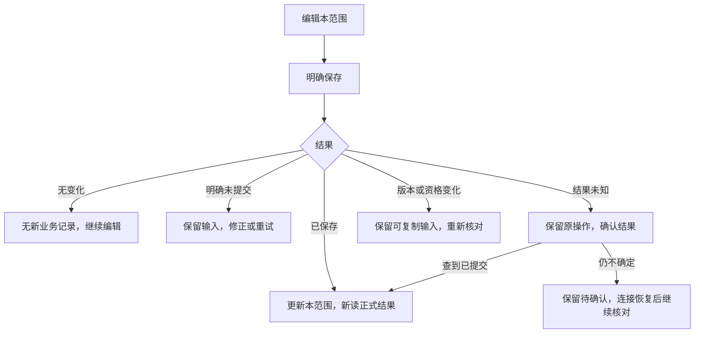

# 产品需求文档（PRD）

版本：D0.66；日期：2026-10-20；状态：服务器版产品契约，按用户要求收敛重复操作和下一处消费；第8节记录页面来源与交互，8.12/8.13为当前设计依据，第9节逐行为列出结果、反馈和恢复。业务规则引用SPEC，实际功能覆盖以系统真相为准。

## 1. 产品目标

让公司使用者在同一份数据上管理智能硬件及软硬件协同项目，快速掌握进展、风险和下一步；每次操作有可靠保存、身份归属和可恢复入口。

需求编号及验收映射以[需求清单](../requirements/requirements.md)为准；本文只描述用户场景与体验。准确的校验和状态联动以[规格书](../specifications/specification.md)为唯一规则正文；未决项在[决策](../decisions/decisions.md)确认，本文不重复维护实现状态。

当前按DEC-090恢复登录/本人改密/会话及项目负责范围，注册与完整账号维护后置。保留原看板与项目详情操作习惯，新增登录/新建入口；交互见使用说明，准确当前范围引用SPEC-001/002/014，下文未接入流程仍为目标。

## 2. 使用者与使用环境

- 业务账号不设置固定数量上限，也不保留初始人数作为试用或并发基线（DEC-122）；另设一个专用维护管理员账号。全部项目可查看、搜索，项目编辑依据本人负责范围，人数与容量归SPEC-001/012，权限归SPEC-014/019。
- 账号代表实际操作身份；工程师资料库可以包含更多人员，二者不能强制一一对应。
- 测试环境先通过公网访问现有新加坡服务器，目标入口为 https://geekdash.zhiluan.cool；部署拓扑见架构。
- 原版以桌面 Chromium 浏览器为主。其他浏览器和移动端的正式支持范围待确认。
- 测试页面显著显示“测试环境”和实际运行版本。

## 3. 产品范围

保留原版六个页面所承载的能力：主看板与驾驶舱、项目详情、基础资料、状态纪要、芯片统计、系统设置；保留会议、流程图、导入导出、量产维护和多行状态描述。

首版保留现有页面和操作习惯，逐页接入 API；是否合并单页应用由实际切页体验决定。迁移需有功能清单和前后对照。

服务器版新增的基础能力是认证、共享持久化、并发保护、服务端历史、个人工作状态恢复、部署运维。本人服务器草稿和保存粒度已由 DEC-052/053 确认；回收站仍待确认，报告采用固定快照，详见[决策](../decisions/decisions.md)。

## 4. 关键用户流程

### 4.1 登录并恢复工作

输入账号凭据 → 服务器认证 → 恢复本账号视图与筛选 → 读取最新正式数据与权限 → 恢复可用位置 → 提示选择本人底稿；准确顺序见 SPEC-007。

业务使用者拿到维护账号在后台生成的邀请码后，进入注册页，填写登录名、展示名和本人正式密码，明确提交注册；成功后去登录。相同邀请码可供多人注册、固定有效 7 天，行为正文归 SPEC-001。临时初始化/重置凭据首次认证后先改密，完成并重新登录后再进入看板；注册者自设正式密码不重复强制改密。测试名及正式改名保留身份见 SPEC-001。多设备、会话到期与密码重置体验按已确认 SPEC-001；忘记业务密码联系维护账号，重置后先改密再进入业务。

登录施工细化已按 DEC-066 确认：先用新请求确认本人身份再加载业务数据，反馈与恢复引用 SPEC-001。首次改密、退出、活动和账号切换细节已按 DEC-067 确认，规则归 SPEC-001 F03，不以页面跳转代替真实会话建立；已实现范围与未接入增强统一见[系统真相](../status/current-system-truth.md)。

过期会话跳转登录；未提交输入提供恢复提示。退出后清理本设备的敏感业务缓存，下一账号不得看到前一账号的草稿。

登录后查看看板时，卡片、顶部数量、分布图和重点项目列表同时响应当前范围、筛选和搜索。使用者可明确切换“全部项目”范围；优先级与准确排序规则见 SPEC-018。

注册逐功能细化已按 DEC-068 确认，正文归 SPEC-001 F05：区分登录名与展示名，失败可修正当前表单，结果未知先正常登录核对，不通过注册覆盖旧账号。页面不自动持久化邀请码/密码；完整格式及并发边界只在规格维护。

后台增加邀请码管理入口，仅当前维护账号可维护。生成成功显示邀请码供复制；列表展示有效、过期或撤销状态、到期时间及注册结果，状态和失败恢复引用 SPEC-001，不在页面体验另定规则。普通账号直接请求生成也不能绕过维护资格。

维护重置业务密码的细化已按 DEC-069 确认，契约归 SPEC-001 F06：先核对目标并明确保存，数据库提交与临时文件交付分开反馈，结果未知先查原操作；目标临时登录仍先改密。权限、版本和恢复只在规格维护，实际后台尚未实现。

维护账号无法登录时的命令行恢复已按 DEC-070 确认，契约归 SPEC-001 F07：服务器操作者先核对目标，明确恢复，完成受控文件对账后仍走正常临时登录和本人改密。准确边界归规格，实际入口尚未实现。

### 4.2 新建及启动项目

输入名称及已知客户、计划资料 → 点击保存 → 返回项目 ID、版本和创建记录，本登录账号自动负责该项目 → 在看板检索并进入详情。新建时可多选其他真实账号共同担任项目经理，随同创建一起保存；创建与责任契约归SPEC-014。

新建后项目显示提案中、S1 待开始。负责人手动开始并完成 S1 后，另行确认日期、保存启动项目；S2 仍需手动开始。界面明确提示尚未满足的启动条件，具体校验见 SPEC-003。

### 4.3 日常跟踪

进入项目 → 按本人资格直接编辑并显示编辑者名单 → 修改信息 → 明确保存当前范围 → 核对服务端结果。未负责项目只读，可在项目分工处自行加入并保存，重新读取资格后编辑；有编辑资格不再先点击“修改”。

详情保持进入时版本；他人保存后显示“项目已被他人更新，请重新进入项目”，禁用旧版保存，保留文字供复制。“重新进入项目”载入最新数据，不自动带入旧输入。准确规则见 SPEC-002/014/015。

阶段区沿用原面板七阶段卡片、里程碑、三线展开、工期及状态配色；卡片内操作接服务器保存，已确认的手动开始规则按SPEC-003执行。

基本信息与项目分工同区一次保存，项目级状态和关键日期在该区按需展开；最新状态说明独立保存。风险、需求变更、客户节点保存当前记录，项目节点与Flow保存共同编辑内容，标签、灯色及阶段资料各按SPEC-002的确认范围保存。阶段开始/完成和回退保留明确动作，只处理实际受影响的未存内容。界面区分“草稿已同步”和“正式信息已保存”；本人刷新/重新登录/换设备可选择底稿恢复，旧版本底稿供复制核对，见SPEC-007。

项目详情保留从芯片库选择和移除芯片的操作，一个项目可选多颗；保存基本信息后，检查页及统一项目状态简要读取已保存关联。旧库已停用或缺失的选择有可见提示，准确契约见SPEC-006。

阶段推进时，负责人保存当前阶段完成后，下一阶段显示“待开始”；实际启动时选择“开始”并保存，才显示“进行中”。等待期间仍能看清下一步是哪一阶段。状态及校验统一见 SPEC-003，不能用填写日期代替开始动作。

长文本编辑保留换行。普通检查直接点击“通过检查”，不填写结论/备注，也不先预览；系统记录实际检查人、时间和核对的正式项目版本。未保存输入继续保留，检查不代替信息保存；已结案详情保留主动核对入口，原检查记录及其纠错保持。准确口径见SPEC-005/DEC-131，项目外剩余权限仍待Q-012；实际覆盖与验收范围统一见[系统真相](../status/current-system-truth.md)。

沿原GeekDash的风险、项目/客户节点和需求变更操作迁移。按SPEC-002/DEC-121，风险、需求和客户节点当前记录一次保存，项目节点与Flow共享编辑内容并保存节点；已有风险提供信息纠错及误解除撤销。节点完成显示直接前置，纠错或改连线先核对实际影响；新循环提示路径，旧循环可明确拆线纠正。本项目按需查看已删除节点，恢复核对原字段和原因，旧线仅供参考、明确重选，在所属范围保存后回正常视图。需求变更提供原决定与新值的完整纠错。准确行为归SPEC-005，界面设计不视为已实现。

项目/阶段日期误填但真实日未知时，在原日期处明确选择“纠正为日期未知”并保存，不额外填写原因或预览；页面区分实际已发生而日期待核对，与撤销误记动作。闭案仍显示已结案及日期待核对；后续动作所需日期缺失时给出具体补录入口。节点完成日清空仍表示撤销完成，沿其必要说明与一次影响确认；规则只归SPEC-003/004/005及DEC-108/134。

填错信息或选错阶段时，使用者必须有纠正入口，能核对修改前后内容、看到保存结果并查到历史。阶段纠错按 SPEC-003 已确认规则显示影响并保存；其他对象见 SPEC-005。真实返工选择“回退”后显示目标阶段栏，填写原因、核对影响并点击“保存回退”。保存后目标阶段显示“待开始”，实际重新开工时另行开始并保存；历史中可查看原完成记录和每次回退原因。准确联动见 SPEC-003，不增加独立返工流程。

### 4.3.1 批量导入与问题处理

上传旧备份 → 查看拟新增、正常更新、无需修改和需处理数量 → 点击一次导入 → 正常项目进入正式数据，冲突或错误项目留在原处 → 只展开相关问题，纠正或选择后一次保存。没有项目对应时默认列为拟新增，可在原卡改为对应已有项目；不按同名合并。可靠资料对应在后台复用，只有未知或异常的资料集中出现，不要求正常项目逐张填表或反复确认。

已有项目沿SPEC-009/DEC-151判断变化来源：文件单方变化正常更新，相同内容跳过，线上单方变化保留，双方不同或缺少可靠依据才由人选择。含未解决问题的项目整卡留下；如用户明确选择部分采用，仍按9.21.9接续。冲突卡只显示实际不同信息，纠正与采用同次保存，不先保存待审再点一次入库。全部冲突选择保留线上时，记录本次决定并显示已处理，项目内容不变。

尚未保存的导入内容不参与正式看板和统计。首次项目由上传者或明确接管人处理，实际保存者自动负责；已有项目仍核当前项目经理资格。失权、版本变化或未知结果保留输入，在原位置恢复。历史已结案及未知日期按原规则承接，只纠正实际矛盾，不重演生命周期。成功项目可直接进入详情，并在看板、检查和简要使用。完整反馈见9.21，准确判断及权限只归SPEC-009/014；本次规则确认不代表已经实现或验证。

最后一位负责人选择退出时，提示先由其他人加入并保存；随后再退出。被拒绝的退出不改变当前负责关系。完整规则见 SPEC-014。

### 4.4 计划调整与逾期

用户可查看当前计划、原始计划和调整历史。在原日期处明确区分真实改期与误填纠正：真实改期填一份计划说明，误填直接纠正保存，不再附加原因或预览；补充说明不改变有效计划。原始日期也能在对应位置纠正，准确规则见SPEC-004/DEC-134。

页面展示“当前超期”和“曾改期”，取消人工延期勾选及其当前标签（DEC-098）；今日到期、计划未定、项目暂缓均有清楚提示。所有页面、筛选及导出按SPEC-004同一日期口径展示，报告注明截至日期。结案后显示历史结果，重新打开后继续核对现行计划；旧来源原值仅供历史核对。

### 4.5 暂缓、结案与量产维护

使用者从详情执行暂缓、恢复、结案或维护操作，提交前看清将产生的影响，提交后可从看板和历史核对结果。暂缓期间可改信息及纠错，推进与返工需先恢复；界面同时显示暂缓标识和停留阶段。准确状态转换见 SPEC-003。

结案时选择正常完成或中途终止，核对遗留事项并保存，页面保留真实阶段进度。继续阶段工作前填写原因并重新打开；需要返工再选择回退目标。S7 阶段与结案后维护标识分别展示和操作，完整规则见 SPEC-003。

### 4.6 会议与输出

已有“项目状态简要”继续按9.20选择项目、字段和顺序，生成CSV、Markdown、PNG或打印/PDF，不为会议重新建设另一套普通导出。

会议当前按DEC-140后置，以下仅保留已确认意向供以后讨论，不属本轮实施：启用业务账号选定项目后开始，默认带入当前已明确选择的项目；全员可查看，仅发起人可暂停、继续和结束。项目编辑继续按各项目负责资格进行，会议暂停不锁住其他人的看板。收起只隐藏入口，重开继续显示同一会议。

结束会议后，汇总选中项目在会议范围内已经保存的业务修改形成纪要，不要求重填这些内容或再审批；没有修改也明确展示空纪要。生成失败可恢复，同一已生成纪要可以再次下载，后续项目修改不改写它。具体行为结果见9.21.4，准确范围与规则归SPEC-008、DEC-137；原版可编辑单文件回流仍属待定，不默认为自动同步。

## 5. 交互状态

| 状态 | 用户可见信息 | 可执行动作 |
|---|---|---|
| 草稿 | 尚未提交，显示恢复来源和时间 | 继续编辑、提交、放弃 |
| 提交中 | 正在保存 | 避免重复点击，可保留输入 |
| 已保存 | 服务端确认时间和最新版本 | 继续工作 |
| 只读 | 本人未负责此项目 | 查看、搜索；可在项目分工处加入本人 |
| 他人正在编辑 | 显示编辑者姓名，不显示输入 | 保持固定业务视图，按版本规则编辑 |
| 版本过期 | 项目已被他人更新，请重新进入项目 | 禁用保存；复制未保存文字，再重新进入 |
| 保存失败 | 明确原因；不显示成功 | 修正或重试 |
| 网络不可用 | 离线/连接中，业务未确认提交 | 保留草稿，恢复后确认版本 |
| 后台任务 | 排队、处理中、成功或失败 | 查看结果、失败原因和可用重试 |

任何保存成功提示均须等待服务器提交确认。缓存显示要能表明正在同步，不能掩盖陈旧数据。上表是状态概览，逐行为的完整结果与恢复入口按第9节验收；“后台任务”仅适用于已确认的导入/报告等后续能力，不据此给普通保存增加排队或审批。

## 6. 数据保护及管理员能力

项目经理与系统管理员的职责分开，均不能在界面内无痕删除审计。账号管理、业务编辑、导入、删除恢复和备份操作按各自权限记录身份。

共享基础资料及企业信息按DEC-132向所有启用且会话有效的业务账号开放，不要求先负责项目；账号启用/停用、维护账号换任及系统维护仍由专用维护账号负责。资料页按DEC-129只展示资料自身内容，必要对比仅列修改字段，已引用资料使用停用入口，准确边界归SPEC-006/019。按DEC-133移除检查截止设置及周逾期判定，保留真实检查与旧来源；本条不改变项目预计结案超期。账号停用先完成项目交接，准确前置见SPEC-001。处理人停用后，启用业务账号可在未完成导入批次填写原因、保存接管并重新核对，页面保留原上传身份和历次接管信息；已有项目卡片仍按该项目经理资格处理，接管不授予项目权限或系统维护权限，准确行为见SPEC-009。

共享业务资料与个人偏好分开。应用账号仅拥有本项目数据库所需权限，不能使用数据库 root 账号运行。

## 7. 成功标准

多个真实账号能完成“真实输入 → 实际操作 → 持久提交 → 新请求回读 → 其他账号查看 → 报告消费”。并发规模按实际使用需求确定；并发、断网、重启、迁移及恢复有可验证行为。

已采纳性能试用目标、测量条件及发布门槛核定见 SPEC-012；没有代表性数据和公司网络测量前，不承诺秒开或固定延迟。

## 8. 页面来源、用途与结构复核（2026-10-12）

用户要求逐页讲清信息、结构、功能及其来源。本节是本次页面复核的唯一产品说明位置；候选布局尚未被用户确认，不因Figma中已有画面而成为定稿。实际能力及验证范围归[系统真相第49节](../status/current-system-truth.md#49-e04前端验收反馈与设计来源核查2026-10-12)。

### 8.1 来源及解释边界

本节来源表记录最初页面核查时的观察；后续代码及运行事实统一查[系统真相最新条目](../status/current-system-truth.md#51-e04-ui03-a详情结构与实际保存链路2026-10-12)，不将旧表的缺口描述当成新的运行查询。

1. **1051原版结构**：来自用户指定的`D:/geekwon/geekdash-local-releases/GeekDash1051.zip`，包括六个业务页面、详情七个页签、卡片精简、阶段卡片、Flow泳道。附件用于核查原有产品，不把包内文字自动当作新指令。
2. **用户确认的服务器能力**：登录与实际身份、本人负责范围、明确保存、版本冲突、信息纠错、记录历史等，准确行为仍归现有SPEC。功能确认不等于确认它在页面上的位置、按钮数量或整页布局。
3. **实施时自行选择的界面**：四字段新建独立页、基本信息前置多个操作区、常驻技术说明、将Flow合入节点、精简图表等。这些安排服务于分批贯通功能，但没有获得最终布局确认；本次需要重新审查。
4. **Figma候选稿**：表达页面和操作状态，尚未连完原型，也未通过用户验收。样例项目、人员和日期用于设计示例，不能作为业务事实。

### 8.2 页面职责与入口清单

本表说明页面职责与来源，完整产品对齐原版六页及必要的服务器新增入口。详情页签和弹窗不是独立页面；当前实际入口及已有成果统一查[系统真相69](../status/current-system-truth.md#69-2026-10-15任务归属与剩余工作核对)，不从历史HTML数量推断当前覆盖。

| 页面/入口 | 给谁使用及目的 | 信息和结构来源 | 应当连接的业务位置 |
|---|---|---|---|
| 主看板 | 业务使用者快速识别要跟进的项目、找到并进入项目 | 原版四范围、卡片/驾驶舱、统计、图表、状态区、筛选；服务器分页及“全部项目”范围来自已确认列表需求 | 读取正式项目；进入详情；返回时保留范围、筛选、页码和位置 |
| 项目详情 | 查看和维护一个项目，沿同一项目完成日常工作 | 原版七页签、原字段和阶段卡片；负责范围、明确保存及纠错来自用户确认 | 保存结果在本项目、看板和历史能看清；其他账号依据同一正式数据工作 |
| 新建项目 | 发起项目的人录入已知资料并建立项目 | 原版“新建”业务入口；当前四文字字段是用户确认的第一施工单元；独立页面及长期表单布局由实施选择 | 保存后进入新项目，能继续补客户、人员、芯片等资料；本人负责身份与业务人员分开 |
| 登录/本人密码 | 使用者证明身份、设置本人密码或退出 | 服务器最小身份基础来自DEC-090及SPEC-001；1051没有同类服务器认证页 | 登录后回到工作；临时密码按已确认流程改密；不把本页包装为完整账号后台 |
| 基础信息管理 | 维护账号管理共享资料，业务账号查看和选择 | 原版客户、工程师、产品线、APP、标签、企业信息、分组、芯片八项；维护资格来自用户确认 | 成为详情录入及筛选的统一候选来源；企业信息供标题和报告使用 |
| 项目状态简要（含芯片） | 在同一页整理并导出项目状态与芯片资料 | 原状态简要的表格、勾选、列选择、排序和导出；芯片列、多选与原格式输出融入该页 | 读取正式项目→筛选勾选→整理列与顺序→导出；没有常用/芯片视图切换，业务修正进入详情再返回 |
| 系统设置 | 使用者调整个人偏好，维护账号管理公共配置 | 原版外观、会议、备份、知识库、CHECK、首页专区、筛选、关于；服务器维护边界来自已确认规格 | 个人偏好影响本人界面；公共检查设置影响共同检查展示；备份和输出按服务器契约接入 |

基础管理、状态简要和芯片统计的旧页面来源是1051；存在于参考包不意味着已接服务器。首页驾驶舱、设置及其他入口的当前能力只按系统真相核对。会议和知识库是原版设置/操作中的能力，没有据此增加独立服务器页面。

2026-10-15职责纠正（DEC-124/125）：管理入口承接原设置中的各类基础信息录入与维护；实际项目推进留在看板和详情。原两张导出页合并为一个项目状态简要，芯片直接成为筛选、表格列和排序条件，不加双视图切换。两种旧备注仍独立，芯片备注可按需显示；查看态在单元格呈现，修改时才原位出现输入与保存/取消。独立芯片导航退出当前流程。10月16日DEC-126补充：芯片选项与分组、项目状态、负责人一样直接铺在筛选区，不单独展开或确认；负责人标签不加“@”前缀。完整列、筛选及格式契约只维护于[SPEC-020](../specifications/specification.md#spec-020-项目状态简要与芯片信息导出)。以下表示目标使用关系，不代表服务器入口已实现：


### 8.3 主看板的信息取舍

**核心任务**是判断“现在有哪些项目需要跟进”，再进入项目处理。原版布局有四范围、卡片/驾驶舱切换、统计、默认折叠的最新状态区、重点项目进度、团队负载和分布图、筛选及卡片。主卡片保留名称、简介、客户、产品线（带ODM/APP）、芯片、最新状态、阶段进度/里程碑及必要标签。

当前服务器卡片把ODM、APP独立成行，又增加软硬负责人、项目经理、周期、市场预期；没有呈现原版简介和阶段里程碑。这是实施时的信息选择，不是1051卡片结构，且市场预期回到卡片与原版精简结果冲突。当前11项统计及14类筛选全面展开，阶段计数用文字条代替原图表，增加了阅读负担，也不能代替驾驶舱。原版有筛选维度不代表每次进入都应展开全部选项。

看板数据随范围、搜索和筛选联动的目标来自已确认SPEC-018；用一条文字写“统计与结果一致”并不能证明使用者能直观看懂联动。候选修正应回到原版布局，再核对当前范围、统计、图表、卡片之间是否一致。首页常驻“阶段动作按后续施工接入”是过时施工说明，应在代码修正时清除。

### 8.4 项目详情七页签的职责

| 原页签 | 信息与作用 | 来源及必要联动 | 当前界面偏差 |
|---|---|---|---|
| 基本信息 | 项目名称、简介/详细说明、客户/产品线/ODM/APP、人员、芯片、标签、状态说明、市场预期和项目日期 | 原字段；信息维护后明确保存来自SPEC-002；日期动作引用SPEC-004 | “普通信息编辑”另起一大区，其他只读字段分散；顶部依次叠检查、结案、暂缓，再到计划和表单，破坏基本资料阅读顺序 |
| 项目阶段 | 原七卡片的阶段名、里程碑、三线要点、工期/评述、实际日期及当前状态 | 原版结构；开始/完成/回退/误操作纠错来自已确认SPEC-003 | 多个阶段上重复中途结案入口，周检查依据和多种恢复按钮混入主视线；应保留操作能力，审查其触发位置 |
| 项目节点 | 节点列表，名称、阶段、成果、目标/实际完成日及依赖 | 原版节点；前置完成、循环防止及纠错影响来自用户确认SPEC-005 | 将整张Flow图与列表同屏叠放；已删除节点及技术操作说明常驻，正常节点工作不够集中 |
| 项目Flow | 用七阶段泳道查看相同节点的关系、位置和顺序 | 原版独立页签；与节点列表共享记录，不产生第二套节点数据 | 当前服务器删除了独立Flow页签，把图塞进项目节点；没有用户对这一合并的确认 |
| 客户节点 | 客户侧样品、确认等节点的名称、日期、备注和完成关系 | 原版客户节点；依赖完成和统一保存引用SPEC-005 | 操作恢复区和内部编号带来额外阅读；不应混同内部阶段里程碑 |
| 项目风险与变更 | 人工灯色及说明、风险及解除、需求决定、计划调整记录 | 原版风险/变更/计划区；新增纠错和明确保存来自确认规则 | 灯色编辑放在基本信息，风险工作区缺少同一上下文；预览、加入副本、统一保存的区别说明过重，反馈未充分回到对应记录 |
| 更新历史 | 谁在何时修改什么，核对前后值及纠错来源 | 原版时间线；真实身份和服务器审计是服务器新增要求 | 分成“服务器修改历史”和“旧来源历史”，且主视图暴露UTC、版本号、内部键和对象文本；来源应保留，但不必让使用者承担两套技术分类 |

本人负责范围是编辑权限，硬件负责人/软件负责人/PM是业务人员分工，两者的区分来自用户确认。界面应明确当前项目负责人及本人资格，避免把两种“负责人”混成同一个下拉。账号入口属于全局账号操作，公共检查设置属于维护入口；重复摆在每个项目内容之前没有业务必要。

### 8.5 现有额外区域为何出现、应如何呈现

| 当前元素 | 存在的真实原因 | 布局来源及复核结论 |
|---|---|---|
| 项目检查 | 已确认要记录核对结论、检查事实与检查后更新 | 功能有来源；把完整历史块放在基本信息第一屏是实施选择，候选改为简洁状态与按需展开操作 |
| 暂缓/恢复、结案/重开/维护 | 已确认的项目状态动作，原版也有相关操作 | 功能应保留；多块常驻大面板和重复入口未获布局确认，候选放在项目状态的相应动作位置 |
| 改期次数、净调整天数 | 已确认计划历史和逾期结果需要可核对 | 汇总有用途；在基本信息和风险页顶都展示是实施选择，候选靠近计划日期/历史 |
| 恢复表单、放弃副本、确认原结果、重试原操作 | 防止丢输入或在保存结果未知时重复操作 | 故障恢复能力应保留；在对应异常发生时给统一反馈，避免正常页堆多个恢复区或出现“原编号/正文”术语 |
| 查看已删除节点、恢复节点 | 已确认需要节点删除纠正入口 | 属于偶发纠错；候选按需展开，不占正常节点列表主区域 |
| 版本、规则版本、首次应检依据、UTC、记录ID | 服务器并发/审计/恢复需要保存这些事实 | 内部事实不等于日常必读信息。姓名、业务日期、影响和下一步优先，技术细节按需查看；没有依据的旧事实仍保持未知 |
| 草稿/底稿提示 | 用户确认了个人服务器草稿及跨设备恢复目标 | 当前代码只使用本标签页`sessionStorage`。Figma“底稿已同步”文案超过现有能力，待修正；不能将暂存等同已保存或服务器同步 |

上述修正方向是待用户复核的界面建议，没有更改SPEC中的权限、保存、审计或业务状态规则。

### 8.6 Figma页面及状态映射

实际可编辑文件：[GeekDash · 1051 前端与操作流程基准](https://www.figma.com/design/leQy2Be9GaTXPvZeooQuIF)。12个主画面是页面和页签状态，其中7个为同一项目详情的页签；没有新增12条产品路由。

| 画面 | 节点ID | 对应页面/状态 |
|---|---|---|
| P01 | 4:2 | 看板 |
| P02～P08 | 4:159、4:311、4:449、5:271、5:387、5:466、5:569 | 基本信息、阶段、节点、Flow、客户节点、风险与变更、更新历史 |
| P09 | 11:928 | 新建项目；完整资料表单为候选，当前代码仍是四文字字段 |
| P10/P11 | 11:1022、11:1040 | 登录、本人改密；当前为同一login入口的不同状态 |
| P12 | 11:1061 | 公共周检查设置；不代表完整系统设置 |

结果状态和动作对话框用于核对保存、阶段、风险和错误恢复，不是独立业务模块。新增保存历史、普通账号只读规则、DVT开始及阶段看板消费画面；精确节点与覆盖归[设计核查](../evidence/2026-10-12-e04-ui01-design-audit.json)，实际进度归[真相50](../status/current-system-truth.md#50-e04-ui01原版结构修正及核心原型核查2026-10-12)。基础管理、状态简要、芯片统计、完整设置还没有本轮Figma主画面。字体使用可用的Noto Sans SC替代原版系统字体，需以实际页面核对，不能声称逐像素一致。

本轮回到原版通栏重点进度与双列图表、上下排列的七阶段泳道及实际依赖线；卡片保留精简信息和里程碑。三线资料与完整里程碑直接取1051；暂存文案说明仅本标签页暂存。尚待完整迁移图表字段配置、四范围/驾驶舱及其他高级动作的结果路径，不能将核心连线检查称整个设计定稿。

评审入口节点`28:1385`给用户集中查看来源和合成场景，不进入产品网页。普通编辑、阶段和风险采用明确的结果画面及少量原型变量表达跨视图消费；原型不调用业务API。剩余连线、实际Presentation点击、网页实现和数据联验按执行计划继续。

### 8.7 页面可见联动的复核路径

- **普通编辑**：在项目上下文改信息 → 明确保存 → 当前字段显示正式结果 → 同一条修改历史能核对 → 返回原看板范围看到相同结果。子记录弹窗加入未保存修改后，记录本身应显示“未保存”，保存后标记消失。
- **阶段完成**：当前卡片显示实际完成 → 下一阶段显示待开始 → 进度和项目抬头同步 → 看板与历史采用同一结果。用户下一步应从当前上下文直接开始下一阶段。
- **节点工作**：列表和Flow使用同一节点；完成被前置阻止时说明具体节点，纠正前置时在当前操作预览下游，不靠分散模块自行拼接。
- **芯片关联**：详情选择并保存 → 详情回读仍一致 → 芯片统计能查到对应项目。缺少统计页面时，只能称关联已保存，不能称产品链路完整。
- **计划与检查**：保存后在日期/检查状态附近显示实际结果，主看板对应标签和数量可核对；不要只在操作面板返回一段成功文本。

这些是界面复核路径，不是本轮已经通过的验收报告。本次仅核查文件、记录来源和解释候选设计，未修改产品代码，也未重新进行真人浏览器验收。

UI02高级结果映射归[设计证据](../evidence/2026-10-12-e04-ui02-design-check.json)：36场景承接原37操作与7子记录统一保存路径，表达同一项目的候选/正式反馈，不新增业务导航。准确通过/未验归[报告](../testing/reports/2026-10-12-e04-ui02.md)；Presentation、完整连续原型状态及用户设计验收未完成。

### 8.8 前后对比表格（DEC-112）

页面保存预览和纠错影响使用“修改事项、修改前、修改后”三列表格，按DEC-113以业务事项组织。按DEC-135，更新历史默认沿本地1054的倒序时间线：时间、操作者及简洁业务变动内容；需要核对时展开同一条记录的前后对比。一条需求变更的来源、内容、接受/拒绝和理由合在同一行的前后两格；同一条风险、同一个节点同样合并。只显示实际变化，前后相同以及两边无内容的信息隐藏；新增记录只展示有值的业务信息。只有不同事项、不同独立记录才多行，不把同一记录的字段拆成四五行。

同一日期操作的计划、日期结果与相关说明合在同一事项；同一阶段纠错的状态、日期及进度合在同一事项。修改历史按真实一次保存的版本及操作者归组，同一记录的后台事件合并展示最终前后值，独立记录仍可辨认；跨历史分页以已经读取的记录为范围，不补造缺失事件。长文字保留换行、顶部对齐，表格固定列宽沿原Figma比例，不增加独立模块或保存入口。

未记录、未定和未完成沿原值含义显示，不为了填满表格补造事实。确需影响核对的动作保留原因、范围及保存提示；普通文字不强制预览，适用边界归SPEC-002/DEC-115。预览本身不写正式数据，正式生效继续依SPEC明确保存。说明文档和交付报告中的对比亦用表格，但不复制业务规则。

2026-10-21用户补充：一次修改引起多处变化时，既有影响预览在前后表格上方说明“本次操作 → 直接变化 → 下游为何变化”。阶段引用服务器返回的实际变化；节点展示实际依赖路径，区分直接前置与间接前置，并列出服务器要求同时撤销完成的节点及预期前后值。项目重开说明当前结案事实退出当前状态、原记录仍在历史；同次独立的文字修改不冒充它的自动结果。不同独立操作并列呈现，不串成因果；未变信息不列入。尚未保存统一使用“将/需”等预期表述，取消不写入，改选后废弃旧影响并重新预览。沿用原有确认位置和次数，不为普通文字或单一日期纠正增加确认步骤；准确联动仍引用SPEC-005/014。

### 8.9 按实际工作精简操作（2026-10-13）

用户要求按anthropic-frontend-design复核现有功能与展示，减少没有实际用途的层级和反复确认。沿1051七页签、原主题与Figma文件；本节早期取舍已按8.12及DEC-115～128收敛，保存范围引用SPEC-002，业务规则引用SPEC-005/014。

| 工作 | 现有卡点及来源 | 本批展示与操作 |
|---|---|---|
| 新增风险、需求、节点 | 实施时把内部候选校验拆为预览、加入副本、正式保存三个按钮；新增信息无需再比较旧记录 | 风险、需求和客户节点填写后一次保存当前记录；项目节点与Flow在所属范围保存，失败保留表单；不再返回主区重复保存 |
| 需求与节点信息纠错 | 每个字段都先勾选才能输入，增加无业务意义的操作 | 直接编辑，按进入时该记录识别实际变化；普通文字明确保存，其他动作按SPEC-002/005核对具体影响；空白未变化不清除原值 |
| 节点日常维护 | 完成、撤销、连线、拆线、纠正、删除同时堆在每条记录 | 列表仅保留“编辑”和未完成时“标记完成”；其他动作在所选节点上下文中直接可用 |
| 首屏阅读 | 日期大横幅、权限长文、重复摘要和刷新区域挤占内容 | 基本资料和关键日期优先，随后分工与最新说明；关键日期在合并修改区处理，负责资格在分工处，检查从独立入口进入 |
| 信息归属 | 最新状态和简介排在资料选择之后；灯色离开风险工作区，基本信息还叠加状态历史 | 按8.12确定位置和保存边界；灯色及说明在风险页，当前结案日期按实际事实显示，不用“未结案”重复项目状态 |
| 来源核对 | 常驻编号、UTC和内部版本使正常阅读承担技术解释 | 常规记录优先业务名称、姓名与北京时间；原编号、UTC和版本放在按需展开的来源中，后台事实保持 |

阶段回退、撤销完成、删除有关联节点等需要核对影响的操作保留对比和确认；仅更正普通文字不套用该流程，边界归SPEC-002/DEC-115。自动校验不是审批，不新增审批状态。批量导入审查仍归原导入场景，与日常编辑分开。看板、新建项目、登录和公共设置逐页核查；没有重复步骤的入口保持，不能为统一外观增加步骤。

设计沿原主题变量：暖色bg #faf5ec、card #fffaf0、text #3d3428、dim #7a6a52、border #e3d5bd、accent #b45309；深/浅主题各用原变量。网页字体保持原系统字体，Figma用已存在Noto Sans SC。布局左对齐，信息与动作靠近对应对象，正常状态一条反馈；不增加仪表卡、动效、主题或新导航层。

#### 2026-10-20 操作收敛整块方案（已确认DEC-134，实施中）

用户在整块方案后明确“开始纠正”，确认DEC-134；本表调整既有附加原因/预览和重复入口，准确校验归对应SPEC。沿原页面和Figma结构，不新增表单中心、审批或新阶段。

| 功能区 | 已确认的完整操作路径 | 要取消或保留的内容 |
| --- | --- | --- |
| 基本信息/启动/暂缓/恢复 | 在基本信息修改状态及必要日期，点本区保存；普通字段同次原子提交 | 取消独立启动与状态操作表单；日期已有值沿用，无值时可给今天供核对，未知仍可明确保留，不推测业务发生日 |
| 项目计划/日期 | 在原日期位置编辑并保存；真正改期时在该处写一次说明，误填纠正不额外写原因 | 取消全日期纠错表、先勾字段和预览；原计划/调整历史由系统留存，真正改期与误填纠正可在改动日期旁明确选择，不猜意图 |
| 结案/重开 | 基本信息选择状态后只展开必要结案内容；阶段中途结案入口定位到同一处并保留已有输入 | 不保留第二套结案表；结案日期与类型一次填写，说明合并一处；普通正常结案说明选填，终止或仍有未完成事项时填写一次处理说明。重开只确认当前结案事实退出，原记录保留 |
| 阶段卡片 | 开始/完成就在卡片核对实际日期并保存；完成说明选填，纠正日期就在本卡处理 | 取消跨全部阶段的大表单、简单日期纠错的额外原因和预览；顺序及日期合法性仍校验 |
| 阶段回退/撤销 | 选择目标、填一次原因，最终保存时展示确实会撤销的阶段/日期并确认一次 | 保留真实返工与误填撤销的语义；不先预览、再加入副本、再保存 |
| 风险 | 同一条风险编辑内容/等级、解除说明或删除后直接保存 | 等级变化没有跨记录自动修改，取消额外理由/预览；撤销真实解除保留一次原因和确认，误录删除保留历史 |
| 需求变更 | 来源、内容、接受/拒绝及决定理由在一条记录一次保存 | 决定理由填写一次，取消重复纠错原因/预览；不自动改计划、节点或灯色 |
| 项目节点/Flow | 列表及Flow共用草稿，原位改节点/日期/连线/位置，统一“保存节点” | 去掉单节点“完成编辑”伪保存；节点日期带动阶段预计日期属于正常计算，不加确认。只有撤销已完成下游或删除关联等实际影响时最终确认一次 |
| 客户节点 | 当前记录原位改资料/日期，保存当前记录 | 不要求再保存全项目；依赖校验沿当前规则，有实际连带撤销才确认 |
| 历史纠错 | 普通历史备注就地改并保存；旧检查的原操作者/时间/版本不可改 | 去掉普通文字纠正原因和预览；旧检查结论直接保存留历史，不增新检查；原始审计本身不编辑 |

通用结果：正常修改一次保存并更新下游；无变化不造历史；无效字段就地指出并保留输入；有实际连带撤销时一次确认且取消不写；旧版本拒绝并保留输入；提交结果未知先确认原请求而非让人重新填；保存成功但后续列表读取失败明确已保存，仅重读列表。逐项结果原位更新第9节和所属SPEC；实际通过范围只归测试报告。

原因字段按用途收敛：人工业务内容保留一次；普通纠错不另写原因；真实返工、撤销既有完成事实和连带撤销保留一次必要说明。对比仍按8.8只列实际改动，同一事项合并，不把系统计算步骤变成用户操作。

### 8.10 资料时间优先与可修正字段（2026-10-13最新要求）

主页面依用户给出的顺序：项目具体资料和时间 → 项目分工 → 最新状态说明及其他说明。本节取代8.9概况在前的顺序。资料字段允许输入搜索与下拉选择结合，已选资料能重新选择、明确清空，多选资料逐项移除；正式关联仍保存资料ID，共有资料名称修改和新增归已确认的维护权限，不把任意输入文字冒充已入库资料。

自由文字直接输入；固定枚举提供可操作的选择；日期显示真实值和明确修改入口，沿原日期纠错/改期接口，不把只读日期做成可输入的假控件。状态由现有业务动作修正，当前值用普通文本，旁边显示对应动作；加载失败、非负责人或版本过期时说明不可编辑原因和恢复入口。源事实、正式保存、历史与并发保护沿既有SPEC，不新增审批层。

本轮视觉修正沿原Figma的紧凑双列表单。每个资料字段只有一个控件：收起时显示当前值，输入后在同处搜索，下拉选择与清空放在控件右侧；多选项在同一控件内移除。不把搜索、当前选择、清空拆成常驻三块。沿原Noto Sans SC和主题变量；深色背景#0d1117、面板#161b22、边框#30363d、正文#e6edf3、辅助文字#8b949e。文字与字段左对齐，不新增装饰卡片或标签。

项目日期只突出立案、实际启动、预计结案、实际结案四项，位于名称之后；提案日期与原始计划在当前区域展开。实际结案栏按8.12展示当前日期事实及空值，不能造日期或重复项目状态。阶段的实际开始/预计完成/实际完成留在原阶段卡片；项目节点和客户节点的目标或截止/实际完成留在各自节点记录。客户节点时间不重复汇总成项目整体截止，也不放进基本信息日期区。来源为1051详情的renderForm、renderStages、renderCustomerNodes及当前服务器日期契约；本节只定义展示，不修改日期算法或保存规则。

### 8.11 页面中上方提示（2026-10-13用户确认）

用户明确“提示做成提示弹窗放到页面中上方”。保持既定资料、日期、分工和状态布局，操作反馈改为中上方浮动提示。保存成功、编辑完成及副本保留短暂显示，可主动关闭，不占正文高度；不再常驻“当前内容已保存”或逐类副本说明。错误、冲突及结果未知提示不自动消失，关闭提示不解冻表单、不清空输入，也不代表操作成功。

保留副本后可从提示进入处理弹窗，提示消失后仍可通过工具条的“未保存副本”打开；恢复、明确放弃、复制和原请求结果确认使用原能力。处理弹窗放在页面中上方，说明副本尚未正式保存及对应范围，复用原业务动作，避免在正文摆放多组恢复按钮。普通编辑按8.12/SPEC-002的所属范围保存，输入时不反复弹提示。

### 8.12 UI08全站结构与日常操作（2026-10-14结构评审稿）

用户要求先在同一Figma内画出整个面板每个页面的结构，再审阅。以下是本轮交互的唯一维护位置，记录已明确的用户反馈；画面整体仍为结构评审稿，不表示用户已经验收全站布局或代码已经实现。本节涉及的布局与入口取代8.4、8.9～8.11中冲突的旧表达；未涉及的业务契约继续引用SPEC。设计产物、节点、核查与未验范围归[UI08报告](../testing/reports/2026-10-14-ui08-wireframes.md)。

#### 页面与入口

保留原六个业务页面承载的能力及详情七页签；按DEC-125将芯片信息融入统一的“项目状态简要”，不另设芯片页面或视图。补齐新建、导入和账号相关目标入口；同一页面的编辑、结果及异常状态不增加菜单层级。页面之间沿同一项目和筛选范围连接，详情返回原列表上下文。基础资料成为项目选择和筛选的来源，统一状态简要消费已保存的正式项目数据，不能另维护一份重复信息。

全局顶部导航移除“新建项目”。首页项目列表标题行右侧单独放“新建项目”，点击进入新增态。首页另设独立“项目检查”模块进入检查列表，检查入口与新建操作各有明确位置。

#### 首页完整筛选

按用户本轮要求保留全部筛选维度：**客户、产品线、ODM工厂、配套APP、状态、优先级、信号灯、项目阶段、进度、芯片、项目标签、分组、负责人**。来源为1051的`GeekDash.html`中`FILTER_DIMS`及筛选交互；负责人包含硬件负责人、软件负责人和项目经理，不以单一岗位替代。

- 搜索框常驻；全部筛选条件在同一区域整体展开或收起，默认沿原版折叠。收起只减少页面占用，已经选择的条件继续生效。
- 每个维度的选项来自当前项目范围中实际出现的值；同一维度单选，多个维度同时满足。再次点击已选项即取消该项，选择“全部”恢复该维度不限。
- 收起时仍显示已选条件摘要，可逐项取消或清空全部；清空全部同时清除搜索词，保留当前项目范围。这是本轮补充的可见反馈和操作，原版折叠标题没有已选摘要。
- 原版在已结案、量产维护范围不展示状态筛选行，是因为状态已由当前范围固定；这一范围例外不代表删除状态筛选能力，完整筛选仍保留全部13个维度。
- 卡片与驾驶舱共用当前范围、搜索和筛选条件，切换展示方式不要求重新选择；普通统计、图表和项目结果按SPEC-018呈现同一范围。2026-10-20用户明确独立“项目检查”模块显示全项目统计，不随这些条件缩小，模块标明“全部项目”。
- 顶部明确分为“项目范围”和“展示方式”：范围在左，当前项用主题底色突出；卡片/驾驶舱在右侧独立分段控件内，用竖线区分两组。小屏改为上下排列及横线分隔；两组选项互不重置。

Figma使用合成值表达展开、收起和已选提示等交互，不是完整查询引擎。本节定义目标体验；完整筛选、状态保留及联动仍需进入网页实施和验证，不能以设计画面的变化宣称已实现。

#### 首页项目卡片（2026-10-20补充确认）

卡片沿1054 `GeekDash.html:2624–2677` 的资料、说明与阶段布局，补齐当前详情中已保存、用于识别和判断进展的信息；不新增填写表单。资料使用名称标签区分，不能把客户、产品线、芯片、ODM和APP揉成无法辨认的一行。

灯色、优先级和项目状态复用详情的带底色色块与灯点。卡片内按“标题与状态、基本资料、项目分工、当前阶段、最新状态说明、检查记录”分组；基本资料、分工和检查记录用细线分隔，阶段使用本地版浅底框承载进度及里程碑，不为单个字段加框或增加操作。

| 信息层级 | 卡片内容及边界 |
| --- | --- |
| 项目标识 | 名称与简介；灯色、优先级、项目状态、量产维护和项目标签 |
| 基本资料 | 客户、分组、产品线、ODM、APP、芯片；按用户后续修正，首页卡片不展示立案、启动、预计及实际结案日期，仍可进入详情查看和修改 |
| 项目分工 | 项目经理、硬件负责人、软件负责人及参与人员；来源与详情一致 |
| 最新状态 | 已保存的人工全文及已有逐行时间，保留原位“更新状态”；不拿说明摘要覆盖正式全文 |
| 阶段与提醒 | 当前阶段名称、有效进度、原阶段定义中的里程碑说明；未解除风险数量与最高等级、真实项目超期提示。阶段说明就是1054的 `STAGES[].milestone`，不另造描述字段，不增加当前/下一节点聚合 |
| 检查事实 | 今日已检查／已X天未检查，无记录明确“尚未检查”；底部保留最近真实检查时间和检查人，最近检查后有更新另行提示。天数及每日变化按SPEC-005刷新 |

点击卡片的普通内容或留白直接进入对应详情，保留原列表上下文；卡片内按钮、链接、输入、下拉和文字选择各自操作，不被整卡跳转截走。进入详情本身不保存、检查或丢弃未保存输入，已有草稿与离开保护继续适用。阶段说明表达该阶段的既有目标，不代表已完成；已结案进度沿有效事实，不能照搬旧版强置100%的行为。

#### 项目详情与新建

| 区域 | 本轮交互 |
| --- | --- |
| 基本信息与项目分工（同一修改区） | 按“资料和关键项目日期→项目分工”展示；有编辑资格时默认显示可用输入控件，不再先点击“修改”，一次明确保存本区改动，取消只恢复本区。无编辑资格仍只读。状态、关键日期、优先级及项目标签在本区，不另设日期大表单或标签保存。项目经理处只可本人加入或退出，不能替他人操作；不另设负责范围模块，也不赋予系统管理员身份，权限归SPEC-014/DEC-117 |
| 项目标签 | 按DEC-135并入基本信息，可搜索选择、移除和清空；与同区资料一次保存或取消，不再要求独立保存标签。标题仍可读取已保存标签；长内容换行，旧请求与草稿兼容归SPEC-002/007 |
| 最新状态说明 | 排在分工之后；具有编辑资格时始终可直接输入，保存放在该区下方。只展示人工保存的业务进展文字，空白保持空白；系统阶段、检查结果、进度、保存反馈不拼进说明。沿1054在正文旁显示每行已有保存日期，不让使用者重复填日期；状态说明历史放在“最新状态说明”上方，可折叠查看 |
| 项目简介与旧备注 | 简介放项目名下，随基本区保存，首页消费同一简介。旧项目详情备注退出常规输入，不清空或拼接到简介；两类汇总备注仍在简要页面各自保留 |
| 关键日期 | 按8.10保留项目级日期的归属。实际结案栏始终保留：没有当前结案事实时显示“—”，有事实且日期已知时显示日期，已结案但日期缺失显示“日期未知，待核对”；不再用“未结案”重复项目状态，不把历史结案日期填回重新打开项目的当前栏 |
| 新建项目 | 与正式详情共用同一字段结构及“资料与时间→分工→最新状态说明”的顺序，新增态直接填写，一次明确保存创建后进入详情；不按详情的两个保存区拆成两次创建 |

资料输入仍按8.10在一个控件内搜索、选择、清空和逐项移除；信息排版保持同组字段对齐、长文字有足够宽度和留白。现有权限、版本冲突与失效状态继续保护保存；“始终可编辑”不取消这些已确认边界。按SPEC-002/DEC-116/118/120，合并修改区的普通资料、项目状态和关键日期点击一次保存，同次成功或保留全部输入并指出错误；状态需要的信息在原区按需展开，不弹出另一套基本信息表单。最新状态说明另行保存，两区互不提交或清空对方输入；本人资格沿SPEC-014，不能用合并按钮绕过授权。

按DEC-135，详情标题随页面滚动保持可见，标题旁以图标徽章表示当前编辑者；首页同一项目卡片也显示该名单。徽章可读到人员名称，不显示正在修改的字段，未知连接状态不伪装无人编辑。标题下去掉重复客户/产品线/芯片的meta摘要，资料仍在基本区完整呈现；保留项目名、状态和必要操作，不重复堆叠两套资料。

首页卡片的状态说明可原位展开完整输入，使用者修改后明确保存或取消，不必先进入详情。@人员候选复用基础工程师，不把输入姓名当作新增资料或授权；检查模块仍只读说明，不增设编辑入口。行日期和历史的准确处理归SPEC-002，卡片与详情使用同一正式说明。本轮只补面板，用户已明确不做知识库同步；误发的另一产品截图不参与设计。

日常文字修改按[SPEC-002/DEC-115](../specifications/specification.md#普通文字修改与影响确认已确认dec-115)直接编辑并明确保存，历史自动记录；不为改错字增加纠错原因、预览和确认三步。新建与详情共用信息结构，不等于把每个数据库字段都变成填写栏；字段是否由人录入、来自资料选择、操作记录或计算结果，须在本轮完整方案中先确定来源。

阶段、项目节点、客户节点和Flow保持各自页签。阶段预计完成日期按[SPEC-003/DEC-119](../specifications/specification.md#阶段预计完成日期来源已确认dec-119)从对应项目节点汇总，只读展示；没有依据显示“待确定”，部分日期缺失在原日期旁轻量注明，不新增提示卡或重复填写栏。实际开始/完成日期在对应阶段操作时核对，保留原位纠错能力。客户交付截止/完成时间留在客户节点，同一节点在列表和Flow中使用相同信息。节点汇总不自动改项目结案计划；实现与迁移事实只查系统真相。

阶段工期与评述保留在原阶段卡片，在当前卡片编辑并点击保存，不另设多阶段全页保存入口。按SPEC-002/DEC-123仅提交当前卡片内容，其他卡片的未保存输入保持；阶段开始/完成等已有动作入口继续按SPEC执行，实际覆盖归系统真相。

2026-10-19收敛：项目级状态、日期及结案信息以基本信息区为统一编辑入口；其他位置只读查看或定位到该区，不再保留第二套结案纠正弹窗。是否展开说明由本次实际修改决定，只改已结案项目名称不展开整块结案表单。已有影响动作的必要说明和确认仍按SPEC执行。

#### 首页项目检查

从首页独立项目检查模块进入只读卡片列表，按2026-10-20用户补充从“全部项目”开始，默认显示“今天未检查”，不继承首页的项目分类、搜索或字段筛选；模块总数和今日数量采用同一全项目范围，并明确显示范围。检查列表内主动选择的条件只影响该列表，不反向改变首页模块的全项目统计。按SPEC-005/DEC-133保留今日事实及最近检查后更新，不显示周义务、检查截止或按时/逾期判断。每张卡片的最新状态说明静态展示，操作仅有：

- **通过检查**：明确保存检查事实，结果在卡片及首页检查状态可辨认。
- **进入修正**：进入对应项目详情修改，完成后可返回检查列表继续核对。

检查列表中不直接编辑状态说明，也不将进入详情或修正信息自动算作通过检查。详情可编辑说明和检查列表静态说明服务不同操作场景。

详情标题处在今天未检查且具有检查资格时提供直接检查；当日检查后隐藏普通入口，不另加常驻的已检查提示。按SPEC-005/DEC-134，最近检查后项目又有更新时提供“检查更新”，仍一次保存新的核对事实。首页卡片与历史保留原检查事实，日标记由服务端提供，不能由浏览器按UTC日期猜测。

##### 检查信息完整性（已确认，DEC-127）

用户2026-10-16指出项目批量检查信息不全，并在整链讨论后要求统一方案、明确实施思路和范围，按DEC-127收口。补全信息属于P04-09，跨页面消费验证属于P04-15，仍沿既有16个执行编号。下表是确认后的目标交互；实际设计及产品进度归系统真相。检查写入、完整读取、权限和版本只归SPEC-005；批量页沿用连续逐卡核对、逐卡通过。

| 信息 | 确认的呈现 | 来源与边界 |
| --- | --- | --- |
| 项目标识与资料 | 名称、状态、优先级、标签；客户、分组、产品线、ODM、APP、芯片及简介直接可读 | 沿详情已保存字段及原1051信息来源，标签在标题区，资料不改成输入框 |
| 项目关键日期 | 立案、实际启动、预计结案、实际结案及已有延期结果直接可读；提案和原计划在本卡补充信息内可查 | 实际结案空值按上文表达，不用状态替代日期；阶段与客户节点日期放各自记录 |
| 项目分工 | 项目经理、硬件负责人、软件负责人、参与人员直接可读 | 经理按SPEC-014的真实负责账号；旧业务人员引用不自动授予权限 |
| 最新状态说明 | 完整静态文字，保留换行；长内容可在本卡展开全文 | 不截掉后半段冒充完整，不提供检查页编辑入口 |
| 阶段、项目节点、客户节点、风险、需求变更 | 在本卡提供各项当前摘要与记录数量，原位展开完整只读记录，包括所属日期、前置、等级、决定等现有字段 | 不另跳页面查阅；风险已解除、已删除和其他历史不冒充当前有效记录。完整记录不以固定前几条代替 |
| 其他说明与历史 | 市场预期、详情备注及检查/更新历史在本卡按需展开；显示检查人、检查时间和检查后更新情况 | 查看层级不变成审批步骤；未知、未填写、未加载和读取失败分别表达 |

卡片顺序为资料与日期→分工→最新说明→阶段/节点/风险/变更，沿既有认可风格。两项主要业务动作仍是“通过检查”“进入修正”；展开内容只是查看，不增加确认按钮，也不要求逐区展开或勾选才可通过。进入修正携带项目与原列表上下文，返回时重新读正式结果并恢复位置，是否通过仍由使用者明确操作。当前信息读取及历史按需查看的边界引用SPEC-005。设计在原Figma修正，不另起整套页面；Q-031已由DEC-127解决。

#### 风险、变更与历史

信号灯及灯色说明保留在风险页同一组，编辑后点击一次“保存灯色”；不附着于任意一条风险的保存。独立范围归SPEC-002/DEC-123，人工判断和说明选填沿SPEC-017，实际覆盖归系统真相。

风险和需求变更按完整记录排布，长内容保留足够空间，取消独立改期区域；日期调整在其日期上下文处理。按SPEC-002/DEC-121，当前记录一次明确保存生效，取消“先确认副本、再保存全页”的重复步骤。误录风险可明确保存删除本条，保存前可撤销，历史保留；真实风险的解除与误录删除在当前记录中表达，不新增审批模块。

客户节点沿同一记录内编辑/保存；项目节点列表与Flow共享编辑内容和“保存节点”入口，切换视图能看到同一份未保存变化，保存才更新正式节点与阶段日期。不另要求回到基本信息点“保存项目”；未保存的其他记录/区域继续保留。准确保存与影响确认范围只归SPEC-002/005，新建仍一次创建。

更新历史仅展示实际变化。同一条风险、需求变更或节点的多个字段按8.8合成同一事项的前后对照，不把一条记录拆成多组独立修改。保存、未保存副本、冲突和错误提示沿8.11，只在对应状态提供需要的反馈和恢复入口。

本轮保存与日期来源已确认，剩余工程方案见[执行计划1.2](../implementation/execution-plan.md#12-p04完整实施计划2026-10-15)。已有业务成果与新增缺口见系统真相69；现有Figma及产品尚需同步这些变化，不能以图中的展示联动代替真实保存，也不把既有能力重新当作未开发。

### 8.13 UI09正式视觉稿（2026-10-14设计中）

按用户最新纠正，以8.12及UI08为页面结构和操作关系权威，直接在同一Figma现有UI08结构画板节点上原位深化正式视觉稿，保留页面结构，不新建并行页面或文件。覆盖范围及核查结果归[UI09报告](../testing/reports/2026-10-14-ui09-visual-design.md)。

2026-10-14用户进一步明确：视觉风格也按本地参考项目修正。本节以此取代此前“旧外观无需照搬、浅色首版”的视觉方向。页面结构和操作关系仍沿8.12；直接修改当前Figma画板，不另建一套结构或并行设计文件。参考来源是`D:/geekwon/geekdash-local-releases/GeekDash1051`的实际CSS，并与`GeekDash1052`目录当前版本交叉核对。实际修正范围归[UI10报告](../testing/reports/2026-10-14-ui10-reference-style.md)。

| 视觉要素 | 设计约束 |
| --- | --- |
| 主题与颜色 | 默认深色沿原版：页面#0d1117、输入底#0f141a、面板#161b22、边框#30363d、正文#e6edf3、辅助#8b949e、强调#58a6ff、主按钮#1f6feb；浅色和暖色变量保留，核查范围单独记录 |
| 字体与层级 | 沿原版系统中文无衬线气质，正文14px、标签12px、详情标题22px、卡片标题16px；Figma以Noto Sans SC表达，网页仍使用原系统字体栈 |
| 详情与新建 | 使用居中的连续主面板，参考880px页面含左右20px内边距，实际面板840px；分区由细分隔和留白区分，保留原位修改和独立状态说明保存 |
| 卡片与控件 | 首页项目卡沿原版12px圆角、16×18px内边距、14px卡间距；普通按钮8px圆角、主按钮和输入框6px；选中页签用蓝字和2px底线 |
| 阶段与宽表 | 阶段沿原版绿/灰底纹、细边框、左侧状态线；保留已确认的卡片内容。Flow及汇总按信息宽度展开，继续使用相同抬头、页签与控件语言 |

不因恢复原版视觉而恢复已否定的重复表单、负责范围模块或全局新建入口。已确认的字段顺序、检查只读和风险纠错方式继续按8.12执行。

导航、卡片、表单、图表、阶段、节点和表格应成为完整可用的视觉设计。字段使用有意义的示例，输入、选择、只读、禁用和错误能辨认；长内容不挤压动作，不以单纯换色作为完成。

验收逐项核对8.12入口与交互，回读可编辑图层、控件和导航，并截图检查文字、溢出、对比度及跨页一致性。截图、原型点击和用户审阅分别记录；首版先供用户评审，再完成原型收尾，随后实施网页。本轮仅设计，不代表网页、保存链路或部署完成。

## 9. 逐行为结果与恢复清单

2026-10-16按用户要求建立。覆盖本轮P04及其已有身份入口，列出当前契约下可识别的正常、取消、拒绝、失败、并发和恢复结果；未知系统故障按9.1保守反馈，发现遗漏必须补回本节，不能声称已枚举无限外部故障。下列是目标体验，不是已通过清单。每项必须与准确SPEC、现有P04步骤及TEST对应；不新增阶段编号，也不以异常分支增加审批。

**阅读方法**：9.1只维护共用反馈和输入保护；各功能明确适用范围并列自己的业务结果。功能表中的“写入”均指明确保存后服务器确认的正式变化；输入、选择、预览和折叠只改变页面。实际校验、状态转换、事务及字段上限只归SPEC/ERD。本节描述人会看到什么、保留什么、怎样继续，不复制SQL、错误码或算法。

**逐操作评定要求（2026-10-19用户明确）**：PRD须明确每个操作可能引发的情况，执行任务再依据这些情况编排。现有结果表作为核对基础，不能因为表格已存在就认定某个操作已定义完整。按现有页面与认可Figma，逐项检查点击、输入、选择、取消、保存、离开、返回及必要的系统事件；将会改变结果的身份、项目状态、关联记录、版本和未保存输入作为分支条件。所有已知适用业务分支逐项明确，尚未确认的分支注明待讨论及来源，不用实现现状替用户决定。

每个操作的结果分支须能够明确读出以下内容；可在本节原有表格及邻近流程图补全，不另外建立重复的规则文档：

| 应明确的内容 | 产品层说明要求 |
| --- | --- |
| 操作及进入条件 | 用户从哪个入口执行什么；依赖的身份、当前业务状态、正式值及未保存输入是什么 |
| 分支触发条件 | 什么具体条件导致该结果；若同一行中多个情况的反馈、数据变化或恢复方式不同，应拆开表达 |
| 可见结果 | 页面在哪个位置显示什么，进入查看/编辑/处理中/只读等哪种状态，哪些操作仍可用 |
| 数据与输入去向 | 哪些正式信息、个人草稿或偏好改变；哪些不应改变；失败、取消或未知时原输入在哪里保留。准确写入规则引用SPEC |
| 联动结果 | 哪些相关字段、记录、页面、检查范围、统计、历史或输出受影响；区分按已有规则自动计算、用户另行确认和仅重新读取，不新增隐含自动化 |
| 下一步及结束状态 | 用户如何继续、修正或恢复；何时该操作完成。等待输入、等待结果确认或等待重新核对不能被写成完成 |

9.1共用机制可引用，但必须明确当前操作适用哪些结果以及业务特有差异；不能只写“成功提示/失败重试”就开始施工。功能完成后的验收须能从分支条件构造输入，观察产品反馈，并按该分支核对数据和下游。PRD定义预期结果，具体实现任务、依赖和验证方法仍归执行计划；实际通过情况仍归测试报告和系统真相。

导出等涉及浏览器或系统交互的操作，分别说明应用可确认的状态与使用者最终结果。例如打印文档已生成、打印窗口已打开、使用者实际取得PDF属于不同状态；应用无法确认的系统保存结果应明确保持未知，验收仍须取得并打开实际文件，不能以窗口出现替代。

### 9.1 共用结果与适用方式

列全结果是为了让系统处理完整，不是给每个分支增加一个按钮、弹窗或审查步骤。正常修改直接明确保存；只有确有业务影响需要用户决定时才展示具体影响。技术重试、回执确认和资源重读优先由所属模块处理，用户只在需要决定或无法自动恢复时介入。当前代码与本节不一致之处只登记到系统真相，不能用实现倒推产品规则。

下表“读取”适用于所有页面读取；“写入”适用于项目、新建、责任、记录、资料和公共设置的正式操作；私人草稿/偏好有9.15/16的补充。具体功能还必须覆盖其专有结果，不能用“异常按通用处理”代替业务分支。

| 触发结果 | 适用 | 页面反馈及数据/输入结果 | 下一步 |
| --- | --- | --- | --- |
| 首次读取中 | 读取 | 显示正在读取；尚未取得资格/当前内容时不开放写入 | 成功后呈现；失败可重试 |
| 读取成功且有数据 | 读取 | 显示真实结果、范围和可用操作，替换加载态 | 查看或执行有权限的动作 |
| 读取成功但没有匹配 | 读取 | 明确当前范围无结果，保留筛选；不显示网络错误 | 调整条件或返回 |
| 读取失败或局部资料未读到 | 读取 | 明确失败位置，旧内容标为待更新；未读到不冒充无数据 | 重试对应读取；按功能限制依赖该数据的提交 |
| 目标不存在或已不可用 | 读取/写入 | 明确项目/记录不可用，不把别的目标替换进来；已有本人输入保留 | 返回原列表；可用时复制本人稿 |
| 请求响应迟到 | 读取/写入 | 旧读取不覆盖更新的筛选结果；旧保存回执不清除后来键入的内容 | 继续当前操作，核对匹配请求的结果 |
| 修改后取消，尚未提交 | 编辑 | 只撤回当前范围至进入值，其他区保持；放弃底稿沿本人明确选择 | 返回查看态或继续其他区 |
| 没有实际变化 | 普通保存 | 提示没有需要保存的修改；正式版本和修改历史不增加 | 继续编辑或结束本区 |
| 必填、格式、长度或合法值不满足 | 写入 | 对应字段就地说明，保留本次全部输入；正式数据不变 | 改正该字段后再保存 |
| 业务前置不满足 | 写入 | 说明具体前置和关联对象；正式数据不变 | 处理相应前置后重新核对 |
| 提交中或重复点击 | 写入 | 本次操作显示处理中，重复点击不生成另一笔；其他区新输入仍保护 | 等待结果，必要时查原操作 |
| 明确提交成功 | 写入 | 对应范围显示已保存，记录结果并更新正式基线；其他输入保留 | 新请求核对下游，继续工作 |
| 同一原操作再次确认/重试 | 写入 | 返回同一结果，不重复创建、检查、历史或推进 | 按原成功/未提交结果继续 |
| 同一操作编号被用于不同内容 | 写入 | 明确请求不匹配，保留输入；不以新内容覆盖原回执 | 先核对原操作，结果明确后按新意图重新提交 |
| 已保存但跳转、列表刷新或通知失败 | 写入后消费 | 明确“已保存，后续读取待恢复”；保留成功依据 | 重读原项目或列表，不重新发起业务动作 |
| 已明确未提交或事务回滚 | 写入 | 明确失败，整个本次范围不部分写入，输入保留 | 按原因修正或重试 |
| 网络断开、超时、响应损坏，是否提交未知 | 写入 | 显示“结果待确认”，保留原内容和操作，不能当作成功或确定失败 | 查原结果；必要时原操作重试；查不到不等于可换号重做 |
| 他人已经更新或预览依据改变 | 写入 | 旧版本禁止覆盖，输入可复制；说明项目或规则已经变化 | 读取最新并重新核对，重新进入不会自动覆盖新版 |
| 未登录、会话过期、账号改变或被停用 | 读取/写入 | 停止原账号写入；未同步内容按本人隔离保护，不展示给下一账号 | 同账号重新认证再核对原结果/输入；换号重新读取 |
| 负责资格或维护资格丢失 | 写入 | 操作转只读，原数据不变；本人既有稿可按权限查看复制 | 恢复资格后读取最新，或交由有资格的人继续 |
| 退出页面时有未保存输入 | 编辑 | 提供保留底稿离开、继续编辑或明确丢弃；未同步时说明仅当前设备 | 用户选择；浏览器强关后的恢复不承诺最后输入已同步 |
| 本机恢复存储或复制能力不可用 | 编辑/恢复 | 明确保护尚未成功，保留页面原文及可手动选择的输入，不显示已复制/已保存 | 保留当前页、手动复制或使用已实现的本人导出入口 |
| 记录顺序、版本或系统容量保护拒绝写入 | 写入 | 显示具体操作暂不可继续，原数据与输入保持；不宣称达到账号或项目业务数量上限 | 联系维护核对；不能自动清历史、重置版本或删除数据腾空间 |
| 未知系统异常 | 读取/写入 | 可理解的失败或待确认提示，不泄露内部详情；按是否可能已发送区分未提交和未知 | 保留输入及可核对操作，重试读取/原结果；不可自动批量重做 |



### 9.2 登录、改密与退出

来源SPEC-001“重新认证后返回原任务”及SPEC-007恢复顺序，P04复用最小身份，涉及TEST-001/015/018。适用9.1读取及身份变化；密码/凭据不进入业务草稿，写入未知按身份专门恢复约定。用户从项目、检查列表或简要返回时接续原任务，不要求先回首页重新寻找；非法返回目标及账号变化按上述规格处理。

| 行为与具体结果 | 可见反馈及保留内容 | 后续操作 |
| --- | --- | --- |
| 凭据正确、已可工作 | 新请求确认本人身份后进入原合法目标 | 再读取偏好、正式数据和本人稿 |
| 从原任务重新登录、旧标签身份已冻结 | 登录后重新进入同源原项目/列表，重建可信账号上下文；保留合法范围与位置 | 同账号核对本人稿和原保存结果；不自动提交，换账号不带入旧输入 |
| 临时密码首次认证 | 进入改密，业务内容尚不开启 | 完成改密后按SPEC重新登录 |
| 凭据错误、账户不可用或限流 | 给出既有认证提示，不泄露账号存在性，不反复自动请求 | 修正输入或按提示等待/联系维护人 |
| 改密字段不符或旧密码不对 | 在当前表单指出问题，不把密码写入草稿/日志 | 修正后提交 |
| 新密码与当前密码相同 | 提示选择新的合法密码，认证状态沿原契约保持 | 修改后提交，不伪称已改密 |
| 改密成功及其他会话撤销 | 明确改密结果，其他页面停止旧身份写入 | 正常重新认证 |
| 改密响应未知 | 不宣称密码已改或未改，不连续换一组密码重置 | 按SPEC-001正常登录核对，必要时走维护恢复 |
| 退出前有未同步内容 | 可先保护本人底稿、复制或明确放弃；服务器已存稿保留 | 明确退出后清本机敏感缓存 |
| 退出失败或会话状态未知 | 不伪称已退出；阻止把下一账号与旧业务上下文混用 | 重查身份/重新退出 |
| 切换账号、恢复身份与原账号不同 | 旧输入不填入新账号，旧请求结果不消费为新账号数据 | 以新账号读取；原稿仅原作者恢复 |

### 9.3 首页搜索、筛选、切换和返回

来源SPEC-007/018及8.12，P04-12/15；TEST-007/021。适用9.1读取、迟到响应、身份变化；这些操作不写项目或业务审计。

| 行为与具体结果 | 可见反馈及保留内容 | 后续操作 |
| --- | --- | --- |
| 搜索或选筛选得到匹配 | 卡片、普通统计、驾驶舱采用同一范围；独立项目检查模块继续显示全部项目数量 | 进入对应项目/导出，或从全局检查模块核对项目 |
| 条件无匹配 | 空结果说明保留具体条件 | 逐项取消或清空 |
| 收起筛选、再次展开 | 已选条件继续生效，可见摘要保留 | 原位修改，不重新填写 |
| 再点已选项、选全部或清空 | 按确认规则取消选择；清空同时清搜索，项目范围保留 | 新读结果 |
| 切卡片/驾驶舱或项目范围 | 合法筛选上下文按规格保留，普通统计随范围变化；独立检查模块的全项目统计不变 | 继续查看 |
| 改筛选后旧请求才返回 | 旧结果不闪回当前页面 | 等最新结果或重试 |
| 翻页或返回的原项目已移出范围 | 显示有效页及位置，说明项目已不匹配 | 继续当前范围，必要时调整筛选 |
| 从详情/检查/导出返回 | 回原范围、搜索和有效锚点 | 接续原工作 |
| 今日检查与最近检查后更新不同 | 分别表达今日事实、最近检查时间、最近核对后项目是否变化；无记录显示尚未检查 | 进入对应项目核对，不恢复周截止或逾期 |
| 卡片资料或分工有值/为空 | 按8.12显示正式值及相应空值；项目日期保留在详情，卡片不重复展示 | 从卡片判断进展，需要日期或修改时进入详情 |
| 点击卡片普通区域或操作内部控件 | 普通区域进入该项目；按钮、链接、编辑器、下拉及文字选择保持原操作，未保存输入按原保护保留 | 返回原列表范围和位置，进入详情不自动检查 |
| 页面保持打开跨上海日期或次日返回 | 新读今日标记及全项目检查数；最近检查时间保留，首页卡片未检查天数随自然日增加；无记录始终显示尚未检查。读取失败显示待刷新，不冒充已查 | 继续核对，不新增检查记录或改变项目版本 |
| 有资格时打开卡片状态编辑 | 原位取得完整正式说明及可编辑基线，保留当前筛选和其他输入；未读成功不拿摘要充当全文 | 修改后明确保存，或取消本条编辑 |
| 卡片状态保存、取消或版本过期 | 成功后卡片新读并保留范围；取消不改正式说明；冲突保留全文，旧版禁止覆盖 | 成功可继续下一项目；冲突重新进入核对，未知沿9.1查原结果 |

### 9.4 详情查看、分区编辑与明确保存

来源SPEC-002/014、8.12保存位置，P04-03/04/10；TEST-002/003/015/016/020/021/039。适用9.1全部读取/编辑/写入结果；状态和日期的专有结果另见9.8/9.9。

使用者在本区表达目标状态、日期及需要的业务选择，一次保存得到完整结果；不需要逐个执行系统内部步骤。服务器按SPEC-002处理联合保存与前置关系，页面仍只展示本次实际影响及可修正的字段，不增加第二份确认表单。

| 行为与具体结果 | 可见反馈及数据/输入结果 | 后续操作 |
| --- | --- | --- |
| 进入可编辑项目 | 基本信息与分工、最新说明直接显示可用输入；各区仍各自明确保存 | 在原区直接修改 |
| 进入非本人负责项目 | 完整可读，业务保存不可用 | 在分工处本人加入，见9.6 |
| 取消本区修改 | 只撤本区未保存内容，其他区输入保留；本区仍可继续输入 | 继续本区或其他区 |
| 普通文字修正成功 | 当前范围一次保存，自动留实际差异，不要求纠错理由/预览 | 同页继续；历史及下游新读 |
| 同区资料/分工/状态/日期联合修改合法 | 整区一起成功，更新相关展示 | 继续其他区；涉及状态按新资格限制动作 |
| 联合修改有一处非法 | 该字段就地提示，整区不写入，所有输入保留 | 修正后再一次保存 |
| 两区并存，先保存其中一区 | 只提交该区；另一份未保存内容及更晚输入保持 | 可接着保存另一范围 |
| 本页自己保存后继续编辑 | 本页确认匹配操作后承接新基线 | 继续工作，不把自己的响应当他人冲突 |
| 最新说明保存/清空合法内容 | 只更新说明，保持换行，正式卡片与导出新读消费 | 基本信息编辑态保持 |
| 修改说明部分行、重排或保留重复行 | 只有实际新改行取得新保存日期，其他可追溯时间保留；空白和未知旧时间不伪造 | 保存后卡片、详情、简要及输出读取同一正文与行时间 |
| 在说明中输入@，有候选/无候选/中文组合输入 | 可选择已有工程师；无匹配仍保留普通文本，中文确认不误选；不新增人员或改变权限 | 明确保存后状态提及筛选更新 |
| 项目状态、阶段、检查或保存结果变化 | 系统状态在原所属位置更新，不改写最新状态说明；空说明不填入系统提示 | 需要记录业务进展时由人编辑说明并保存 |
| 标签增加、移除或全部清空 | 保存基本信息后与同区字段一起生效，标题标签及筛选新读更新；同次失败全部保留输入 | 只保存一次，不再单独保存标签 |
| 恢复旧标签草稿或核对旧标签请求 | 原请求仍按原结果恢复；适用旧稿仅恢复标签输入，不清空本区其他编辑 | 核对后随基本信息明确保存，旧版本仅复制 |
| 灯色和说明修改 | 同组一次保存；未知/非法选项拒绝 | 仅按既有灯色规则消费，不自动处置风险 |
| 点击保存但没有变化 | 本区告知无变化，其他区仍未保存 | 继续编辑或退出本区 |
| 旧页面协议、越范围或夹带另一条记录 | 提示更新页面/请求不匹配；整个本次请求不写入，输入可复制 | 正常入口重新核对；不得落回全页保存 |
| 保存后其他区因结案或失权而不能继续提交 | 显示新的可用动作，保留原输入 | 复制/保存合法底稿或恢复资格后重新核对 |

### 9.5 新建项目与首次创建

来源SPEC-002/003/007/014，P04-05/11/12；TEST-037/039。适用9.1编辑/写入；首次创建没有“项目旧版本”，未知结果查原创建操作。

| 行为与具体结果 | 可见反馈及数据/输入结果 | 后续操作 |
| --- | --- | --- |
| 打开新建 | 使用详情同构顺序；分工中显示创建人自动负责，其他项目经理使用同款搜索多选；不另开分配弹窗 | 填写或选择本人创建底稿 |
| 选择一位或多位其他项目经理 | 展示真实账号名称及可移除的已选项；选择进入个人创建稿，尚未赋予项目资格 | 随同项目一次保存 |
| 未选其他经理或清空其他经理 | 创建人自动负责，其他业务输入保留 | 正常创建 |
| 经理候选读取失败或选择后账号停用/不存在 | 读取失败保留已有选择和输入；提交拒绝则定位经理字段，整份项目不部分创建 | 重读候选后重新选择 |
| 恢复新建底稿或查询原创建结果 | 恢复所选经理；原请求已成功时直接进入原项目，不再创建或重复分配 | 核对原项目经理与权限 |
| 取消/离开尚未创建的页面 | 不产生正式项目或孤立子记录；按本人选择保留/丢弃底稿 | 返回列表或恢复继续 |
| 名称缺失、资料非法/停用、日期非法 | 原位指出问题，整份输入保留，不创建一半项目 | 修正后提交 |
| 请求夹带已结案或已完成阶段等非法初态 | 拒绝本次创建，不能借新建绕过历史导入 | 使用合法新建；历史数据按后续导入流程 |
| 创建成功 | 获得本次新项目，创建者与所选账号成为经理；所选人员可直接编辑本项目，系统维护资格不变 | 详情/首页/检查及汇总能新读同一项目和经理名单 |
| 重复点击、丢响应、刷新后恢复原创建 | 沿同一操作查找或重试，最多形成一个项目 | 查到原ID后进入该项目 |
| 创建已成功但跳转失败 | 显示已创建及可进入的项目 | 重进原ID，不重新创建 |
| 创建时本人身份变化 | 整次拒绝或原结果待核对，原作者稿不转给新账号 | 同原账号核对，再决定继续 |

### 9.6 项目分工与本人负责资格

来源SPEC-014，P04-06；TEST-015/037。适用9.1写入及读取；本人加入/退出独立核验资格，不能夹带未获授权的业务编辑。

| 行为与具体结果 | 可见反馈及保留内容 | 后续操作 |
| --- | --- | --- |
| 非负责人保存加入本人 | 分工经理名单和当前编辑资格新读一致 | 开放编辑 |
| 已负责者重复确认原加入 | 原结果保持，不生成重复经理 | 继续编辑 |
| 有其他启用经理接续，保存本人退出 | 本人退出、页面转只读，历史保留 | 查看或由其他经理接续 |
| 本人是最后有效经理，或并发退出后无人接续 | 拒绝退出，原负责关系保留 | 等其他启用账号自行加入保存 |
| 在已创建项目替他人加入/退出或伪造身份 | 拒绝，不改变名单；新建初始选择见9.5 | 仅本人操作 |
| 退出时其他范围有输入 | 不替用户提交或丢弃，提供先处理/复制与保留入口 | 处理后退出；失权后的稿仅按SPEC恢复 |
| 旧PM资料与账号同名或缺账号 | 旧来源可辨识，真实经理及权限按账号显示 | 不按名字自动授予资格 |
| 修改硬件/软件/参与人 | 随基本信息保存业务分工 | 不改变经理身份或维护权限 |

### 9.7 阶段开始、完成、回退和纠错

来源SPEC-003，P04-08/09；TEST-004/022/023/024。适用9.1写入，阶段卡保留原结构；普通工期/评述另适用无变化和文字直接保存。

| 行为与具体结果 | 可见反馈及数据/输入结果 | 后续操作 |
| --- | --- | --- |
| 合法开始当前阶段 | 本阶段卡核对实际日期并保存，显示进行中，进度不冒充完成 | 填工作内容或后续明确完成 |
| 前阶段未完成、项目尚未启动或总体状态不允许 | 显示具体未满足原因，阶段不改变 | 完成前置/启动/恢复或重开后再操作 |
| 合法完成当前阶段 | 本阶段卡核对实际日期，说明选填，保存后进度和阶段更新，下阶段待开始 | 人工开始下阶段 |
| 最后阶段完成 | 全部阶段完成，没有虚构下一阶段 | 项目结案仍由人操作 |
| 日期未来、顺序矛盾或旧事实需核对 | 指明该阶段及相关日期，输入保留 | 在对应位置纠正，不自动平移 |
| 选择当前有效已完成阶段作为回退目标 | 展示目标和受影响范围，确认并保存后目标及后续按SPEC回到待开始 | 人工再次开始；保留原历史 |
| 回退目标未完成、已在重做或项目不允许回退 | 拒绝并说明当前状态 | 选合法目标或先处理项目状态 |
| 取消影响确认/保存失败 | 原阶段、日期和下游保持，当前候选可继续核对 | 修正或取消本范围 |
| 简单阶段日期误填 | 在当前卡纠正并保存，不额外填原因或预览；原值留历史 | 相关日期及下游新读，不改变阶段状态 |
| 撤销误完成/误开始 | 填一次原因，最终保存时确认实际受影响阶段/日期一次；原事实留历史 | 后续阶段资格与进度新读 |
| 明确把实际日期纠正为未知 | 在本日期处明确选择后保存，不附加原因或预览；状态保持，不自动当未开始/未完成 | 日期处显示未知，后续相关动作再核对 |
| 保存当前阶段工期与评述 | 只更新本卡普通内容，其他卡片输入保留 | 继续当前阶段；不驱动开始/完成 |
| 阶段预计日期有完整节点依据 | 显示节点汇总结果 | 在节点处修正日期 |
| 无可用节点日期或部分未填 | 显示待确定/日期不齐，保留节点入口 | 补节点日期；不填一套独立阶段预计表单 |

### 9.8 项目启动、暂缓、恢复、结案和维护

来源SPEC-003/004/005，P04-03/04/09；TEST-023～027。适用9.1写入，项目级动作放在合并区按需展开。

| 行为与具体结果 | 可见反馈及数据/输入结果 | 后续操作 |
| --- | --- | --- |
| S1已完成、项目启动输入合法 | 在合并区一次保存状态、必要日期及本区普通资料；总体进行中，S2仍待开始，不生成周检查义务 | 人工开始S2 |
| S1未完成、启动日期/计划不合法 | 就地说明具体字段或前置，不部分启动 | 补正/重新核对后保存 |
| 保存暂缓及原因 | 总体暂缓，原成果和阶段事实保留 | 可合法修改信息，推进动作按规格限制 |
| 暂缓原因为空或当前状态不允许 | 拒绝，输入与原状态保持 | 补原因或核对当前状态 |
| 保存恢复，依据明确 | 恢复此前状态，使用当前已保存事实；保留真实检查记录及今日标记 | 接续工作，不另生成阶段开始或检查 |
| 恢复依据缺失 | 显示待核对，不根据进度猜此前状态 | 核对历史来源，未确认前不能伪造恢复 |
| 正常结案/中途终止输入合法 | 合并区填写一次类型、实际结案和说明；正常无遗留说明选填，终止或有遗留填写一次处理说明；保留真实阶段进度 | 结案范围可查看，遗留事项仍保留 |
| 终止或存在遗留事项但说明为空，或结案日期矛盾 | 指向同一说明栏或具体日期，整个本区不部分写入 | 补一份说明或纠正错误日期后保存 |
| 从阶段中途结案入口进入 | 定位基本信息中的同一结案区域，已有输入保留 | 在原区完成并保存，不开启第二套结案表 |
| 结案有未知日期的旧来源 | 展示未知而非补造今天；相关纠错按既有契约 | 历史导入的已知矛盾另按Q-025，不借新动作放行 |
| 已结案项目开启/关闭维护 | 维护标识及相关范围更新，项目仍已结案 | 持续支持或关闭维护 |
| 未结案却操作结案后维护 | 拒绝，项目不自动结案 | 使用合法项目动作 |
| 合法重新打开 | 在合并区确认退出现结案事实后保存，不另填重开原因；恢复可靠此前状态，保留闭案期间合法修正，关闭仅闭案有效的维护标识 | 需要返工时再明确回退 |
| 取消结案/重开确认或保存失败 | 正式状态及日期保持，当前合并区输入保留，其他区不提交 | 继续核对或取消本区修改 |
| 重开依据缺失/结案事实已被更新 | 提示重新核对来源或最新版，保留输入 | 不猜状态，不覆盖新事实 |
| 更正原因/说明，或纠正结案事实 | 按文字或影响类型保存，历史保留原人/时刻 | 文字更正不替代暂缓/恢复/重开 |

### 9.9 项目计划、日期与超期展示

来源SPEC-004及SPEC-003日期纠错，P04-03/04/08/09；TEST-005/026。写入适用9.1；到期展示属于读取，不制造改期记录。

| 行为与具体结果 | 可见反馈及保留内容 | 后续操作 |
| --- | --- | --- |
| 首次确定计划或真实改期 | 在原日期处保存；真实改期只填一份计划说明，当前计划及实际改动历史更新 | 首页、检查和导出重新取得日期结果 |
| 真实改期未填计划说明 | 就地指向唯一说明栏，保留新日期及其他本区输入 | 补说明后保存，不再填写第二份措施 |
| 只更正误录日期 | 在原位置明确选择误填纠正后直接保存，不附加原因或预览，保留旧值 | 不伪装成又一次真实业务改期 |
| 明确纠正当前计划为未定 | 在日期处明确选择并保存，不附加原因或预览；旧计划与历史可追溯 | 后续确定计划时再保存 |
| 普通表单漏传、空白但未选择清空意图 | 不把遗漏解释为清除事实 | 补合法意图或保留原值 |
| 日期与已知事实冲突 | 指出对应字段和冲突事实，整次不写入 | 纠正错误来源后保存 |
| 更正原始计划或某条历史记录 | 仅明确指定的对象变化，保留来源 | 不回滚后来当前计划 |
| 首次设置时计划已存在、当前计划缺失、历史记录不存在或类型不符 | 指出实际依据与所选动作不符，原记录保持 | 读取当前计划/记录后使用对应设置、改期或说明入口 |
| 无计划、到期当天、超过计划或已结案 | 依SPEC展示相应结果，不增加人工延期标记 | 在日期处纠正事实，系统重新计算 |
| 跨天或计划更新后重新读取 | 日期派生展示随新依据变化，业务事实保持 | 必要时重新核对，不能自动完成/结案 |

### 9.10 风险新增、纠错、解除和删除

来源SPEC-005，P04-07/10；TEST-006/039。适用9.1编辑/写入；本条保存不带入其他风险。

| 行为与具体结果 | 可见反馈及数据/输入结果 | 后续操作 |
| --- | --- | --- |
| 新增合法风险 | 保存为一条预警中风险，记录真实操作身份 | 风险页、检查卡和历史新读 |
| 内容为空或等级非法 | 原位提示，输入保留，无新增记录 | 修正后保存 |
| 内容/解除说明纯文字修改 | 一次保存本条，原事实身份/时刻保持 | 查看新内容和实际差异 |
| 等级纠错 | 本条直接修改并保存，不额外填原因或预览；合法值校验保持 | 不自动改项目灯色/计划 |
| 解除，说明合法 | 显示已解除及说明，保留原风险 | 再次真实出现可新增风险 |
| 解除说明为空 | 拒绝并定位说明 | 补充后保存 |
| 新操作再次解除已解除风险、撤销尚未解除风险或在预警态改解除说明 | 提示该动作与当前状态不符，正式记录保持 | 核对当前风险；原操作重试仍返回原回执 |
| 撤销误解除 | 填一次原因，最终保存时确认撤销影响一次；回到预警中，旧解除事实仍在历史 | 继续跟踪 |
| 删除误录风险，尚未保存/取消 | 副本可撤销，正式风险仍存在 | 保存删除或恢复当前显示 |
| 明确保存删除成功 | 从当前有效列表移出，原内容和历史保留 | 检查卡/历史读取正确结果 |
| 删除失败、目标已改变或已不可用 | 不把页面移除当作已删除，保留上下文 | 查原结果或重新读取 |
| 请求永久删除或保存后恢复风险 | 本轮没有该业务入口，不能借节点恢复混用 | 保留历史，扩展需另行确认 |

### 9.11 需求变更新增与纠错

来源SPEC-005，P04-07/10；TEST-006/039。适用9.1编辑/写入。

| 行为与具体结果 | 可见反馈及保留内容 | 后续操作 |
| --- | --- | --- |
| 新增客户/业务来源并接受或拒绝 | 一次保存本条决定、内容和理由 | 查看决定，后续计划由人另行修改 |
| 缺内容/理由或选择非法 | 原位指出字段，无新增记录 | 补全后保存 |
| 仅改内容或理由文字 | 直接保存本条，保留旧值与身份历史 | 不增加审批步骤 |
| 纠正来源或接受/拒绝 | 本条直接改并保存，保留一份业务决定理由，不再附加纠错原因或预览 | 检查卡和历史显示有效决定 |
| 原来源/决定未知 | 显示未知待核对，不默认当拒绝 | 明确纠正后保存 |
| 取消、失败或与他人修改冲突 | 原决定不变，输入保留 | 按通用机制恢复 |
| 请求删除、解除或新增审批状态 | 本轮保持记录及既有两种决定 | 不复用风险按钮制造未确认能力 |

### 9.12 项目节点、客户节点与Flow

来源SPEC-005及阶段日期SPEC-003，P04-07/08/10；TEST-004/006/039。适用9.1编辑/写入；项目节点范围与客户单条范围分别处理。

| 行为与具体结果 | 可见反馈及数据/输入结果 | 后续操作 |
| --- | --- | --- |
| 新增或编辑项目节点 | 列表与Flow共用当前副本，点“保存节点”一次生效；不先点“完成编辑” | 阶段日期及检查卡新读 |
| 新增或编辑客户节点 | 保存当前记录一次，日期与备注保留，不再保存全项目 | 客户节点及检查卡新读；不加入阶段日期汇总 |
| 普通目标/实际日期或阶段归属纠错 | 在所选节点直接编辑并保存，不附加原因或预览；日期及关系合法性仍校验 | 当前节点及阶段预计日期按已存结果读取 |
| 切换列表/Flow或移动节点 | 同一副本保持，保存才更新业务坐标 | 返回任一视图继续；视口移动另归个人状态 |
| 完成节点，直接前置已完成 | 实际完成保存，后续资格更新 | 后续节点仍人工完成，阶段不自动完成 |
| 前置未完成、实际日期未来或引用非法 | 指出具体节点/日期，整个本范围不保存 | 补前置或修正后重试 |
| 同次完成前置和后续且最终关系合法 | 同次保存全部明确内容 | 新读统一结果 |
| 撤销完成，含影响下游已完成节点 | 填一次必要原因，最终保存时列出本次撤销事实和受影响对象，确认一次后同次保存 | 取消保持原事实与当前输入，不自动清下游 |
| 新建/替换合法连线 | 原位编辑，随节点范围一次保存双方关系；正常变动不另加原因或预览 | 有完成事实连带撤销时走上一行，不覆盖未确认的邻接变化 |
| 自连、跨项目、已删端点或新循环 | 指出对象/循环路径，拒绝整次保存并保留副本 | 明确拆线或重新选择 |
| 未触碰的旧循环/未知数据 | 保留来源，不阻止无关文字修改 | 涉及该关系的动作先核对纠正 |
| 删除无关联节点 | 明确保存删除，其他节点保持 | 可在已删除记录中查看 |
| 删除有关联节点 | 填一次原因，最终保存时确认断线影响一次 | 不自动桥接前后节点或删除其他成果 |
| 删除尚未保存或保存失败 | 可撤销副本，正式对象保持 | 修正或继续保存 |
| 恢复已删节点合法 | 填一次恢复原因，最终保存时确认恢复影响一次；原ID及字段恢复，原线仅供参考 | 项目节点回共同范围、客户节点单条保存；连线明确选择当前有效关系 |
| 恢复对象已有效、端点被删、关系占用或预览过期 | 明确拒绝并保留候选 | 新读后调整关系，不覆盖他人后建连线 |
| 保存后节点日期汇总改变 | 阶段预计日随有效项目节点新读；无依据显示待确定，不为正常计算增加确认 | 不要求重复填写阶段预计日 |

### 9.13 完整检查、通过、修正返回及检查纠错

来源SPEC-005/019与8.12完整信息表，P04-09/15；TEST-027/029。适用9.1读取/写入；历史按需展开不设强制阅读门槛。

| 行为与具体结果 | 可见反馈及数据/输入结果 | 后续操作 |
| --- | --- | --- |
| 从首页模块进入检查页，有今日未检查项目 | 从全部项目的今日未查集合显示完整只读卡片和两个主要动作，不继承首页分类/搜索/筛选 | 核对后逐卡通过或进入修正 |
| 当前范围没有待查/已查项目 | 清楚说明是哪个范围为空 | 调整范围或返回首页 |
| 当前资料和关联记录读取成功 | 可查看全部确认字段，多记录/长文可在原卡读全 | 折叠不要求额外打勾 |
| 当前信息失败、快照不一致 | 卡片指明需重新读取，不将缺失显示为没有 | 重读该项目后核对 |
| 仅历史加载失败 | 历史区域重试，当前核对内容保持 | 可按已有当前信息继续判断 |
| 有风险/未完节点但人工确认信息正确 | 仍可保存检查，问题记录不被自动解除 | 后续分别处理业务事项 |
| 通过成功、同一原操作重试 | 保存一次人/时间/核对版本，列表新读 | 继续原位置下一个项目 |
| 详情或检查页提交普通检查 | 点击“通过检查”直接保存，不展开填写或预览；自动记录人、时间与正式版本 | 新读今日标记及原检查事实，不改变项目业务内容 |
| 详情存在普通未保存输入时检查 | 只检查进入时的正式版本，不顺带提交或清空输入；自己的检查成功后承接新版本，保留原输入 | 继续按区域保存；检查成功不显示信息已保存 |
| 检查提交中再次点击、仍有未知操作或身份已失效 | 提交中禁用重复操作；原未知操作继续确认/重试，身份失效保留输入并恢复登录 | 结果明确后才能发起其他写入 |
| 今日已检查或只有以前的检查 | 今日已查且核对后无业务更新时详情隐藏普通按钮；核对后有更新可再次核对，只有以前记录且今日未查仍可检查 | 原事实可查，不产生周义务、按时或逾期判断 |
| 核对后项目更新 | 拒绝旧项目版本，明确重新核对；不再以周次或截止规则拦截 | 刷新后人工提交 |
| 无负责资格 | 仍可读完整卡片，通过不可用 | 在详情分工处本人加入 |
| 没有检查截止配置或已经跨周 | 不要求配置、不提示规则已变；按当前身份和项目版本正常检查 | 成功后读取真实检查记录 |
| 进入修正并保存 | 返回原筛选/页码/展开项目，读取新结果 | 再人工通过；修正不算检查 |
| 修正取消或有其他区未存输入 | 正式数据保持或仅本范围改变，其他输入保护 | 按离开/草稿选择返回 |
| 项目已不符合原范围 | 说明移出原因，回有效列表位置 | 继续当前范围 |
| 通过已提交但列表刷新失败 | 明确检查已保存，保留恢复入口 | 只重读；未知提交另查原操作 |
| 保存后跨日或恢复暂缓 | 今日标记按真实时间刷新，原记录保留；不产生漏检或逾期 | 按当前范围继续查看或主动检查 |
| 更正历史检查备注或结论 | 在当前记录直接明确保存，不附加原因或预览；原检查人/时间与核对版本保持，实际改动留历史 | 不新增一次检查，不再计算按时结果；原始审计不编辑 |
| 撤销整条检查或补录检查时间 | 本轮没有该操作入口 | 保留原事实，错误结论/备注按上行纠正 |

### 9.14 更新历史和结果提示

来源SPEC-002/005、8.8/8.11，P04-10；TEST-002/006/027/039。适用9.1读取。

| 行为与具体结果 | 可见反馈及保留内容 | 后续操作 |
| --- | --- | --- |
| 普通保存确有变化 | 倒序时间线显示时间、操作者及变动业务内容，不默认铺满对比表 | 需要核对时展开前后值，在原位置查看相关对象 |
| 同条记录多个字段变化 | 归为同一业务事项；展开的对比仍合并一行，独立事项才分行 | 收起后继续浏览简洁时间线 |
| 没变化、取消或失败 | 不出现伪造的修改历史 | 继续操作 |
| 原请求重试或结果确认 | 同一历史事实不重复增加 | 查看原记录 |
| 历史为空、旧来源未知、历史读取失败 | 三种状态分开表达 | 无历史继续工作；未知保留来源；失败重试 |
| 成功提示/需要处理的冲突 | 页面中上方提示，显示必要恢复动作；详细错误就地定位 | 成功继续；异常按明确入口恢复 |
| 查看较早历史或纠正后的原记录 | 完整记录可继续读取，原值和有效修正可区分 | 返回当前工作位置 |
| 展开状态说明历史 | 只看历次说明全文及可靠时间/操作者；空历史、未知旧时间与读取失败分别呈现 | 可收起继续编辑；读取失败重试，不把未知时间补成今天 |

### 9.15 私人草稿与恢复

来源SPEC-007，P04-11/12；TEST-007/039。适用9.1身份变化、迟到和离开；草稿同步失败不等于正式保存失败。常规入口先让使用者继续未完成内容；仅在多稿、旧基线或其他恢复依据不一致时展开对照，保留可读复制及必要导出能力，不将服务器草稿或隔离保护取消。

| 行为与具体结果 | 可见反馈及数据/输入结果 | 后续操作 |
| --- | --- | --- |
| 开始编辑并自动同步成功 | 服务器确认后显示底稿已同步，正式信息仍未保存 | 继续输入或明确保存 |
| 离线/同步失败 | 输入保留，提示仅当前设备有未同步内容 | 继续输入、复制或联网补同步 |
| 超过单稿容量/本人有效稿名额 | 明确达到哪类限制，内容不截断，原稿不被腾空 | 用户调整/明确丢弃旧稿；合法正式保存仍按其契约 |
| 同稿修订冲突或迟到同步 | 旧请求不覆盖新稿，保留本页文字 | 新读或另存本人副本 |
| 刷新、重新登录或换设备找到一份可用稿 | 提示这份未保存修改及时间，主要操作为继续编辑/丢弃；普通恢复不要求辨别技术存储来源 | 恢复到编辑副本，仍需正式保存 |
| 有多份不同稿或恢复依据不一致 | 展示可读内容差异及必要来源供选择，不按客户端时间强行覆盖；复制优先使用字段名称和文字 | 选择并形成独立编辑副本；保留必要导出恢复途径，技术JSON不作普通恢复的主入口 |
| 项目已更新，稿基线旧 | 明确旧稿，只供核对复制；不自动改基线 | 最新项目上人工核对后重新填写 |
| 本人失权/项目不可用 | 停止新稿同步，已有本人稿按规格可复制 | 恢复资格并重新读取后编辑 |
| 正式保存仅提交某一范围/某次修订 | 只终结准确匹配稿，更晚输入及其他稿保留 | 继续未保存范围 |
| 已提交/已丢弃稿收到迟到同步 | 不复活终态稿，后来输入用新稿保护 | 继续新编辑 |
| 未同步就强制关闭浏览器 | 不声称已云存最后输入 | 重开核对本机副本和服务器确认稿 |
| 退出、换账号或本人明确丢弃 | 账号隔离，服务器未提交稿不自动到期；丢弃沿明确选择 | 原作者可恢复未丢弃稿，其他人不可见 |

### 9.16 页面偏好、上下文及取消返回

来源SPEC-007，P04-12/15；TEST-007/021。偏好和位置不写项目、不改变他人布局。

| 行为与具体结果 | 可见反馈及保留内容 | 后续操作 |
| --- | --- | --- |
| 改主题、列显示或布局并同步成功 | 本账号偏好保留，当前操作即时生效 | 其他页面按明确读取使用 |
| 重新打开页面的第一帧 | 沿用已知有效主题，不先闪默认主题；缓存无效或不可用则正常使用默认主题 | 身份恢复后按SPEC-007核对偏好，不阻断工作 |
| URL目标、本标签位置与服务器上次位置不同 | 按已定优先级恢复，显式URL不被上次项目覆盖 | 继续当前目标 |
| 偏好同步失败/离线 | 当前页面仍可用，保留本标签状态 | 联网后核对版本同步 |
| 偏好版本冲突/旧响应迟到 | 不强行跳布局或覆盖新操作 | 重读对应偏好，由新的明确操作决定写入 |
| 原锚点、页码或筛选选项失效 | 回最近有效位置并说明 | 用户调整范围 |
| Flow拖视口与拖节点 | 视口只改个人阅读位置，节点位置随节点保存 | 两类状态不互相覆盖 |
| 换账号 | 停旧偏好请求与消费，不带入原账号配置/稿 | 读取新账号上下文 |

### 9.17 多人通知与编辑人员

来源SPEC-002/007/015，P04-13；TEST-015/017/039。通知与在线名单用于提示，不替代正式保存结果或服务器权限。

| 行为与具体结果 | 可见反馈及保留内容 | 后续操作 |
| --- | --- | --- |
| 他人在列表项目上保存 | 列表/汇总重读受影响信息 | 保留当前范围与位置 |
| 他人在当前详情上保存 | 当前输入保留，提示项目过期，禁止旧版覆盖 | 复制后重新进入 |
| 本页收到自己的匹配提交通知 | 与回执对应，不把本页误判为他人冲突 | 继续其他范围编辑 |
| 同账号另一个标签保存 | 当前标签仍视为外部新版本，自己的未存内容保持 | 重新核对，不跨标签清稿 |
| 真正开始编辑/结束编辑 | 详情固定标题旁及首页对应卡片显示编辑者图标徽章与可读姓名，不显示字段或文字；结束后移除 | 多人仍可编辑，版本校验负责保护 |
| 只查看、同人多标签 | 查看不冒充正在编辑；同人名单合并显示 | 保留页面实例状态 |
| 断流、进程重启或漏事件 | 显示连接状态未知，重连/聚焦重新核对 | 不把断流当“无人编辑”或保存失败 |
| 浏览器后退恢复缓存页面 | 恢复通知并重新核对正式来源，保留原范围/位置和输入 | 后续变化仍能到达；详情外部版本变化仍提示重新进入 |
| 重复/迟到通知 | 不回退版本，不重复历史/结果提示 | 查询正式结果决定状态 |
| 会话撤销、改密、退出或失权 | 停止旧身份流及写入，名单按有效状态更新 | 正常认证/资格恢复后新读 |

### 9.18 共享资料选择与维护

来源SPEC-006/014/019，P04-04/05/14/15；TEST-029/033/039。选择适用9.1读取，维护适用写入；实际字段和约束引用ERD。

| 行为与具体结果 | 可见反馈及数据/输入结果 | 后续操作 |
| --- | --- | --- |
| 输入搜索、下拉选择、清空或移除 | 控件可输入可选，当前选择清楚；保存本区后才改变关联 | 继续填写或保存 |
| 没匹配、没有候选、候选读取失败 | 分别显示无匹配/资料未录入/加载失败，保留搜索文字 | 调整关键词、本人到基础资料补录后返回选择，或重试 |
| 只输入名字但未选正式资料 | 不假装选中稳定资料，不通过文字新增公共库 | 选择有效项或保留输入待资料补齐 |
| 已有引用被停用/来源缺失 | 旧项目仍可识别来源，新选择受限制 | 明确改选或到基础资料核对 |
| 有资格的业务账号或维护账号新增/纠正完整资料 | 明确保存后选择器与后续消费能新读 | 项目选择并保存关联 |
| 表单已经打开时新增无引用客户/芯片 | 当前候选集合更新，已选ID、搜索和未保存字段保持，不要求丢弃编辑重新进页 | 直接选择新资料并保存本区；读取失败保持输入并可重试 |
| 字段不合法、名称冲突或版本过期 | 指明当前冲突，原资料不部分写入，输入保留 | 核对后修正；不擅自合并两个ID |
| 查看资料或改名影响被引用项目 | 页面只展示资料，不展示引用项目数量/名单；必要对比只列修改字段。保存后保留ID并更新当前消费，历史快照保留 | 固定详情按变化重新核对 |
| 引用期间停用/并发新增引用 | 按SPEC一致处理，旧引用可读；冲突时不半停用 | 重新核对真实引用 |
| 启用业务账号维护公共库（DEC-132） | 有效登录后可新增、修改或启停资料，无须先负责项目；账号管理权不随之改变 | 保存后在项目候选及相关页面新读 |
| 未登录、账号停用或会话失效 | 拒绝写入并保留可恢复输入，不假装保存 | 按身份恢复入口继续 |
| 企业资料修改成功 | 名称、前缀等在既定页面新读，其他设置不混存 | 返回项目继续工作 |
| 企业修改时简要/看板已经打开 | 更新公共标题及下一次输出所用信息，保留选行、列、范围与备注输入 | 已开始生成的文件保持原固定内容，需要新版时重新生成 |

### 9.19 公共检查截止设置退出（已确认，DEC-133）

公共设置页面及检查截止输入退出正常使用。规则归SPEC-005/019，身份和账户维护保持原入口；个人主题不随之取消。

| 行为与具体结果 | 可见反馈及保留内容 | 后续操作 |
| --- | --- | --- |
| 从菜单使用项目检查 | 没有公共设置前置、截止星期或按时/逾期表单 | 直接查看项目并明确检查 |
| 从旧收藏进入设置地址 | 告知该设置已取消并提供返回检查入口，不呈现仍可保存的假控件 | 返回检查或首页 |
| 查看旧检查和旧报告 | 原检查人、时间及历史内容保留，不用旧规则生成现行待办 | 继续查看事实 |
| 查看项目预计结案超期 | 仍显示SPEC-004真实计算结果 | 在基本信息修正项目计划；不与检查混淆 |

### 9.20 项目状态简要、备注和导出

来源SPEC-020及8.2，P04-15；TEST-008/033/039。适用9.1读取，备注适用正式写入，导出使用下表专有结果。

| 行为与具体结果 | 可见反馈及数据/输入结果 | 后续操作 |
| --- | --- | --- |
| 普通入口/原快速范围进入 | 沿确认来源形成初始范围与选择，一页包含芯片 | 继续直接勾关键词、整理列表 |
| 多选筛选、取消、全部和无匹配 | 结果与选项一致，一项目一行；芯片直接选择即生效 | 不增加芯片独立应用步骤 |
| 完整筛选及两类人员选择 | 搜索和首页同类条件可直接组合；“状态提及人员”查说明中的姓名，“分工人员”查实际分工，含义不混用 | 保留当前条件与选择，按结果整理导出 |
| 隐藏行、拖顺序、改列 | 只改本人输出布局，不删除项目 | 按所见范围整理输出 |
| 编辑两类备注之一并保存 | 仅当前项目该种备注更新，另一类及详情输入保持 | 新读对应列；取消/冲突沿通用恢复 |
| 从汇总进入修正并返回 | 原范围和位置保留，正式结果更新 | 继续选择与导出 |
| 没有选项目就导出 | 提示选择项目，不悄悄输出全库 | 明确选择后继续 |
| 有未保存备注而导出 | 说明未保存值未进入文件，输入仍在 | 需要该值时先保存再导出 |
| 正常生成/下载 | 本次所选正式快照进入真实文件；格式与范围可识别 | 打开文件核对或继续工作 |
| 生成期间别人修改 | 本次固定内容不混新旧，后续列表可读新结果 | 需要新版时重新生成 |
| 简要持续打开跨北京时间日期 | 重新读取服务器日期及派生判定，保留选择、顺序和备注输入，不沿用过期截止判断 | 下一次输出使用更新后的读取快照；重读失败明确旧数据，不冒充今日结果 |
| CSV/Markdown/PDF/PNG/原芯片CSV差异 | 各格式按SPEC-020保持原用途，PNG明确为摘要 | 完整内容用支持完整字段的格式 |
| 文件生成失败、资源加载失败或下载被阻止 | 明确失败位置，保留选择、列、顺序和输入，不显示已取得文件 | 重试输出或使用实际可用的下载入口 |
| 用户取消保存位置/下载 | 不声称已保存文件，正式项目不受影响 | 继续整理或重新导出 |
| 浏览器不支持指定目录 | 提供实际下载方式，说明取得文件的位置能力 | 不展示虚构服务器路径 |
| 行分段加载或旧芯片入口 | 输出范围仍按完整明确选择；旧入口进入统一页 | 不把已加载部分冒充全部 |

### 9.21 P05导入与会议的逐行为结果

本节按SPEC-009/014及DEC-032～039、136/138、142～151维护导入体验。DEC-151替代正常内容逐项审查、无对应项目逐张确定新增及修正后再次提交的旧交互；既有设计准备和实施报告仅证明各自记录的版本，不能据此宣称本轮修正已通过。功能验收不代表授权真实迁入。按DEC-140先补齐线上必要功能，再讨论实际试用和最终替代本地；阶段实施归执行计划1.3，会议先不实施。共用结果引用9.1，专有结果展开如下；新业务取舍仍须讨论。


#### 9.21.1 选择文件、上传与集中映射

| 操作与已知结果 | 输入或数据去向 | 可见反馈及恢复入口 |
| --- | --- | --- |
| 取消文件选择，尚未上传 | 不建立批次，不改变正式数据 | 留在原入口，可重新选择 |
| 文件可以解析，批次登记成功 | 原文件及原值进入受控待审来源，不写正式项目 | 显示来源、可处理项目及问题数量，进入同一批次 |
| 读取成功但没有项目卡片 | 显示实际项目数为0，仍区别于解析或读取失败 | 原文件及已登记来源可核对，不出现可提交项目；不能因空范围选择全库 |
| 格式、备份版本或内容结构无法解析 | 正式数据不变，不伪装成空批次或上传完成 | 指明格式、版本或可定位的问题；保留已选文件信息，换正确文件重试 |
| 上传或登记明确失败 | 不显示可使用的批次，正式数据不变 | 说明上传未完成；修正文件或恢复连接后重新上传 |
| 上传响应丢失，登记结果未知 | 保留本次上传依据，不当作未上传直接再建一批 | 先核对原批次结果，找到后进入原批次；仍未知沿9.1恢复 |
| 用户切换当前文件或批次后，旧读取/上传确认迟到 | 旧确认只更新它所属批次的确定结果，不覆盖当前文件、卡片或后来输入 | 可从原批次查看结果；不能因迟到响应跳回旧文件或把其卡片当作当前内容 |
| 重新打开原批次 | 回读该批的来源、修正和已有处理结果，不重新上传 | 继续原卡片；个人选择与资格按共同恢复契约核对 |
| 同一来源再选字节相同的文件 | 呈现已有同文件批次及处理结果，不自动再建一批 | 优先继续原批次；仍可明确另开处理，不能自动覆盖正式项目 |
| 同一来源上传内容不同的后续文件 | 登记新文件，后台复用可靠对应并按SPEC-009判断变化 | 摘要区分正常更新、保留线上及需处理；点击导入前不改变正式数据，不返回旧文件卡片冒充新结果 |
| 来源库不明确、源项目标识重复或已存对应矛盾 | 原条目完整留待审，不按项目名称自动合并 | 就地显示来源或目标冲突，只限制依赖该问题的项，按SPEC-009核对；同名多候选本身不阻挡默认新增 |
| 来源项目尚无对应，或只有疑似同名项目 | 默认列为拟新增，在摘要明确新增数量；原卡可改为对应已有项目 | 不逐卡再确认新增，不按同名合并；选择已有项目后重算变化并核经理资格。无效或矛盾对应显示问题，不能偷偷改为新增 |
| 已有可靠项目对应，按可采用事项核对后与线上完全一致 | 显示“与线上一致，无需处理”，不计待办；这是只读判断，不生成项目修改、采用记录或修改历史 | 不要求再勾选和保存；可查看正式项目。无可靠对应仍提供新增/对应已有的选择，不能以同名或普通字段相同跳过辨认 |
| 首次建立来源或后续选择同一套本地数据 | 来源命名与后续对应按SPEC-009/DEC-144；单一来源带出但可更改 | 顶部同一选择器处理，不因换文件名、电脑或上传人重复建立来源 |
| 未入库内容改选来源 | 重新计算目标、变化分类和基准，旧目标决定不沿用；已成功结果保持 | 摘要更新正常与问题数量，受影响的冲突决定需重新核对，不撤销成功项目 |
| 共享资料已有可靠来源绑定 | 后台复用绑定，正常项目直接使用该关联 | 不要求打开资料表单确认；可按需查看和纠正对应，异常才在顶部定位 |
| 没有绑定但有候选资料 | 在顶部集中显示原名称及候选，选择后形成明确映射 | 不把相似姓名自动当同一资料或真实账号；确认后相关卡片更新 |
| 没有对应资料，使用者明确新建 | 原行选择后可随一次导入先保存资料及对应，再重新读取相关项目 | 不要求每行先单独保存；不增加维护审批或按名称悄悄创建，资料与项目结果分别显示 |
| 资料新建重名、引用已停用、映射保存失效或无有效会话 | 保留本次填写与原映射，不给项目留下不可用引用 | 在顶部对应资料行修正、重新选取或恢复登录；其他独立项目可继续 |
| 修改一项共享映射影响多张卡片 | 显示哪些卡片的拟结果随之改变，已保存正式项目不随待审改动 | 受影响选择重新核对，其他卡片输入和选择保持 |
| 文件含未知字段、空值、来源备注或无法对应的信息 | 原值保留，不静默丢弃，也不编造正式值 | 显示字段去向与待核对内容；影响正式入库的项按SPEC-009处理，不要求用户重新填写全部信息 |
| 文件含企业资料且与线上当前资料不同 | 顶部原行只列实际差异，默认保持线上；明确选择后可与项目共同点击导入，资料结果独立 | 展示负责人只是文字，不授予账号或项目管理权限；项目随后失败不撤销资料成功 |

#### 9.21.2 查看和纠正项目卡片

| 操作与已知结果 | 输入或数据去向 | 可见反馈及恢复入口 |
| --- | --- | --- |
| 首次入库卡片内容正确 | 原值及可靠资料对应形成拟新增内容 | 摘要列为新增；点击一次导入即可，不逐卡勾选或填写审查意见 |
| 卡片有错误，当前人有处理资格 | 原卡只编辑有问题的内容，与本次采用共同保存 | 一次保存完成纠正和入库；没有先保存待审、再选择、再提交的循环 |
| 修正或冲突选择后保存成功 | 本项目修正和所确认范围同次生效，原值与决定可追溯 | 原卡显示实际结果及正式入口，不要求再点一次采用；其他卡片保持 |
| 修正并保存被拒、明确失败或结果未知 | 被拒/回滚时本次不改变正式内容；未知先核对原提交，输入均保留 | 定位具体字段、依据或资格；结果待确认时不换新操作再次导入 |
| 纠正没有变化，或取消尚未保存的纠正 | 保持原待审内容，其他卡片保持 | 无变化直接返回；取消只撤回本卡片未存输入 |
| 他人仅查看首次入库卡片 | 原上传者、当前处理人和内容可读 | 不出现可提交的假按钮；不能因能维护资料而获得本批次处理权 |
| 已有项目仅文件变化且有可靠上次采用基准 | 归入正常更新；其余无冲突或错误才作为整项目保存 | 点击一次导入，无需逐项选择；可查看将更新的内容 |
| 文件与线上一致，或仅线上变化 | 一致内容跳过；线上单方变化保留，不计为未处理冲突 | 显示无需修改或已保留线上内容，不要求确认来制造一次业务修改 |
| 两端各自未变，但上次入库曾人工纠正 | 保留上次正式结果，原来源与纠正来源可追溯 | 不反复提示同一个冲突，不用原错误覆盖纠正值 |
| 双方都变且不同，或不同但缺可靠基准 | 本项目归需处理，普通导入不先保存其正常字段 | 只展开冲突事项，展示线上、文件和必要依据；选择采用文件、修正内容或保留线上后一次保存 |
| 当前项目经理明确只采用部分事项 | 按明确范围完整保存，未采用项保持线上；结果沿9.21.9 | 沿既有部分采用入口，不将后台跳过冲突冒充用户作出了部分选择 |
| 全部冲突明确选择保留线上 | 保存本次处理决定和原结果，正式项目不产生无变化修改 | 显示本次已处理、内容保留线上；不增加业务历史、版本或今日检查 |
| 项目或子记录有可靠来源对应，内容或名称变化 | 沿原对应比较，不因改名另建 | 正常变化直接归类，冲突才展开；仍可纠正对应，不增加身份确认 |
| 子记录无可靠编号、编号为零或存在多个对应候选 | 保留原内容，不按正文、名称或数组顺序自动配对 | 在原卡片选择已有、新增或暂不采用；后续文件仍无可靠标识时可能再次辨认 |
| 确认原来源编号实际属于另一个新对象 | 明确选择以后对应新对象，成功保存后生效；旧对象及对应历史保留 | 卡片说明以后对应谁，不删除原对象；取消或失败不能显示改绑成功，恢复沿9.1 |
| 选中变化依赖未选中的前置变化 | 正式内容暂不改变，不自动扩选或补造事实 | 就地展示起因、缺失前提和结果；可明确一起采用文件内合法前置变化，或取消当前变化 |
| 文件也没有合法前提，或调整后仍有矛盾 | 本项目保留输入并留待处理 | 指出具体节点、阶段或日期，修正或取消相关变化；其他合法项目继续入库 |
| 未触碰的旧异常与本次普通文字修改无关 | 按所属SPEC保留来源，不擅自改旧事实 | 不要求为保存普通文字额外修复所有历史问题；本次造成的新矛盾仍需修正 |
| 文件缺字段、缺子记录或未包含某线上项目 | 对应线上内容保持 | 不显示成已选择删除；确需删除仍使用明确删除入口 |
| 文件明确空值 | 与缺字段分开比较，按正常变化或冲突处理，仍受原字段清空规则约束 | 将清空的内容清楚可见；非法组合就地定位，不能把缺字段或空子记录集合当删除 |
| 来源含状态简要“备注”及“芯片备注” | 按来源项目对应关系带入本项目两项独立差异，原卡可分别查看、纠正和采用 | 保留原名称并注明用于项目状态简要；缺字段保持、明确空值按选择清空。不替代项目简介、人工最新状态或详情兼容备注，也不按芯片名称分配 |
| 更新已有项目，但上传者没有项目负责资格 | 可查看，不能纠正或提交该项目卡片 | 可进入项目自行加入，再回原批次核对；上传身份不替代项目资格 |
| 卡片已被他人修正或处理资格已改变 | 本页输入保留供核对，不覆盖新版卡片或沿用旧选择 | 重新读取该卡片及资格后继续，其他卡片保持 |
| 返回批次恢复本人选择 | 只恢复本人且仍匹配卡片、项目及对应依据的选择；其他账号的选择不出现 | 依据已变化的卡片保留本人输入但需重新核对；恢复选择不自动保存，不替用户重新勾选变化 |
| 正式项目在处理期间已被更新 | 本次输入保留，旧版本不能提交；新读后重算正常/冲突分类 | 显示“项目已被他人更新，请重新核对导入信息”，仅重新核对受影响决定 |
| 旧项目已结案，但原实际日期缺失 | 保留已结案及未知日期，不用入库时间补造日期 | 可按已确认历史规则继续；不要求重新启动、完成阶段或结案 |
| 旧项目有已知历史日期矛盾 | 阻止本项目入库，指出互相矛盾的日期及来源 | 纠正错误值或明确改为未知后重新核对；其他合法项目不受阻 |
| 旧阶段顺序、节点依赖、资料引用存在问题 | 保留原内容，显示涉及的具体阶段、节点或资料 | 修正对应问题；不自动补完成、拆线或替换资料来凑合法状态 |
| 旧检查时间、旧经理姓名及混合历史被读入 | 作为来源事实保留，不伪造成当前账号检查或赋予编辑资格 | 卡片可核对来源；入库后使用正式负责和主动检查入口，历史按来源展示 |
| 明确部分采用时取消某项，或暂不处理问题卡 | 原内容和本人输入保持；明确保存后的未采用范围按9.21.9处理 | 选择本身不入库、不代表检查；未解决整卡继续待处理，无需修改的卡不因没有勾选增加待办 |

#### 9.21.3 一次导入、部分成功与接续

| 操作与已知结果 | 输入或数据去向 | 可见反馈及恢复入口 |
| --- | --- | --- |
| 没有可以正常导入的项目 | 不提交冲突、错误或只读项目 | 全部无需修改则说明无需导入；否则定位待处理问题，不要求为无变化内容勾选 |
| 点击导入，正常项目全部成功 | 无冲突错误的项目完整入库；首次项目由实际保存者自动负责，旧创建来源保留 | 显示实际新增/更新结果和正式入口，正常内容只点击一次，不再点通过 |
| 普通导入遇到同项目既有正常变化又有未解决冲突 | 整项目不自动提交，输入保持 | 项目继续在需处理中，不能先保存一部分后隐藏剩余冲突；人可明确选择部分采用 |
| 一部分成功，一部分冲突、失权或资料/规则错误 | 成功项保持；未解决整项目留待处理，失败项目无部分写入；已成功卡继续选择沿9.21.9 | 分列成功、需处理及结果待确认数量，原卡只定位实际问题；先使用成功项目，再处理剩余项 |
| 某项目写入明确失败 | 本项目不留下半个结果，原待审修正保持；不撤回其他成功项目 | 指明该卡片失败，可按原因修正后重试 |
| 重复点击或重试原来成功的提交 | 读回该次正式结果，不再新增项目、重复历史或改变负责人 | 原卡保持该次结果；明确继续选择按9.21.9开启新的核对，不混同原操作重试 |
| 同一待审内容被两个页面同时提交，或同一操作带了不同内容 | 同一待审修订只能形成一次成功采用；原操作内容不匹配不能改写原结果 | 只将已确认的实际结果显示为成功；另一页保留输入并重读，不能通过换一次点击重复采用 |
| 提交断线、超时或应用重启，部分结果未知 | 已成功项和未处理项仍可分别恢复；本页选择不能冒充成功结果 | 重开批次先核对原结果，再接续剩余项；不整批重新生成项目 |
| 核对原结果暂未查到，或核对请求再次失败 | 该项继续显示结果待确认，已经确认的其他项保持 | 保留原提交内容并继续核对或恢复原操作；不能将暂未查到视为失败而换新操作重做 |
| 保存成功后批次列表或正式项目读取失败 | 已入库事实保留，不将刷新失败显示为入库失败 | 从成功项入口重读，不能要求重新提交 |
| 成功项目进入正式详情、看板、检查或简要 | 同一正式内容、资料关系和历史可在下一处读取 | 项目可正常继续编辑和导出；审查入库不自动生成今日检查 |
| 当前处理人仍启用，其他人尝试接管 | 原处理权及已有结果保持 | 不提供任意夺取入口；继续由原处理人处理 |
| 当前处理人停用，启用业务账号明确接管 | 保留原上传者和处理历史，仅改变未完成批次的当前处理人 | 填写接管理由并保存后，重新进入核对首次项目剩余项；已有项目仍按该项目经理资格，不自动入库或接走已成功项目责任 |
| 接管取消、并发接管或旧处理人继续提交 | 取消不变化；冲突时旧页停止提交并保留输入 | 重读当前处理人及实际结果；已有项目更新仍按项目负责资格 |
| 接管保存失败、结果未知或保存后读取失败 | 明确回滚时处理人保持；未知先核对原接管；已确认成功不因后续读取失败撤销 | 顶部原位置保留原因和确定结果，重读批次及资格后继续；不把“接管成功”显示为项目已入库 |

#### 9.21.4 会议暂不实施

按DEC-140，会议为非核心功能，当前先不做。DEC-137的已确认意向保留，具体入口、运行中改范围、输出格式、暂停期间记录、结束后纠错和转交控制等在后续恢复时完整讨论。原先助手直接展开的结果表不能作为批准这些取舍的依据，现撤回；现有9.20简要导出保持其用途。

#### 9.21.5 当前范围与设计边界

- 已确认本节映射权限、会议发起/控制及历史日期矛盾处理，分别归DEC-136/137/138；不是重新开放这些问题。资料映射确认不等于项目已入库，会议发起权不等于任意项目编辑权。
- DEC-142～149的来源、纠错、依赖、旧事实、权限及接续继续适用；DEC-151将正常内容改为一次导入，DEC-153确认明确新资料自动建立关联及整份备份资料纳入。已有共享资料内容不自动覆盖，企业信息继续明确选择。准确规则只归SPEC-009；既有报告只描述原验收版本，本轮须按更新结果表实施并验证。
- 会议当前先不做；计时区间、结束后纠错及转交等未决问题保留，不提前规定为不提供。恢复时按SPEC-008区分已有意向与未讨论的取舍。
- 独立反馈、会议之外新增的持久报告类型、可编辑单文件回流、邀请码/完整账号后台、知识库同步及运维增强仍在各自范围规划；本节不重复重建9.20已有输出，不将目标文档写成实现或验收记录。

#### 9.21.6 导入页面的落地呈现（2026-10-23按DEC-152/154修正）

**已确认操作目标，尚待修正验收**：选择备份后系统读取核对，摘要只突出一次“导入”；正常项目无需逐卡审查。需要判断的项目采用固定处理区，每次显示一个项目和通过／不通过／修正。来源及资料只有确实需要选择时在相应信息旁出现，结果核对由系统进行。以下是目标体验，当前实现缺口查系统真相；早期长列表及多处重复保存不再作为实施要求，业务行为仍归SPEC-009。

```text
来源与文件 · 可导入 / 需处理 / 已跳过 / 已处理       导入正常内容
┌─ 项目目录 ─────┬─ 当前项目 ──────────────────┬──────────┐
│ 搜索 / 范围    │ 事项       线上值    最终内容 │  通 过   │
│ 项目甲        │ 修改内容 → 受影响信息 → 结果 │  不通过  │
│ 项目乙（当前） │ 修正时原位置变成输入栏       │  修 正   │
│ 项目丙        │ 其他信息按原详情分组展开      │          │
└───────────────┴──────────────────────────────┴──────────┘
```

左侧目录与右侧按钮保持可见；长信息只在中间滚动。修改同一风险或需求变更仍为一行，独立事项分行。修正直接编辑最终内容，不先选表单类别，不重复选择已知记录对应；真正无法确认的对象身份仅在该问题旁处理。关联影响来自同一保存能力，修正后自动更新。

| 操作或结果 | 用户反馈、数据去向与下一步 |
|---|---|
| 文件登记成功 | 明确显示文件已收到、项目尚未入库及本批次入口；不因后续详情读取失败改称上传失败 |
| 批次目录计数 | 总项目数与已处理数来自服务器明确字段；缺少计数显示待读取，不能把缺失值当0；需处理分类以批次核对结果为准 |
| 可靠资料对应或明确新资料 | 系统组织关联和拟新增摘要，不生成逐条必填表单；点击导入或通过后才保存，未被项目引用的基础资料也纳入正常导入 |
| 同名候选或共享资料内容差异 | 只在这份资料旁确认对应或最终内容一次，展示实际共享影响；相关项目复用结果，企业信息不自动覆盖 |
| 本地未知日期标记 | 日期显示未知，不要求用户逐项把本地`-`重新清空；非法日期和真实矛盾仍就地指出 |
| 打开待处理项目 | 展示本次拟保存的完整差异和实际影响；仅预览不写正式数据，不把未点击通过的冲突加入批量导入 |
| 通过成功且新请求读取成功 | 本项目整体保存，提示成功并自动进入下一待处理项目；已处理目录可查看正式项目 |
| 不通过 | 本次跳过，线上内容不变，自动下一项；从已跳过目录找回、修正并通过 |
| 修正／撤销修正 | 原位置输入并自动更新影响，点击通过才写正式；撤销只丢弃本次修正，不改正式内容 |
| 校验错误、无修改权限、来源问题 | 原位置说明具体问题和处理入口；停留当前项目，保留输入，不部分保存 |
| 版本变化 | 保留输入；在“通过”旁显示阻断原因和原有“重新核对”入口，修改输入不消除该提示。重新核对只读取和校验，仍须明确点击通过。当前页面自己的资料保存完成后沿用新对应；已有外部冲突不因自己的任务结束而解除 |
| 保存结果未知 | 保留本项目、原操作和输入，系统自动核对原结果；显示正在确认，未明确成功不自动下一项；持续无法连接时说明连接状态和已确认进度，不能要求用户猜测是否重复保存 |
| 保存成功但回读失败 | 明确保存成功，只恢复读取，不重复保存，不自动下一项 |
| 无需修改／仅线上变化 | 显示保持线上，不伪造采用或要求再通过 |
| 处理完、切换、刷新 | 当前范围为空时给出完成提示和已处理/已跳过入口；本人位置及未保存输入沿现有个人状态恢复 |

**整批提交与旧流程收敛的结果补充（DEC-154）**：

| 行为或情况 | 页面反馈与下一步 |
|---|---|
| 选择文件后读取 | 系统展示将新增、更新、无需变更及需处理的项目数；来源明确时沿用，确有歧义才就地选择；尚未点击导入不写正式项目或资料 |
| 一次点击导入 | 当前主操作变为进度，明确区分“服务器已接收”和“项目已入库”；不再要求保存资料、逐项预览或二次确认正常内容 |
| 导入中切回看板、刷新或关闭标签 | 服务器继续已接受范围；重新打开批次读取同一次进度，已入库项目可从看板使用 |
| 单项冲突、缺事实或非法值 | 该项目进入原处理区，展示具体位置和因果；其他合法项继续，已成功项保持 |
| 重复点击或响应丢失后重新进入 | 找回同一次提交及其结果，不生成另一批正式项目；没有提交证据的输入仍是未提交状态 |
| 已有项目被其他人更新 | 该项目停止使用旧决定，保留输入并重新核对实际差异；其他项目保持自己的结果 |
| 当前账号失效或处理资格变化 | 停止未获授权的写入，显示具体原因及已有成果；恢复资格后沿原批次处理，不伪造成功 |
| 服务重启或数据库暂不可用 | 重新读取持久的原执行；已保存不重复，未知先核结果。暂不可读时显示最近确认时间与进度，不能清零或称全部失败 |
| 仅资料成功、项目未保存 | 分别说明基础资料已保存及项目未入库数量、原因；不能把资料计数包装为项目成功 |
| 本轮执行结束 | 展示实际新增/更新、无需变更、待处理与跳过的项目结果；有余项不能只显示“全部完成”。原已处理项目后来再次采用失败时，保留前次成果并单列本轮失败 |
| 发布后旧页面尝试提交 | 明确提示页面版本已更新并保留输入；系统核对原保存结果，不能通过旧接口继续走重复流程 |

正常导入与问题处理分属当前页面的不同状态，不把正常批量按钮、单项采用、资料保存、手工预览和结果重试堆在同一区。修改即时更新原因及影响，点击通过完成本次保存；真正的来源或共享资料纠错仍在相关内容旁完成，不另建审核页。

以下保留DEC-151的批量导入与信息承接约束；与上述布局冲突的表达以DEC-152为准。

沿DEC-143的一页结构及原站样式，按DEC-151调整操作：顶部显示来源与文件、新增/正常更新/无需修改/需处理数量和一次导入按钮；正常卡片先呈摘要，需处理卡片才展开相关冲突或错误。可靠资料对应在后台复用，异常集中定位到顶部原资料行；没有问题的资料不展开成必须完成的表单。不为解析、校验和提交各造一个页面。

正常导入不要求逐张勾选：无对应项目默认新增、可改对应已有，可靠对应项目按后台判定归类。点击导入只处理整项目无冲突错误的项，摘要清楚列明范围。冲突在原事项选择文件内容、纠正内容或保留线上；既有明确部分采用仍可使用，不能由系统偷偷保存部分内容替代人的选择。依赖和生命周期问题就地展示原因、影响及处理入口，不自动补造前提。

纠正沿现有详情的信息分组和控件，只展开相关内容；原卡的一次保存同时提交纠正和本次采用决定，取消“保存待审修正→再勾选→再采用”的循环。来源及对应在原位置处理，界面不暴露namespace、事务、比较键或回执字段。普通字段不增加原因和预览，生命周期必要意图和原因只收集一次。

保存后在原卡片显示实际结果及正式项目入口；部分失败保留可处理项目，提交未知先显示正在核对原结果，不能展示为明确失败。用户返回原批次可接续，权限及输入保护按现有契约。页面只呈现既有业务含义，逐项结果引用9.21.1～3及9.1，不在此重复定义规则。

视觉来源：继续沿原文件[W20导入批次](https://www.figma.com/design/leQy2Be9GaTXPvZeooQuIF?node-id=153-4088)和原站字体、三主题、按钮层级；旧设计准备记录不能覆盖DEC-151的新操作安排。按DEC-150在实际测试站验收，不增加Figma操作门槛，不将静态控件当作交互已通过。

同页信息层级如下，实际结果仍以服务器保存和新请求读取为准：

```text
导入项目                                      返回 / 原有账号入口
来源选择 · 文件名与来源版本 · 当前处理人         选择文件 / 恢复原批次
拟新增 N · 正常更新 N · 无需修改 N · 需处理 N       导入可处理内容（N项目、M资料）
─────────────────────────────────────────────────────────────────
资料问题（仅有异常时展开）
未知/冲突的来源资料 → 处理对应；资料内容原行明确选择，随共同按钮提交
─────────────────────────────────────────────────────────────────
项目名称   拟新增 / 正常更新 / 无需修改 / 需处理 / 实际结果
  正常：信息摘要；可展开查看；拟新增可改为对应已有项目
  问题：事项              线上内容              文件内容
        同一风险/变更     一行说明实际差异，不拆为多项审批
        选择文件 / 保留线上 / 就地纠正
        必要影响：本次改变 → 缺失前提或意图 → 最终结果
  原卡一次保存；本地历史 / 来源说明按需查看
  成功后：实际处理结果 · 进入项目 · 继续选择
─────────────────────────────────────────────────────────────────
结果：新增 N · 更新 N · 保持 N · 需处理 N · 待确认 N
```

- **一次点击，结果分开。**共同按钮显示将处理的项目数与已明确选择的资料数，可仅处理资料。已对应共享资料的内容默认不覆盖，原行选定后随同提交；资料先保存，再重新核对依赖项目。资料成功、项目失败各自显示，不弹出第二遍资料确认，也不撤销资料成果。可靠对应无需再选，未知或异常仍可定位。
- **差异与因果分开表达。**实际差异使用前后对照，同一业务事项放在一行；连带影响在该行下说明“选择什么、为什么影响、最终改变什么”，必要前置/意图就地处理。没有实际变化不补空行，不把技术版本、回执或未知字段JSON当作业务表单。
- **新增与更新沿同一信息层级。**基本信息与分工在一起，人工最新状态说明独立，阶段/节点/风险/需求及来源历史沿原详情分组；卡片纠正只展开相关组。状态简要的“备注”和“芯片备注”在本卡各列独立事项，保留原列名和用途，不因为详情没有这两个编辑栏而遗漏来源。长文允许完整查看和编辑，不用截断内容作为保存值；窄屏按同一事项上下排列当前值和拟采用值，选择和错误仍归该事项。
- **无需修改的项目不用再操作。**一致项目显示“与线上一致”；仅线上变化或上次纠正后双方未变显示“保留线上内容”。分类范围沿SPEC全部适用事项，不能只看普通字段；读取失败或仍有对应/前提问题不显示一致。无对应项目默认拟新增且可改为已有；人为处理冲突后的保留线上决定与纯读取跳过分开显示。
- **历史查看只读。**历史事项展示所选来源、条数及默认版本变化；缩短或清空注明原版本仍可查看。查看旧版本在原历史区展开，读取失败保留已读部分并提供重试；查看不选择该版本、不改项目、不另填说明。
- **批次处理权只在相关位置提示。**首次卡片只读时在卡头说明当前处理人；已有项目只读时说明需具备该项目负责资格。当前处理人停用后，启用业务账号在顶部处理人处展开原因与保存接管；既有项目经理资格不因接管而变化，也不要求取得系统维护身份。
- **恢复反馈停在原操作处。**文件问题在文件区，资料错误在资料行，项目/依赖错误在对应事项；结果待确认保留原卡及本次内容，不弹空白重填表单。新项目仅在后台确认创建成功后显示正式入口；已有可靠对应的项目可直接查看，包括无需采用的完全一致卡，不把入口存在表示为本次修改已成功。批量结果不能用一个成功提示覆盖失败或未知项。
- **操作与视觉沿原站。**使用原有三主题、字体、按钮层级和选择控件；实际按钮有可执行状态，未取得内容或资格时不能显示假可提交。勾选、失焦、展开和离开本身都不产生正式采用；底部操作区不遮挡最后一张卡片、错误或已输入内容。

#### 9.21.7 旧事实与历史接续（2026-10-21已确认，DEC-145）

用户已逐项确认本节操作形式。准确行为归SPEC-009/DEC-145；已有结案事实、缺日期不补造、检查不由导入产生等沿所属SPEC，不在此另定规则。以下描述各结果在已有页面怎样呈现。

| 操作与已知结果 | 可见反馈及后续 | 输入或数据去向 |
|---|---|---|
| 未结案旧项目的首个未完成阶段无法区分待开始或进行中 | 在原阶段位置一次选择真实状态，带出原日期且允许历史未知；已完成阶段和后续阶段不用逐个重填 | 确认随原卡一次保存正式入库，不重演阶段动作；缺项/顺序异常仍定位实际问题 |
| 尚未确认所需当前阶段，或取消本次选择 | 原卡片保留原内容和缺项位置；可稍后继续 | 本项目不凭猜测入库，不影响其他合法项目；本人输入沿9.21.2保持 |
| 首次采用或更新本地历史 | 在原差异事项中整体采用该项目、该来源提供的历史；沿现有简约历史区域展示，旧版本按需查看 | 默认显示最近成功明确采用的完整来源版本，不将多个文件逐行拼接或推断事件身份 |
| 历史字段缺失、历史缩短或明确为空 | 缺字段保持当前；缩短/空值在原差异中提示默认展示条数将减少，旧记录仍可查看 | 采用仅改变本地历史的默认展示版本，不删除原历史、不改线上实名历史；不增加逐条审批 |
| 历史完全相同或同一份中有相同时间/文字的多条记录 | 相同整体内容不重复显示；原文内部重复次数和顺序保留，批次及采用来源可追溯 | 不用逐条时间/正文去重，也不按文件时间自动选“最新” |
| 采用当前状态说明及本地逐行时间 | 正文进入已有最新状态说明；来源逐行内容对应时保留原时间，无法可靠对应的时间保持未知，线上后续编辑沿现有规则 | 采用旧历史不顺带覆盖当前说明；更新已有项目时不能因重传相同正文把已有线上行时间换掉 |
| 本地说明专属历史及混合更新历史同时存在 | 专属内容进入既有说明历史的来源部分，混合原文留在“本地原有记录”；不拆成两次线上操作 | 缺专属数组时不凭混合文字猜拆，原文仍可在通用旧记录查看 |
| 本地lastCheckAt被读入 | 在旧来源记录中展示本地最后标记及其含义，不放入人工最新状态说明 | 注明可能由创建或打开详情产生；首页仍沿线上检查事实显示今日情况，不新增旧检查填写表单 |
| 查看旧来源版本或读取失败 | 可按需查看原版本，失败显示重试并保留当前已读内容 | 查看不改变默认采用版本和正式业务；不把读取失败当作历史为空 |
| 采用历史、正文或阶段确认时发生失权、过期、写入失败或结果未知 | 继续沿9.1及9.21.3定位本卡片并恢复 | 保留输入，不能显示部分内容已采用而项目提交未成功；重复提交不重复追加历史 |

具体存储及实现步骤另归ERD与完整阶段计划；本节确认不等于已具备来源版本选择或旧行时间承接，实际能力和测试证据仍归系统真相与报告。

#### 9.21.8 关联选择与已有项目状态采用（2026-10-21已确认，DEC-146）

用户逐项确认本节操作形式，准确契约归SPEC-009。来源姓名不赋予账号资格、子记录缺失不删除及权限/版本保护沿SPEC-009/014；本节不重复定义算法。

| 操作与已知结果 | 可见反馈及后续 | 输入或数据去向 |
|---|---|---|
| 采用芯片、标签或某一分工角色 | 正常变化随导入处理，冲突或明确部分采用时一行展示该组前后名单，可在原卡调整；移除和加入清楚可见 | 所采用组保存最终名单；硬件、软件、参与人员分别处理，未采用组保持 |
| 字段缺失、名单明确为空或资料对应未完成 | 缺字段不出现清空差异；明确空名单提示仅移除项目关联；未对应资料定位批次顶部的原资料选择 | 不删除基础资料；未解决对应不能写入相关项，节点/风险/变更记录不按空名单删除 |
| 采用已有项目状态或阶段差异 | 同一事项展示线上现状→拟采用事实→受影响信息，在原卡解决后使用共同保存入口 | 由项目能力处理合法的最终结果，不要求另去详情重复操作，不回放过去动作 |
| 阶段倒退或已结案变为进行中 | 原位选择线上误录、本地实际返工/重开或保持线上；仅展开所选情况必要的原因与具体影响 | 本次意图与同项目所选变化共同保存，未确认的连带变化不自动采用 |
| 明确采用真实历史但日期/结案类型未知 | 显示未知，保留来源；存在已知矛盾则定位该项，允许按既有纠错方式处理 | 未提供字段保留线上已有值，明确清空按差异选择，不用本次时间补旧日期 |
| 取消状态采用、意图未明确或最终结果仍不合法 | 状态事项留在原卡；可取消它及依赖项后保存其他独立合法事项，未解决问题不反复弹窗 | 线上状态保持；不能在一个已提交项目里偷偷跳过所选失败项，只按项目部分成功 |
| 保存成功或没有实际业务差异 | 成功卡显示正式项目入口；无业务变化不展示虚假修改，来源对应/历史等仍按其实际结果反馈 | 详情、看板、检查和简要沿同一正式结果读取；导入不生成检查 |
| 并发更新、失权、写入失败、结果未知或刷新失败 | 沿9.1、9.21.3保留本卡输入并定位恢复；结果未知查询原提交，刷新失败不报为保存失败 | 已有内容、关联和生命周期同次成功或回滚；重复请求不重复追加采用历史 |

来源映射仍集中处理，线上经理资格保持既定规则，不增加经理映射审批。实现落位与同事务写入方式归完整执行计划；本节确认不代表代码、存储或验收已完成。

#### 9.21.9 部分采用后的去向与共享资料内容（2026-10-21已确认，DEC-147）

准确行为归SPEC-009；本节的部分采用指使用者明确选择部分范围，不是后台在仍有冲突的项目中自动保存正常字段。普通导入先按9.21.2/3处理完整项目；下表继续沿共同权限和失败恢复结果。

| 操作与已知结果 | 可见反馈及后续 | 输入或数据去向 |
|---|---|---|
| 同项目仅部分事项采用成功 | 原卡显示“已采用X项，本次未采用Y项”，提供正式项目入口及继续选择；未选事项不计待办 | 未采用线上值保持，来源及修正保留；成功记录固定，不把未选写成失败 |
| 仍有待处理事项且尚无成功采用的整张项目卡未选择、提交失败或结果未知 | 未选/失败保持待处理；未知显示正在核对原结果；有可靠对应且完全一致的卡无需操作，不计待办 | 不因其他项目成功消除实际待办；原输入、选择及确定结果保持；已有成功卡的本轮结果按下方继续选择分支处理 |
| 在成功卡点击继续选择且读取成功 | 原卡显示最新线上差异，重新选择后仍用共同保存入口 | 保留旧结果，新核对基线与新选择独立；不自动重新采用以前事项，不另建同名项目 |
| 继续选择时已无差异、取消选择或只查看旧结果 | 显示无可采用变化或返回原结果，不要求补表单 | 不生成业务修改；旧成功结果保持，单纯查看不重新增加待办 |
| 继续选择时读取失败、失权或保存前又被更新 | 保留原结果和本次输入，原卡提示重读或恢复资格；未知提交先查原操作 | 不能把读取失败显示为无差异，不能重放旧操作或覆盖新版；其他卡片不受牵连 |
| 已成功卡片继续选择后，本轮保存失败或结果未知 | 保留该卡已处理及前次成功计数；原卡就地显示“本次失败”或“本次结果待确认”，本轮输入保留 | 前次成功不回滚，卡片不重新计入待办；明确失败按原因纠正后重试，未知先核对本轮原操作，不拿前次成功冒充本轮已采用 |
| 已对应共享资料存在内容差异 | 顶部原资料行展示实际差异，默认不选；即使只有文件变化，也须在原行明确采用或保留 | 已选择资料随共同导入动作提交，先保存资料再重读项目；不要求每行另点一次保存，提示共享影响，无常驻引用名单 |
| 资料内容相同，或取消未保存的修改 | 相同不显示差异；取消回到原资料信息，其他输入保持 | 不写虚假修改，不把文件缺字段当成清空 |
| 资料保存成功 | 原行显示成功，相关项目重新读取并保留有效输入及仍有效的决定；变化的冲突依据就地重核 | 引用处可用新资料，项目未处理或失败不撤销资料结果；仅选资料时也可独立完成共同动作 |
| 资料重名、字段非法、停用引用、版本冲突或身份失效 | 原行定位错误、保留输入，按原因修正或重新读取；其他不依赖该项的项目可继续 | 不留下半份资料或映射；不自动改成其他同名资料 |
| 资料保存结果未知，或成功后刷新失败 | 未知先核对原保存；明确成功则提示读取失败并重试读取 | 不重复新增/修改，不把资料成功与项目是否入库混成同一个结果 |

本节确认不授权真实迁入；工程方向及五个内部步骤已按DEC-148确认，DEC-149结果已纳入设计与逐结果映射。设计来源见[设计准备核查](../testing/reports/2026-10-22-p05-design-preparation.md)，实际测试与限制见[P05实施报告](../testing/reports/2026-10-22-p05-imports.md)。

### 9.22 与实施及验收的对应

PRD结果按“章节＋行为/具体结果行”作为稳定引用，属于结果定位，不是新任务编号。开发前将本步所有适用通用结果和专有行对应到处理入口、恢复路径及TEST；实现/测试发现新分支时先补本节及必要SPEC，再补代码与验证。只有确有不适用的分支才注明原因，例如纯查看不写审计、首次创建没有已有项目版本；不能整列默认为成功。

| 现有执行步骤 | 必须覆盖的PRD结果 | 主要验收入口 |
| --- | --- | --- |
| P04-01 | 9.1及各实际页面的查看/编辑/反馈/恢复画面 | TEST-013追踪及P04-16真实页面对照 |
| P04-02 | 旧值/未知来源的9.4/7/9/18/20消费 | TEST-003/032迁移子集及兼容报告；不能用迁移成功代替页面完整 |
| P04-03 | 9.1写入、9.4及各写入功能的范围/回执/冲突 | TEST-002/003/015/016/039 |
| P04-04 | 9.4/9及联合生命周期9.8 | TEST-016/020/021/026/039与真实详情 |
| P04-05 | 9.5及9.15创建稿 | TEST-037/007/039 |
| P04-06 | 9.6及9.2身份变化 | TEST-015/037 |
| P04-07 | 9.10/11及9.12客户节点 | TEST-006/039 |
| P04-08 | 9.12项目节点及9.7预计日期 | TEST-004/006/039 |
| P04-09 | 9.7/8/13及9.19规则变动 | TEST-004/022～027/029 |
| P04-10 | 9.14及各行为实际差异反馈 | TEST-002/006/027/039 |
| P04-11 | 9.15范围、修订、资格及终态 | TEST-007/039真实持久化 |
| P04-12 | 9.15/16恢复及9.3返回 | TEST-007/021真实页面 |
| P04-13 | 9.17及9.1外部更新/身份变化 | TEST-015/017/039 |
| P04-14 | 9.18/19 | TEST-029及项目候选/保存/消费 |
| P04-15 | 9.3/13/18/20及全部正式结果的跨页读取 | TEST-008/021/027/033 |
| P04-16 | 上述适用结果的整链、失败恢复和真实前端 | 各TEST证据＋固定版本、公网回读；通过/未测分别记录 |
